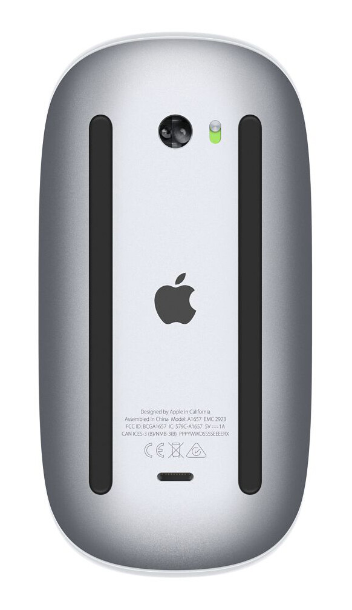
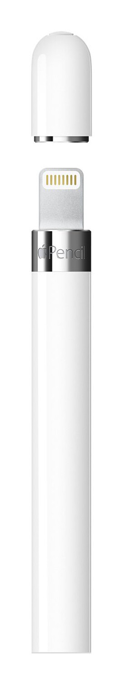
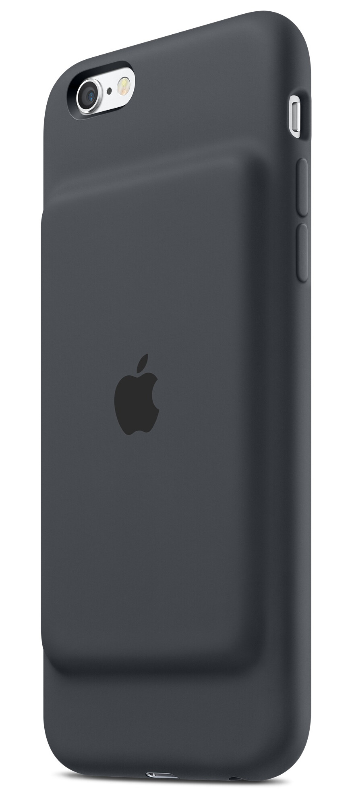
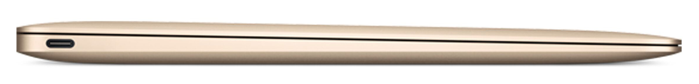

Nyt on Apple alkanut laiskottelemaan suunnittelun kanssa sitten ihan urakalla. Otankin kootusti tässä käsittelyyn jokusen tapauksen ja käydään niitä läpi sitten porukalla. Varmaan käy näistä selville miksi en ole kyseistä tuotetta ostamassa ainakaan ennen seuraavaa paranneltua versiota.

## Magic Mouse 2

Ensimmäisenä otetaan käsittelyyn tämä hiiri. Oikealle laitoinkin kuvan hiiren pohjasta sillä siellä on se ongelman ydin.

Nimittäin hiiren lataaminen tapahtuu tuolla pohjasta olevasta neliskanttisesta portista mikä kuvassa näkyykin alareunassa. Tämä on Lightning portti ja voitkin ladata sillä kaapelilla hiiren täyteen.

Ellei joku jo tajunnut ongelmaa niin sehän on siinä, että et voi käyttää hiirtä, kun lataat sitä. Portti on pohjassa ja latausjohto törröttäisi ikävästi siinä, kun yrittäisit käyttää sitä.

Miksihän tuota latausporttia ei voitu suunnitella hiiren etuosaan kuten esimerkiksi useassa muussa langattomassa hiiressä on.

## Apple Pencil

Tämä tuli iPad Pro mallin matkassa julki ja tässäkin on oikeastaan tuo lataaminen se ongelma. Oikealla onkin kuva tuosta latausportista ja kappas kummaa kun sekin on Lightning liitin.

Tämä on nimittäin suunniteltu ladattavaksi sinun iPad Prostasi eli toisin sanoen tökkäset sen iPadin Lightning porttiin ja annat sen olla siinä. Ongelmanahan tässä on se, että se ”törröttää” ulos siitä ja voin kuvitella, että joku sen hajottaa siitä.

Matkassa tulee käsittääkseni myös sovitin, että sen voi ladata myös Lightning kaapelilla. Jollain tasollahan tuo on ihan ok ajatus, että voit ladata iPadillä sen lisälaitetta. Ei se tosin kovin hyvännäköinen saati käytännöllinen tapa ole – ainakaan minun mielestäni.

Ehkäpä se kannattaa tökätä sen adapterin kautta kiinni siihen Lightning kaapeliin ja olla sen kautta sitten tyytyväinen. Miksihän ei muuten voitu tehdä toisinpäin tuota, että olisi tullut adapteri jolla sen olisi saanut kiinni iPadiin eikä oletuksena noin päin… Ken tietää taas näitä ajatuksia Applen puolelta.

## iPhone 6s Smart Battery Case

Apple toi juuri äsken markkinoille ensimmäisen heidän valmistamansa kotelon iPhone 6s:lle jossa on sisäänrakennettu akku. Katsokaapas hetki tuota kuvaa oikealla ja siirrytään sitten seuraavaan kappaleeseen.

Kuka huomasi tuon ison möllykän tuossa selkämyksessä? Minä! Tässäkään ei ole nähty vaivaa siihen, että se olisi saatu ohuemmaksi ja sitä kautta hieman paremman näköiseksi.

Ai niin, hinnanhan voisin muuten tästä mainita vielä – se maksaa 99 dollaria. Tuolla rahalla saat jo todella ison ulkoisen lisäakun ja siihen saat kytkettyä muitakin laitteita. Vielä kun mainitsee, että tuossa kuoren akussa on alle 2000 mAh akku niin ei paljoa houkuttele tuon ostaminen.

Ehkä seuraava malli on jo hieman paremmannäköinen, jos sitä koskaan tullaan tekemäänkään Applen toimesta.

## Uusi MacBook

Apple teki päätöksen uuden MacBookin kanssa ja päätti siirtyä USB-C aikakauteen kerralla ja heti. En lähde kritisoimaan speksejä tai hintaa millään muotoa tässä, mutta keskitytään sen sijaan tuohon USB-C liitäntään mikä on tässä koneessa. Se näkyykin tuossa alla olevassa kuvassa.

Niin, mainitsinko, että se on ainut portti koko koneessa? Kaikki lisälaitteet mitä haluat laittaa koneeseen niin pitää mennä tuohon sekä samaten lataus tapahtuu tuosta yhdestä ainoasta USB-C portista.

Siis hienohan tuo itse USB-C standardi on, että se kykenee kaikkeen tähän ja muuhunkin, mutta miksi niitä on pitänyt laittaa vain ja ainoastaan yksi koko koneeseen?

Ensinnäkin sinulla pitää olla kasa adaptereita matkassa, että saat normaaleja USB standardin mukaisia laitteita kiinni kuten ulkoisia, muistitikkuja, muistikortinlukijaa ja sen sellaista kiinni siihen. Samoin sinulla pitää olla sellainen adapteri, että voit ladata ja pitää näitä yhtä aikaa kiinni koneessa – se latauskin kun tapahtui tuon portin kautta.

Otetaan esimerkkinä jos haluaisin kytkeä näytön HDMI:n kautta, ulkoisen kiintolevyn sekä kortinlukijan kiinni. Minun pitäisi ostaa esimerkiksi [tämä](http://www.apple.com/shop/product/MJ1K2AM/A/usb-c-digital-av-multiport-adapter) Applen adapteri joka maksaa 80 dollaria. Samoin pitäisi vielä USB hubi ostaa tuohon kylkeen, että saisin ulkoisen kiintolevyn ja kortinlukijan kiinni yhtä aikaa.

> [My friend made this after seeing that the new Macbook will have only one ”USB-C” port](https://imgur.com/DBQpUPO)

Oikeasti Apple, miksi ette laittanut vähintään kahta noita portteja tuohon koneeseen. Ei se nyt niin paljon olisi voinut maksaa.

## Lopuksi

Onhan tämä mennyt hieman alaspäin. Minun mielestä paras muotoilu oli aikoinaan iPhone 3G:ssä. Tykkäsin siitä puhelimesta älyttömästi ja olihan se silloin jotain uutta ja uniikkia. Eikä sitä muuten ollut jokaisella kädessä kun kaupungilla liikku täällä Kuopion suunnalla.

iPhone 6:n muotoilukin on muuten mukava, mutta tässä minua ärsyttää suunnattomasti tuo kameran ulospäin suuntautuvuus. Olisivat tehneet puhelimesta millin paksumman ja tätä kautta akun kokoa nostaneet.

Applen tuotteet ja infra on muuten kyllä mahtava ja toimiva, mutta näitä suunnitteluvirheitä on nyt tullut aika paljon viime aikoina.

Olkaa hyvä ja avatkaa sanaiset arkkunne tuonne kommenttien puolelle!
