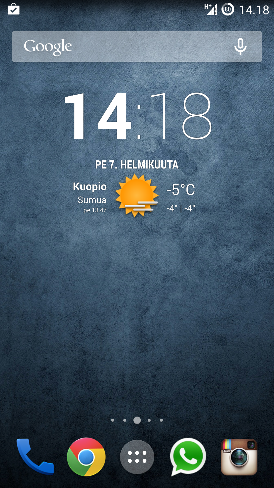
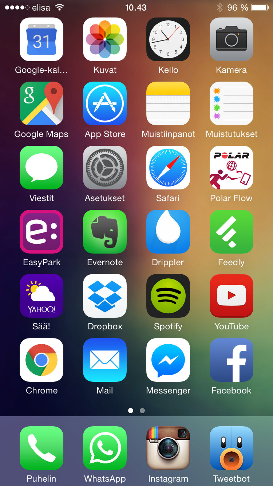

Sanotaan se jo heti kärkeen: iOS kaipaa uudistusta – kipeästi. Noin, nyt pääsenkin kertomaan miksi olen tätä mieltä ja uskon, että moni voi olla samaakin mieltä tästä asiasta.

Muistan sen ajan kun iPhone oli tullut markkinoille ja se oli silloin todellakin jotain uutta ja hienoa. Muistan myös sen kun tein päätöksen, että minä hankin iPhonen heti kun se tulee suomeen. iPhone 3G oli ensimmäinen suomeen tullut iPhone ja sen minä sitten hankin aikoinaan Soneralta. Silloin Sonera taisi olla ainut joka tätä möi ja olihan se saatava. Harmikseni minulla ei ole enää tuota omaa ensimmäistä iPhoneani vaan möin sen pois. Nyt jos jollain on iPhone 3Gs niin voisin sen lunastaa sopivaa rahasummaa vastaan itselleni.

Takaisin asiaan. Tuolloin nämä nykyisetkin ikonit oli jotain uutta ja muutenkin puhelimen toiminta oli täysin erilaista sen aikaisiin puhelimiin. Katsoin monta videota ja kuvaa tuosta iPhonen toiminnasta ennen kuin se tuli itselleni. Silloin kun sain sen niin itselläni oli tunne, että tässä on nyt jotain sellaista mitä ei kaikilla ole – tämä oli muuten totta. iPhone 3G ei ollut valtavirran suosiossa silloin, kun taas tänä päivänä iPhoneja näkee siellä sun täällä.

Palataanpas nykypäivään sillä iPhone 3G tuli vuonna 2008 eli noin 7 vuotta sitten. Vielä tänäkin päivänä iPhoneissa ja iPadeissä on sama logiikka taustalla, kuin tuossa omassa ensimmäisessä iPhonessa. Pientä uudistusta ulkoasuun on tullut ja samoin muita uusia ominaisuuksiakin verrattuna aikaisempiin malleihin. Nyt kuitenkin odotan sitä päivää milloin Apple päättää uudistaa UI:n totaalisesti.

Unelmoidaanpas hieman. Applella on loistava ekosysteemi ja loistavia sovelluksia. Android maailmassa on taas mahdollisuus kustomoida UI:ta lähes miten tahtoo. Entä jos yhdistettäisiin hieman näitä kahta maailmaa. Otetaan siis pohjalle Applen iOS ja otetaan siihen ominaisuuksia Android puolelta. Eikö olisikin hienoa jos voisit itse päättää mitä lukitusnäytöllä on ja vaikka valita teemoista miltä se näyttääkin siinä. Itse haluaisin siihen suoraan näkyviin kellon, sään, kalenterin sekä tietysti tulleiden sähköpostien, viestien ja puheluiden määrät.

Mennään lukitusnäytöltä puhelimen kotiruutuun. Applella on siinä ikoneita ja vain ikoneita – et saa laitettua mitään muuta siihen kuin ikoneita ja kansioita joissa on lisää ikoneita. Et voi myöskään jättää tyhjää väliä ikoneille eli esimerkiksi niin, että ylärivi olisi tyhjää ja ikoneita vain alhaalla.

Otetaanpas kuvat avuksi. Alhaalla näettä vasemmalla minun Samsung Galaxy S4 ruudun, kun se oli minulla vielä. Oikealla on taas minun iPhone 6 ruutu. Molemmat on ns. etusivulla, kun ollaan avattu puhelimen lukitus.





Molemmissa on se yhtenäistä, että alhalla on eniten käytetyt sovellukset eli puhelin, Whatsapp, Instagram ja Twitter (Chrome S4:ssä). Android puhelimessani siinä ei olekaan muita sovelluskuvakkeita vaan löytyy kello, sää ja Googlen hakupalkki. Jossain vaiheessa minulla oli myös pari sovellusta lisää tässä näkymässä. Mennäänpäs sitten iOS sekamelskaan. Olen kasannut tässäkin käytetyimmät sovellukset ensimmäiselle sivulle, mutta eihän se näytä yhtä hyvältä kuin Androidille? Jos saisin laittaa vimpaimia iPhoneeni niin silloin sovelluksia olisi tasan ja tarkkaan kaksi riviä ja ylhäällä olisi nimenomaan sää ja kalenterin tulevat tapahtumat. Muut sovellukset olisivat sitten muilla sivuilla.

iOS puolella on paljon rajoituksia ja juurikin se kustomoinnin vapaus on viety pois. Itse haluaisin käyttää aikaani siihen, että saisin säädettyä omasta näytöstäni juuri sellaisen kuin tahtoisin. Ongelmana on kuitenkin se, että iOS puolella sovellusten laatu on parempi kuin Android puolella. Se onkin iso syy miksi palasin iOS maailmaan, kun iPhone 6 tuli markkinoille.

Haluaisin itselleni oikeastaan kaksi puhelinta, joita voisin vaihdella mielihaluni mukaan. Harmikseni oma budjetti ei salli toisen älypuhelimen hankintaa vaikka tarjonta olisikin mielenkiintoista Android maailmassa.
