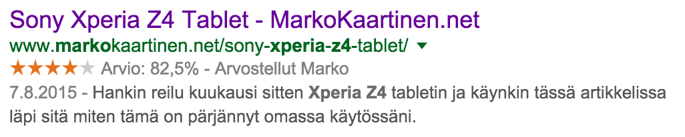
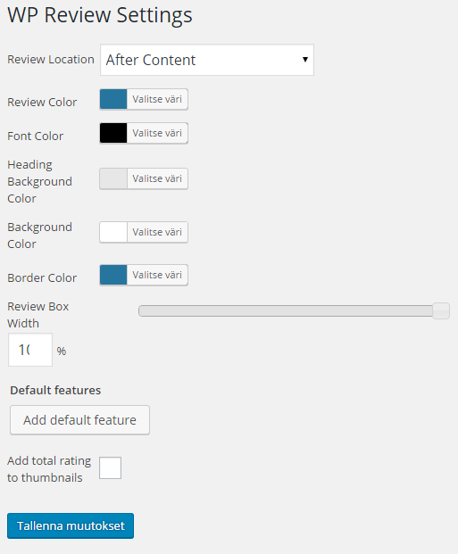
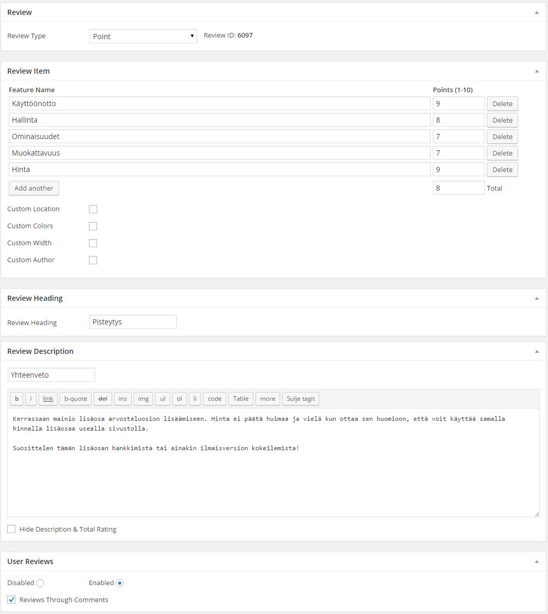

Tuli tehtyä pieni heräteostos ja hankin WP Review [lisäosan Pro version](https://mythemeshop.com/plugins/wp-review-pro/?ref=markokaartinen). Ajattelinkin tehdä tästä pienimuotoisen arvostelun ja samalla näette sen tuolla alhaalla toiminnassa! Eli WP Review Pro lisäosa antaakin helpon mahdollisuuden lisätä arvosteluosio blogiin ja mahdollistaapa se myös sen, että kävijätkin voi arvostella sen kautta!

Tämän kirjoituksen lopussa onkin nähtävissä tuo arvosteluosio mistä puhuin ja siitä näette suoraan miten tämä voisi esimerkiksi toimia! Olen siinä arvostellut tämän lisäosan eri osa-alueita ja sitä kautta saadaankin yhteispistämäärä näytettäväksi. Noita pisteiden näyttötapoja on neljä erilaista joista osa on vain Pro versiossa. [Ilmaisessa](https://mythemeshop.com/plugins/wp-review/?ref=markokaartinen) versiossa on kuitenkin hyvä määrä ominaisuuksia ja sitä kannattaakin kokeilla itse ennen ostoa.

Hintaa lisäosalla on tällä hetkellä 27 dollaria, kun normaalihinta on 39 dollaria. Tällä hinnalla saat tuen ja päivityksen vuodeksi ja voit asentaa sen niin monelle sivulle kuin haluat. Vuoden jälkeen pitää maksaa hieman lisää rahaa, jos haluaa että saa lisää päivityksiä. Hinta ei joka tapauksessa ole päätä huimaava!

Suomenkielistä käännöstä ei mukana tule, mutta tämä ei ole ongelma sillä tässä on täysi tuki käännöksille. Matkassa tuleekin englanninkielinen käännöstiedosto ja noin 90 käännettävää riviä, joten iso homma tuon kääntäminen ei ole. Itse käänsin muutaman tarvittavan rivin ja hallintapuolen jätin koskematta sillä englannin ymmärtäminen ei itsellä ole ongelma.

Lisäosassa on myös tuki ns. Rich Snippeteille eli Googlen hakutuloksissa pitäisi näkyä arvosana. Tämä taas tuo lisää käyttäjälle jos se sattuu hakukoneesta bongaamaan arvostelusi. Tämä onkin hyvin demottu tuolla yllä olevalla hakutuloksella, jonka tein äskettäin.

Itse käyttöönotto on simppeli. Asennat lisäosan ja aktivoit sen ja tämän jälkeen voitkin lisäillä arvosteluosiot mihin artikkeliin tahansa. Asetuksista voit säätää oletusvärit, muita asetuksia ja jos on valmiit osa-alueet niin voit nekin syöttää.

Tämän jälkeen voitkin kirjoitella arvostelun ja lisätä siihen tuon arvostelulaatikon osa-alueineen. Jokaisella artikkelilla voi olla omannäköinen arvostelulaatikko ja siksipä se käykin esimerkiksi tähän blogiin mainiosti kun arvioitavana voi olla palvelu, sovellus, tuote tai jotain ihan muuta.

Itse arvosanan saa laitettua myös pikkukuviin eli, jos sinulla on teema jossa on käytössä artikkelikuvat niin saat siihen ympättyä myös tuon arvosanan. Tämä on oletuksena asetuksissa kytkettynä pois, mutta saa päälle helposti.

Mukana tulee myös vimpain, jonka saa laitettua esimerkiksi sivupalkkiin. Vimpaimella voi listata näppärästi välilehdelle erilaiset listaukset arvosteluista kuten viimeisimmät, parhaat, äänestetyimmät ja mukautetun. Vimpaimessa voi muuttaa myös välilehtien nimet suomenkielisiksi sekä niiden järjestyksen voi vaihtaa.

Tässä ensimmäinen WordPress lisäosa arvostelu ja näitä tulee lisää vielä ajan saatossa. Nämä on tosiaan mietteitä ja kokemuksia parin päivän testauksien ja säätöjen perusteella. Mikäli varsinaisessa käytössä tulee lisää selville niin päivitän tätä artikkelia tarpeen mukaan.

Lisäosan saat hankittua [täältä](https://mythemeshop.com/plugins/wp-review-pro/?ref=markokaartinen)!
