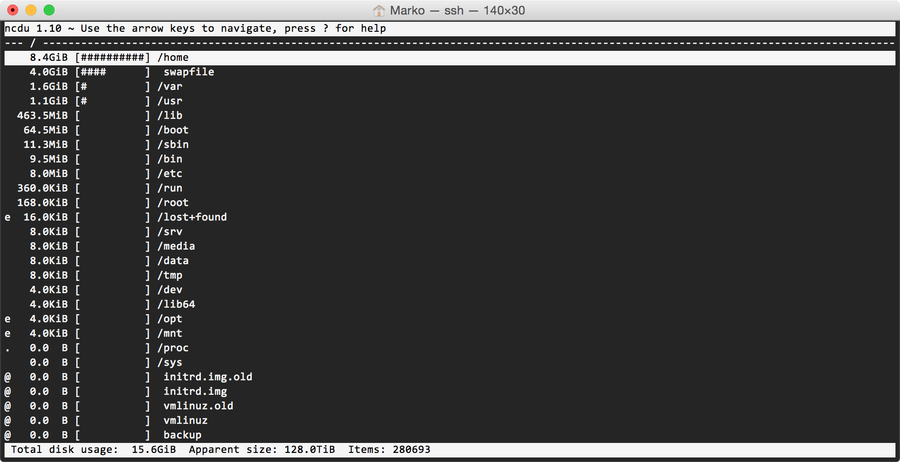
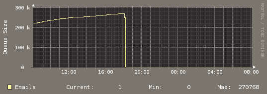

Olen viikonlopun aikana siirrellyt sivujani palvelimelta toiselle sillä asentelin Vesta nimisen hallintapaneelin ja lähdin sen kanssa pelaamaan. Tästä tulee juttua vielä erikseen. Siirsin kaikki sivut sellaisenaan ja tavoite oli päivitellä WordPressit ja muut samalla ellei ne olleet ajantasalla. Sivustoissa oli yksi tai kaksi WP asennusta, jotka ei ole juurikaan käytössä ja domainit meni minne sattuu – otin ne nyt käyttöön oikein ja sieltähän löytyi jotain mielenkiintoista. Puran tässä nyt tapahtumaketjua hieman teille auki ja otetaan opiksi tästä.

### Levytilan täyttyminen

Huomasin, että levytila oli jostain syystä täyttynyt ja ihmettelin suuresti tätä. Siirrettävää materiaalia kun oli ollut alle 10 gigaa ja tilla pitäisi olla käytössä reilusti. Tilan täyttymisestä älähti MySQL kun se ei halunnut toimia oikein. Olipa tämän ansioista yksi taulu hieman korruptoitunut, mutta mitään tämän vakavempaa ei ollut tapahtunut – tietoa ei sentään kadonnut.

### Täyttymisen syy?

Levytilan täyttymisen syyksi paljastui nopeasti `/var/spool/exim4/` kansio. Olen löytänyt mahtavan työkalun levytilan käytön tutkimiseen – nimi on ncdu. Sen saa asennettua suoraan Ubuntussa `apt-get install ncdu` komennolla ja komennolla `ncdu /` se skannaa ja näyttää tulokset sinulle (kuva alla).

Komento exim -bp näyttää hieman sitä mitä siellä jonossa oikein on. Samoin komento `exim -q` alkaa tyhjäämään jonoa. Tiedostoja oli kuitenkin rutkasti ja päädyin ensin koittamaan perinteistä `rm *` komentoa tuolla kansiossa. Tämä kuitenkin antoi argument list too long ilmoituksen sillä tiedostoja oli niin paljon. Hätä ei ole tämän näköinen vaan laitetaan komento `find ./ -type f -name "*" | xargs rm -f` sisään joka poistaa nuo tiedostot.

### Ongelman löytäminen

Ongelma ei ratkennut kuitenkaan tähän. Tiedostoja tuli kokoajan lisää ja avasinkin pari tiedostoa. Näissä tiedostoissa koitettiin lähettää spämmiä erääseen oman domainin sähköpostiosoitteeseen mitä ei ole olemassakaan. Kaikki nuo tiedostot jäivät tuonne jumiin kun ei saanut mailia lähtemään. Tiedostossa myös kerrottiin mikä koitti lähettää ja vastauksena oli alias.php niminen tiedosto.

Seuraavaksi aloin etsimään tuota alias.php tiedostoa. Komento `find / -name "alias.php"` kertoi minulle tarkalleen missä tiedosto oli. Poistin sen ja välittömästi loppui uusien tiedostojen tuleminen sähköpostijonoon ja ongelma katosi. Joku oli tuota alias.php tiedostoa kutsunut koko sen ajan mitä tuo uusi palvelin oli ollut verkossa ja siitä lähtien kun toin tuon vanhan projektin näkyviin taas oikein.

### Mitä opin tästä?

Ensinnäkin sen, että pidä huoli päivityksistä oli kyse miten vanhasta projusta tahansa (ehkä jopa hylätystä). Jostain syystä tuolla sivustolla ei ollut pelannut WordPressin automaattiset päivityksetkään – outoa. Toisekseen kun siirrän sivuja ensi kerran niin päivitä mielellään ennen siirtoa.

Opin myös hieman paremmin jäljittämään näitä ongelmia ja mistä ne voi johtua. Kaikelle tuppaa olemaan palvelinpuolellakin syy ja tällä kertaa syy oli yhdessä ainoassa koodissa.

Tämä artikkeli jääköön tänne blogiin muistutukseksi niin minulle kuin muille ja on tässä jokunen hyödyllinen komentokin laitettu jemmaan!

Katselin myös tuon Vesta hallintapaneelin käppyröitä. Alla onkin havainnollistava kuva tuosta exim4 palvelimen toiminnasta.

Kuvasta näkeekin suoraan milloin minä tuon huomasin ja miten se vaikutti. 270 tuhatta spämmiä on koitettu lähettää oman domainin sähköpostiin jota ei ole edes olemassa. Se tippui käytännössä nollaan kun tuo alias.php poistettiin.

Tuo palvelin on ollut nyt tehokkaassa seurannassa ja mitään ongelmia ei ole tullut ilmi tänä aikana enää tähän liittyen.

Pitää myös etsiä palvelinpuolelle joku skannaus koodi joka tekisi tätä skannausta kerran pari päivässä, jos on heittää vinkkiä niin tuonne kommenttiboxiin voi heitellä. Toinen vaihtoehto voisi olla jokin WordPress plugari joka pitäisi tuosta puolesta huolta.
