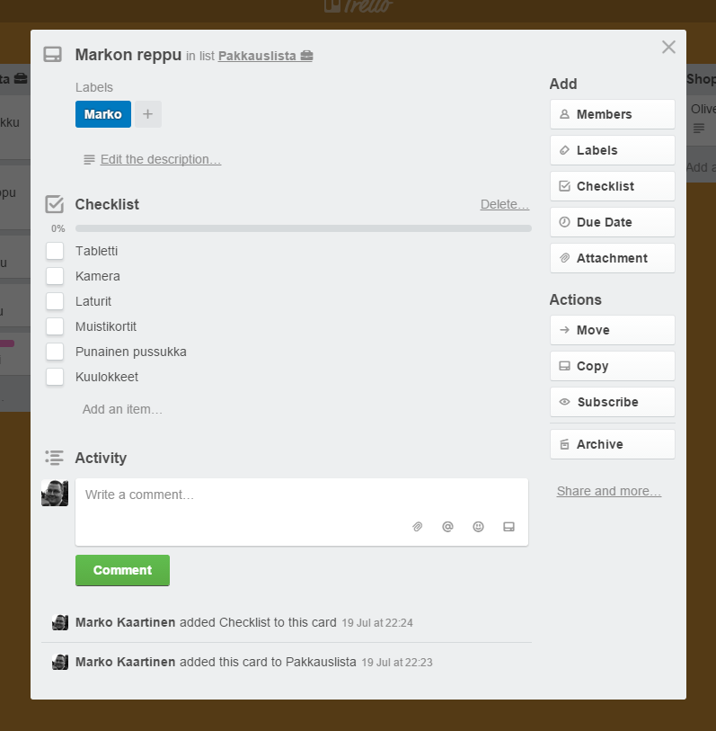

Kerroinkin jo [matkablogin](http://auringonalla.fi/2015/07/matkan-suunnittelu-trellon-avustuksella/) puolella siitä miten käytämme [Trelloa](https://trello.com/markokaartinen/recommend) matkan suunnittelussa. Nyt mietinkin hieman miten Trello voisi olla vielä hyödyllisempi. Trellohan on simppeli verkkopohjainen palvelu, jossa voit luoda tauluja ja kategorisoida erilaisia asioita kortteihin ja tätä kautta suunnitella matkaa, projektia tai mitä mieleen juolahtaa. Katsastetaan hieman käyttötapoja ja ominaisuuksia sekä ehkäpä hieman puutteitakin.

Ensin matkojen suunnittelu Trellon avustuksella. Nyt kun olen yhteen matkaan saanut mietittyä hieman miten kategorisoida kortteja niin Trellossa on näppärä ominaisuus, jolla taulun kortteineen tai ilman voi kopioida. Näin saan siis seuraavaan reissuun jo valmiin pohjan eteeni – näppärää eikö?

Kortit ovat muuten mahtavia. Niihin saa chekkauslistoja laitettua näppärästi sekä keskustelua korttien ympärille jäsenten kesken – todella näppärää. Tunnisteiden ja jäsenten liittämisellä saakin noita visualisoitua mukavasti ja saa hieman jaettua tehtäviäkin.

Kuten tuolta yläkuvasta näkeekin niin kortteihin saa kansia laittamalla liitteeksi kuvan niin saa kivasti koko tauluun hieman visualisointia. Toivoisinkin, että voisi liittää vielä suoraan osoitteen ja näin tulisi Google Maps näkyviin kansikuvaksi – olisi muuten mahtava juttu. Tuo ominaisuus olisi nannaa varsinkin matkojen suunnittelussa.

Sitten muita käyttötapoja mitä tulee mieleen ainakin omalle kohdalle. Olen hieman kokeillut tätä ns. todo-listana projektien kohdalla. Näin saan seurattua missä tilassa mikäkin tehtävä on ja saankin tehtyä näppärästi erinäköisiä aikajanoja tehtävälle. Esimerkiksi tämmöinen: Ehdotus -\> Suunnitteilla -\> Työn alla -\> Testauksessa -\> Tuotannossa. Tässä sama kortti menisi viiden eri listan läpi. Korttiin olisi merkattu kuka tekee ja tunnisteella onko tämä mitä osaa järjestelmää koskeva kortti.

Ilmaisilla ominaisuuksilla [Trellon](https://trello.com/markokaartinen/recommend) kanssa pärjää jo pitkälle. Maksamalla saisit kuitenkin isommat korttien liitetiedostot, räätälöidyt taustakuvat, lisää tarroja sekä jotain muuta kosmeettista. Yrityspuolen paketeilla taas saisi lisää mahdollisuuksia rukata organisaation käyttäjien oikeuksia – nämä lähinnä voisi kiinnostaa itseäni, mutta ilmaisella paketilla pärjää vielä mukavasti.

Trello toimii muuten myös mukavasti tableteilla ja puhelimilla. He ovatkin tehneet omat sovellukset Androidille ja iPhonelle, tietenkin Trello toimii myös selaimen kautta.

Mihin sinä käytät Trelloa tai mihin sinä käyttäisit sitä?
