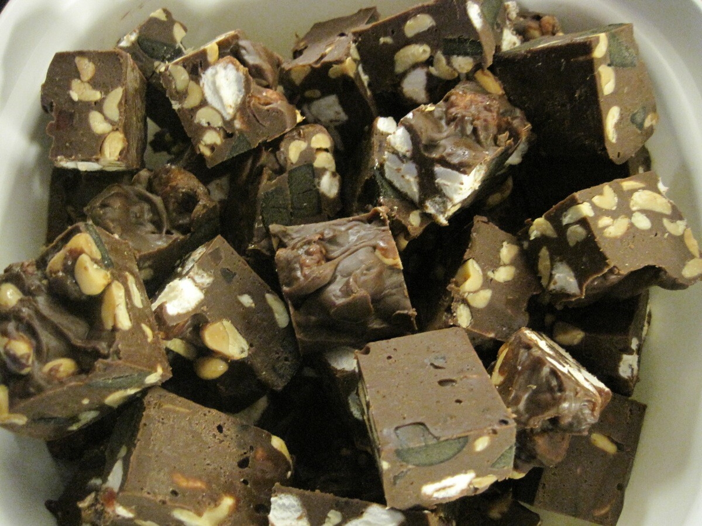

Vinkkasin teille aiemmassa [luukussa numero viisi](/2015/joulukalenterin-luukku-5) jo reseptin sinapin tekoon. Nyt toistetaan reseptin jakaminen ja tällä kertaa saattekin tehtäväksi Rocky roads -namuja.

Tämänkin reseptin takana on Outi ja alkuperäinen resepti löytyy tietysti hänen [blogistaan](http://lusikkasopassa.net/2011/12/24/rocky-roads-namuset/).

## Ainesosat:

- 200 g lakua
- 3 dl suolapähkinöitä
- 100 g vaanhtokarkkeja
- 200 g maitosuklaata
- 200 g tummaa suklaata
- 50 g valkosuklaata
- 1 prk kondensoitua, sokeroitua maitoa (n. 400 g)
- 50 g voita

## Ohjeistus:

Paloittele lakut ja vaahtokarkit pieniksi palasiksi. Sulata kattilassa miedolla lämmöllä suklaat, maito ja voi. Sekoita koko ajan, sillä keitos palaa helposti pohjaan. Kun se on kokonaan sulanutta ja sileää, niin kaada se paloiteltujen namien ja pähkinöiden päälle ja sekoita voimakkaasti. Tämän jälkeen kaada seos leivinpaperilla vuorattuun lasagnevuokaan ja tasoita levyksi. Anna jäähtyä kylmässä ainakin neljä tuntia, mieluummin yön yli. Paloittele jähmettynyt nami levy terävällä veitsellä annospaloiksi.
