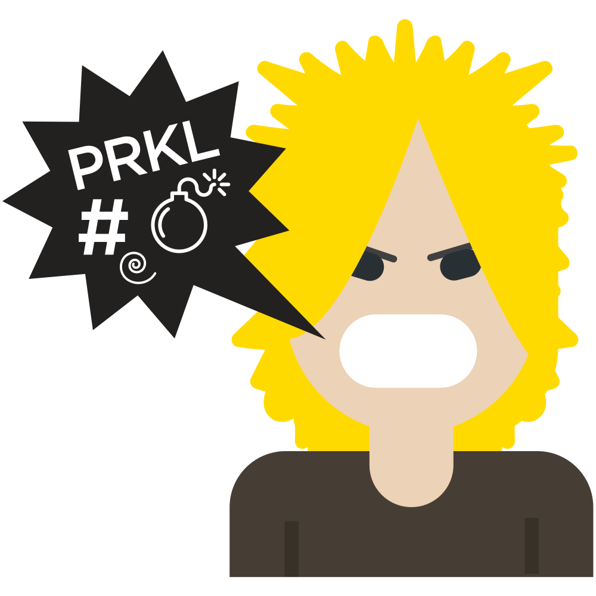
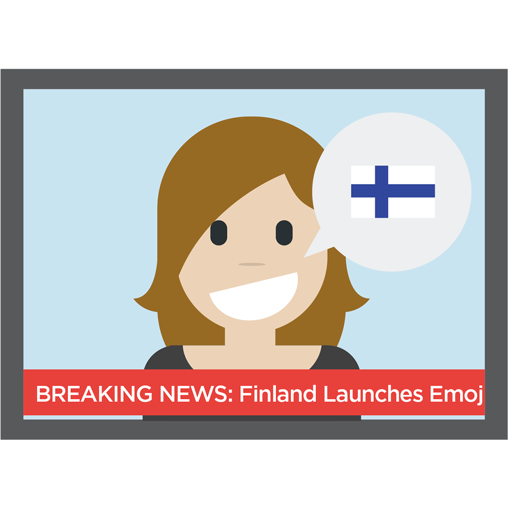
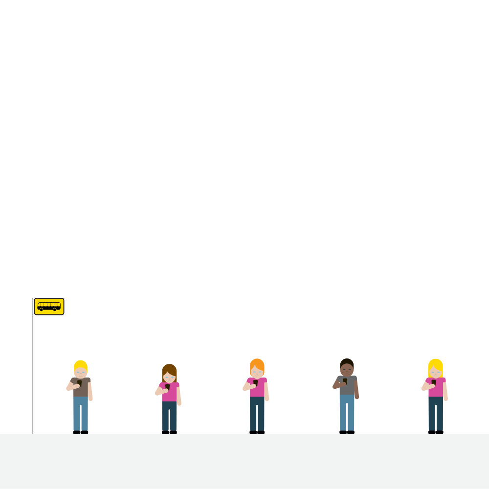
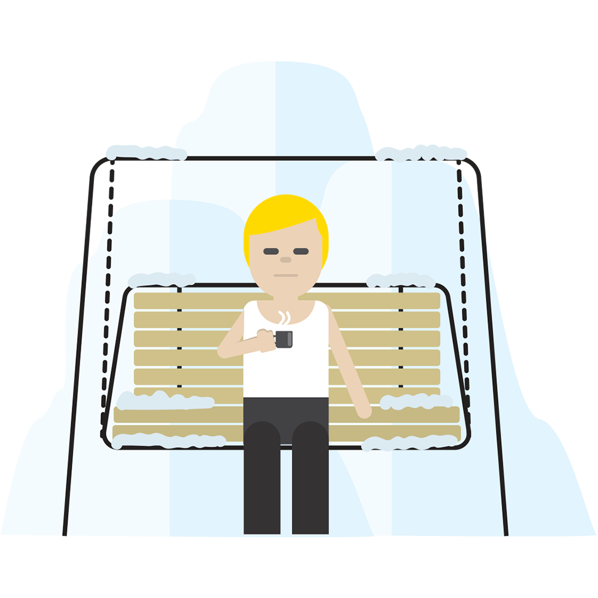

Suomalaiset emojit ansaitsevat oman luukkunsa. Osoitteessa <http://xmas.finland.fi/> löytyykin niiden oma joulukalenteri, jossa joka päivä on yksi emoji näkysällä.

Samalta sivustolta saakin ladattua pakettina kaikki emojit. Emojit on muuten saatavilla myös iOS:lle ja Androidille. Samoin voit ladata pakettina nuo emojit ja ne tulee silloin kahdessa koossa: 128px ja 1000px kokoisina.

Alla onkin pari esimerkkiä suomalaisista emojeista.




