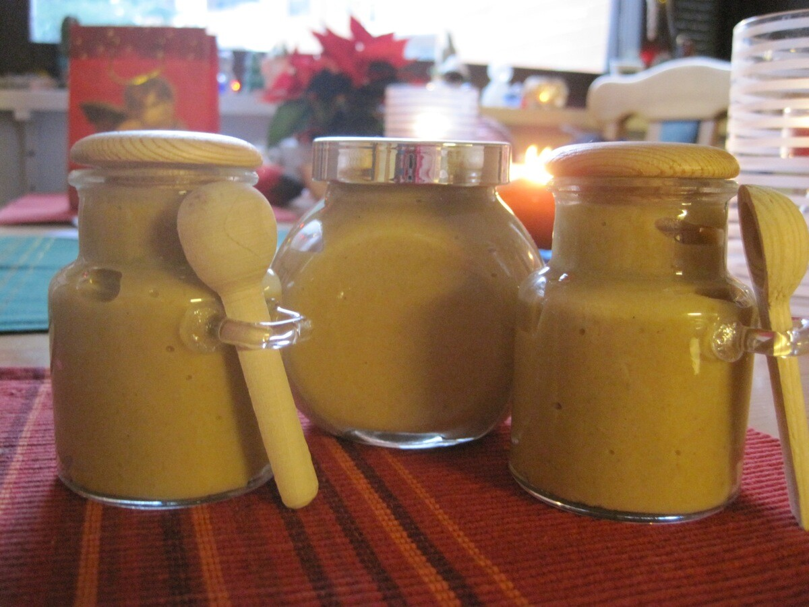

Tällä kertaa jaetaankin jotain aivan muuta. Tätä ei täällä blogissa ole ennen nähty ja tullaanko enää koskaan näkemäänkään. Jaan nimittäin teille reseptin!

Tämän reseptin takana on tietenkin parempi puolisko [Outi](http://lusikkasopassa.net/). Suurin osa haluaa kinkkunsa päälle sinappia ja jaankin tässä teille ohjeen omenaisen viskisinapin tekoon. Alkuperäinen ohje on vuodelta 2011 ja löytyypi [täältä](http://lusikkasopassa.net/2011/12/25/omenainen-viskisinappi/).

## Ainesosat:

- 12 rkl sinappijauhetta
- 1/2 tl suolaa
- 4,5 rkl kiehuvaa vettä
- 3 tl oliiviöljyä
- 3 tl balsamico viinietikkaa
- 3 rkl hunajaa
- 3 tl viskiä
- n\. 1 dl omenasosetta

## Ohjeistus

Sekoita suola ja sinappijauhe keskenään. Lisää ainekset ohjeen mukaisessa järjestyksessä ja sekoita tasaiseksi. Lisää viimeisenä omesose sinappiin. Maistele oikea määrä sen mukaan kuinka tulista sinappia haluat. Parhaiten tähän soveltuu kotitekoinen omenasose, joka on hieman hapanta. Toki kaupan makeaakin voi käyttää, mutta tällöin varsinkin kannattaa maistella sinappia soseen lisäysvaiheessa.
