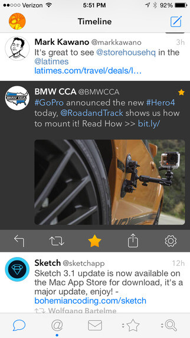
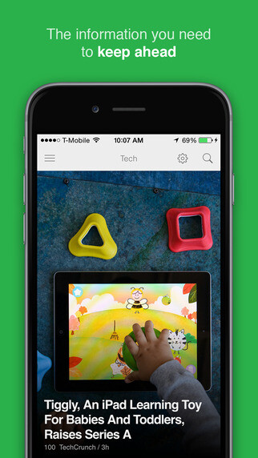
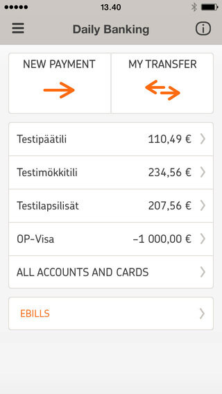
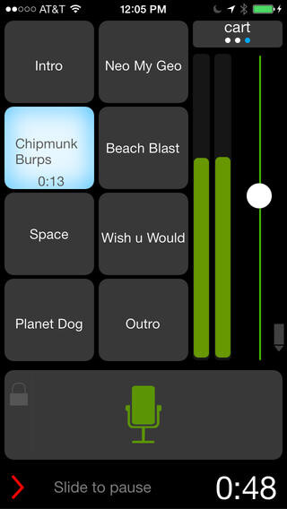
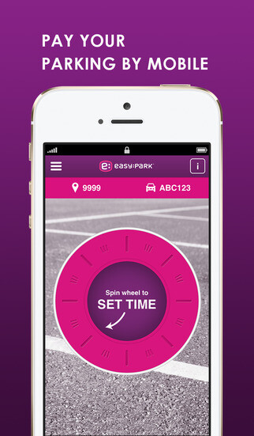
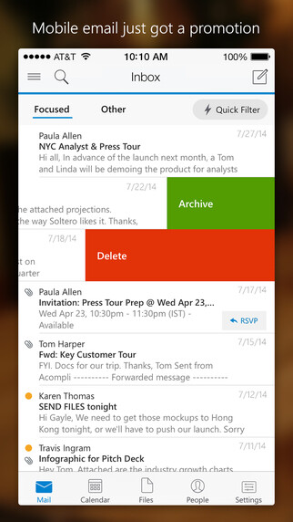

Mietiskelin jonkin aikaa mistä kirjoittaisin teille sillä tämmöiset ns. perinteiset blogipostaukset on liian vähällä. Siitä se ajatus sitten lähti ja päätin lähteä heittämään teille erilaisia iPhone ohjelmia jotka on iPhone 6 puhelimessani suht säännöllisessä käytössä.

## Tweetbot 3 (4,99 €)

Ehdottomasti oma lempparini Twitter sovelluksista. Tätä käyttelin jo aikoinaan kun se tuli ja en ole muihin koskenut iPhonella sen jälkeen. Millainen lie Twitterin oma sovellus tänä päivänä? Ainut huono puoli on Windows sovelluksen puute niin ei synkkaa sinne päin DM:n lukua yms., mutta Macille on sovellus ja se onkin itsellä ahkerassa käytössä.

Vaikka sovellus onkin maksullinen on se koko rahan arvoinen sijoitus.



## Feedly (ilmainen)

Feedly on ollut korvaajani taannoiselle Google readerille. Tällä on myös loistava sovellus niin puhelimeen kuin tablettiinkin. Itse tulee selailtua blogijutut aika usein puhelimella ja tämä on ollut kyllä loistava ohjelma siihen tarkoitukseen. Tulee muuten enemmän käytettyä tätä, kuin selaimella toimivaa versiota.

Mikä parasta – se on ilmainen.



## OP-mobiili (ilmainen)

Osuuspankki on tehnyt loistavaa työtä oman mobiilisovelluksensa kanssa. Tilin saldon saan tämän kautta näkyviin ilman turvalukulistan kaivamista. Maksan kaikki paperilaskuni tällä missä vain on viivakoodi olemassa. Kerrassaan loistava sovellus ja suosittelen lämpimästi kaikille Osuuspankin asiakkaille! Vaikka kuva on englanniksi niin itse sovellus on kyllä suomeksi, en halunnut omia tilejä kuvaan pistää.



## Bossjock studio (9,99 €)

Jokunen podcast on tullut nauhoiteltua Bossjockin avustuksella ja käytän sitä tänäkin päivänä podcastien teossa. Se toimii mainiona soundboardina ja jos haluaa matkan päällä nauhoitella jotain niin tällä saat tehtyä kaiken ja hieman enemmänkin mitä tarvitsen. Jos tällä nauhoittelen niin tulee laiteltua tiedosto Dropboxin kautta koneelle, mutta esimerkiksi FTP:n yli voi tiedostoja siirrellä tällä.



## Easypark (ilmainen)

Onneksi täällä Kuopiossakin on muutama parkkipaikka, joissa voit käyttää Easyparkkia. Tämä sovellus helpottaa elämääni huomattavasti varsinkin, kun on asiakaskäyntejä kyseisten parkkipaikkojen läheisyydessä. Joskus palaveri venyy ja saan pysäköintiaikaa lisättyä helposti puhelimella – tämä voi pelastaa parkkisakolta! Olen käyttänyt tätä jo suhteellisen pitkään ja mitään ongelmaa ei ole ollut, tulen käyttämään jatkossa ja toivonkin, että useampi parkkipaikka Kuopiossa ottaisi tämän käyttöön.



## Outlook (ilmainen)

Microsoft teki oman Outlook sovelluksensa uudelleen. Käytän tätä pääasiassa työpostien lukemiseen. Työpostimme, kun on Office 365 palvelussa niin yhteensopivuus on loistava ja tämä tuntuu hoitavan homman paremmin ja selkeämmin kuin OWA for iPhone sovellus.

Tähän saisi myös muita sähköpostitilejä kiinni, mutta en ole vielä liittänyt kuin oman työpostini tähän. Tulen pari muuta työhön liittyvää postia liittämään tähän ohjelmaan, kunhan muistan.



Mitä ohjelmia omassa luurissasi on? Pitäisikö minun ehdottomasti koittaa jotain tiettyä ohjelmaa? Kerro siitä kommenteissa tai keskustelun puolella! Toki Twitterissä ja Facebookissakin voi olla yhteydessä!
