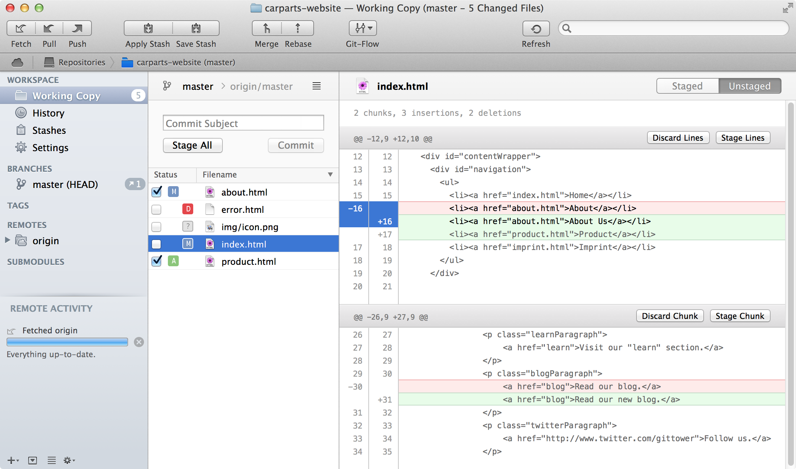
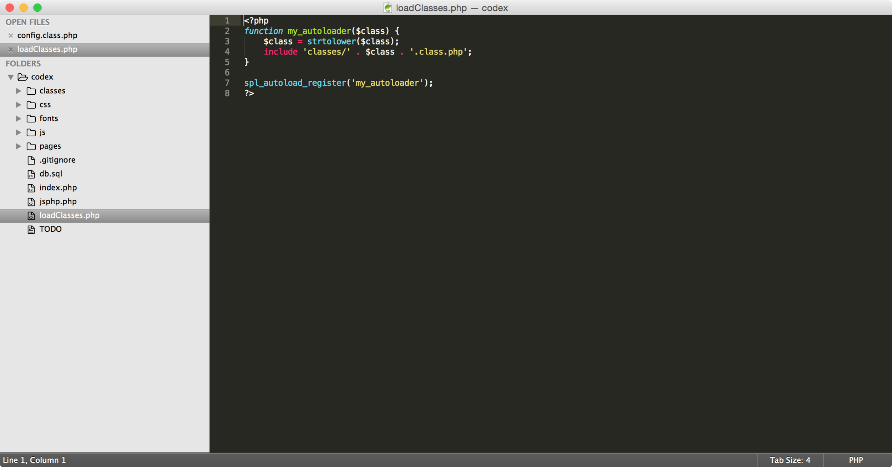
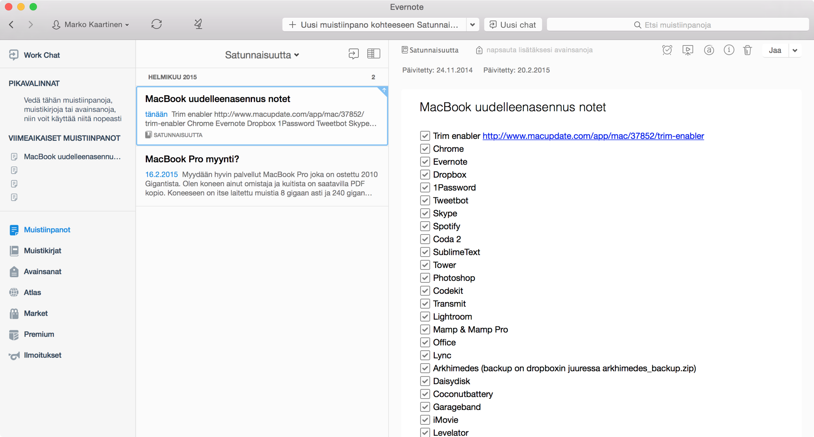
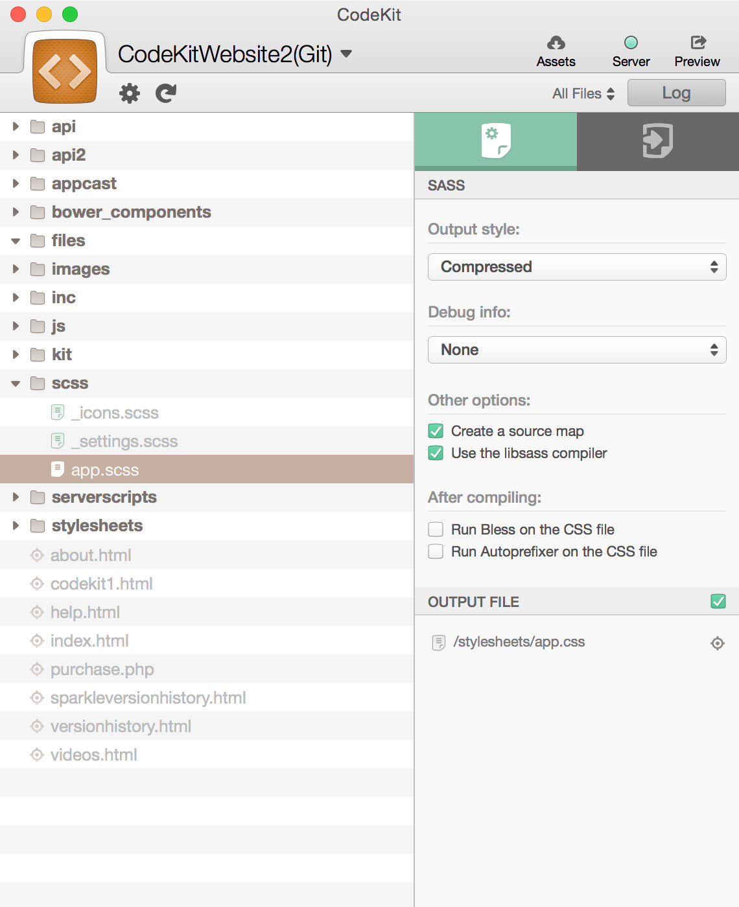
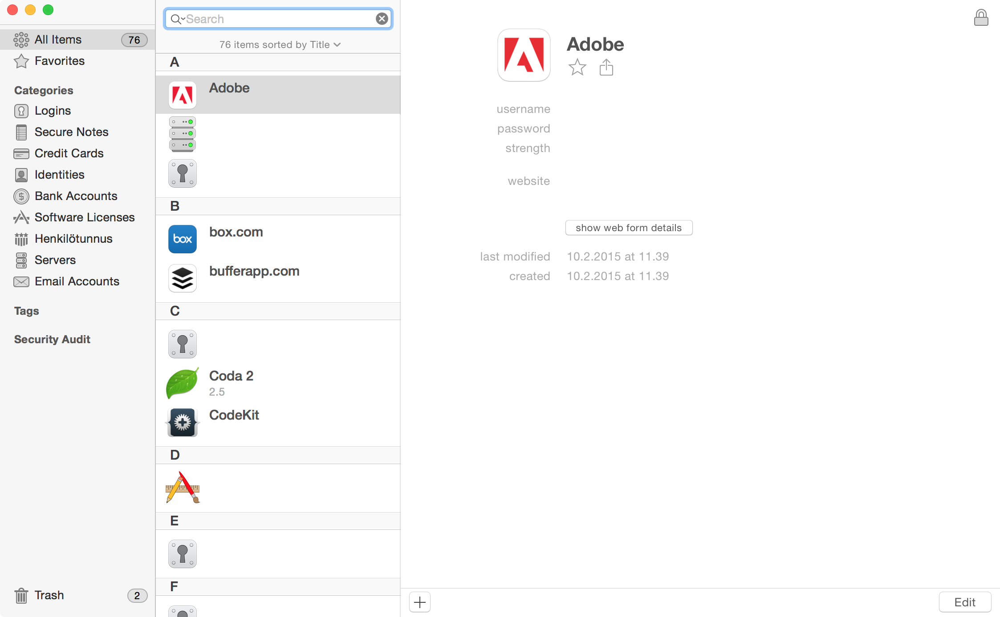
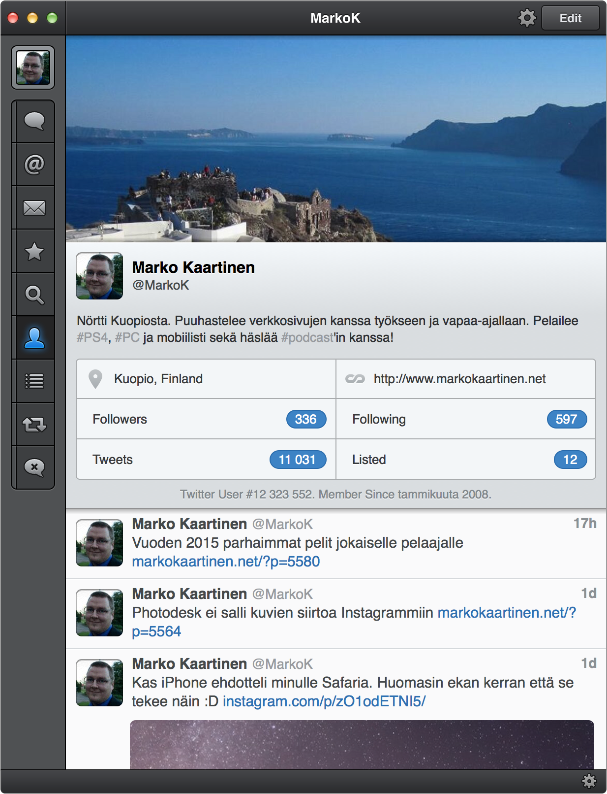

Olen tehnyt listauksia iPadin ja iPhonen sovelluksista. Miksi en siis listaisi ihan perus Mac sovelluksia joita käytän. Suurin osa sovelluksista tulee olemaan työhöni viittaavia sovelluksia sillä MacBook Pro on itselläni pääasiassa työkone. Käytän toki konetta myös vapaa-ajalla, mutta suurin osa käytöstä on työkäyttöä. Aloitetaan nyt kuitenkin!

## Tower

Tower on graafinen Git clientti ja olen käyttänyt tätä sovellusta jo useamman vuoden ajan. Git on yksi tärkeimmistä työvälineistä tällä hetkellä sillä sen avulla saadaan tehtyä aika paljon koodin hallinnan kannalta. Esimerkiksi meillä pyörii oma palvelin, joka toimii myös git varastona. Siellä löytyy meidän projektit ja saan minkä tahansa oman koneen gittiin sitä kautta haettua uusimmat versiot eri projekteista.

Tower mahdollistaa simppelin käyttöliittymän avustuksella git repojen hallinnan ja olenkin tykästynyt tähän sovellukseen täysin. Aikoinaan se tuli ostettua ja en ole päivääkään katunut sen hankintaa.

Itsellä on eniten käytössä tämän työkalun historiatietojen tarkastus sekä konfliktien ratkaisu. En juurikaan käytä enää gittiä komentorivin kautta sillä minulla on tämä mainio työkalu siihen.

Kotisivut: <http://www.git-tower.com/>

## Sublime Text

Käytin pitkää pääasiallisena työkaluna Coda nimistä editoria. Päätin kuitenkin jossain välissä koittaa Sublime Textiä ja se oli menoa se. Tämän saat itse aika säätää haluamaksesi. Voit teeman vaihtaa, lisäosia asentaa ja säätää muitakin asetuksia. Pyrinkin pitämään tuon suhteellisen simppelinä ja tätä kautta tuo onkin pirun kevyt käyttää.

Näppäriä ominaisuuksia tuossa on mm. projektit, eri lisäosien tuomat mahdollisuudet, yksinkertaisuus sekä muutenkin toimii vallan mainiosti. Tämä on ehdottomasti minun suosittelema editori jos jotain pitäisi tällä hetkellä suositella.

Kotisivut: <http://www.sublimetext.com/3>

## Evernote

Tämä on yksi ohjelma minkä käyttö unohtuu joskus ja palaan siihen kuitenkin aina takaisin. Kyseessä on Evernote, jolla saat tehtyä vallan näppärästi tehtyä muistiinpanoja itsellesi. Nämä vielä synkkautuu eri laitteiden välillä ja näin muistiinpanot on aina mukana.

Parastahan tässä ohjelmassa on se, että tämä on täysin ilmainen. Muutenkin toimivuus on hyvä ja enpä ole pahempia ongelmia huomannut. Joissain tilanteissa ei ole välittömästi synkkautunut toisiin laitteisiin. Kuvankaappauksessakin on esimerkiksi oman MacBookin asennuksen muistilista jota käytin aika pitkälti apuna kun asentelin tätäkin konetta.

## CodeKit

Tämä on uusimpia löytöjäni omaan työkalupakkiin. Saan tuolla napinpainalluksella jQuery, Bootstrapin ja muita palikoita ladattua ja tämä pitää ne ajan tasallakin. Samaten tämä kääntää esimerkiksi SASSin CSS:ksi ja minifoi sen vielä samalla. Samaten Javascriptin minifoi ja tarkistaa virheidenkin varalta.

Käytännössä CodeKit kääntää esimerkiksi scss tiedoston css tiedostoksi kun teet muutoksen scss tiedostoon ja tallennat sen. CodeKit haistelee siis lisätyn projektin tiedostojen muutoksia ja sen perusteella ajaa läpi ne. Scss tiedoston muutos css:ksi tapahtuu nopeasti ja näin voikin käyttää suoraan koodissa tuota minifoitua tiedostoa.

Itse olen ottanut tämän käyttöön uusiin projekteihini ja se tekee kyllä sen mitä lupaakin. Tämäkin on maksullinen sovellus jonka ostoa en ole katunut jälkeenpäin. Simppeli sovellus ja kannattaa ainakin kokeilla sopiiko omaan työnkulkuun.

Kotisivut: <https://incident57.com/codekit/>

## 1Password

Seuraavaksi päästäänkin salasanoihin ja niiden tallentamiseen. 1Password on ollut minulla käytössä suhteellisen pitkään ja olenkin sinne alkanut säännöllisesti laittamaan eri palveluiden salasanat niin omat kuin työhön liittyvät salasanat. Päivitin äskettäin lisenssiäni niin, että saan myös Windows koneelle asennettua 1Passwordin ja näin minulla on salasanat saatavilla niin Macillä, Windowsilla, puhelimella kuin tabletillakin.

1Password on hyvä sovellus ja suosittelen lämpimästi sen käyttöä. Tämän avulla on myös mahdollista generoida salasanoja palveluun ja se pystyy tallentamaan selain lisäosan avulla myös eri verkkosivujen salasanatkin. Tämä ohjelma menee taas luokkaan: ”En ole katunut tämän ostamista”.

## Tweetbot

Nyt päästäänkin sosiaaliseen mediaan. Tweetbot on ollut minun lempisovelluksia niin iPhonessa kuin iPadissäkin – onneksi Tweetbot löytyy myös Macille. Olen käyttänyt tätä Twitter sovellusta varmaan niin kauan kuin minulla on Mac ollut ja kuulin tästä ensimmäisen kerran.

Parhaimpia ominaisuuksia tässä on mm. monen käyttäjän tuki, mahdollisuus tallentaa suoraan Pockettiin, ulkoasu ja käytettävyys. Kuvat on mukavasti näkyvillä suoraan twiiteissä (voi säätää itse poiskin) ja muutenkin säätömahdollisuuksia on mukavasti – ainakin omiin tarpeisiini.

Mac versio voisi alkaa iPad version kanssa kaivata pientä faceliftiä sillä iPhone versio sen sai jo. Mikään iso asia ei tämä minulle ole sillä Tweetbot näyttää tälläkin hetkellä hyvältä.

Voin tätäkin sovellusta suositella varauksetta muillekkin sillä niin loistava Twitter sovellus tämä on.

Kasasin tähän vain kuusi sovellustani tuosta minun dockista. Nämä on ne sovellukset mitä oikeastaan käytän päivittäin työssäni ja osittain myös vapaa-ajallakin. Tulen varmaan tekemään jossain välissä jatko-osaa tälle sillä ohjelmat vaihtuvat ja niitä tulee ajoittain lisääkin.

Onko sinulla jotain sovelluksia mitä käytät ja haluaisit niistä vinkata minulle? Kerro niistä kommenteissa, Twitterissä, keskustelussa tai vaikkapa Facebookissa!
