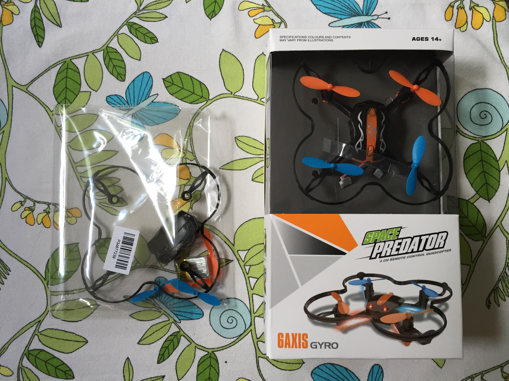
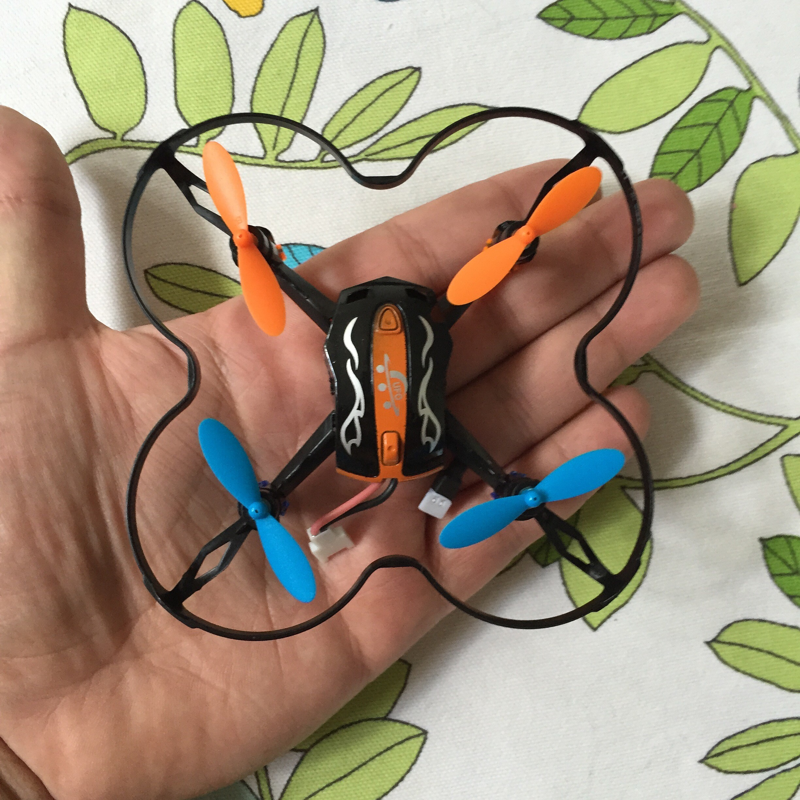
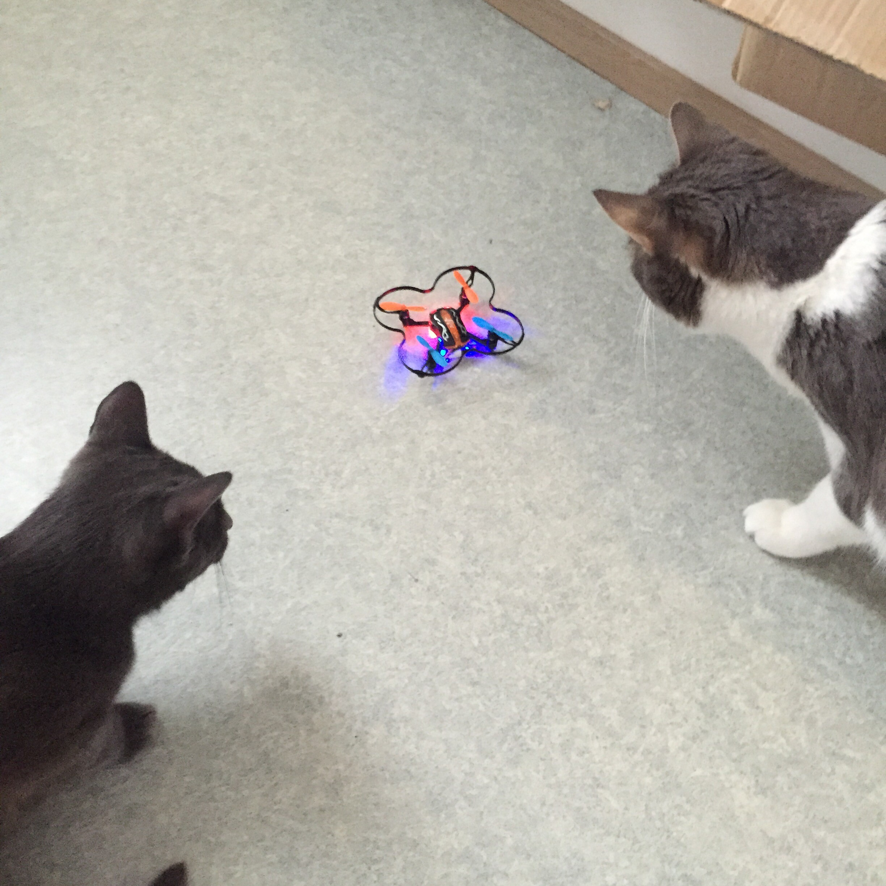

E-villessä oli tarjouksessa kauko-ohjattava [Nano Quad kopteri](http://www.e-ville.com/fi/3219-rc-helikopterit/15451-nano-quad-kopteri.html), pitihän se sitten tilata jo ihan kokeilun vuoksi. Olin isoja malleja katsellut YouTubesta aikaa sitten ja nämä on mielenkiintoisia laitteita. Tänä päivänä kun näihin saa survottua kameraa, joka kuvaa jopa 4k kuvaa… Mainitsenpa alkuun jo sen, että kannattaa käyttää markokaartinen@gmail.com sähköpostia suosittelijana niin saat sinä alennusta ja minä pientä hyötyä. E-ville ei ole maksanut tätä bloggausta ja kopteri on tilattu omilla rahoilla.

Otin samaan tilaukseen myös tuon tuotesivulla olevan lisätarvikesetin sillä ajattelin jo silloin, että akkukesto ei nyt mikään kauhea ole ja siinä tuli toinen akku matkassa. Oikealla onkin koko setti kuvassa mitä se posti oikein toi sieltä E-villestä.

Eli kopteri tuli siistissä paketissa ja siellä olikin kaikki tarvittava: Itse kopteri, kauko-ohjain, akku, vara propellit ja USB johto akun latausta varten. Varaosat tuli sitten muovipussissa, jossa oli: propelleja, suojakoppa, suojakaari ja akku. Mainittavaa on se, että tuota USB johtoa ei parane hävittää sillä sen toinen pää käy vain noihin akkujen latauksiin. Varmaan tuommoisen kaapelin saa jostain muualta hankkittua tarvittaessa.

Kopterin koko on varsin passeli ja kuten tuosta kuvasta näkee niin se menee kämmenelle vallan mainiosti. Kuvassa akkua ei olekaan vielä kiinnitetty.

Otin ohjeet käteen ja aloin katsomaan saisikon tuon lentoon. Ohjeet olivatkin huonoin osa tätä pakettia sillä ne oli selvästi skannattu jostain ja teksti oli suht pientä ja välillä epäselvääkin. Akun kiinnityksessä oli pientä ongelmaa, sillä yksi pinni oli vääntynyt huonosti ja se piti älytä vääntää kunnolla niin sai kopteri virtaakin.

Kauko-ohjainhan ei mikään maailman isoin ole ja paristoja siihen ei matkassa tullut. Onneksi kotoa löytyi pari IKEAn paristoa mallia AA ja pääsi lentelemään ilman kauppareissua siltä osin.

Kun kopteri sai virtaa oli lentoon lähtö simppeliä. Ledivalot vilkkui ja vasempaa tattia ylös ja alas – tämän jälkeen hetki odottelua ja eikun menoksi. Itsehän en vielä oikein kunnolla hallitse tätä, mutta hauskaa sillä lentely on niin isännän, kuin kissojenkin mielestä.

Edessä ja takana on eriväriset ledit ja propellit, joten lentäessä voi hahmottaa näistä väreistä mikä suunta on eteen ja mikä taakse. Olen tällä hetkellä lennellyt vain sisällä sillä keli on täällä ollut suht surkeaa ja tuultakin ollut niin en ole uskaltanut viedä tätä ulos.

Iskuja tämä on ottanut runsaasti… En ole vielä saanut yhtään propellia tai suojakaarta rikki vaikka on se osunut niin kattoon, lattiaan seinään ja kissan käpälään. Hieman on muovi vääntynyt, mutta ei se menoa ole haitannut. Kestävästä vekottimesta on siis kyse.

Akku kestää noin 5 minuuttia yhtäjaksoista lentoa ja todennäköisesti saa hieman enemmänkin irti siitä. Akun lataaminen kestää taas jonkun 20-30 minuuttia (tätä en tarkkaan mitannut). Tämän takia olikin hyvä, että sen toisen akun tilasin varaosien mukana. Saa reilut 10 minuuttia lentämistä ja toisen akun kun pistää laturiin heti sen loputtua niin odotusaikakin saadaan minimoitua.

Kerrassaan mainio vempele tuohon 15 euron hintaan. Suosittelen tämän hankkimista jos yhtään nämä vekottimet kiinnostaa. Suomessa taitaa vastaavat maksaa enemmän, kuin mitä itse tästä maksoin.
