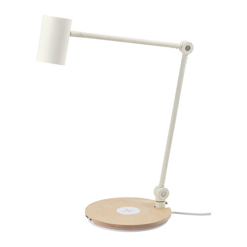
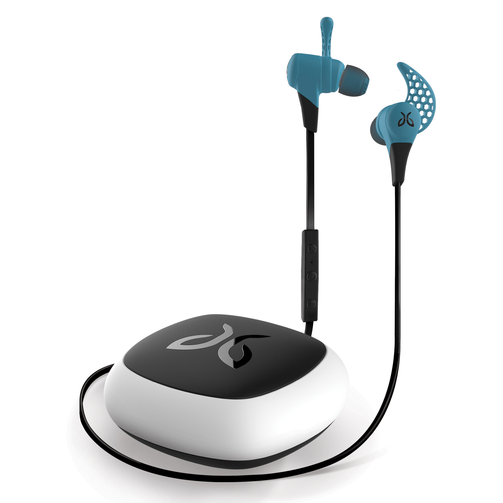
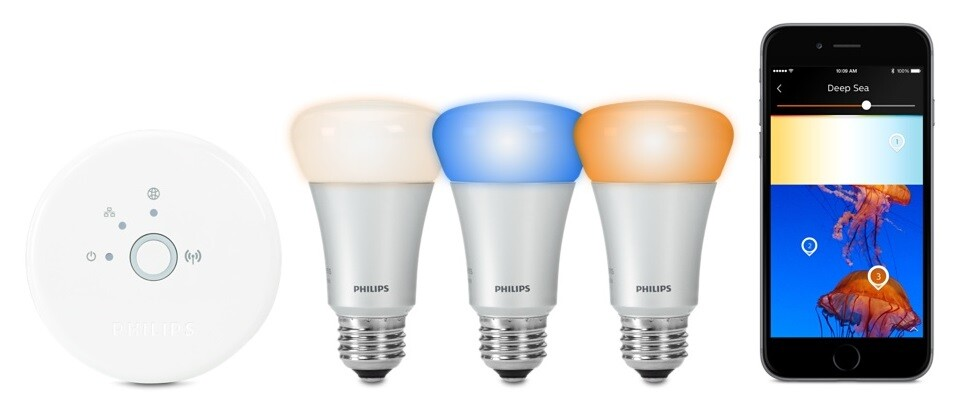

Olen joskus tehnyt näitä koontipostauksia mitä olisi kiva omistaa ja mitkä näin ylipäätään on mielenkiintoisia tuotteita. Otsikossa en halunnut nyt paljastaa ihan kaikkea joten laitoinkin ympäripyöreästi sen. Koostankin tähän muutaman jutun mikä olisi ostoslistalla ja mihin ehkä joulun aikaan veronpalautuksia joutuu tuhlaamaan.

## Langatonta latausta Ikeasta

Ikea on lanseerannut jo hyvän aikaa sitten langattomaan lataukseen erilaisia huonekaluja. Näillä tarkoitan siis pöytiä ja lamppuja joissa on sisäänrakennettu langaton laturi esimerkiksi matkapuhelimelle jotka sitä tukevat. Nämähän on vielä Qi standardin mukaisia latureita eli jos sinulla on tätä standardia tukeva laite niin homman pitäisi toimia.

Ensimmäisenä olisikin hankinnassa tuo kuvassa näkyvä valaisin yöpöydälle. [Riggad](http://www.ikea.com/fi/fi/catalog/products/40280678/) valaisin kustantaa 59 euroa ja tässä on langaton laturi sekä yksi USB portti mitä voisi käyttää myös lataukseen. Tämä olisikin itselle hyvä setti, koska näin saisi puhelimen ja tabletin laitettua lataukseen. Tälle lampullehan olisi vaihtoehtona myös [pöytä](http://www.ikea.com/fi/fi/catalog/products/S39094738/) tai [latauslevy](http://www.ikea.com/fi/fi/catalog/products/40289792/) joissa on langaton laturi. Tee se itse ihmisille on taas vaihtoehtona tuolla upotettavat langattomat laturit: [Morik](http://www.ikea.com/fi/fi/catalog/products/20299443/) ja [Jyssen](http://www.ikea.com/fi/fi/catalog/products/80291873/).

Koska itsellä on iPhone 6 niin siinä ei ole suoraan tuke Qi lataukselle. Ikeasta saa myös [Vitahult](http://www.ikea.com/fi/fi/catalog/products/10314000/) nimisen latauskuoren joka on yhteensopiva iPhone 6 kanssa. Hintaa sillä on 19,99 euroa eli ei mikään kauhea hintalappu. Värihän on tylsän valkoinen, mutta ainahan sitä voi esim. tarroilla piristää.

Tälle setillehän hintaa tulisi noin 80 euroa eli jos näitä ostaisi pari kappaletta (myös Outille omat) niin 160 euron investointi olisi tämä. Töihin voisi sitten jossain välissä ostaa tuon latauslevyn niin 200 euron setistä olisi kyse.

Tässä vielä linkki tuohon [Ikean langattomat laturit sivulle](http://www.ikea.com/fi/fi/catalog/categories/departments/wireless_charging/), josta löydätkin muita vaihtoehtoja langattomaan lataukseen.

## Jaybird X2 bluetooth kuulokkeet

Langalliset nappikuulokkeet on alkaneet ärsyttämään minua suunnattomasti. Samoin myös langalliset kuulokkeet ylipäätään myös koneella ollessani. Langattomuus olisi niin mukava konsepti ja bluetooth mahdollistaakin sen ilman mitään ylimääräisiä palikoita koneessa tai puhelimessa. Törmäsin [Jaybirdeihin](http://www.jaybirdsport.com/X2-bluetooth-headphones/) jo kun niistä oli tullut eka versio ulos aikaa sitten ja nyt kun tekniikka on kehittynyt niin on tullut X2 versio ulos.

Nämähän on langattomat in-ear tyyppiset kuulokkeet ja näitä markkinoidaan urheilukäyttöönkin sopivaksi. Täysin langattomat nämä ei ole tai oikeastaan on sillä tuo johto yhdistää vain kuulokkeet toisiinsa. Puhelimen ja koneen välinen keskustelu tapahtuu bluetoothin yli ja akkukestoksi lupaillaan 8 tunnin kuunteluaikaa. Tuo 8 tuntia on oikeasti aika hyvä suoritus kun mietit oikeasti, että nappikuulokkeissa on akku, lähettimet ja muut rensselit.

Harmillisesti näillä on hintaa vajaa 200 euroa mitä nyt pikaisesti Webhallenista ja Verkkokauppa.comista katselin. Näitä ei ole kummallakaan vielä varastossa, joten ei taida suomesta vielä näitä saada. Nämä kuulokkeet ovat varmaan yksi niistä hankinnoista mitä tehdään tässä syksyn aikana.

Kuulokkeita onkin kehuttu Youtubessa aikas paljon ja itsekin tykästyin tähän tyyliin ja malliin. Harmi kun näitä ei vielä oikein Suomessa taida olla saatavilla. Alla on vielä MKBHD:n tekemä arvostelu näistä kuulokkeista.



## Philips Hue – Väriä valoihin

Ikean langattoman latauksen valaisimista päästäänkin mukavasti itse lamppuihin. Philips on tuonut jo aikaa sitten Hue lamput ja olen niitä sivusilmällä katsellut aina silloin tällöin. Aina olen näitä halunnut itselleni ja haluan vieläkin. Näillä saisi mukavasti tunnelmaa esimerkiksi olohuoneeseen ja itselleni isoimpana mielenkiinnon kohteena olisi se, että saisin puhelimella hallittua näitä.

Starter kitti jossa on jokunen lamppu ja valoverkkoreititin maksaa reilu 200 euroa Verkkokauppa.comissa joten se on suht hintava setti. Lisälamput maksaa sitten muutaman kympin kappale joten koko kämpän valaistukseen ei ihan riitä pelkkä starter kitin lamppumäärä.

Philips Huen saa muuten liitettyä myös IFTTT palveluun joten integraatioita voisi laittaa vaikka miten. Tämä olisi ehdottomasti ensimmäinen askel oman kodin hallintaan ja, koska asun vuokrakämpässä niin ihan mitään mahdottomuuksia ei pysty tekemään.
