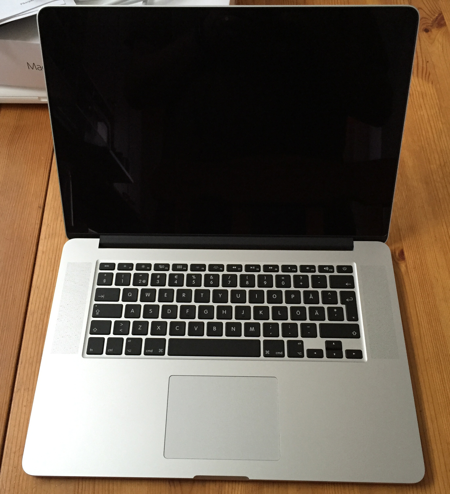
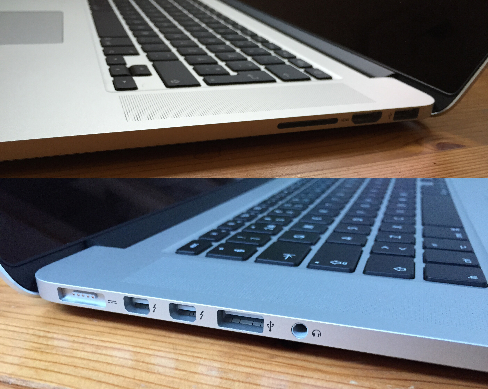
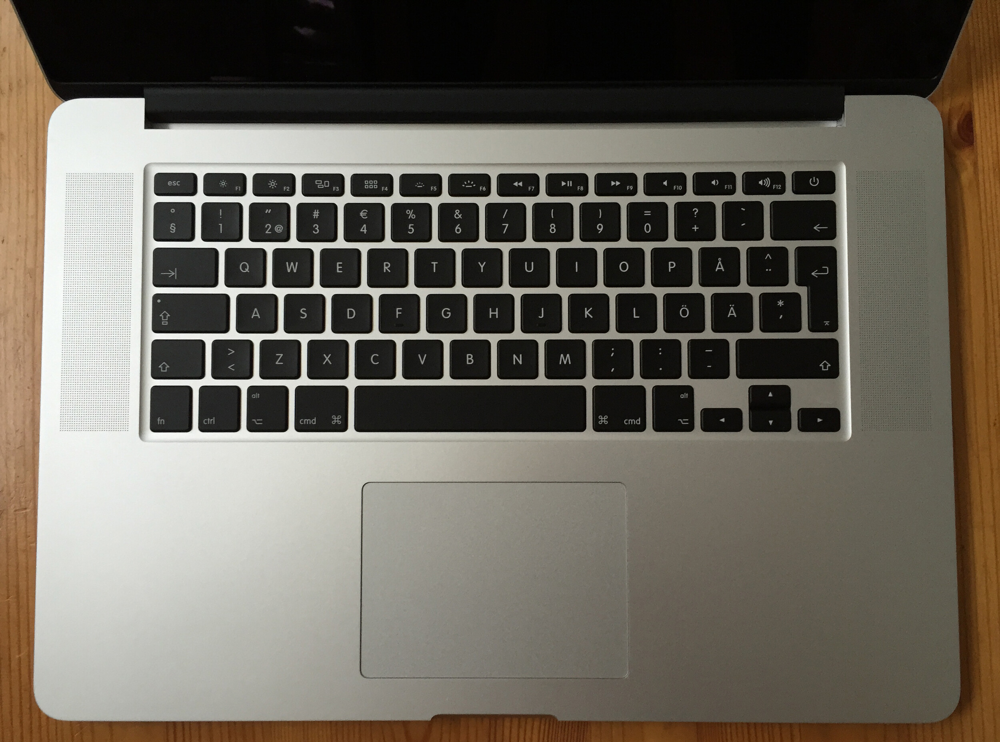

Oma luotettu [MacBook Pro 13″](/2010/macbook-pro-magic-mouse) (mid 2010) alkaa olla tehoton itselleni työkäytössä ja päädyinkin hankkimaan hieman uudempaa rautaa. Tilaukseen lähti siis Applen MacBook Pro 15″ Retina näytöllinen malli. Päädyin 15 tuumaiseen malliin seuraavien syiden takia:

- i7 prosessori
- 16 gigaa muistia
- Vain pari senttiä leveämpi kuin nykyinen MacBook Pro
- Enemmän pinta-alaa näytöllä käytössä

Katsoin myös tuota 13 tuumaista MacBook Pro retinaa ja huomasin, että hintaa alkoi tulla äkkiä lisää kun pisti muistia samoihin ja prosessoria paremmaksi. Tarkoitus olisi, että tuo kestäisi myös sen 4,5 vuotta (toivottavasti).

Listaan vielä ennen ensivaikutelmia tekniset tiedot pääpiirteittäin:

- **Näyttö:** 15,4″ Retina (LED-taustavalaistu näyttö IPS-teknologialla, 2880 x 1800 pikselin tarkkuus, 220 pikseliä tuumalla)
- **Prosessori:** 2,2 GHz neliytiminen Intel Core i7 -prosessori (Turbo Boost jopa 3,4 GHz) ja 6 Mt jaettua L3-välimuistia
- **Näytönohjain:** Intel Iris Pro Graphics
- **Muisti:** 16 Gt 1600 MHz DDR3L
- **Kiintolevy:** 256 Gt PCIe-flash-muistia (käsittääkseni voi itse vaihtaa isomman)
- **Liitännät: **2x USB3, 2x Thunderbolt 2, HDMI, kuulokeportti, SDXC-korttipaikka
- **Verkko: **Wi-Fi(ac/a/b/g/n), Bluetooth 4.0

Sain koneen tuossa maanantaina töistä tullessani itselleni ja alkoi sitten armoton asentelu. Halusin aloittaa tämän koneen kanssa puhtaalta pöydältä ja suurin osa ohjelmista ei vaadi peruskonffien lisäksi mitään ihmeellistä. Tietysti työskentelyyn vaadittavat sovellukset vaativat hieman enemmän säätöä, mutta sen jätin suosiolla tiistaille. Ensivaikutelmat koneesta olivat: ”piru kun on vikkelä”, ”onpas hyvä näyttö” ja ”onpas se pieni”.

Asentelin huoletta koneelle myös Virtualboxin virtuaalikoneita varten ja samalla kun puuhastelin koneen kanssa asentui siellä Windows 7 virtuaalikoneena. 16 gigaa muistia mahdollistaa mukavasti myös Windowsin pyörittämisen virtuaalikoneen kautta. Osa töistäni vaatii Windows pohjaisella järjestelmällä testaamista ja Windows 7 lisenssi sattui olemaan kätösillä niin pistettiin sekin hyötykäyttöön.

Liitännäthän on varsin passelit. DVD asema kun on jätetty pois niin on saatu tietysti myös paksuutta pois ja saatu liitännät molemmille puolin. Vanhassa MacBook Prossa oli kaikki liitännä vasemmalla puolella. Nyt oikealla on USB 3.0, HDMI ja SDXC-korttipaikka, kun taas vasemmalla puolella on Magsafe 2 laturi, 2x Thunderbolt 2, USB 3.0 ja kuulokeportti.

Itselle tärkeitä liitäntöjä oli nuo USB 3.0 portit, HDMI ja SDXC kortinlukija. Erikseen voi tulla tarve ostaa perus verkkoadapteri, mutta aluksi pärjännee ilman. Tuota paksuutta sai muuten pois nimenomaan tuolla verkkoportin pois jätöllä, tätä harrastaa usea valmistaja tänä päivänä – harmikseni Apple ei tarjoa ilmaista adapteria.

Näppäimistö ja touchpadi on samaa Apple laatui kuin ennenkin ja pidän kovasti molemmista. Olen vieläkin sitä mieltä, että Applen touchpadi on parhain mitä olen koittanut. Mikäli tulen joskus saamaan tuon [Hackintosh projektin](/2015/hackintosh-projekti-joka-olisi-hauska-toteuttaa "Hackintosh – projekti joka olisi hauska toteuttaa") tehtyä niin hankin siihen tuon [erillisen touchpadin](https://www.apple.com/fi/magictrackpad/) hiiren kaveriksi.

Kuvasta näkyy myös, että kaiuttimet on laitettu tuohon reunaan. En ole vielä testaillut noita kaiuttimia, joten en osaa sanoa onko tämä hyvä vai huono ratkaisu. Voisin kuvitella sen olevan ihan hyvä ratkaisu sillä nyt kajarit on sinuun päin enemmän, kuin jos ne olisivat pohjassa. Yleensä en käytä läppärin kajareita musiikin yms. kuunteluun vaan sitä varten pöytäkoneessa on hiukan paremmat kaiuttimet tai vaihtoehtoisesti kuulokkeet korville.

Olen tykästynyt myös tähän 15 tuuman retina näyttöön. Resoluutiona käytän 1920×1200 resoluutiota ja tällä saan aika kivasti ruututilaa käyttöön. Voisin myös halutessani käyttää näytön natiiviresoluutiota 2880×1800, mutta meni teksti liian pieneksi silloin (optikolle hakemaan kunnon vahvuudet?). Näytön laadun huomaa, kun tuijottaa ensin tätä konetta ja sen jälkeen alkaa katsomaan vanhalta jotain juttua – vanhan MacBookkini näyttö näyttää epätarkalta. Hurjaa miten ne kehittyy.

Kuten sanoin niin olen pari päivää käyttänyt tätä konetta ja nyt alkaa olla täydessä taisteluvalmiudessa tämän kanssa. Ensivaikutelmat on loistavat ja toivon, että tällä päästään taas 4.5 vuotta eteenpäin kuten vanhalla MacBook Pro 13 tuumaisella. Konetta on mukava kanniskella repussa sillä se ei paina, kuin hitusen yli 2 kiloa (lähes saman painoinen, kuin vanha MBP).

Jään käyttämään konetta lisää ja palaillaan kuukauden parin päästä takaisin tämän koneen kimppuun. Kysymykset ja kommentit voi tuttuun tapaan pistää Twitteriin, kommenttiboxiin, Facebookkiin tai vaikka keskustelualueelle!
