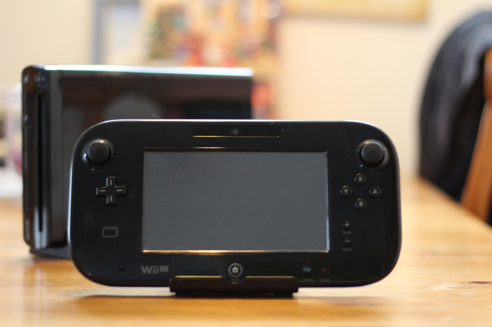

Wii U julkaistiin jo vuonna 2012, mutta mielestäni Nintendo ei tehnyt sen markkinointia oikein ja ihmiset luuli sitä mm. Wii:n lisäosaksi tai vastaavaksi. Toinen ongelma oli minusta se, että sitä verrattiin ehkä liikaa Xboxiin ja Pleikkariin vaikka minusta en on hieman eri sarjaa. Jos ihan rautapuolelta katsotaan niin Wii U ei ole se leikkikentän tehokkain konsoli ja se on muutenkin hieman outo ilmestys isolla gamepadillään ja pienellä koollaan noin niinkuin muuten.

Otetaan ensin syyt siihen miksi hankin juuri nyt Nintendo Wii U pelikonsolin. Ensinnäkin Wii U:lle on tänä vuonna ilmestynyt iso kasa hyviä pelejä joihin pääsee käsiksi vain Wii U:lla – vaikkapa esimerkiksi Super Mario Maker ja Splatoon. Samoin noiden kahden lisäksi Wii U:lle on iso kasa muitakin pelejä joita haluan kokeilla ja listaankin alle jokusen:

- Super Mario 3D World
- New Super Mario Bros. U
- Hyrule Warriors
- The Legend of Zelda: The Wind Waker HD
- Mario Kart 8
- Yoshi’s Woolly World
- Donkey Kong Country: Tropical Freeze

Ennen kuin mennään katsomaan teknisiä tietoja niin huomaatte varmaan pelien listasta, että hyvin Mario painotteista settiä on luvassa. Itselläni oli Sega junnuna ja Nintendo puoli jäi siltä osin kokematta, mutta tänä päivänä löytyy kyllä huushollista se alkuperäinen NES ja pari Mariota sille.

## Tekniset tiedot

Ensinnäkin tästä on olemassa kaksi mallia: Premium ja Basic. Isompana erona Basic ja Premium mallissa on se, että Basicissa on 8 Gt sisäistä tallennustilaa ja Premiumissa on 32 Gt. Molempiin saa lisättyä tilaa ostamalla esimerkiksi ulkoisen kiintolevyn. Mikäli hankit suurimman osan peleistäsi levyinä niin tilalle ei isoa tarvetta tule ihan heti.

Wii U:ssa on IBM Power -pohjainen moniytiminen suoritin, AMD Radeon -pohjainen High Definition -grafiikkasuoritin ja 2 Gt muistia. Samoin siellä on neljä USB porttia, langaton sovitin (b/g/n), Bluetooth ja SDHC korttipaikka.

Mainitsen vielä teknisissä tiedoissa sen, että Wii U pystyy käyttämään vanhemman Wiin oheislaitteita kuten ohjaimia, tasapainolautaa sekä classic ohjainta. Itse olenkin jo pelaillut vanhemman Wiin ohjaimien avustuksella pelejä.

## Yleistä Wii U konsolista

Aloitetaan käyttöönotosta sillä siinä ärsytti muutama asia. Alku meni mainiosti, mutta kun tuli aika tehdä Nintendolle tiliä niin sehän pyysi minua päivittämään konsolin sillä tilin luominen ei onnistu vanhalla ohjelmistoversiolla. Päivitin konsolin, mutta eipäs jatkettukaan siitä mihin jäätiin vaan tili piti luoda sitten toista kautta. Hieman selkeyttä tähän vaiheeseen kiitos!

On myös muitakin asioita mitä ei vain sanota, kun olet tehnyt tilin. Ensinnäkin sinun pitää kerran käydä Miiversessä aloitusruudun kautta tekemässä tarvittavat temput, että voit pelissä postailla kuvia ja juttuja sinne. Jos et ole käynyt kertaakaan siellä niin pelissä kuvien postaaminen aiheuettaa vain sen, että maapallo pyörii pitkään ja mitään syytä sille ei kerrota miksi se kestää ja mitään ei tapahdu.

Mainitsin kuvien postaamisen peleissä äsken ja tästä haluankin hieman avautua lisää. Tämä prosessi kaipaisi todella paljon hiomista. Käynkin tämän alla läpi:

1.  Painat ohjaimen Home-painiketta
2.  Valitset kosketusnäytöltä Miiverse kuvakkeen
3.  Odotat sen maapallon pyörimistä oman aikansa (se kestää joskus tosi kauan)
4.  Valitset haluatko tallentaa kuvankaappauksen vai tehdä Play journal entryn
5.  Tämän jälkeen valkkaat haluatko tv näytöstä vai ohjaimen näytöstä sen kaappauksen menevän
6.  Kirjoittelet jutut jos haluat
7.  Sitten se tallentelee ja palaat peliin

Miksi pitää mennä tuonne hitaaseen Miiverseen. Eikö voisi olla jotain overlayn tapaista tuolle hommalle muutenkin? Olisi parempi jos voisit vain valita kuvan, minne se menee ja tekstit lisätä siihen – tämän jälkeen homma menisi taustalla sinne Miiverseen. Kaikki odottelu tapahtuisi siis taustalla ja käyttäjälle jäisi kuva sujuvammasta operaatiosta.

Miiversestä ja Nintendon kaverisysteemistä yleisestikin. Minun kaverillani on 3DS ja myös tili Miiversessä, koitimme saada toisemme kaveriksi tuolle – eipä muuten onnistunut. Saimme kaveripyynnön lähetettyä (minä sain, kaveri ei), mutta se ei mennyt koskaan ilmeisesti perille vaikka minulla näytti että odotti hyväksyntää. Miiversessä kun selasi Wii U:lla kaverin profiilia niin Friend request nappi oli harmaa ja sitä ei voinut painaa. Googlettelun tuloksena tulimme siihen johtopäätökseen, että emme voi olla kavereita koska ei ole samaa pelisysteemiä. Tästäkin olisi kiva saada ilmoitus tai sitten edes korjata tämä asia.

Otetaan seuraavaksi käsittelyyn tämä ohjain. Aluksi olin hieman epäileväinen tuota ohjainta kohtaan sillä onhan se huomattavasti paljon isompi, kuin Xboxin ohjain. On siinä toki se kosketusnäyttökin. Ohjain tuntuu kuitenkin oikein mukavalta kädessä ja kosketusnäyttö onkin hyvä lisä tuossa. Olenkin pelannut esimerkiksi Super Mario Makeriä suoraan tuolta näytöltä ja en ole huomannut vasteajassa mitään ongelmaa. Osa peleistä käyttää tuota näyttöä hyvin sillä esimerkiksi Shovel Knight pelissä voit hallita itemeitä ja ottaa niitä käyttöön suoraan ruudulta.

En myös ymmärrä sitä miksi ohjain ja konsoli piti tehdä kiiltävästä muovista. Ohjain ja konsoli kerää nimittäin sormenjälkiä enemmän kuin laki sallii. Kuten yllä olevasta ohjaimen kuvasta varmaan huomaakin.

Hieman vielä peleistä jos puhuttaisiin. Wii U nimittäin tukee myös vanhemman Wiin pelejä ja sen levyjä suoraan. Samaten voit ostaa esimerkiksi SNESsin tai NESsin pelejä pelattavaksi Wii U:n Virtual Consolen kautta. Tämä puoli toimiikin mainiosti ja avopuolisolle hankittiin Donkey Kong SNESsille sitä kautta.

## Lopuksi

Ehkä olisi hyvä lopettaa tämä kirjoitus johonkin pohdiskeluun siitä mitä olen tykännyt nyt Wii U:sta parin viikon jälkeen. Omassa mallissahan tuli mukana Splatoon ja Mario Kart 8. Olen siihen saanut hankittua vasta Super Mario Makerin, Disney Epic Mickey 2: The Power of Two (avopuolisolle) ja Shovel Knight pelit. Paljon pelejä on siis vielä hankittavana jos tuota aiempaa listaa ajattelin käydä läpi.

Hieman toivoin, että vanhempien pelien hinta olisi tullut jo alas Wii U:lla ja niitä saisi käytettynä järkevään hintaan. Olin hieman väärässä sillä pelien hinta on vieläkin 50-60 euroa uutena ja Gamestopin suht kalliilla käytettyjen hinnoilla ne on siinä samoissa.

Olen kuitenkin pitänyt siitä mitä olen tähän mennessä nähnyt ja en ole noissa peleissä huomannut mitään tökkimistä tai vastaavaa. Grafiikka ja värit on mukavan pirteitä ja iloisia – ainakin kun kyse on Splatoonista ja Mario Kartista. Olenkin hieman sitä mieltä, että Wii U on se kiva pelikonsoli jolle on juuri näitä iloisia ja värikkäitä pelejä tehty joiden graafinen tyyli on enemmän piirrosmaista kuin realistista.

*Unohdinko mainita jotain vai jäikö kysyttävää? Alhaalla on kommentointi, joten käytä sitä hyödyksi!*
