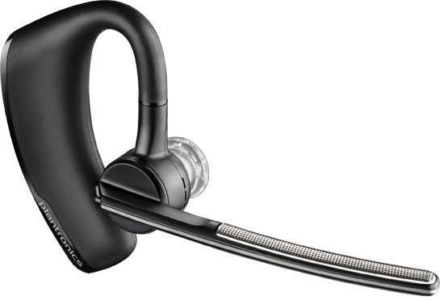
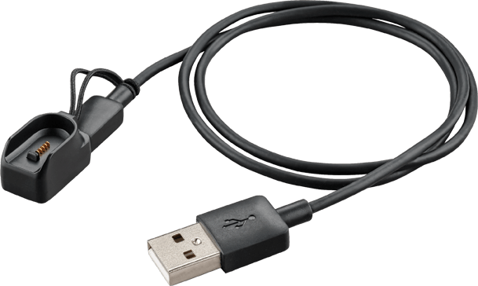

Ostin jo helmikuun lopussa itselleni uuden handsfreen sillä entisestä alkoi loppua akku nopeaan ja sen toiminta oli vähän mitä oli. Tällä kertaa päätin ostaa kerralla kunnollisen sillä tuo on minulla käytössä joka ikinen arkipäivä. Päädyin hankkimaan [Plantronicsin Voyager Legend](http://www.plantronics.com/us/product/voyager-legend#fndtn-overview) nimisen bluetooth handsfreen. Halusin myös langattoman handsfreen sen takia etten sotkeudu niihin esim. autossa tai liikkeesä ja tällöin bluetooth handsfree on selkeä valinta. Saapa sen myös bluetooth yhteyden ansioista paritettua myös tietokoneeseen.

Tämähän on hyvin tyylikkään näköinen ja erittäin laadukkaan tuntuinen handfree. Matkassa tulee noita korvaosia jokunen kipale ja niiden vaihtaminen on helppoa. Sen saa myös laitettua kummalle korvalle haluaa. Nappeja on oikeastaan kaksi ja sitten on volyyminsäätö liukukytkimellä sekä on/off säädin.

Otetaan ensimmäiseksi käsittelyyn tämän handsfreen selkeä heikkous. Se on nimittäin laturi. Ikävä kyllä Plantronicsilla ei ole ajateltu tätä loppuun asti ja laitettu selkeää micro usb porttia tähän handsfreehen. On laitettu kontaktipinnat ja pitää käyttää erillistä latauspäätä joka kyllä sopii micro usb piuhaan.. Itse en ole vielä onnistunut hävittämään tuota päätä, mutta se on sen verran pieni ja olenkin koittanut pitää sitä kotona aina piuhan päässä jottei se katoaisi.

Sitten päästäänkin niihin asioihin mitkä toimivat mielestäni hyvin. Autoillessahan käytän tätä aina ja se onkin jo valmiiksi korvalla. Kun puhelin alkaa soimaan niin handsfree kertoo minulle soittajan nimen (toki hieman mikropuhemaisesti) – tietenkin jos se on yhteystiedoissani. Voin sitten napin painalluksella vastata ja puhua normaalisti. Äänenlaatu on minun korvaan hyvä ja sen suhteen ei ole ollut ongelmia. Kaverin kanssa soitellessa olen kysynyt pariin otteeseen miltä kuulostaa ja auton melu ei ole kuulunut juurikaan ja muutenkin tuntuu, että Voyager Legend koppaa juurikin oikein vain minun äänen.

Tämähän on myös siitä fiksu, että se tunnistaa onko korvalla ja ohjaa puhelua sen mukaan joko puhelimeen tai handsfreehen. Olen muutaman kerran tehnyt niin, että olen puhelun aloittanut puhelimella ja sitten jossain välissä vaihtanut handsfreehen lennosta. Olen käynnistänyt handsfreen ja laittanut sen korvalle ja puhelu on siirtynyt suoraan handsfreehen ilman, että on pitänyt valita puhelun asetuksista mitään.

Akun kestonhan näet ainakin iPhone puhelimessa bluetooth kuvakkeen vieressä ja handsfree sanoo sen minulle kun aukaisen. Täytenä se kertoo kertoo kestävänsä 7 tuntia puhetta eli pärjäät hyvinkin yhden työpäivän tällä. Itse latailen 1-2 kertaa viikossa riippuen täysin miten paljon tulee sen kautta puhuttua. Akunkestoon olen kuitenkin erittäin tyytyväinen ja ei se ole kesken päässyt loppumaan kiitos sen, että se kertoo akun tilan minulle käynnistyessä.

Loppuun otetaan vielä perinteinen hyvää/huonoa listaus. Kysymykset, kommentit ja mielipiteet voi heitellä tuttuun tapaan kommentteihin, keskustelualueelle tai vaikka sosiaaliseen mediaan.

### Hyvää

- Äänenlaatu molempiin suuntiin
- Muotoilu
- Toiminnot
- Toimivuus
- Akun kesto

### Huonoa

- Laturi
