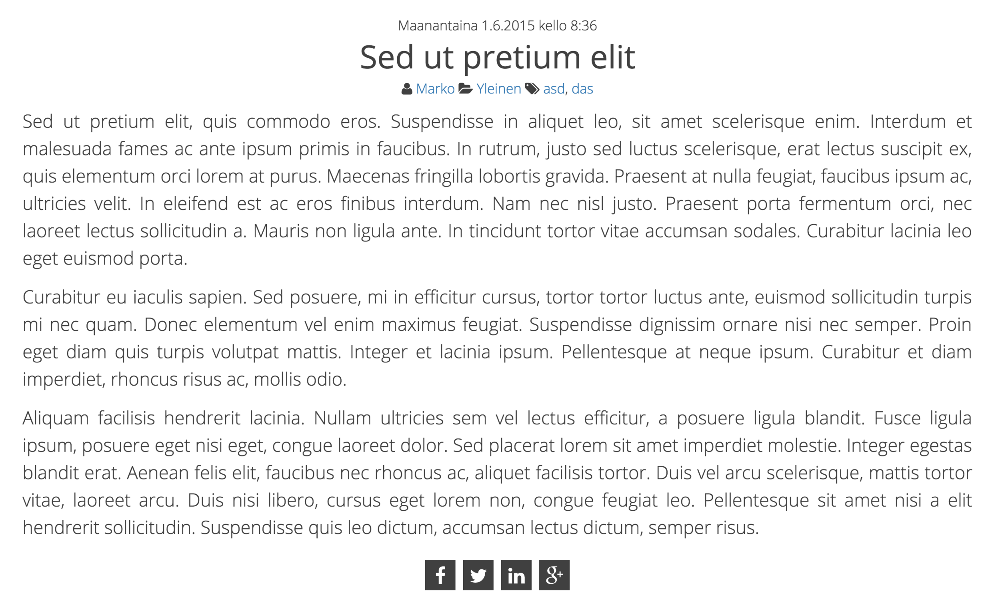

Kirjoittelin tässä koodia ja en löytänyt sopivaa lisäosaa WordPressiin, jolla saisin hyvin simppelit sosiaalisen median jakonapit näkyviin siihen kohtaan mihin haluan ne. En halunnut mitään hienoja laskureita tai mitään vaan yksinkertaisen ikonin, jota klikkaamalla voi jakaa artikkelin. Enkä halunnut isoa kasaa erilaisia ikoneita vaan nämä neljä: Faceboo, Twitter, G+ ja LinkedIn. Alla on jotakuinkin lopputulos tai ainakin se tulos miltä se tällä hetkellä näyttää – ainakin nuo somenapit jäänee tuommoisiksi. Tätä ohjetta voi kyllä soveltaa mille vain alustalle, mutta WordPress on nyt esimerkkinä sillä sille itse sen tein.

Eli tätä varten tarvitset hieman ymmärrystä ohjelmoinnista ja muutenkin miten WordPressin teemat pelittää. Et paljoa, mutta sen verran kuitenkin, että koet kykeneväsi tähän hommaan. Onhan nyt peloiteltu tarpeeksi?

Ensinnäkin itse käytin [Font Awesome](http://fortawesome.github.io/Font-Awesome/) ikoneja tätä varten, joten hanki ne tai vastaavat ikonit. Voit toki käyttää kuviakin, mutta muokkaa sitten itse funktiota ja CSS koodia sinulle sopivaksi.

## PHP-funktio

Otetaan oman teeman `functions.php` auki (ellei sitä ole niin sen voit luoda). Liitä sinne alla oleva funktio:

function someJako(\$url, \$title){\
    \$url        = urlencode(\$url);\
    \$title      = urlencode(\$title);\
    \$source     = urlencode("https://markokaartinen.net"); //kotisivusi osoite\
    \$twnick     = "MarkoK"; //Twitter nimimerkkisi\
    \$facebook   = '';\
    \$twitter    = '';\
    \$gplus      = '';\
    \$linkedin   = '';\
    echo \$facebook.\$twitter.\$linkedin.\$gplus; //tulostetaan tuossa järjestyksessä\
}\

Tämä funktio on suhteellisen simppeli. Se ottaa parametrinä osoitteen (url) ja otsikon (title). Tämän jälkeen syötät vielä kotisivusi osoitteen source muuttujaan ja Twitter nimimerkkisi twnick muuttujaan. Mikäli haluat muuttaa järjestystä niin muuta echottavien muuttujien järjestystä.

## Funktion kutsuminen

Itse halusin tämän yhteen paikkaan joten käytin jakonapit id:llä diviä, mutta sinähän voit muuttaa tuon miten haluat. Sen sisään laitoin tuon funktio kutsun. Otathan huomioon, että tämän pitää olla WordPressin loopin sisällä, jotta saadaan linkki ja osoite haettua. Kannattaa tutustua WordPressin dokumentointiin näissä asioissa.

\
\
    \
\

## Tyylittelyä

Itse halusin tämän keskitettynä ja kaikki napit vierekkäin – kuten kuvassakin näkyy. Alla onkin suhteellisen simppeli CSS-koodi.

\
\#jakonapit {\
    text-align: center;\
    margin-top: 20px;\
}\
\
.somenappi {\
    font-size: 25px;\
    line-height: 40px;\
    height: 40px;\
    width: 40px;\
    text-align: center;\
    display: inline-block;\
    background:#404040;\
    margin: 5px;\
    color: #FFF;\
}\
\
.somenappi:hover {\
    color:#A4CF2E;\
    text-decoration: none;\
}\

Tässähän ei sinänsä mitään ihmeellistä ole. Tuolle jakonapit diville määritetään keskitys ja hieman marginia ylös. Itse napeille taas annetaan koot ja värit.

## Lopuksi

Ei tuo muuta vaadi. Tallenna tiedostot ja katso menikö se nyt ihan niin miten halusitkaan. Bugit, kommentit, kysymykset ja muut voi pistää tuonne kommenttiboxiin tai keskustelualueen puolelle.
