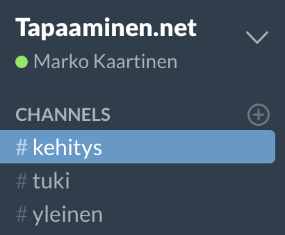

[Podcastissani](/2015/024-podcastday-pitkasta-aikaa-eetterissa) uhkasin ja lupasin alkaa kehittämään [Tapaaminen.netistä](http://tapaaminen.net) uutta versiota, jossa onkin hyvä kasa ominaisuuksia ja muutenkin tehdään hommia fiksummin. Alankin pitää täällä blogin puolella kehitysblogia siitä miten homma etenee ja mitä sinne on tulossa sekä kuvankaappauksia yms. mukavaa. Tekaisin tänne blogiin ihan tätä varten oman [kategorian](/kategoria/tapaaminen-net), josta sitten löytyy nämä Tapaaminen.net kehittämiseen liittyvät postaukset. Kootaankin tähän alle hieman, että missä mennään nyt!

## Slack

Ensinnäkin meillä on nyt yksi kanava missä kehitetään Tapaaminen.nettiä ja missä siihen kehitykseen voi osallistua. Olenkin maininnut tuosta Slack tiimistä jo pariin otteeseen, mutta mainitaan nyt vielä.

Olen luonut Slackkiin aluksi kolme eri kanavaa keskustelua varten. Kanavia voi jatkossa luoda tarpeiden mukaan lisää, mutta käydään läpi nuo jo luodut kanavat.

\#kehitys on tarkoitettu kehityskeskustelua varten ja sinne laitoinkin aamulla jakoon Google Docsissa tehdyn pikaisen dokkarin, jonka perusteella lähdetään hommaa viemään eteenpäin.

\#tuki kanava on tarkoitus toimia nopeana tukena käyttäjille. Toiveissa olisi kerätä tuonne Slackkiin Tapaaminen.net käyttäjiä ja saada sitä kautta suoraan tietoa heiltä.

\#yleinen onkin sitten ihan yleiseen keskusteluun ja ehkä siihen hieman asian viereiseenkin keskusteluun.

Halusin lähteä kokeilemaan voisiko tuon Slackin avulla saada tälläisen projektin ympärille keskustelua ja saisiko sinne aktiivia käyttäjiä. Tätä kautta voisi kehitystyö saada ihan erilaista suuntaa kun loppukäyttäjät on suorassa vuorovaikutuksessa kehittäjän kanssa. Uskoisin myös tämän toimivan hyvänä tukikanavanakin.

Tutkiskelin eilen illalla myös mahdollisuutta automaattikutsuihin eli niitä ei tarvitsisi erikseen minulta lähteä pyytämään vaan se tulisi pienen automatiikan kautta. Katsotaan mitä keksitään.

## Tulevat ominaisuudet

Tulen pitämään ominaisuuslistan suhteellisen samana mitä se on jo nyt tuolla. Tapaaminen.net historiaan palatakseni sehän tehtiin aika nopealla koodauksella ja osittain senkin takia haluan lähteä tekemään tuota koodia kokonaan uudestaan. Tämä pohjan uudelleen koodaus mahdollistaa monen ominaisuuden helpon tuonnin jo heti alusta asti. Uudessa versiossa tulee olemaan nykyisten toiminnassa olevien ominaisuuksien lisäksi mm. tuki käännöksille, käyttäjätunnukset sekä jonkinasteinen tuki teemoille.

Rajapinta on myös yksi asia minkä haluan tehdä uuteen versioon. Ei välttämättä suoraan, mutta jossain vaiheessa. Rajapinnan tekeminen mahdollistaisi esimerkiksi sen, että ulkopuolinen sovelluskehittäjä voisi tehdä mobiilisovelluksen tapaamisten luonnille. Tietenkin jonkinlainen rajapinta-avainten hallinta ja tälläinen pitäisi tehdä myöskin, mutta uskon sen olevan hyödyllinen ominaisuus tänä päivänä.

## Tapaaminen.net pohdiskelua

Tämä onkin sitten mielenkiintoinen pohdiskelun aihe jo muutenkin. Tämän käyttöhän on ollut ilmaista ja tulee olemaan ilmaista jatkossakin. Hurjimpina visioina voisin kuitenkin heittää esimerkiksi mahdollisuuden luoda yritykselle/yhteisölle oman näköisen version tai vaikkapa tehdä täysin oma asennus heidän omaan verkkoon.

Kuten olen jossain (ehkä podcastissa) sanonutkin niin Tapaaminen.net sivustolla on kävijöitä vielä. Nimittäin kuluvalla viikolla (ma-to) on tapaamisia luotu jo yli 20 kappaletta eli noin viisi per päivä. Yhteensä tapaamisia onkin luotu 3382 kappaletta (1.10. mennessä). Mainostamiseen ei olla käytetty senttiäkään ja kävijöitä tuleekin tasaiseen tahtiin. Kävijämäärissä on selkeitä laskuja loma-aikoina ja muutenkin viikonloppuisin. Aktiivisimmin tätä käytetään arkipäivinä.

Itse en ole tehnyt vielä senttiäkään tällä projektilla, mutta joku päivä olisi hauska ehkä pari euroa saada esimerkiksi mainostulojen kautta. Muutenkin rahanansainta ei ole ollut pääosassa Tapaaminen.net sivuston kanssa – eikä oikein muidenkaan projektien kanssa.

Katsotaan mitä tulee ja miten tämä homma eteneekään. Kommentit ja palaute on aina tervetullutta!
