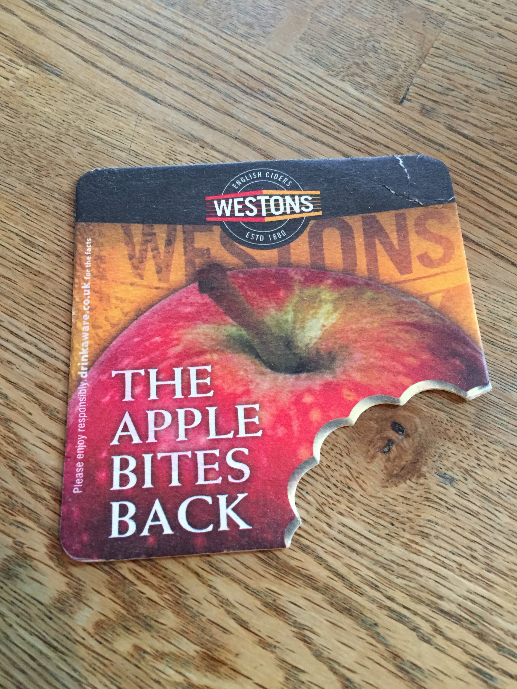
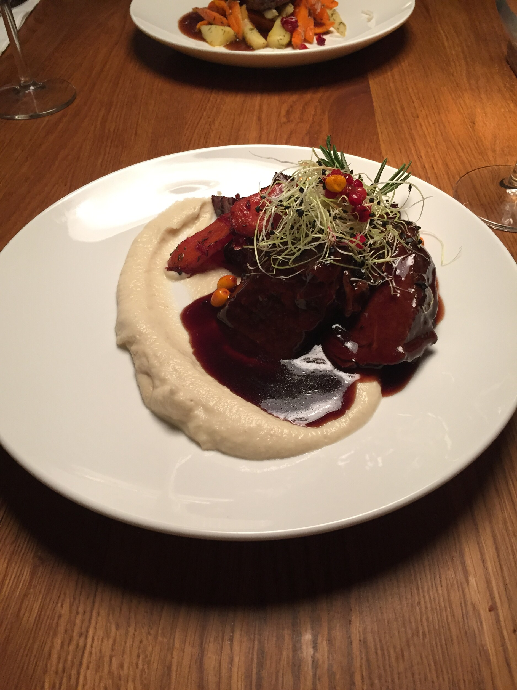

Kirjoittelen tätä artikkelia erittäin hyvässä kuppilassa nimeltä [Drink](https://plus.google.com/118434724194816830330/about?gl=ee&hl=en). Siemailen tässä Westonsin Old Rosie Still siideriä joka kustansi 4 euroa. Olen täällä käynyt parilla reissulla nyt ja olen erittäin tyytyväinen siihen, että täältä saa hanasta kunnon siideriä kuten tuota em. Old Rosieta ja Wyld Woodia sekä Stowford Pressiä – pullossa on sitten jokusta muuta siideriä vielä lisäksi. Mainittakoon, että oluesta on sitten vielä parempi valikoima eli suosittelen tänne tulemaan vierailulle jos olet oluen tai siiderin ystävä!

Meillä (siis minulla ja [Outilla](http://ice-cherry.net)) Tallinnassa käyntiin sisältyy hyvää ruokaa, juomaa sekä tietysti niitä kauppoja. Ollaankin tässä käyty jo ajelemassa Ülemiste keskuksessa ja Sikupillin Prismassa. Prisma Sikupilli oli pieni pettymys sillä Ülemiste keskuksen Rimissä oli paremmat hinnat – ihan tiedoksi muillekkin. Tulemme lauantaina vielä käymään Rocca al Maren Prismassa ajelemassa sillä teemme siellä vielä hieman ostoksia kotiin päin.

Huomasitte varmaan, että puhuin ajelemisesta. Me ollaan nimittäin useamman vuoden ajan käyty Tallinnassa niin, että matkassa on ollut oma auto. On nimittäin pirun kätevä ajaa laivaan autolla ja pois sieltä. Tallinnassa sitten saa tuliaiset ja ostokset suoraan autoon ja sen voi sitten purkaa kotona – suosittelen. Ei tuo nimittäin kovin kummoista hommaa ole ottaa auto matkaa Tallinnaan. Kerron alla vielä erikseen siitä mitä valmisteluita tein auton mukaan ottamiseen.

Voisinkin listata tähän muutaman paikan satunnaisessa järjestyksessä missä on tähän mennessä pyöritty.

- Drink (hyvää juomaa ja ruokaakin – olemme täällä syöneet vain alkupaloja)
- Hell Hunt (hyvää juomaa ja ruokaa – täälläkin söimme lähinnä alkupaloja)
- Texas.ee Honky Tonk (hyvä ruoka ja juomaakin – ei tosin mitään kummoista siideri valikoimaa – suosittelen mozzarella tikkuja vadelmahillolla!)
- Rataskaevu 16 (ruoka oli hyvää, mutta ruokia sai odottaa – tarjoilija sanoi, että kesällä on vielä pidemmät odotusajat – oikealla oleva kuva on muuten täältä saatua uunissa haudutettua hirveä)
- F-hoone (loistavaa ruokaa – olemme useamman vuoden ajan käyneet täällä ja aina olemme saaneet hyvää ruokaa)

Tallinnassahan on nähtävää jo vanhassa kaupungissa. Me olemme pyörineet jo useamman vuoden ajan täällä ja aina se vain jaksaa kiinnostaa. Tällä hetkellä on hieman liian vilpoista istuskella terassilla, mutta parin viikon päästä alkaa olla terassikelit kohdillaan. Nyt niitä terasseja näytetään rakenneltavan ja parissa paikkaa ne onkin jo valmiit. Ihan vanhan kaupungin ytimessä torilla on jo terassit auki – niissä tosin on lämmittimet ja hintataso oluella ja siiderillä todella kova.

Tämä reissu on kyllä ollut hyvä, olemme pitkästä aikaa kahdestaan liikenteessä ja saammekin olla toistemme seuraassa ihan koko reissun ajan. Autolla on tullut ajeltua pariinkin otteeseen ja huomenna suuntana vielä Rocca al Mare. Tänään Outi onkin kasvohoidossa ja ilmeisesti kynsillekkin tehdään jotain, hänen [blogistaan](http://ice-cherry.net) voitte lukea varmaan siitä lisää ja muutenkin tästä Tallinnan reissusta paremman kuvauksen kuin tämä.

**Autolla Tallinnaan?**

Ensinnäkin kannattaa olla yhteydessä vakuutusyhtiöön ja pyytää Green card autollesi sekä jos olet toisen autolla liikenteessä niin ainakin OP Pohjolalla tuli Green cardin mukana valtakirja. Samaten autossasi pitää olla huomioliivit, varoituskolmio ja kilon sammutin.

Satamassa kannattaa Suomen ja Tallinnan päässä olle reilu tuntia ennen laivan lähtöä – näin varmistat sujuvan laivaan nousun omalta osaltasi. Laivaan mennessä kannattaa seurata mitä miehistä sinulle viittoo sillä sinut viitotaan oikealla paikalle. Aja rauhallisesti ja äläkä tee äkkinäisiä liikkeitä – pätee muutenkin liikenteeseen.

Virossa ajamista ei kannata pelätä. Itse olen ajellut Tallinnassa ja sen lähiympäristössä ja ilman kolhuja on selvitty tähän mennessä. Rauhallisuus on valttia ja navigaattori on oiva apuväline tähänkin touhuun.

Mikäli renkaiden uusiminen on Tallinnassa ajankohtaista niin kannattaa lueskella tämä [artikkelisarja](/sarja/kesarenkaat-tallinnasta) – suosittelen valitsemaani Rehvid.ee yritystä lämpimästi!
