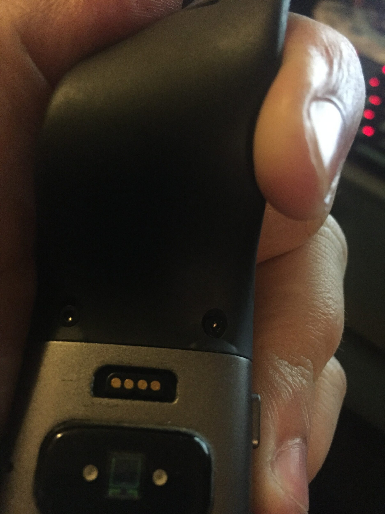
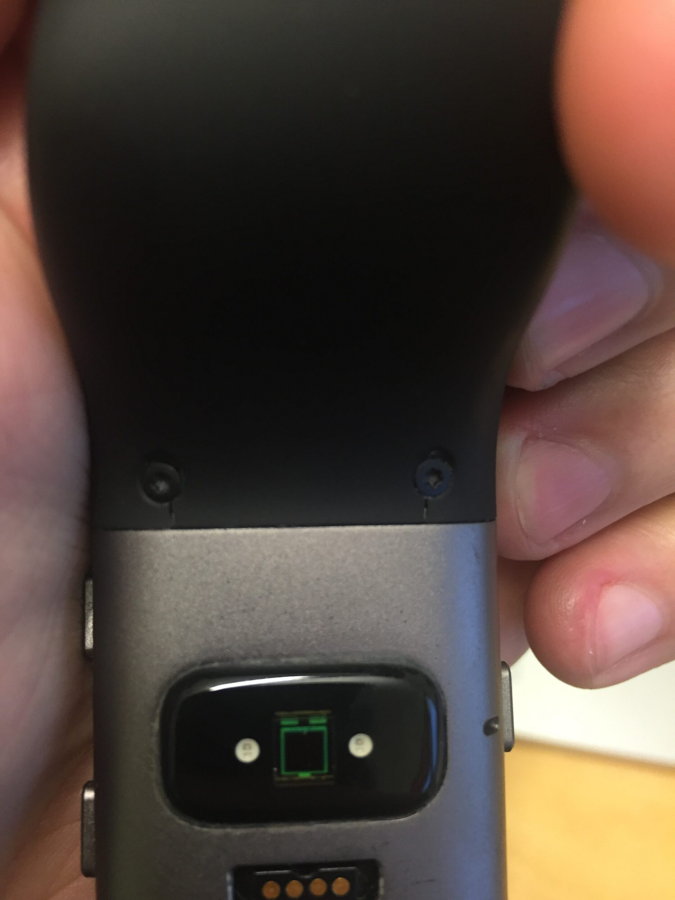

Huomasin tuossa viime viikon loppupuolella että reilut [pari kuukautta](/2015/kokeilussa-fitbit-surge) vanha Fitbit Surge rannekkeeseen on tullut pientä ongelmaa ja laitoinkin siitä viestiä heidän tukeen. Alla onkin pari kuvaa tuosta rannekkeesta ja huomaa selkeästi, että ruuvien kohdalle on tullut rako ja tuntuu, että liimaus on muutenkin pettämässä toiselta puolen kun se nousee irti kellosta. Samaten toisella puolella on pientä nousua havaittavissa. Kuvat on otettu kännykällä ja siksi laatu ei ole parasta mahdollista – ongelma käy siitä silti ilmi.





Nämä kaksi kuvaa lähti Fitbitin tukeen joka vastasi muuten aika pikaiseen. He pyysivät lisäksi kuittia tästä ja infoa mistä on ostettu ja tämmöistä perus tietoa. Lopulta selvisi, että he lähettävät minulle uuden tulemaan ja siinä menisi 10-12 arkipäivää kun se sieltä saapuisi minulle. Sain tänään seurantakoodin eli kolmantena arkipäivänä yhteydenotosta sain seurantakoodin. Odottelen mielenkiinnolla milloin korvaava saapuu ja päivitän tätä artikkelia sitten tarpeen vaatiessa!

Fitbit Surgeen ei ole olemassa vaihtoranneketaa mikä on sinällään harmillinen homma sillä kun tuo ranneke hajoaa niin kellokin on aika pitkälti entinen. Rannekkeen molemmat osat on ilmeisesti kiinni liimalla ja noilla ruuveilla tuossa itse yksikössä, joten teoriassa rannekkeen vaihto olisi mahdollista.

Vielä pari sanaa Fitbitin tuesta. He hoiti homman hyvin – ainakin tähän asti. Prosessista viisastuneena olisin voinut heti pistää kuitit ja ostotiedot mukaan niin olisi ollut yksi sähköposti vähemmän lähetettävää.

Itse kelloon olen ollut tyytyväinen ja tukikin kun pelaa näin mukavasti niin mikäs tässä. Odotellaan nyt mitä sieltä tulee takaisin ja rikkinäisen kellon he muuten pyysivät vain kierrättämään oikein. Tuosta nimittäin saisi vielä ihan toimivan pelin jos tuon rannekkeen saisi korjattua.

**Päivitys 21.2.2016**

Uusi kello saapui (perjantaina 19.2. oli postissa) ja sehän toimii kuten pitääkin. Parin päivän jälkeen ei rannekkeessa ole näkynyt samoja merkkejä, mutta seuraillaan tilannetta. Kaiken kaikkiaan homma meni kerrassaan mainiosti ja mitään pahaa ei asiakaspalvelusta voi sanoa.
