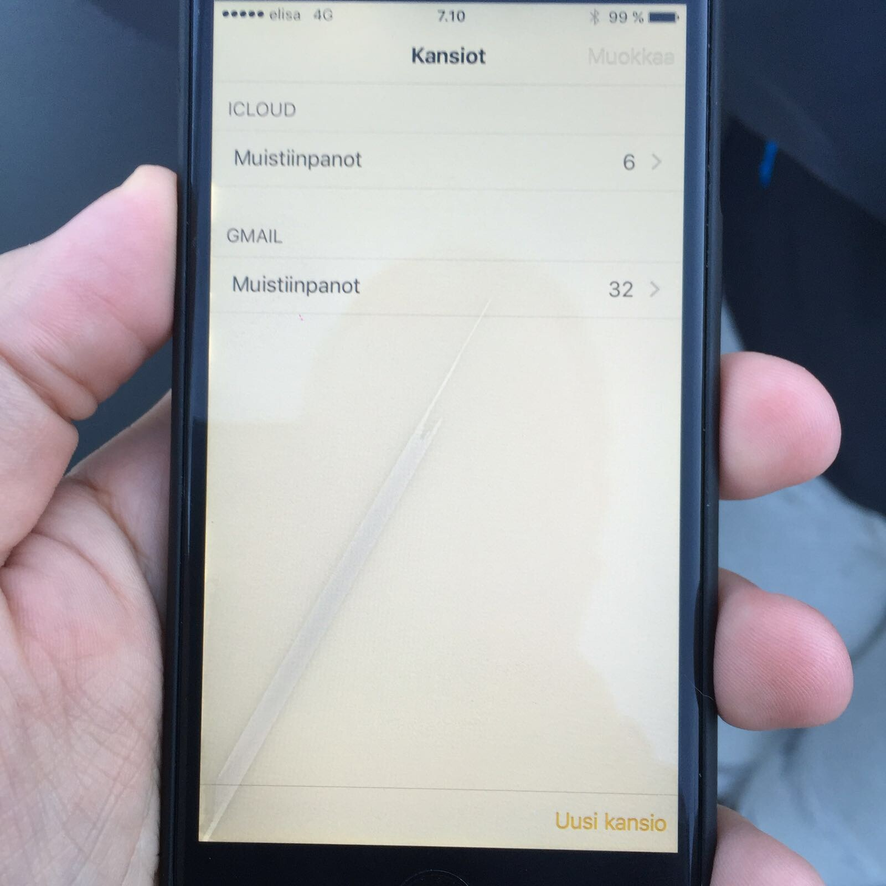

Nyt ollaan taas jännien asioiden äärellä. Nimittäin huomasin tuossa aamulla, että iPhone 6 puhelimen näyttöön on tullut rantu. Tuossa oikealla onkin kuva tuosta rannusta.

Eilen illalla tätä ei vielä ollut ja koitin puhelintakin boottailla ja siinä se vain on. Mitään säröä ei näytössä itsessään ole ja muutenkin puhelin on ollut kunnossa. Puhelin oli yön latauksessa ja siitä aamulla nappasin sen pois. Ainut missä se kävi oli farkkujen taskussa, jossa sitä yleensäkin olen pitänyt. Taskussa on vain silmälasien puhdistusliina tuon kaverina.

Odotellessani ulkona autoa niin huomasin tämän. Eli tuo rantu on ilmeisesti tullut sillä välin kun kävelin portaat alas asunnosta parkkipaikalle.

Nappasinkin avopuolison kameralla tuon kuvan ja pistin sen Elisalle päin. Sieltä he sitten vastailivat ja ohjasivat liikkeeseen. Epäilivät vielä, että ei menisi takuuseen…

> [@MarkoK](https://twitter.com/MarkoK?ref_src=twsrc%5Etfw) Oih! Vähän epäilen, että tuo ei mene takuuseen. Jos pääset käymään meidän myymälässä, osaavat he kertoa tarkemmin. :) -Laura
>
> — Elisa Asiakaspalvelu (@Elisa_aspa) [March 16, 2016](https://twitter.com/Elisa_aspa/status/709989203002716160?ref_src=twsrc%5Etfw)

Tänään sitten liikkeeseen käymään ja ennen sitä pitänee varuilta ottaa varmuuskopiot. Päivittelen tätä ketjua etenemisestä… Saa nähdä miten tämänkin suhteen käy. Näyttöhän itsessään toimii tuon rannun kohdaltakin, mutta kyllä tuo käyttöä häiritsee. Varapuhelin on kotona vanha Android vekotin, että niin…

**Päivitys 16.3.2016**

Kävin aiemmin päivällä Elisalla josta puhelin oli ostettu. Myyjä ei osannut sanoa varmaksi meneekö takuuseen vai ei. Itse epälen vahvasti, että ei mene takuuseen. 40 euroa maksaa puhelimen käyttäminen siellä pelkästään ja jos korjataan niin noin 400 euroa. Applehan antaa suoraan uuden tilalle. Vakuutusyhtiö korvaisi 400 eurosta 250 euroa.

Tällä hetkellä on jokunen eri vaihtoehto:

1.  En tee puhelimelle mitään
2.  Myyn puhelimen tuossa kunnossa
3.  Laitan huoltoon ja jos ei mene takuuseen niin korjautan
    - 400 euroa pitää pistää rahaa kiinni siihen ennen kuin saa 250 euroa takaisin vakuutusyhtiöltä tuosta
4.  Laitan huoltoon ja toivon että menee takuuseen – maksan 40 euroa jos ei mene

Tässä on myös se huomioitava, että ajatuksena on parin-kolmen kuukauden päästä myydä tuo joka tapauksessa. Eli maksanko nyt 150 euroa, että voin myydä sen hyväkuntoisena vai myynkö sen nyt tuossa kunnossa kuin se on.

Nyt jokatapauksessa katson loppuviikon ja pohdin mitenkä tulen tekemään.

Mielipiteet on tervetulleita!

**Päivitys 17.3.2016**

Tulen todennäköisesti myymään tämän puhelimen eteenpäin. Näytön vaihto itse on ehkä liian haastava ja uskallusta ei niin paljoa löydy, että lähtisin tekemään. Jätän nämä ammattilaisille. Hinta pitää vain miettiä kohdilleen.
