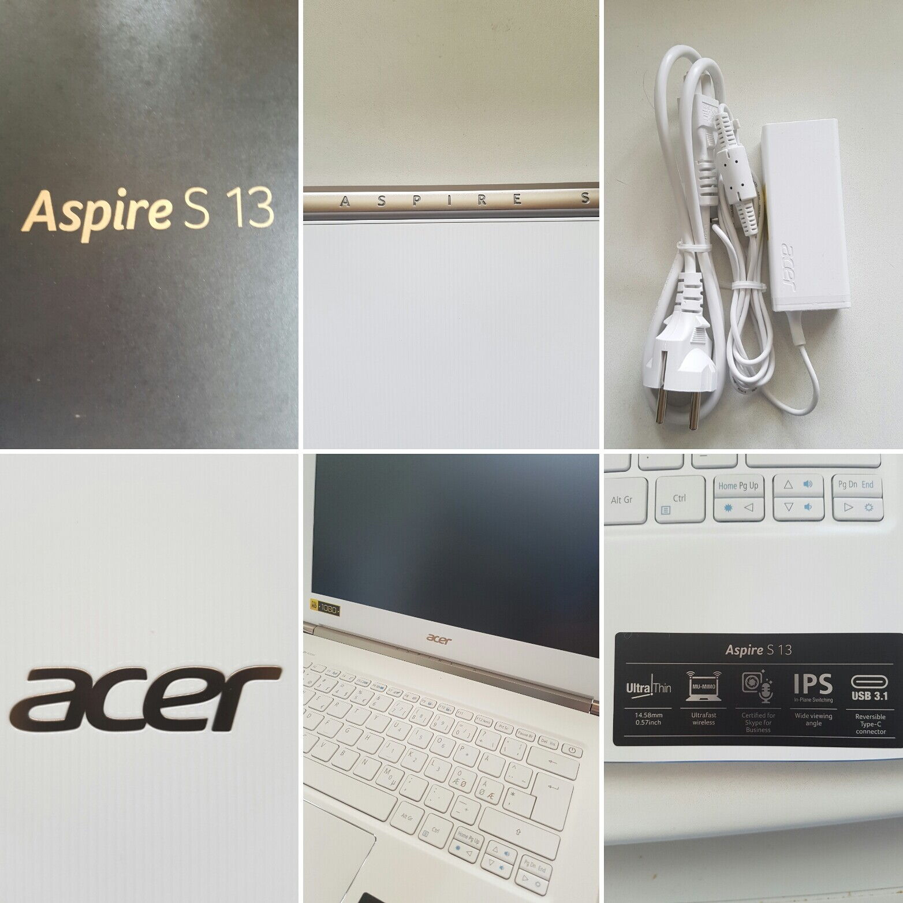

Sain toisenkin Acerin koneen kokeiltavaksi ja tämä alkaakin olla sitä kaliiberia, että huolisin tämän jo työkoneeksikin. Tehojahan tässä minun mallissa on suhteellisen hyvin ja prosessorina on Intel Core i5-6200U (2.3GHz) sekä muistia on 8 gigatavua. Kiintolevytilaakin löytyy 250 gigaa. Tämä onkin ensimmäinen laite itsellä missä on USB-C liitin, mutta tätä en voinutkaan koittaa sillä ei muita USB-C tukevia laitteita ole, joten ei löydy sitä muistitikkuakaan siihen koitettavaksi. Muuten liitännöiltään tämä on varsin passeli sillä löytyy HDMI portti, USB 3.0 portteja (2 kpl), muistikortinlukija sekä tietysti kuulokeportti.

Kuten kaikissa koneissa niin tästäkin pitää poistella turhia ohjelmia mitä valmistajat tykkäävät laittaa mukaan, mutta tämä nyt on jo aika normaalia tänä päivänä. Ei ole tämä kone pahimmasta päästäkään vielä, mutta hieman puuhastelua käyttöönoton yhteyteen se tuo silti. Muuten käyttöönotto oli simppeli ja tarvitsi syöttää muutamaan kohtaan infoa ja homma oli sillä selvä – perus Windows 10 käyttöönotto siis.

Tosiaan työkoneeksihan tämä taipuisi ihan täysin siitä ei olekaan enää mitään epäilystä. Saan oman työnkulun toimimaan tällä koneella mainiosti ja ilman isompia kompromisseja – virtuaalikoneen muistia hieman rajoitetaan, mutta muuten kerrassaan mainio tähän tarkoitukseen. Voisin kuvitella vielä toimistotyöhön käyvän vielä paremmin ja varsinkin jos tehdään etänä töitä niin kone lähtee mukaan todella helposti sen koon ja painon ansiosta. Palavereihin kuskaamisesta puhumattakaan – tosin tällöin kannattanee varata jonkinlainen vga adapteri mukaan sillä näkee vielä vanhoja videotykkejä palaveritiloissakin – hdmi portilla pärjätään jo pitkälle tänä päivänä onneksi.

## Matkalle mukaan?

Aloinkin miettimään tälle koneelle muuta käyttötarkoitusta työskentelyn ja kotikäytön lisäksi sillä faktahan on se, että tämä on vallan mainio väline molempiin. Kreikan reissu on taas tulossa parin kuukauden päästä, joten aloin pohtimaan sopisiko tämä sinne. Mehän pidetään [matkablogia](https://auringonalla.fi/) aina Kreikan reissun ajalta niin teille kuin itsellekkin muistoksi. Aikaisempina vuosina ollaan kirjoiteltu sitä tabletin ja näppäimistön avustuksella, mutta viime vuonna se kirjoitettiinkin MacBook Airin avustuksella. Tässähän koneessa on enemmän tehojakin, kuin avopuolison MacBookissa. Tänä vuonna tulemme syyskuussa kirjoittamaan blogiin päivittäin matkan aikana joten kannattaa ottaa tuo meidän [auringonalla.fi](https://auringonalla.fi) blogi seurantaan!

Matkallahan yksi tärkeistä ominaisuuksista on koko ja siinä tämä loistaa – painoa on reilun kilon verran ja kokokin on maltillinen. Akkukestokin on yksi hyvä ominaisuus reissussa ja tässä se tuntuu olevan mainio. Tätä en ihan tarkasti testannut, mutta parin tunnin raparperin siivous+pakastus urakan aikana HBO Nordic pyöri mainiosti taustalla ja akkua ei ollut kulunut kauheita määriäkään edes (noin 30% ehkä). Ulkomailla tulee oltua paljon langattomissa verkoissa, joten sim korttipaikkaa ei niinkään kaipaa enää ulkomailla ellei sitten hanki prepaidia.

Matkalla on oikeastaan muutama ohjelma mitkä pitää pyöriä ongelmitta ja ne toimikin vallan mainiosti. Selain tarvitaan tietysti blogin kirjoittamiseen ja matkakohteen/ravintoloiden tutkimiseen paikan päällä. Kuvankäsittelyohjelmalla taas saadaan tarvittaessa käsiteltyä kuvia ja Photoshop/Lightroom combo toimikin vallan mainiosti. Näillä jo pärjätään pitkälle, mutta tähän voisi heittää vielä viihteeksi Spotifyn sekä Netflixin ja tietysti jos haluaa varautua niin kiintolevylle menee kyllä elokuvia/sarjojakin talteen – lentokoneessa on hyvä olla viihdettä.

## Lopuksi

Koneen toimitti tosiaan Acer minulla ilmaiseksi ja ilman mitään velvoitetta. Halusin kuitenkin jakaa omat aatteet teidän kanssa. Kokeilun aikana en kokenut koneen kanssa mitään ongelmia ja kone toimi hyvin kokeilun ajan. Ainut mistä alkaisin valittamaan oli näppäimistön valot – en pitänyt niistä sillä olen tottunut MacBookin näppäimistön valaistukseen ja tässä se oli toteutettu mielestäni hieman huonommin. Valot tulikin laitettua pois päältä.

Olin muuten oikein tyytyväinen koneeseen testiaikana ja voisin tämmöisen ottaa työkäyttöön. Ehkä vielä herkemmin jos tästä olisi malli jossa on i7 prosessori ja 16 gigaa muistia. Tästä löytyy malli missä on i7 prosessori ja 8 gigaa muistia – pärjäisin kyllä tuollakin työkäytössä vallan mainiosti. Kotiinhan tämän 8 gigan malli riittää helpostikin ja jos tämä olisi koneen työjuhtana niin mikä ettei.

Pelikoneeksi tästä ei kuitenkaan ole sillä integroiduilla näyttiksillä pelaillaan toki kevyitä pelejä ja selainpohjaisia pelejä, mutta en niitä ottaisi oikeaan pelikäyttöön. En testannutkaan tätä konetta sitä puolta silmällä pitäen.

Näyttö on tässä laitteessa FullHD 1080p näyttö, joten leffojen/sarjojen katseluun tämä onkin hyvä peli. Tulikin Netflixiä ja HBO:ta käytettyä jonkin verran tällä ja tämän keveyden sekä pienen koon ansiosta kävi oikein hyvin myös sohvalla katseluun.

Lue lisää infoa koneesta [Aspire S 13](http://www.acer.com/ac/en/US/content/series/aspires13) sivuilta.
