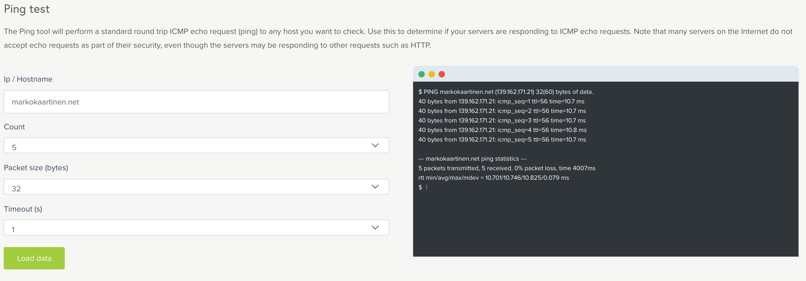
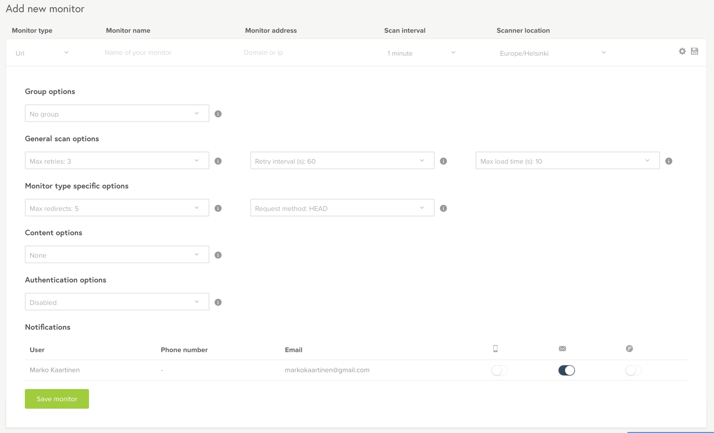
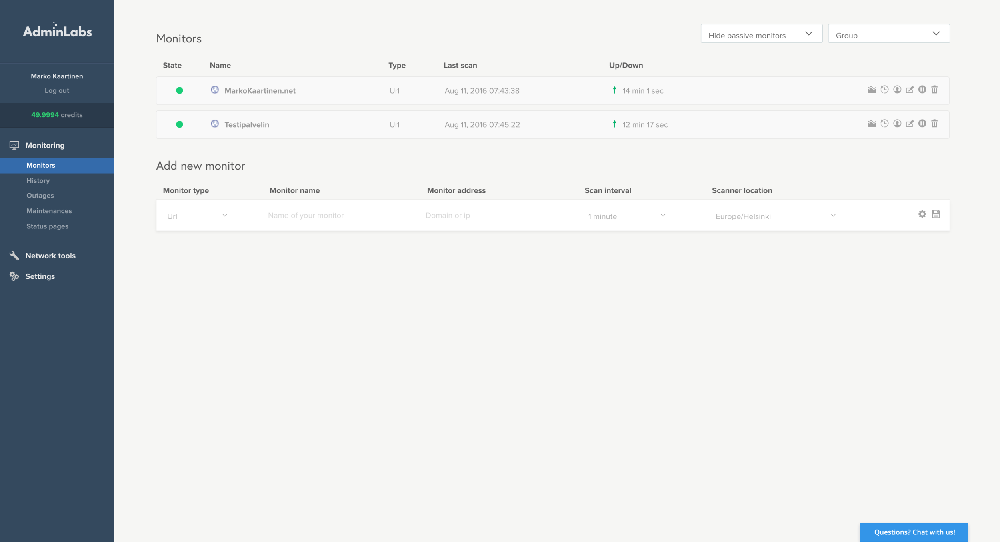
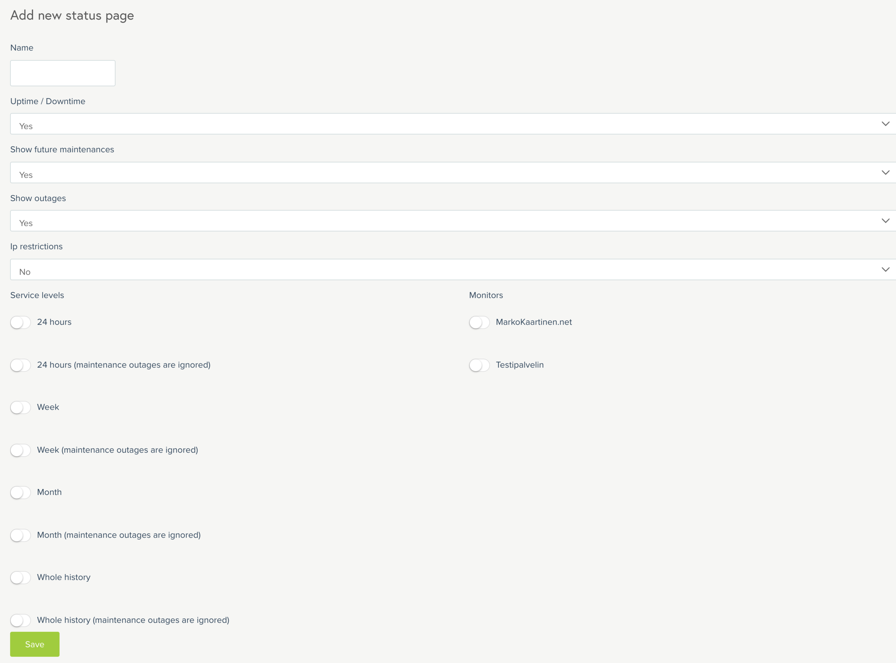
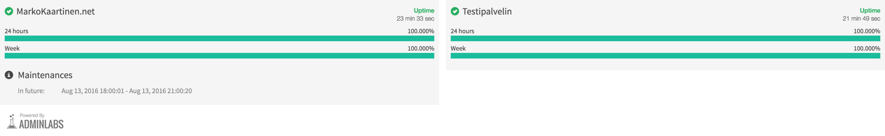
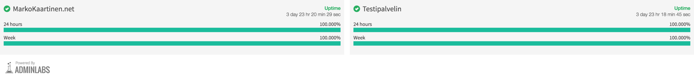
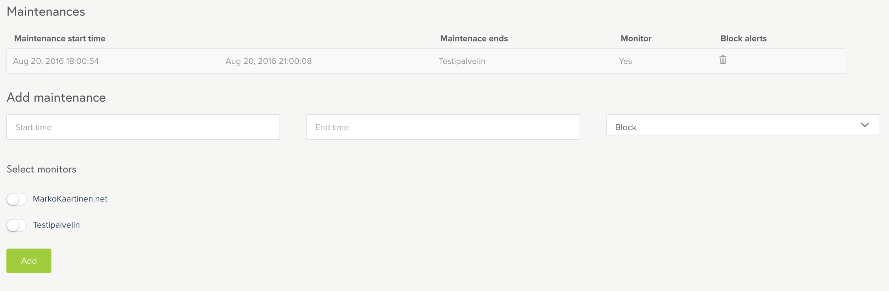
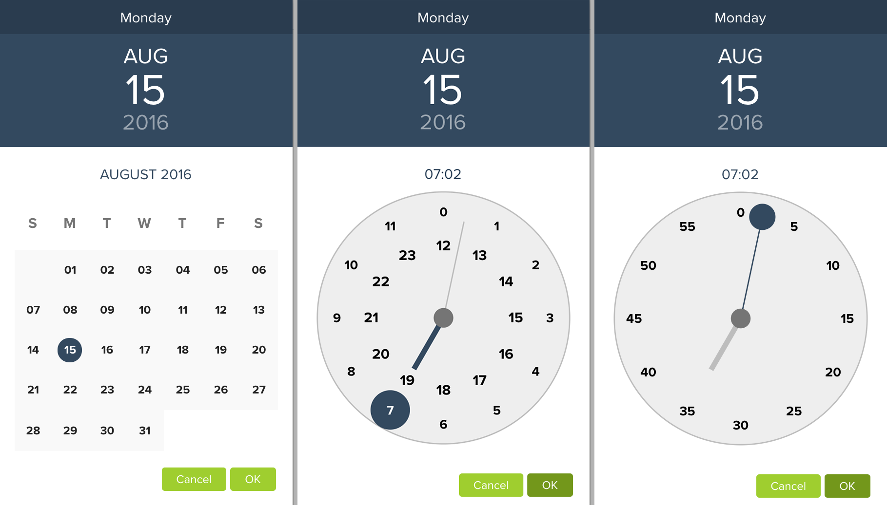
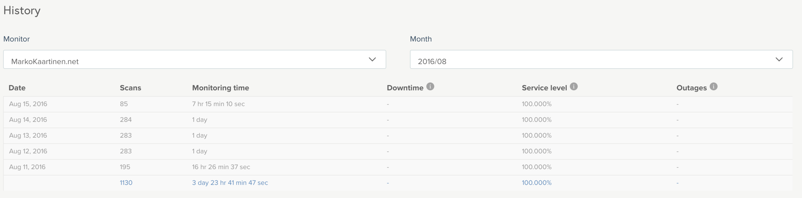

Minulle tarjottiin mahdollisuutta päästä kokeilemaan [AdminLabs](https://www.adminlabs.com) valvontatyökalua ja tietenkin suostuin siihen. AdminLabs on kaikessa yksinkertaisuudessaan työkalu verkkosivujen tai verkkopalveluiden valvontaan. Saat siis infoa siitä onko sivustosi/palvelusi pystyssä vai ei.

Testaankin tässä jutussa tuota työkalua ja kerron teille hieman omia kokemuksiani. Vaikka minulle annettiin krediittejä kokeilemista varten niin mielipiteet ja kokemukset ovat omiani.

## Verkkotyökalut

Hallinnan puolella lähdin ensin tutustumaan verkkotyökaluihin ja päätin tutkia monitorointia hieman sen jälkeen. Verkkotyökaluista löytyykin kattava valikoima erilaisia yksinkertaisia työkaluja joita kieltämättä itsekin tarvitsen silloin tällöin. Siellä saat pingattua osoitetta ja tarkistettua onko tietty portti auki vaiko ei. Saat myös kaiveltua tietoja domainin takaa kuten dns ja whois tietoja. Saat myös kaiveltua oman ip:n ja selaimen infojakin. Näiden työkalujen käyttö ei kuluta krediittejä eli niiden käyttäminen on ilmaista.

Alla vielä lista työkaluista mitä löytyy:

- Ping test
- Port check
- DNS lookup
- Whois lookup
- Reverse DNS lookup
- Show my IP
- Traceroute test
- Country by IP lookup
- Certificate information

## Monitorointi

Tämä on AdminLabsin tärkein osio ja palvelu. Voit luoda monitoroida urlia, pingiä tai sitten porttia, voit myös valita osoitteen mitä monitoroidaan, aikavälin milloin monitoroidaan sekä sijainnin mistä tutkitaan antamiasi tietoja. Yksinkertaisimmillaan et muuta infoa tarvitse ja saat sivusi seurantaan hyvinkin nopeasti. Alla vielä kuvankaappaus siitä mitä kaikkea lisäyksessä voisi laittaa.

Monitorin lisäyksen jälkeen AdminLabs hoitaa puolestasi ilmoitukset jos osoitteessa on ongelmia ja saat halutessasi ilmoituksen kännykkään, sähköpostiin tai sitten Pushover palvelun kautta. Alla onkin juuri lisäämäni monitorit parille eri palvelimelleni.

Voit hallita lisättyjä seurantoja helposti ja voit jopa poistaa ne halutessasi. Voit hallita samoja asioita mitä lisäyksessä syötit. Saat myös monitori kohtaista tilastoa skannauksista ja uptimestä. Voit myös lisätä muita käyttäjiä saamaan ilmoituksia jos sivusi on alhaalla.

### Tilasivu

Voit myös luoda simppelin tilasivun näytettäväksi esimerkiksi omilla kotisivuilla. Alle kaappasinkin kuvan siitä mitä kaikkea tilasivulla voi näyttää ja voipa sen rajoittaa näytettäväksi tietyillä ip-osoittellekkin.

Luomasi tilasivu näyttää sitten valinnoista riippuen esimerkiksi tältä:

Tässä vielä sama tilasivu sen jälkeen, kun palvelimet ovat pyörineet pari päivää ja tuo huoltoikkuna mennyt ohitse.

### Huollot

Voit lisätä huoltoikkunoita näytettäväksi mm. tilasivulla ja tämä vaikuttaa myös monitorointiin sillä voit asetuksista valita vaikuttaako katkos huoltoikkunan ajalla seurantaan. Nämä katkokset näkyy myös halutessasi tilasivulla.

Tämä on hyvin simppeli ja toimiva osa järjestelmää. Voit lisätä huoltoja näppärästi ja mikäli menee väärin niin poistaa sen. Ainoan nootin antaisin kuitenkin tuosta huollon alku- ja loppuajan lisäämisestä. Siinä tulee kiva työkalu, mutta se on hieman työläs lisätä sillä valitaan päivä, tunnit ja minuutit erikseen ja kaikki valinnat on ok painikkeen kautta. Itselle tuo oli hieman kömpelö tapa valita aika. Sekunnit se myös tuntuu ottavan jostain vaikka niitä ei valita ja niitä et saa muokattua – ihan sekunnin tarkkaa ei tosin ole, mutta jos ne näytetään hallinnassa niin pitäisi niitä voida muokatakin.

### Historia / katkokset

Pitäähän tietysti jonkinlaista tilastoakin saada ulos. Historia sivulta saat näppärästi listattuna päiväkohtaiset tiedot ja kuukausitasolla yhteenvedon skannauksien määrästä, monitoroidusta ajasta sekä palvelutasosta. Katkokset sivulla taas saisit infot katkoksista kuukausittain joko kaikista tai valitsemastasi monitorista.

## Lopuksi

Loppujen lopuksi AdminLabs on erittäin toimiva palvelu ja simppelin käyttöliittymän ansiosta sitä on helppo käyttää. Kerran kun olet monitoroinnin laittanut toimintaan niin sen voit periaatteessa unohtaa sillä saat ilmoitukset katkoksista haluamallasi tavalla sekä saat halutessasi sähköpostiisi päivittäisen raportin toiminnasta. Ainoa osa mitä pitää itse aktiivisesti päivittää on huoltojen hallinta, mutta nämäkin yleensä tiedetään reilusti etukäteen, jolloin ne voi rauhassa syöttää palveluun. Halutessasi saat tilasivun esim. iframella upotettua omille sivuille.

Lähtisin jo suosittelemaan tätä palvelua sekin takia, koska tämän takana on suomalaista porukkaa. Kerrassaan hyvää työtä ovat tehneet tämän palvelun suhteen. Tutustu AdminLabsiin tarkemmin heidän [verkkosivuillaan](https://www.adminlabs.com) ja voit muuten kokeilla sitä ilmaiseksikin!

*Tuttuun tapaan mikäli unohdin jotain tai haluat ilmaista oman mielipiteesi niin alhaalla on kommenttiloota.*
