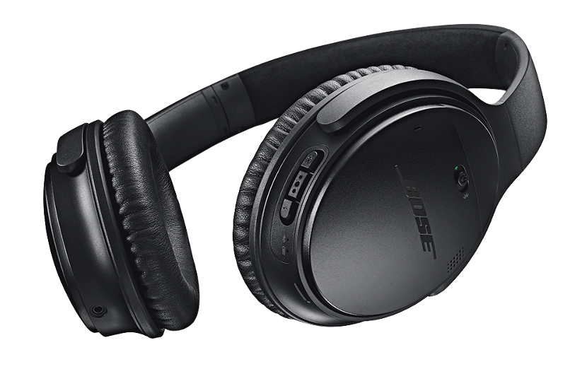

Sain ensimmäistä kertaa kokeiluun kuulokkeet ja lähdettiin heti vielä kovilla panoksilla liikenteeseen. Minuun otti yhteyttä Bosen Suomen PR toimisto ja kysyivät haluaisinko lähteä testaamaan Bose QC35 kuulokkeita ja voitte arvatakin vastaukseni. Bose QC 35 kuulokkeet ovat langattomat kuulokkeet, joissa on uusi lempiominaisuus nimittäin melunvaimennus! Välittömästi kun laitoin kuulokkeet päälle niin ero oli selkeä – ympärilläni oleva melu vain katosi.

Käyttöönotto oli helppoa sillä yhdistetään perinteisen  bluetooth laitteen tapaan puhelimeen ja jos haluat niin latailet vielä Bose Connect appsin, jolla voit hieman hallita kuulokkeita, mutta tarpeellinen se ei mielestäni ole. Olen käytellyt kuulokkeita lähinnä musiikin kuunteluun ja ne ovatkin olleet paritettuna puhelimeni kanssa.

Paketissa tuli mukana kuulokkeet, USB piuha (latausta varten MicroUSB päällä), äänijohto, lentokonesovitin sekä suojakotelo. Itse kuulokkeet ovat laadultaan hyvät vaikka ne ovatkin suhteellisen kevyet ja kompaktit kooltaan. Toki hintatasokin on sitä luokkaa, että laatua näiltä kuulokkeilta odotetaankin (430€). Omaan päähän kuulokkeet kävivät hyvin ja ne ei painaneet ja näitä pystyy pitämään pitempäänkin päälle – Suomen kesä ja korkea kosteusprosentti aiheuttaa hikoilua, mutta tästä ei pääse näillä keleillä mitenkään eroon. Kuulokkeissa on myös on/off kytkimen lisäksi painikkeita joilla voit äänenvoimakkuutta säätää ja tietenkin vaihtaa biisiä.

Toki voit kuunnella kuulokkeita myös johdollisesti mukana tulevalla johdolla ja tämä syökin vähemmän akkua. Itse en tätä mahdollisuutta käyttänyt sillä langattomuus on tätä päivää ja pidän langattomista kuulokkeista. Sivujen mukaan bluetoothilla päästään 20 tunnin kuunteluun ja johdolla 40 tunnin kuunteluun. Tätä en itse testannut sillä haluan, että omissa laitteissa on akkua sen verran, että ne ei lopu kesken käytön.

Miltä nämä sitten kuulostaa? Jos lyhyesti sanon niin hyvältä. En ole mitenkään ”kultakorva” ja minulla onkin vain 10 euron nappikuulokkeita ja vasta äskettäin hankin langattomat 60 euron kuulokkeet. Headset tyyppisiä kuulokkeita olen käyttänyt töissä ja sielläkin on halvat 20 euron kuulokkeet. Kyllähän nämä ne tietysti voittaa, mutta mitään ”vau” elämystä en näissä koe (paitsi melunvaimennus oli jo aika vau itselle) – tosin en oikein voi vertailla sillä ei ole toisia tämän hintaluokan kuulokkeita vertailukohteeksi. Olen kyllä erittäin tyytyväinen siihen miltä kuulokkeet minun korvaan kuulostaa ja sietääkin tällä rahalla olla hyvän kuuloista settiä.

Näissähän olisi myös mikrofoni puheluja varten, mutta sitä ominaisuutta en testannut – minulla onkin tätä varten oma handsfree jo olemassa ja haluan käyttää siihen tarkoitettua laitetta puhumiseen. Ei näitä taida olla suunnattukaan handsfreen korvaajaksi vaan aivan loistaviksi kuulokkeiksi musiikin kuunteluun ja median ahmimiseen.

Onhan nämä kuulokkeet hyvät – siitä en pääse mihinkään. Onhan nämä paremmat kuin yhdetkään kuulokkeet mitä itse tällä hetkellä omistan ja sietääkin olla sillä nämä on täysin eri hintaluokkaakin. Jo pelkästään melunvaimennus on ominaisuus mitä jään kaipaamaan langattomuuden lisäksi. Olisi hauska vertailla näitä johonkin vastaavaan kuulokepariin, mutta se ei ikävä kyllä ole nyt mahdollista. Harmi ettei testijaksoni sattunut minkään reissun ajaksi sillä lentokoneessa olisi melunvaimennus päässyt testiin.

Jos sinulla on rahaa pistää 430 euroa kuulokkeisiin ja haluat langattomat melunvaimennus ominaisuuksella olevat laadukkaat kuulokkeet niin anna palaa. Kyllä minä nämä ottaisin päivittäiseen käyttöön koska vaan!

Kuulokkeet toimitettiin maksutta kokeiltavaksi Bosen toimesta. Tutustu kuulokkeisiin [Bosen sivuilta](https://www.bose.fi/fi_fi/products/headphones/over_ear_headphones/quietcomfort-35-wireless.html).
