Huawei haki joku aika sitten betatestaajia heidän tulevalle tuotteelle ja itse olin yksi onnekas joka pääsikin testiohjelmaan mukaan. Minulle ei kerrottu mikä puhelin sieltä olisi tulossa vaan sain tietää sen, kun hain sen postista. Tuotteeksi paljastuikin Huawei Honor 8 puhelin. Honor 8 on jo julkaistu esimerkiksi USA:ssa, joten Youtubesta löytyykin jo unboxausta tästä laitteesta. En kokenut sen tekemistä tarpeelliseksi ja annammekin tässä blogissa kunnian UnboxTherapylle.



## Ensivaikutelmat

Honor 8 tuntui todella hyvälle kädessä ja vaikka siinä onkin 5.2″ näyttö niin se ei tuntunut isolta. Honor 8 tuntui todella laadukkaalta ja arvokkaalta puhelimelta – onhan etu- ja takakansi tosiaan lasia ja sivuilla onkin sitten alumiinia. Kyseessä on siis erittäin tyylikäs puhelin ja oma sininen Honor 8 onkin todella hyvännäköinen.

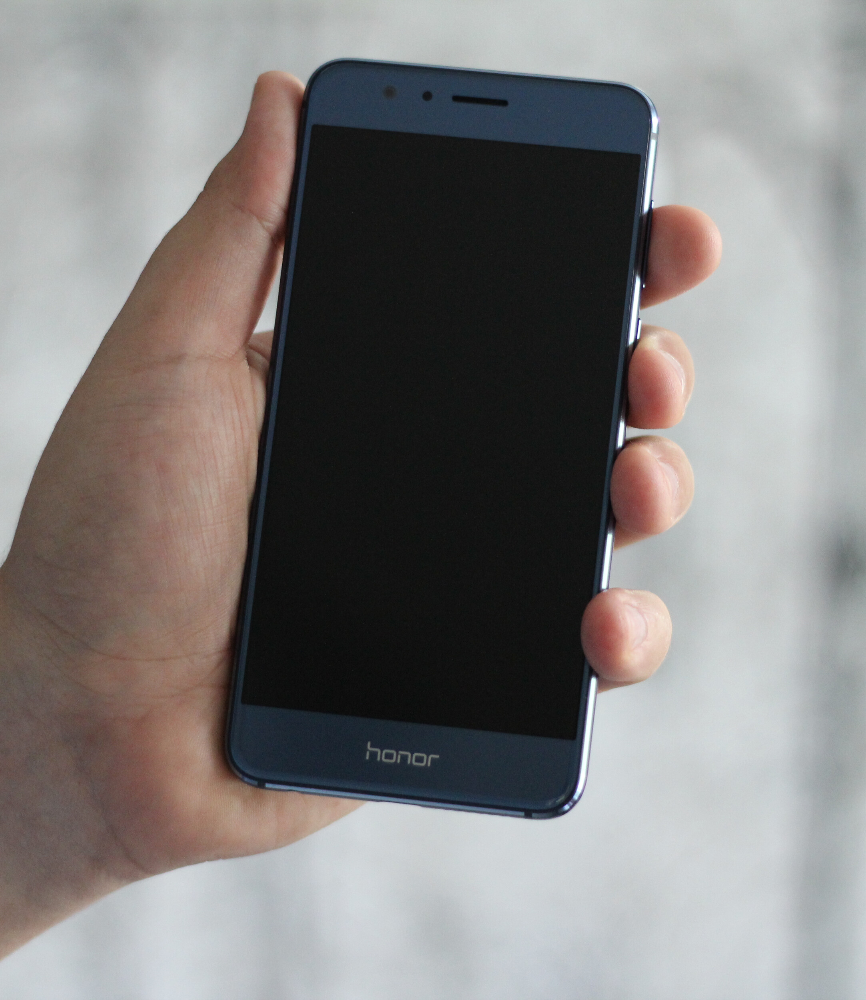

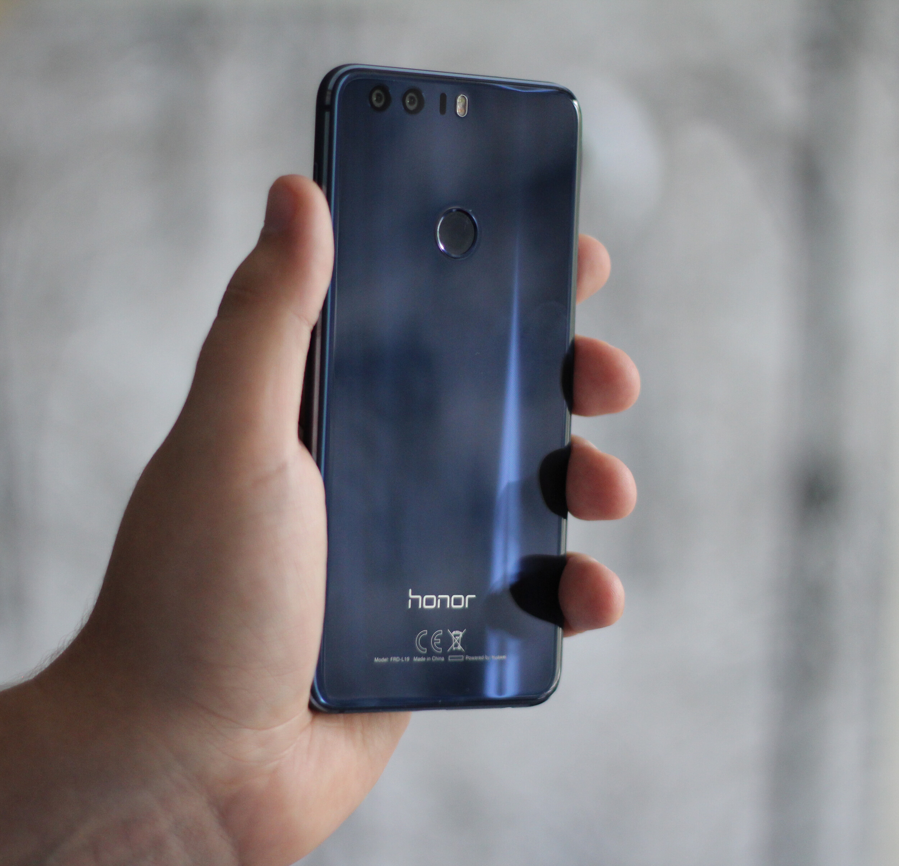

Ulkonäkö sikseen, siirrytään käyttöönottoon. Se oli yksinkertaista kuten kaikissa Androideissa tänä päivänä. Syötetään omat infot sisään ja sitten asennat tarvittavat sovellukset. Ainut ero perus Androidiin on oikeastaan Huawein oma Emotion UI josta sanon pari sanaa hieman myöhemmin.

## Tekniset tiedot

Prosessorina on tässä puhelimessa kahdeksan ytiminen Hisilicon Kirin 950 (4\*Cortex A72 2.3GHz + 4\*Cortex A53 1.8GHz + i5 co-processor). Muistia puhelimessa on 4 gigatavua ja sisäistä tallennustilaa on joko 32 tai 64 gigatavua (mallista riippuen). Näyttönä olikin jo mainittu 5.2 tuuman ja resoluution on 1080x1920px (423 PPI). Kokoa Honor 8:lla on seuraavasti: 145.5 mm (Korkeus) x71.0 mm (Leveys) x7.45 mm (Paksuus).

Kameroita puhelimessa on kaksi 12 megapikselin kameraa toinen värillinen ja toinen monochrome kamera. Etukamera on 8 megapikselin kamera. MicroSD kortilla lisää tallennustilaa saa 128 gigatavuun asti. Akussa on virtaa 3000 mAh. Puhelimessa on myös sormenjälkitunnistus, NFC, 4G, Bluetooth, Infrapuna, Wifi ja muuta peruskauraa mitä tänä päivänä puhelimelta voikin odottaa.

Tarkat speksit saa Huawein omilta [sivuilta](https://store.hihonor.com/us/honor-8/specification).

## Emotion UI

Tämä on itselleni ehkä se oudoin asia tässä puhelimessa sillä Emotion UI on Huawein oma käyttöliittymä ja sitä onkin omasta mielestäni aika rankalla kädellä kustomoitu heidän haluamakseen. Tätä voisi ehkä sanoa jopa iPhonemaiseksi käyttöliittymäksi.

Ensimmäinen asia minkä huomasin on se, että tässä ei ole app draweria ollenkaan vaan ohjelmat menee suoraan eri ikkunoihin ja toki ne voit jemmata kansioihin kuten iPhonessa. Itse pitäisin app drawerista sillä haluan vain eniten käytetyt ohjelmat näytölle ja sitten muut löytää sieltä. Harmi ettei tässä ole sitä edes vaihtoehtona. Toki voin launcherin vaihtaa esimerkiksi Nova Launcheriin, mutta olen halunnut testata tuota Emotion UI:ta.

Itse käyttöliittymä on kyllä toimiva ja sen kanssa ei ole kyllä ongelmia ollut. Teemojakin saa vaihdettua mielensä mukaan, mutta itse olen ollut tylsä ja halunnut pitää käyttöliittymäni suhteellisen puhtaana. Olen kyllä pitänyt tuosta käyttöliittymästä jos ei oteta app drawerin puutetta huomioon. Jos jollain on hihassaan vinkkejä Emotion UI:n käyttöön niin niitä saa laitella kommenttiboxiin!

Alle olen kasannut kuvia Emotion UI:sta.


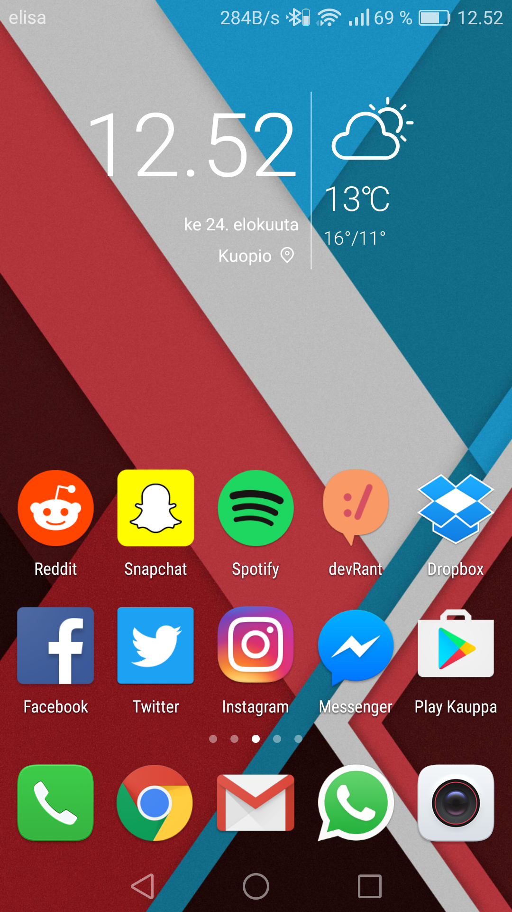
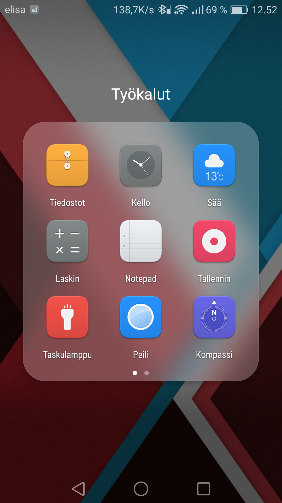
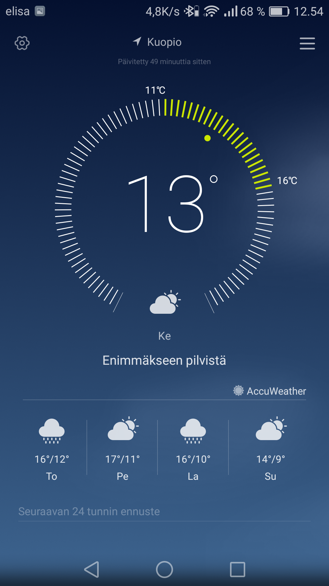
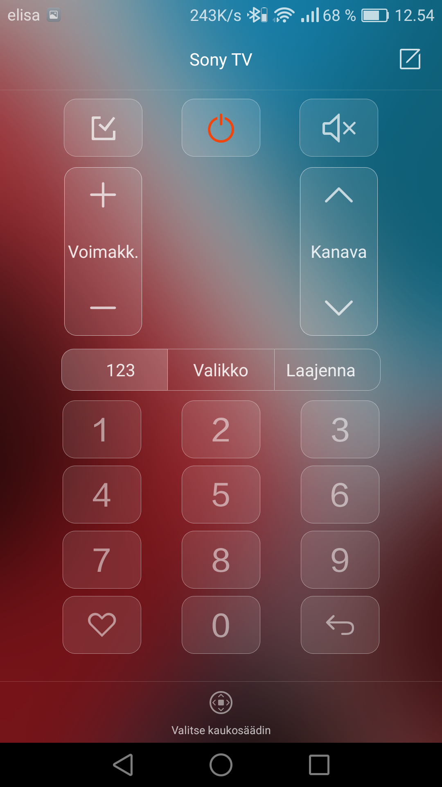
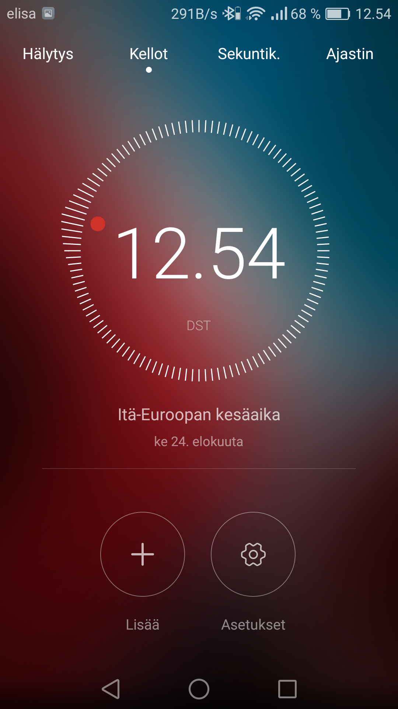
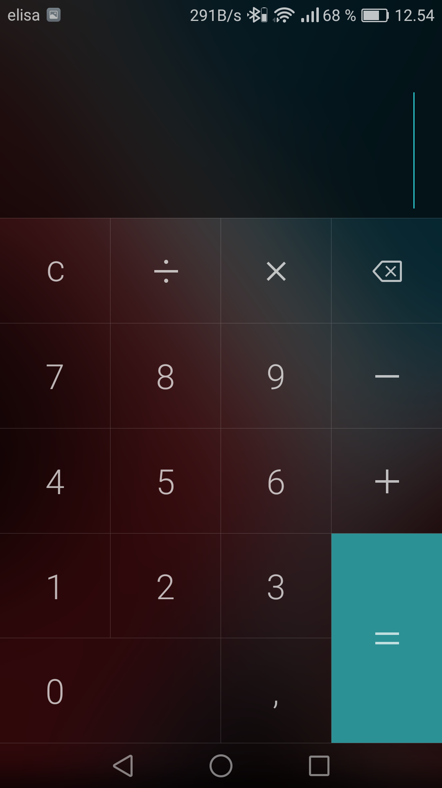
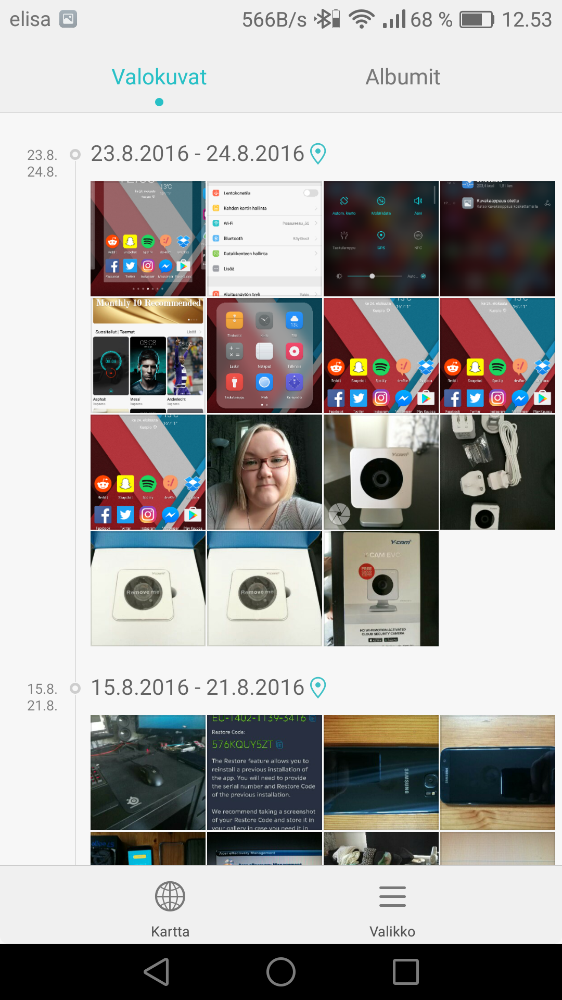
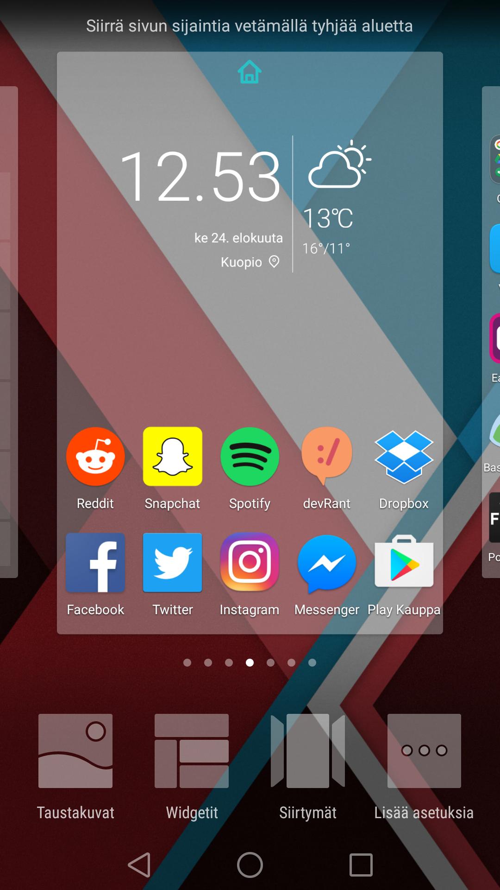
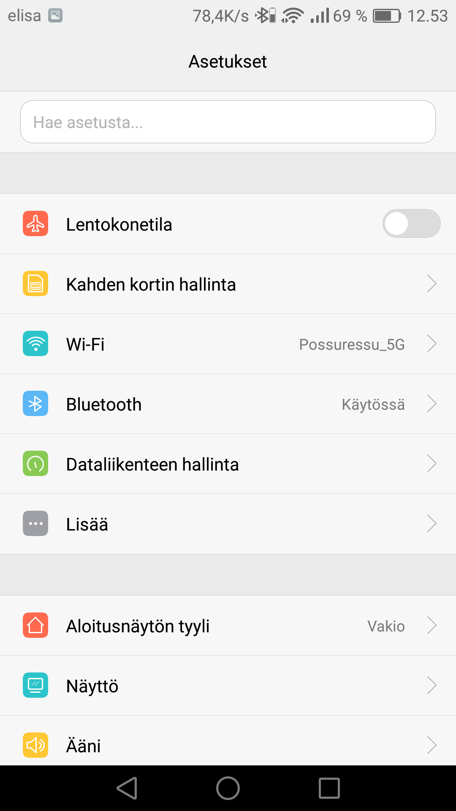
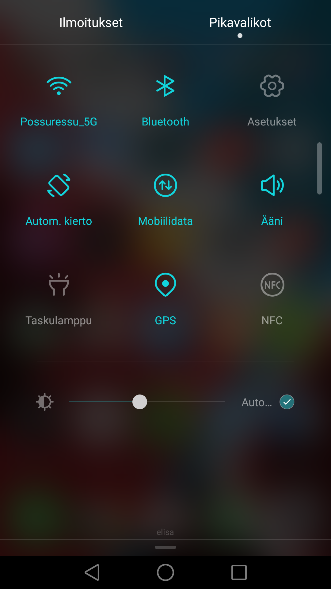
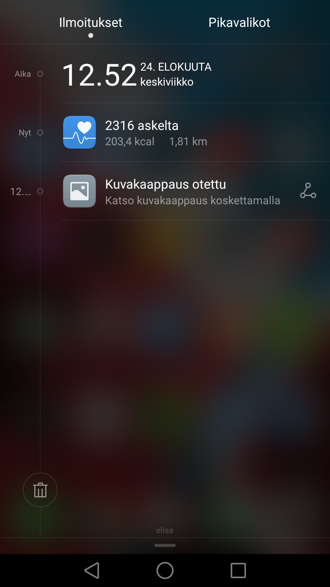
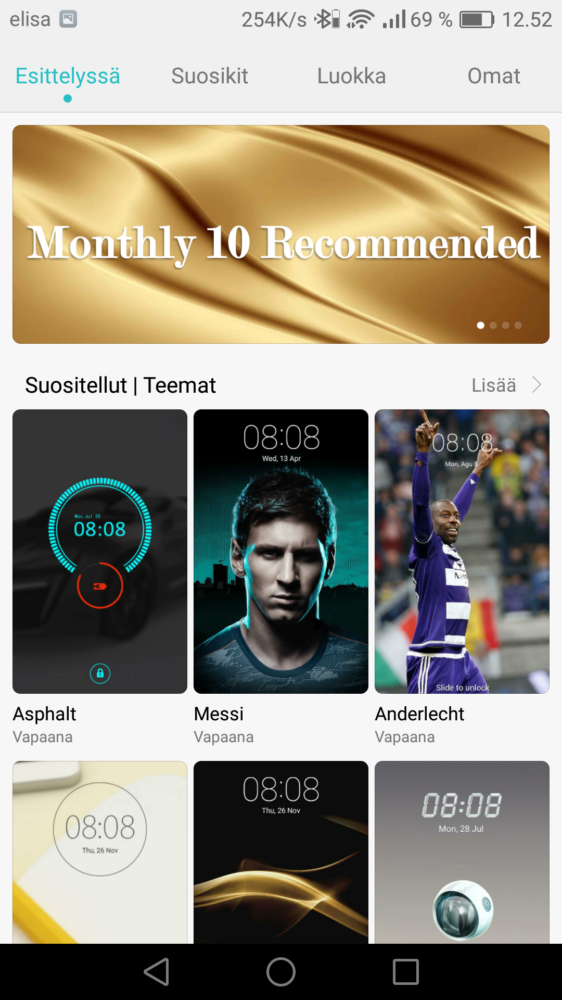


## Kamera

Kamera on tässä mielestäni yksi erikoisuus sillä tässä on tosiaan kaksi kameraa ja toinen ottaa väriä ja toinen sitten monochrome kuvaa ja siitä kombona tuleekin mitä mainioin kuva tässä hintaluokassa. Kameraa minun pitää vielä enemmän testata ja käyttää – tätä tulee käytettyä varmaan reissussa sitten enemmän ihan lomakuviinkin. Alla kuitenkin yksi kuva kissasta ja yksi kuva arvostelussa olevasta kamerasta. Molemmat kuvat on suoraan kamerasta ja ilman mitään käsittelyä. Etukamerassa on jonkin sortin beauty modekin, josta avopuoliso innostuikin ja onkin pari selfietä napannut sen avulla.

Kamerassa on noita eri tiloja useita ja itse olenkin ottanut sen kannan puhelimella kuvaamiseen, että automaatti tila saa tehdä enimmän työn ja miten hyvin se hoitaa hommansa kertoo enemmän peruskäyttäjälle suunnatusta kamerasta, kuin se miten hyvä pro mode on. Honor 8:ssa on myös pro mode ja sillä saakin säädettyä vaikka sun mitä. Haluan kuitenkin keskittyä enemmän siihen, että saan hyvän kuvan helposti ja tämä on peruskäyttäjällekin se tärkein asia. Kamerasta voin kertoa lisää kunhan olen testaillut sitä ja Kreikassa sitä tulee käytettyä enemmän.


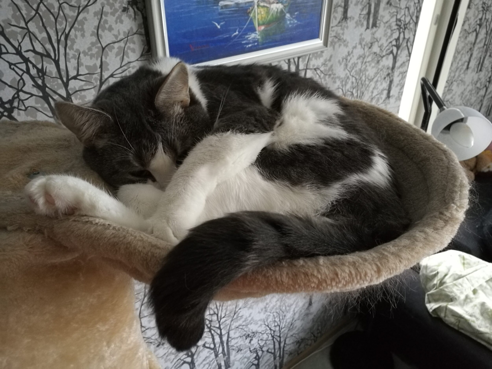
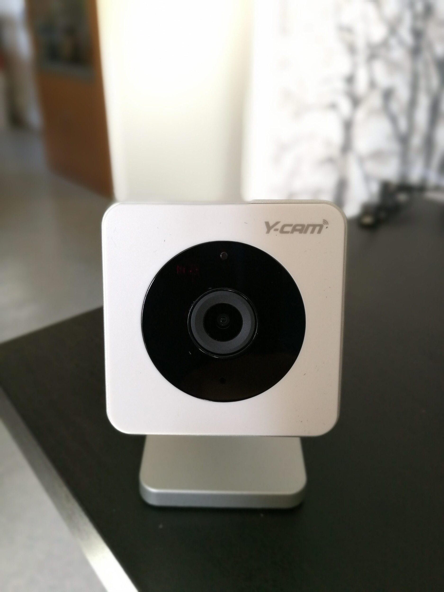


Kunnes itse käytän tuota kameraa enemmän ja ihmettelen sitä lomallani lomakuvien ottoon niin laitetaan jakoon Pocketnown arvostelu kamerasta.



## Käyttökokemuksia

Sormenjälkitunnistin on tässä puhelimessa mitä mainioin ja todella nopea. Voisinpa sanoa, että Honor 8 sormenjälkitunnistin on parempi, kuin S7 Edgessä oleva. Ainut ongelma mihin törmäsin on sen sijainti. Jos puhelin on pöydällä niin sormenjälkitunnistimeen päästäksesi pitää puhelin nostaa sillä se sijaitsee puhelimen takaosassa. Normaalissa käytössä tämä toimii hyvin sillä etusormella olen saanut luontevasti puhelimen avattua.

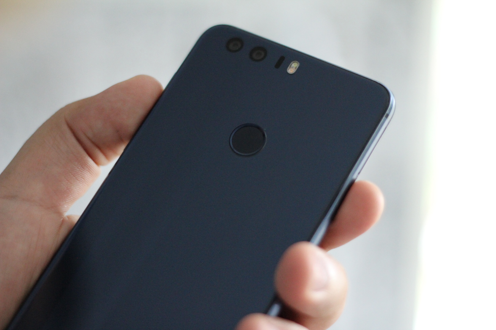

Näyttö on fullhd laatuinen ja se onkin passelin kokoinen kooltaankin. Harmillisesti kyse ei ole Amoled näytöstä sillä auringossa siitä ei näe niin hyvin kuin S7 edgen Amoled näytöstä. Muuten näyttö on ollut minun silmään mainio ja toiminut hyvin. Automaattinen kirkkaudensäätö tekee joskus omituisia kirkkaus ratkaisuja, mutta sitä voi itsekin säätää halutessaan.

Mennään vielä takaisin muotoiluun. Sanoinkin, että tämä tuntuu todella laadukkaalle kädessä ja näyttää aivan mahtavalta. Yksi ongelma tässä lasissa kuitenkin on – se on pirun liukas. Se ei kädessä ole niin liukas kuin S7, mutta pöydällä se on todella liukas. Sitä voi huoletta tasaisella pinnalla pyöritellä ympäri sillä se liukuu. Olenkin aikeissa ostaa tälle puhelimelle jonkinlaisen suojan kunhan niitä kauppoihin tulee. Samoin tuo lasi kerää sormenjälkiä ja oikein vetää niitä puoleensa – tämä on tosin ollut ongelmana muissakin puhelimissa.

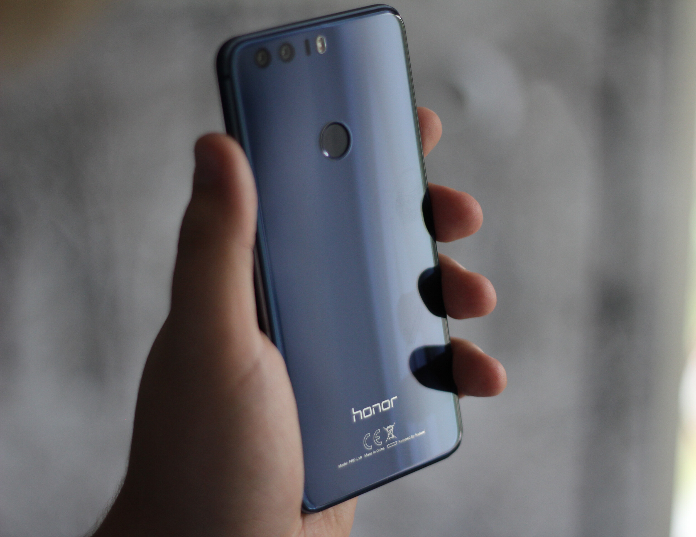

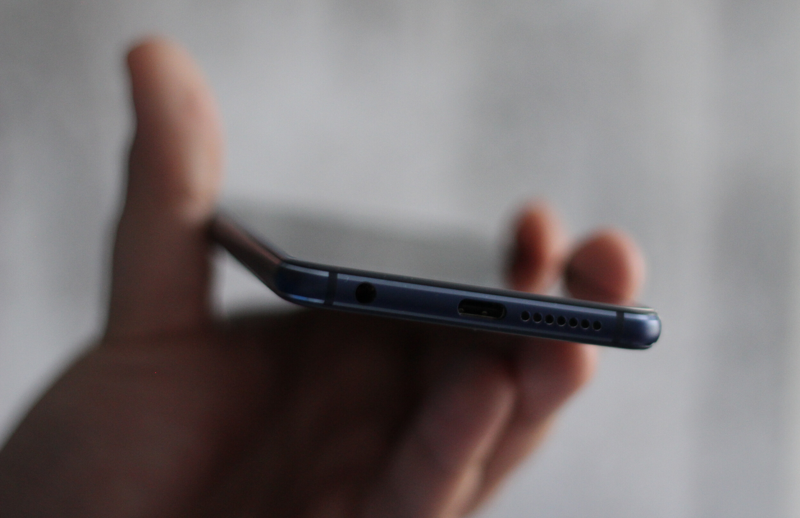

Akku on minun käytössä kestänyt päivän ja kestäisi varmaan parikin päivää jos en räpeltäisi ja pelaisi tällä niin paljoa kuin olen nyt parin viikon aikana räpeltänyt. Tämä uutuuden viehätys on vielä voimissaan. Tein kuitenkin pienen testin yksi maanantai ja pyrin välttämään turhaa räpeltämistä (en ihan onnistunut siinä). Aamulla 6 puhelin pois laturista ja illalla 9 takaisin – akkua oli jäljellä 49%.  Riippuen päivittäisestä käytöstä voisi tällä saada sen pari päivää irti, mutta itse olen tyytyväinen puhelimeen jos sen akku toimii koko päivän ilman ongelmia – yöllä lataan puhelinta muutenkin.

Mikäli akku tuppaisi loppumaan kesken päivää niin matkassa tuli myös pikalaturi, jolla saisi nopeasti virtaa lisää. Itselle pientä hankaluutta on lataamiseen tuonut uusi USB-C portti sillä piuhoja ei itsellä ennestään ollut tälle vaan olen pärjännyt toistaiseksi mukana tulleella piuhalla. Tilasin kuitenkin toisen piuhan, jotta kotona olisi yksi ja töissä sitten yksi piuha.

## Lopuksi

Olen kyllä erittäin positiivisesti yllättynyt tästä puhelimesta. Olen satunnaisesti käyttänyt Honor 7 puhelinta, koska äidilläni on se puhelin ja tämä tuntuukin kyllä todella hyvältä puhelimelta. Näillä ominaisuuksilla oleva puhelin on kyllä toimiva paketti ja tässä hintaluokassa ei ollenkaan huono valinta puhelimeksi. Puhelimen tuntu on kuin kalliimpaa puhelinta käyttäisi ja se on täysin tuon lasin ansiota.

Puhelin lähtee vielä parin viikon reissuun Kreikkaan ja on muutenkin täysipäiväisessä käytössäni parisen viikkoa ja tulee olemaan vielä ainakin kuukauden käytössäni. Tämä on kyllä vastannut hyvin omia tarpeitani ja se on pärjännyt itsellä niin vapaa-ajalla kuin työssäkin!

Honor 8 on tullut saataville Suomessa tänään 25.8. ja 32 gigainen malli maksaa 449 euroa ja 64 gigainen malli maksaa 499 euroa. Itse suosittelen tuota sinistä väriä sillä se on vaan niin mahtava. Saatavina on myös musta, kultainen ja valkoinen Honor 8. 64 gigainen Honor 8 taitaa olla Limited Edition ainakin Elisan ja Verkkokauppa.comin sivujen mukaan.

**Mikäli sinulla on kysyttävää puhelimesta niin nyt kannattaa kysyä sillä puhelin on itselläni vielä käytössä ja tämmöistä mahdollisuutta ei itselle usein tule!** Unohdin todennäköisesti kirjoitella jostain asiasta ja tästä voikin tulla lisää kirjoituksia vielä. Voit lukea lisää Honor 8 puhelimesta Huawein [Suomen](http://www.hihonor.com/fi) tai [USA:n](https://store.hihonor.com/us/honor-8) sivuilta.

**[Katso myös Huawei Honor 8 otettuja kuvia! Klik.](/2016/huawei-honor-8-kameralla-otettuja-kuvia)**

*Puhelin on saatu beta testaukseen Huaweilta ja mielipiteet tässä kirjoituksessa ovat täysin omia.*


