Tällä kertaa sainkin ihan jotain muuta kokeiluun. Minuun otettiin yhteyttä ja kyseltiin haluaisinko lähteä kokeilemaan NZXT HUE+ valaistusjärjestelmää tietokoneeseen. No kappas kun kävi kivasti sillä minulla on kopassa kurkistusaukko kyljessä joten miksikäs en lähtisi kokeilemaan tätä.

Oma koneenihan ei ole mitenkään visuaalisesti näyttävä kapistus ja on siinä elämän jälkiä tullut koteloon niin muuton ja muun elämisen myötä. Koppahan on jo useita vuosia vanha joten mitenkään hienoa kaapelointijärjestelmää siellä ei ole kuten nykyisissä kopissa on. Näette kohta puoliin millaiset valot se sentään sai sisäänsä!

## Ensivaikutelmat

HUE+ tulee näppärässä paketissa ja sen sisältä löytyyin alla olevassa kuvassa olevat asiat eli ohjeet, 4kpl ledinauhoja, HUE+, nippusiteitä, ruuveja, molex adapteri virtaa varten, usb johto emolevyyn sekä erinäköisiä johtoja ledinauhojen ketjuttamiseen ja kiinnittämiseen HUE+ moduuliin. Ohjeet on tietty hyvä vilasita läpi sillä siellä kerrotaan mitenkä päin nämä johdot tulee kytkeä ledinauhoihin, jotta homma pelittää oikein ja mikään ei hajoa.

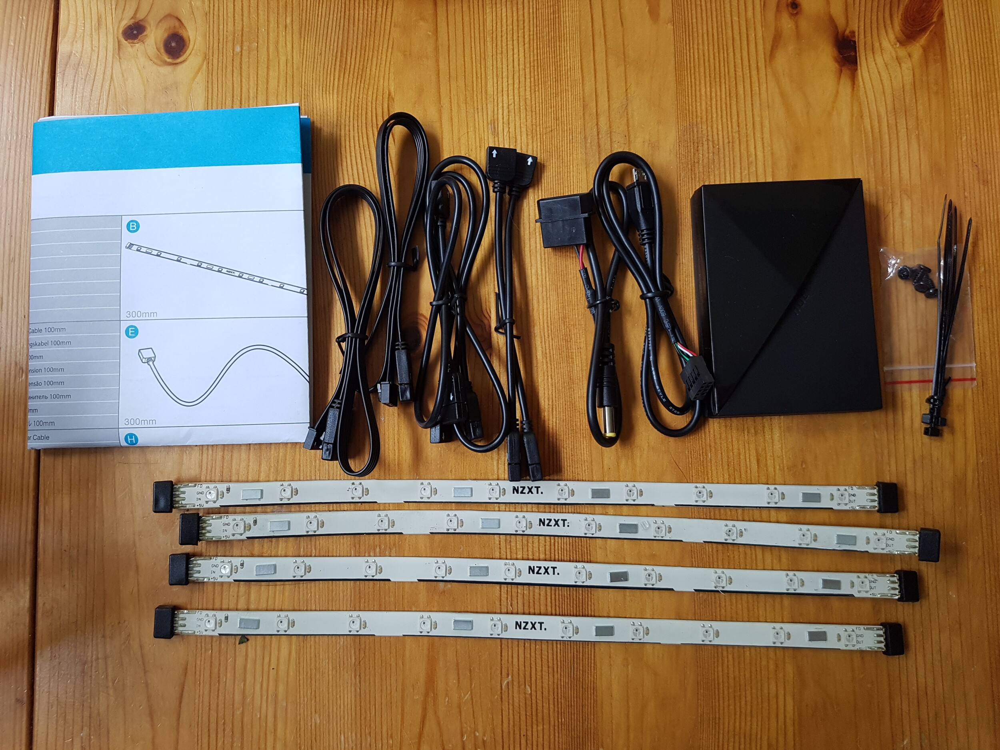

Virran HUE+ saa siis Molex liitännästä eli omassa tapauksessa pitää laittaa modulaariseen poweriini yksi kipale johtoja lisää, jotta saan molex virtaliitännän tälle. Emolevyn USB 2.0 pinnehin taas voi laittaa suoraan tämän kiinni mukana tulevalla MicroUSB piuhalla ja tämä onkin näppärä ratkaisu niin ei mene tietokoneen USB porttia siihen.

Itse led nauhat ovat muuten magneettisia joten pysyvää kiinnitystä ei tarvitse teipillä välttämättä tehdä. Toki tuolla pohjassa on teippikin valmiina ja silläkin sen saisi kiinni. Neljällä led nauhalla saa kyllä kivasti valoa aikaiseksi koppaan!

HUE+ moduulissa onkin suht simppelit liitännät. Siihen tarvitsee kytkeä USB ja virtapiuhan lisäksi led nauhoihin menevä johto. Matkassa tulee kaksi näitä piuhoja eli voit pistää 2+2 led nauhaa liitäntään 1 ja 2 tai sitten vaikka 4 nauhaa ketjuttaa yhteen liitäntään kuten itse ajattelin tehdä.

Nyt kun paketti on saatu auki ja tutkittu mitä siellä oikein olikaan niin siirrytään asennukseen.

## Asennus

Asennus oli hyvinkin simppeli operaatio omalla kohdallani. Tuo kopan ikkuna kun on vain puolet kopasta niin päätin laittaa valoja alareunaan, vasemmalle sekä yläreunaan. Näin saadaan tuo ikkuna kokonaisuudessaan kivasti valaistua. En tarvinnut noita jatkokaapeleitakaan vaan ketjutin ledinauhat suoraan toisiinsa ja kytkin ne yhdellä piuhalla tuohon HUE+ moduuliin. Moduulista sitten lähti johto USB 2.0 pinneihin emolevylle ja molex liittimeen.

Uskon, että asennuksesta selviää kuka tahansa joka osaa lukea emolevyn manuaalista missä USB 2.0 pinnit on ja tietää millainen molex liitin on. Eli tarvitaan perustietämys tietokoneen kasaamisesta. Näiden jälkeen päätin laittaa pelkillä magneeteilla tämän kiinni eli teippejä en käyttänyt tällä kertaa ollenkaan sillä en tiedä kauanko tämä koppa tulee minulla olemaan.

Kannattaa lukea ohjeista miten nämä tulee kytkeä varsinkin jos käyttää jatkokaapeleita. Muuten erittäin helppo ja yksinkertainen asennus.

## CAM sovellus

Tätä koko palettiahan hallitaan [CAM nimisellä sovelluksella](https://camwebapp.com/) ja sepäs onkin täysin ilmainen softa. Latailin sen ja kappas kun siinä on paljon muutakin, kuin pelkästään HUE+ säätäminen. Tällä voi nimittäin säätää myös heidän muita tuotteitakin. Keskityin itse tässä sovelluksessa kolmeen välilehteen: dashboard, build ja HUE+ sillä ne minua eniten kiinnosta. Peleihin tässä saisi myös overlayn jossa näkisi FPS:n yms. infoa.

Dashboard välilehdellä näet koneesi yleisen tilan kuten lämpötilat, loadit, muistin käytön sekä kiintolevyn käytön. Kaikki kivalla UI:lla ja yhdellä silmäyksellä. Build välilehdellä taas on näkyvillä hieman tarkempaa infoa koneestasi kuten prosessorin, näytönohjaimen, emolevyn, muistin ja kiintolevyjen tarkemmat tiedot.


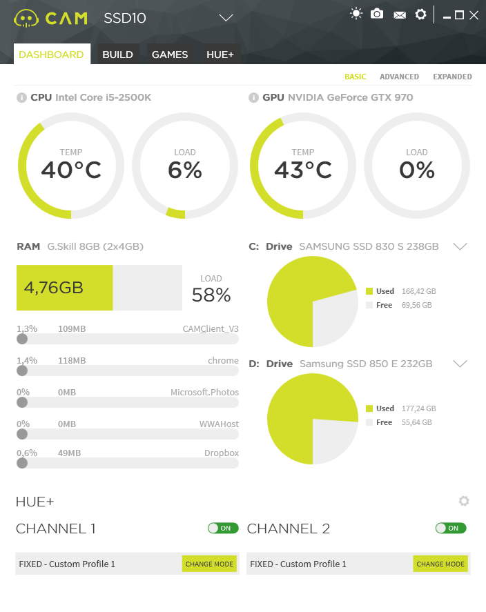
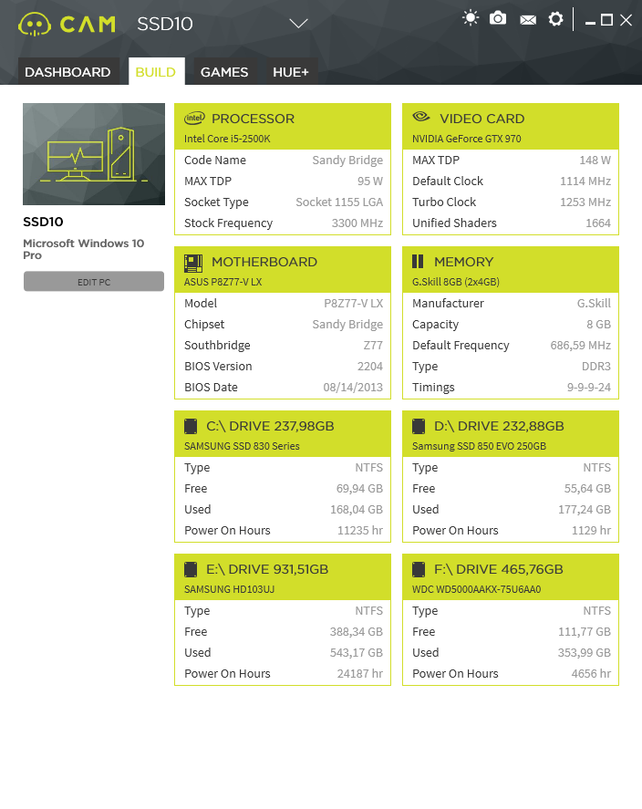


Sitten itse HUE+ välilehdelle jossa onkin sitten kaikki valojen hallinta. Voit hallita valoja aivan älyttömän paljon ja värejäkin on vaikka mistä valita. Erilaisia valotyylejä on 9 kappaletta ja niitten kaikki värit ja nopeudet saat itse säätää. Voit jopa säätää valot toimimaan niin, että väri vaihtuu näytönohjaimen tai prosessorin lämpötilan mukaan – tai vaikkapa FPS:n mukaan.


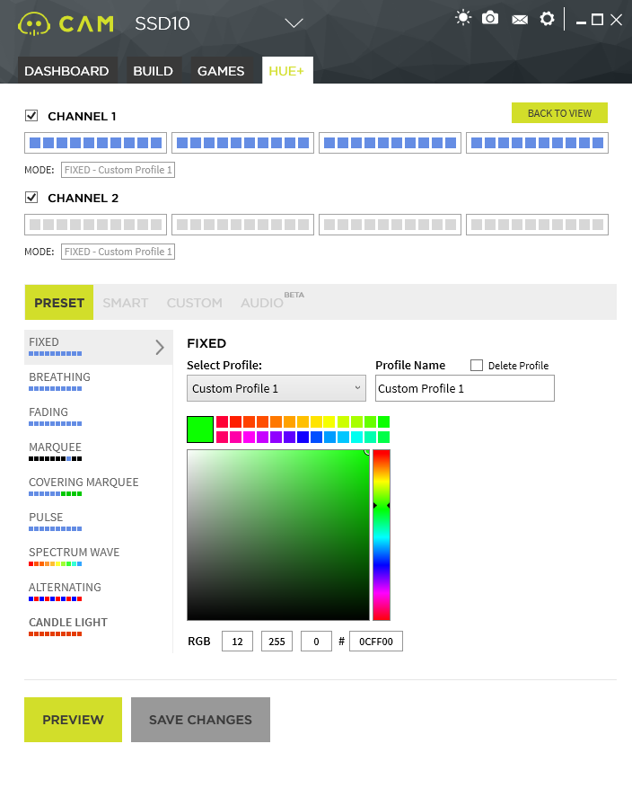
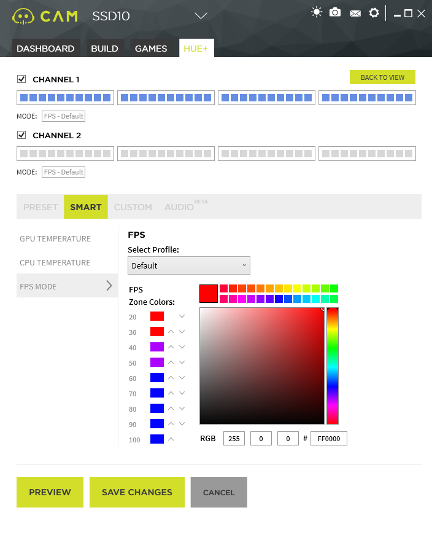
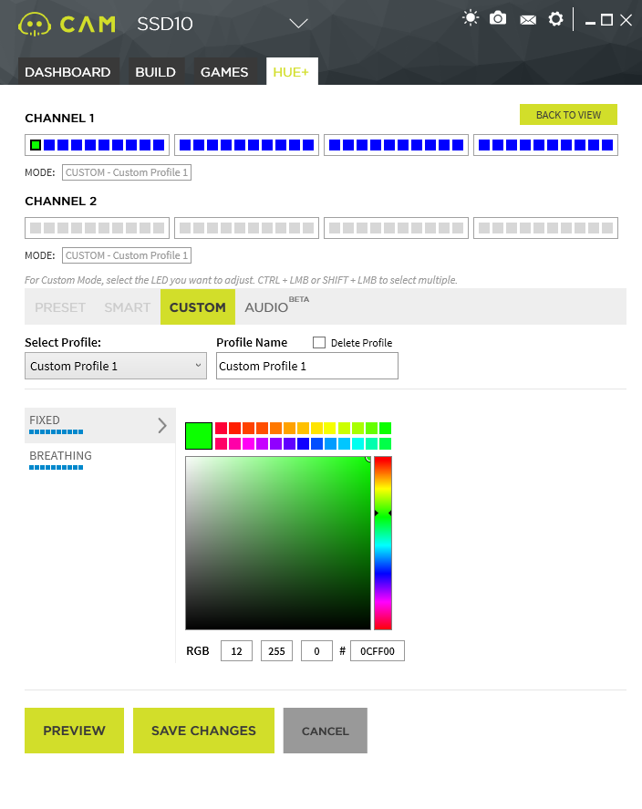
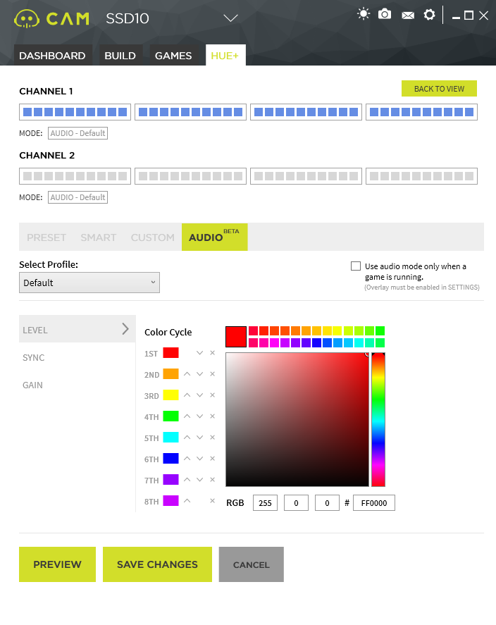


Kyseessä on todella kattava sovellus valojen säätämiseen eli tälläkin puolen on tehty todella hyvää työtä.

## Lopuksi

Otetaan ihan ensin miltä se koppa näytti ennen valojen lisäämistä.

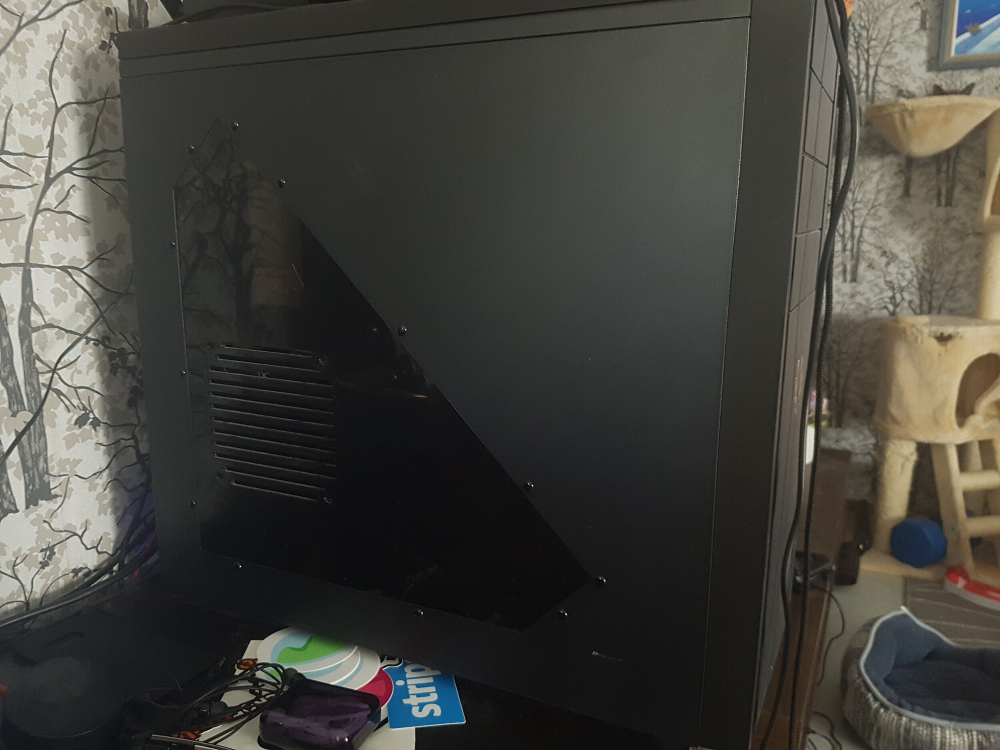

Ja alla onkin sitten pari kuvaa miltä se näytti valojen jälkeen parilla eri asetuksella.


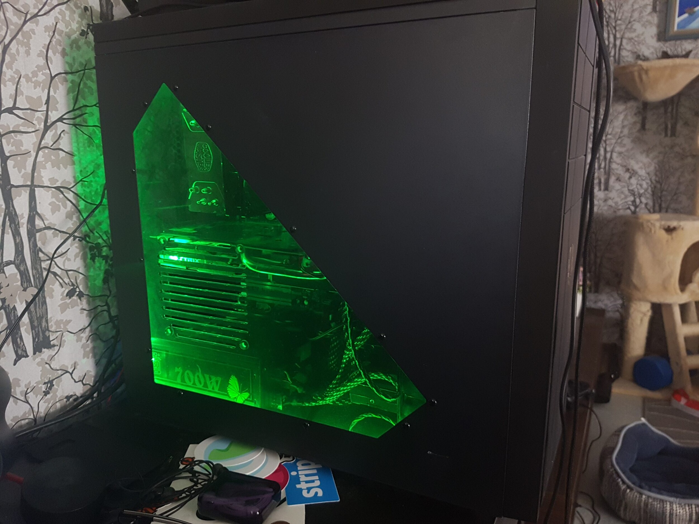
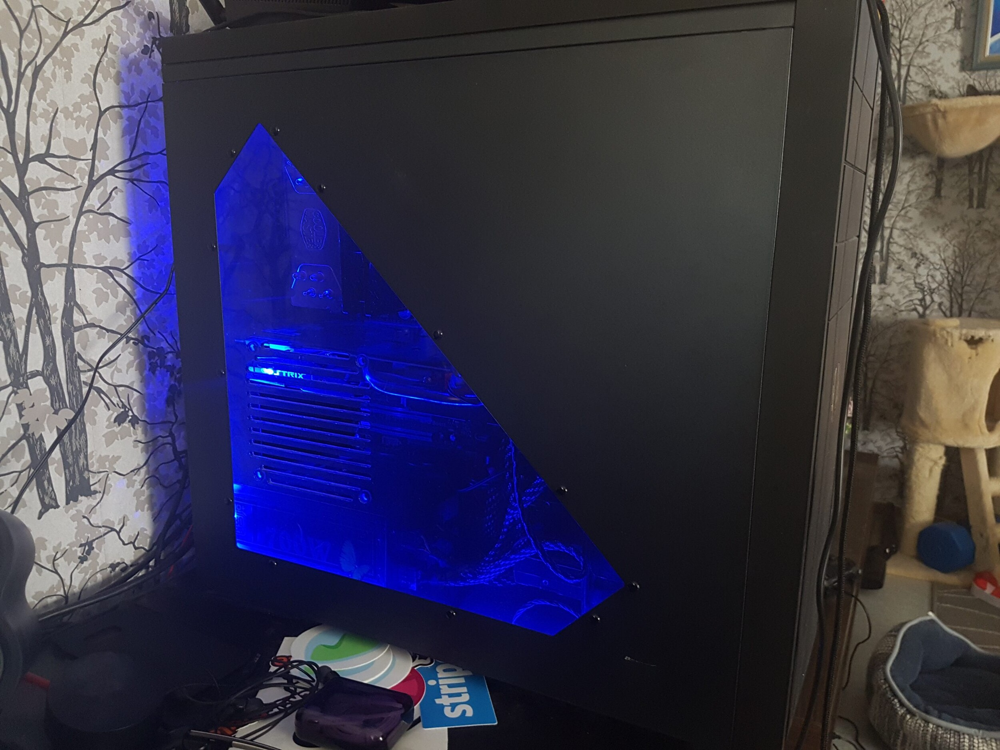
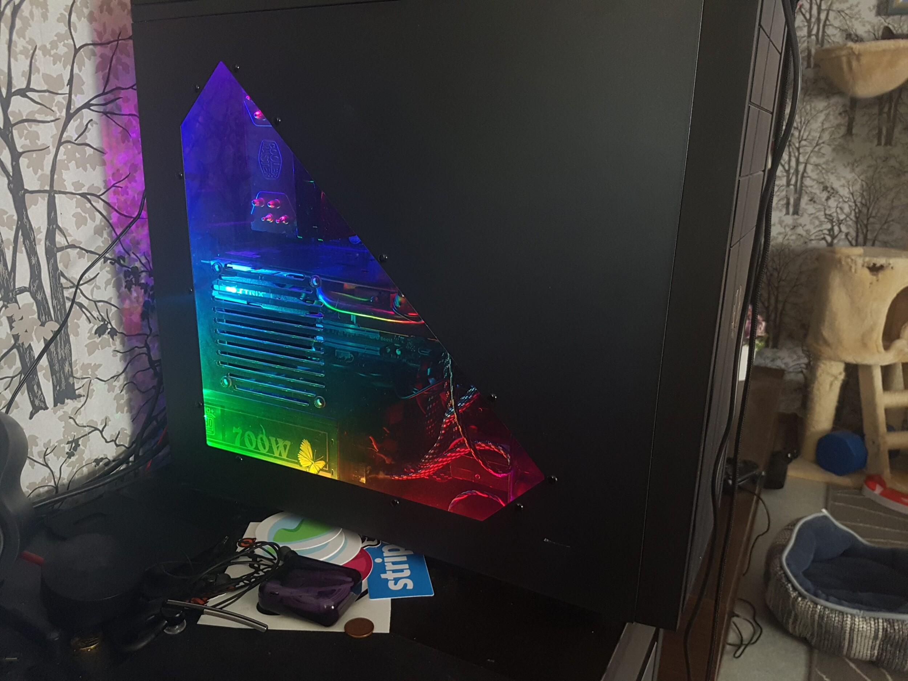
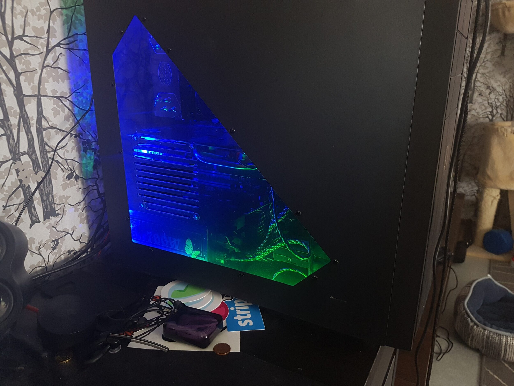


Laitoin myös Instagrammiin hieman videota eri valomoodeista ja alla onkin linkattuna se.

https://www.instagram.com/p/BFWlF_ezNC3/

Varmasti saat ainakin valojen värit kohdilleen jos jotkin. On niitä vaihtoehtoja sen verta paljon. On tuo koppa minulla kauan ollut ja nyt tuo sivupaneelin pleksi sai vasta tarkoituksen. Joskus olen pyöritellyt siinä led tuuletinta, mutta sekin jäi pois kun laakerit meni siitä aikoinaan. Tulen noita ledejä pitämään tässä kopassa ja aika varmasti seuraavaankin koppaan ne jotenkin laittamaan.

Kaiken kaikkiaan NZXT HUE+ on kerrassaan mainio tuote ja sen saa asennettua ja toimintaan todella helposti. Mikäli sinulla on yhtään haluja laittaa ledejä koneeseen niin tämä on kyllä hyvä setti minun testailujeni perusteella.

Linkki HUE+ kotisivuille: <https://www.nzxt.com/products/HUE-Plus>
