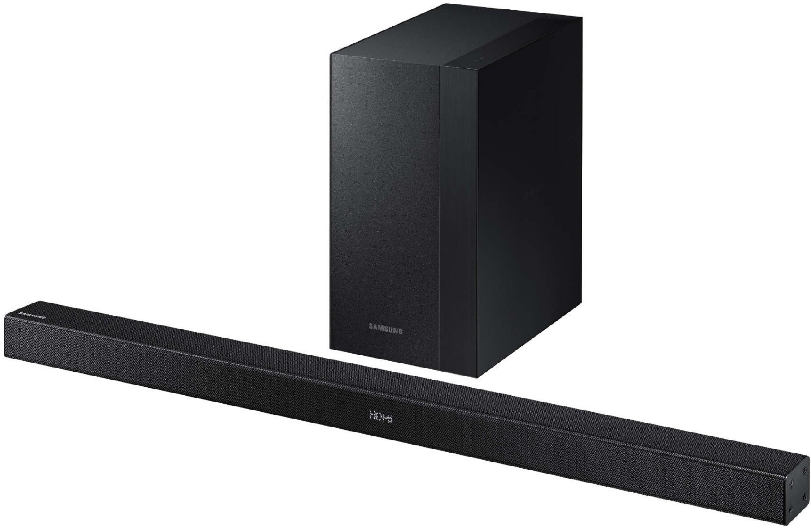
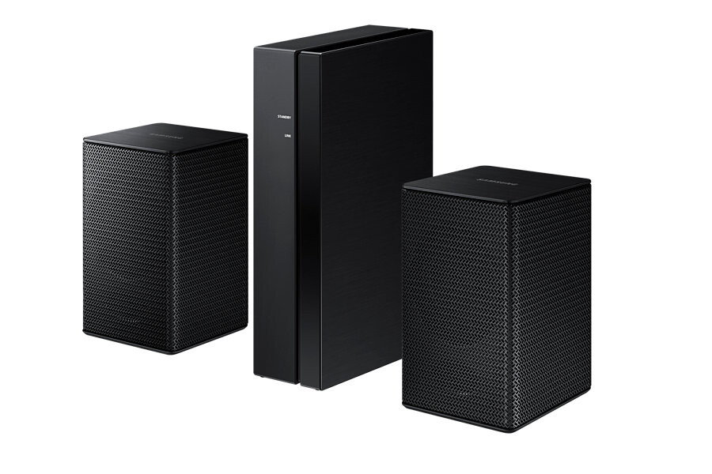

Tuli päivitettyä oman olohuoneen äänentoistoa hieman parempaan suuntaan. Tuli siis hankittua soundbar ja langattomat takakaiuttimet. Olen vuosia haaveillut kotiteatterista ja tähän asti on menty pelkästään television kajareilla eteenpäin. Nyt kuitenkin sattui hyvä tarjous, jossa sai soundbarin lisäksi kaupan päälle langattomat takakajarit niin pitihän se tarttua siihen.

Yksi syy miksi hankin pelkän soundbarin on se, että siitä lähtee tarpeeksi ääntä meille ja ne on kuitenkin jo aika laadukkaita. Veli hankki myös soundbarin joku aika taaksepäin ja tämmöiseen rivitaloon tuo onkin hyvä jo naapurisopua ajatellessakin.

## Samsung Soundbar (HW-K460)

Ensin tuli [postissa](/2016/viimeaikainen-kokemukseni-postin-smartpost-pakettiautomaatista) soundbar sillä sen tulon jälkeen sai tilattua Samsungin kampanjasta vielä nuo langattomat takakaiuttimet. Paketissahan tuli itse soundbar, langaton subwoofer, kaukosäädin sekä kiinnitystarvikkeita ja johtoja.

Käyttöönotto on kaikessa yksinkertaisuudessaan hyvinkin simppeli. Kytketään soundbarin ja subwooferin virtajohdot seinään sekä laitetaan soundbar kiinni televisioon mukana tulleella optisella kaapelilla. Sitten vielä laitetaan paristo (tämäkin tuli mukana) kaukosäätimeen ja laitetaan koko setti päälle. Subwoofer tajusi itsellä automaattisesti soundbarin ja niitä ei tarvinnut erikseen parittaa. Näiden kahden välillä ei mene johtoa vaan homma hoituu langattomasti joka helpottaa sijoittelua aika paljon. Mahdollisuutena olisi myös kiinnittää soundbar seinään mukana tulleilla kiinnikkeillä.

Jo pelkästään tällä pärjäisi vallan mainiosti ja äänenlaatu on omille korvilleni hyvä ja meille täysin riittävä. Saat säädettyä bassoja ja joitain muitakin määreitä soundbarin kautta ja televisiosta tuleva ääni tuleekin ongelmitta soundbarin kautta.

Meillä on pääasiassa käytössä tuo optinen liitäntä ja television äänet tulevat oikein mainiosti sitä kautta. Kaikki laitteet mitä televisioon on liitetty tulee siis soundbarin kautta ja ainut liitäntä televisiosta soundbariin on tuo optinen kaapeli. PS4, Chromecast ja itse television ääni on tullut moitteetta soundbarista ulos ja kuulostaa paremmalta kuin television omien kajareiden kautta.

Olemme myös koittaneet kuunnella musiikkia soundbarin kautta ja saatkin liitettyä vaikka puhelimesi bluetoothin yli soundbariin. Näin saat vaikka Spotifyn soimaan ongelmitta kajareista. Vaihtoehtona on myös perinteinen AUX kaapeli johon mietinkin Chromecast Audion hankintaa. Käsittääkseni jos sinulla on Samsung TV niin sen voisi saada langattomasti yhdistettyä tuohon Soundbariin.

Ainut ongelma on lähinnä television puolelta sillä siellä pitää volyymi olla nollassa sillä muuten en saanut ääntä menemään pelkästään soundbarin kautta. Tämä taas ei ole ongelma soundbarissa vaan televisiossa.

## Wireless Rear Kit SWA-8000S

Tämä oli ilmainen lisä tuohon soundbariin, koska Samsungilla oli menossa kampanja juuri sopivasti, jossa tämän sai kaupan päälle. Tämä setti teki tuosta soundbarista siis vielä mielenkiintoisemman kapistuksen ja rahalle sai enemmän vastinetta. Paketissa tuli kaksi kaiutinta, liitäntäboxi sekä piuhoja.

Käyttöönotto oli taas suhteellisen helppo prosessi. Boxiin virtaa ja kajareihin boxista piuhat kiinni. Sen jälkeen ohjeiden mukaan paritettiin soundbar sekä boxi. Tämän jälkeen soundbarista saikin säädettyä takakajareiden äänenvoimakkuutta sopivammalle.

Isoin etu tässä setissä on se, että tämäkin on lähes langaton. Ainoat piuhat mitä menee ovat boxista virtapistokkeeseen sekä kaiuttimiin. Se langattomuus tulee siitä, että tämä yhdistyy langattomasti tuohon soundbarin subwooferiin eli ei tarvitse vetää piuhaa huoneen läpi.

Verrattuna itse soundbariin nämä kaiuttimet ei tuo niin isoa muutosta normaalissa televisionkatselussa, kuin itse soundbar toi. Onhan tämä kiva lisä, mutta jos haluttaisiin todella laadukas huoneen kattava setti niin pitäisi oikeasti pistää rahaa kotiteatteriin. Soundbarin kylkiäisenä nämä on kyllä mukava lisä olohuoneeseen.

## Lopuksi

Ollaan oltu kyllä tyytyväisiä tähän hankintaan ja television äänenlaatu on parantunut huomattavasti verrattuna television omiin kaiuttimiin. Varsinkin, kun koko setti maksoi 200 euroa Elisan Black Friday tarjouksena. Tällä hetkellä hinta näkyy olevan 300 euron luokassa ja tuo takakaiutinpaketti on taas 150 euron kantturassa.

Soundbar on ollut käytössä nyt jo pari viikkoa ja takakaiuttimet pari päivää. Toiminnassa ei ole ollut mitään ongelmia ja toivon, että toiminta jatkuukin ongelmitta. Ehkäpä saan joku päivä ratkaisun tuohon, että saisin television äänilähteenkin ”oikein” laitettua. Mikäli tulee ongelmia niin blogiin rustaillaan sitten artikkelia.

Tuttuun tapaan kommentit ja kysymykset voi pistää tuonne alas. Mikäli unohdin mainita jotain tai haluat lisää informaatiota niin pistä kommenttia!

**Linkit:**

- [Samsung Soundbar HW-K460](http://www.samsung.com/fi/consumer/tv-av/audio-video/soundbar/HW-K460/XE)
- [Wireless Rear Kit SWA-8000S](http://www.samsung.com/fi/consumer/tv-av/accessories/av-accessories/SWA-8000S/XE)

*Soundbar on hankittu itse. Samsung tai Elisa ei ole pyytänyt kirjoittamaan tuotteesta artikkelia.*

*Kuvat: Samsung*
