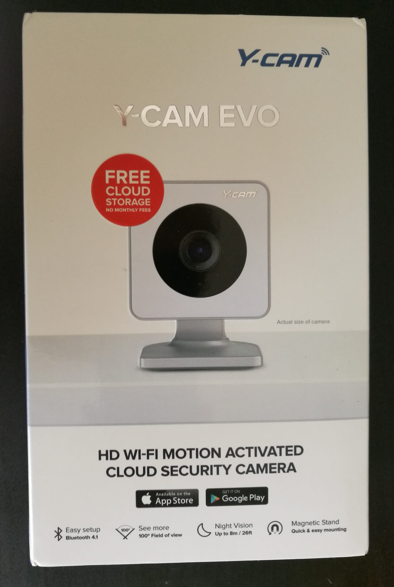
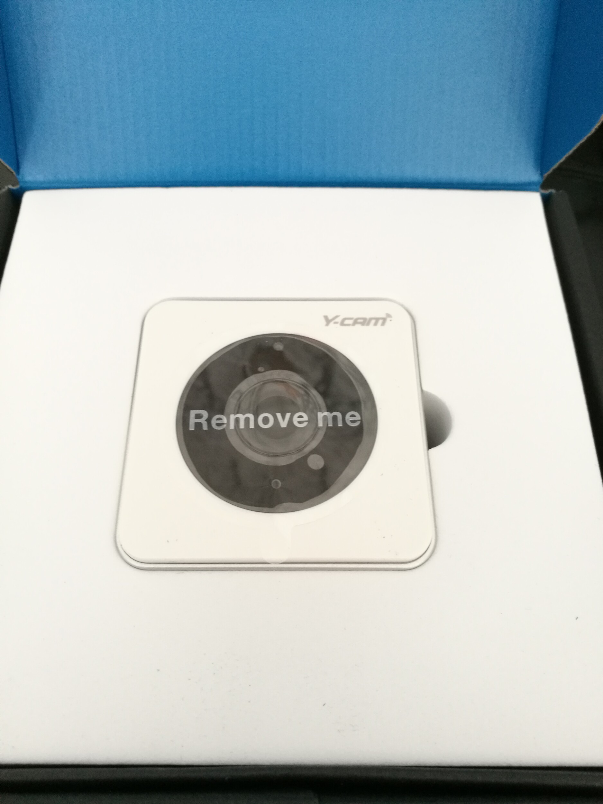
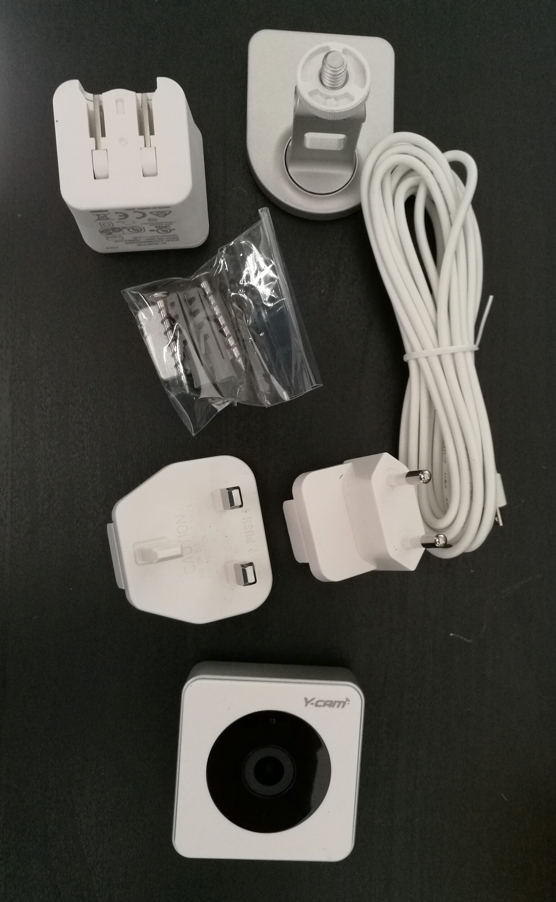
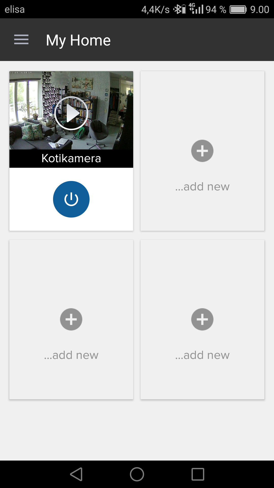
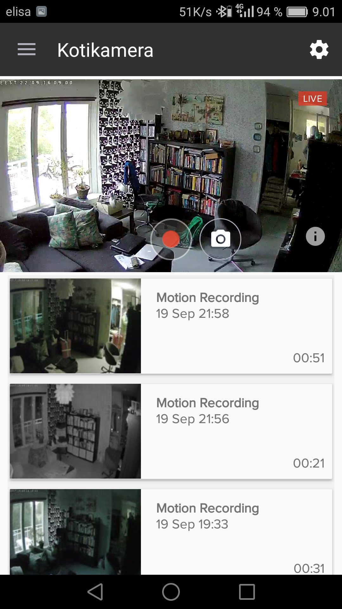
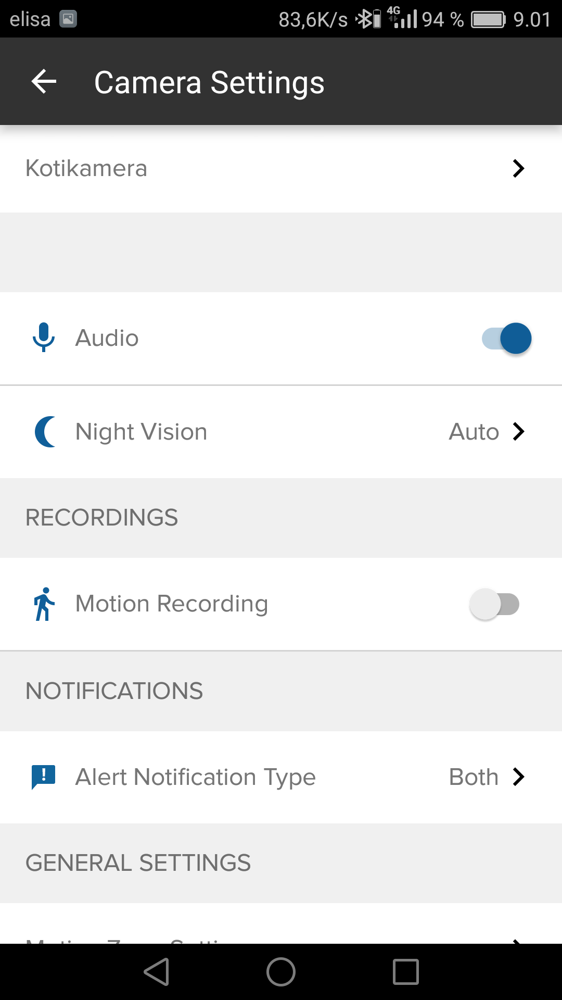
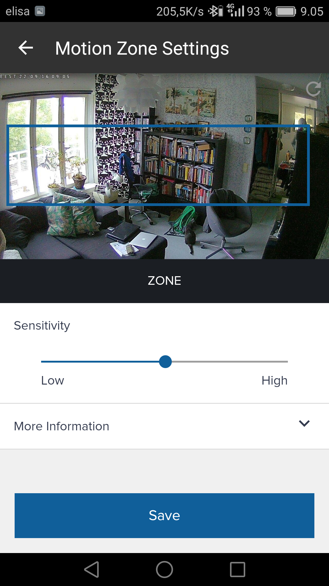
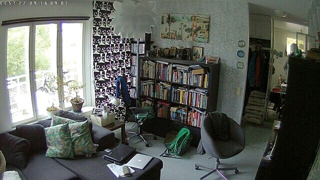
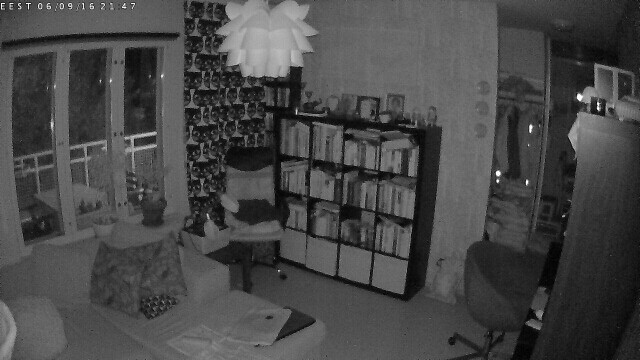

Kokeiluun tuli sisäkäyttöön tarkoitettu valvontakamera nimeltä Y-cam Evo. Tämä tulikin tilauksesta sillä tämä saapui juuri ennen Kreikan reissua ja tällöin oli asunto tyhjillään ja tämä pääsikin heti oikeaan käyttöön. Mikä parempi tapa testata sitä kuin käytäntö? Katsotaan hieman mitä paketti piti sisällään ja millainen kokemus tämän käyttö minulle oli. Eikö ole hienoa, miten joskus asiat vain loksahtavat kohdalleen ja saadaan laite heti oikeaan testiin.

Kuten paketista näkyy niin hieman oli pahvit kärsinyt kuljetuksessa, mutta jotain pientä jo laitteesta alkaa paljastua sen mukaan. Itse paketissa oli tietysti kamera ja se olikin heti näkyvillä.

Paketissa kameran lisäksi oli laturi ja sovittimet siihen sekä arviolta pari metrinen usb kaapeli josta kamera saa virtaansa. Sekä jalusta ja metallilevy sekä ruuvit kiinnittämistä varten. Jalustassa on muuten magneetti ja sen saakin näppärästi kiinni tuohon levyyn sillä ja levyn saa tietty ruuveilla esimerkiksi seinään kiinni. Asennus on siis simppeli.

Siirrytään itse kameraan. Sillä on 100 asteen näkymä, resoluutio on 1280×720 eli ei fullhd laatua, mutta mielestäni riittää tarkoitukseen. Yönäkyvyys 8 metriin saakka ja Wifi sekä bluetooth yhteydet. Laite on pieni (52 x 52 x 28mm) ja jalusta tuo hieman lisää siihen. Saa siis aika hyvin asennettua. Laitteessa palaa vihreä valo kun se on päällä ja punainen valo kun siinä on pimeätila päällä.

Käyttöönotto oli yksinkertaista. Laitoin laitteen päälle ja asensin Y-camin ohjelman puhelimeen. Sen jälkeen seurasin aika pitkälti ohjeita ja homma oli sillä hyvä. Ohjelman kautta voin säätää kameran asetuksia ja katsoa livekuvaa laitteesta sekä nauhoituksia mitä on tallessa. Tuo ilmainen tili taitaa pitää 7 päivää nauhoitukset tallessa ja se onkin riittävä aika itselleni. Jos sinulla on useampi y-cam niin voisit lisätä useamman kameran sovellukseen ja nimetä jokaisen. Saat säädettyä myös alueen mitä seurataan kun tarkkaillaan liikettä, jos tuolla alueella on liikettä niin silloin nauhoitetaan klippi talteen (mikäli ominaisuus on päällä). Alla vielä pari kuvankaappausta sovelluksesta.





Minulla oli matkan ajaksi säädetty tuo niin, että se nauhoittaa kun huomaa liikettä eli jos joku käy asunnossa niin se alkaa nauhoittamaan. Sijoitin sen niin, että näen olohuoneen sillä siellä on arvokkaimmat esineet kuten tietokone, televisio ja muu elektroniikka. WLANin tämä tosiaan vaati joten jätin reissun ajaksi netin päälle jotta tämä yleensä toimii. Outin isä kävi katsomassa postit ja kastelemassa kukat, joten tiesin sen, että kameran pitäisi saada materiaalia. Outin isän käynnit nauhoittui ihan oikein ja ilman ongelmia. Harmikseni aina kun kamera vaihtoi automaattisesti yömoodista päivämoodin ja toisin päin tuli myös nauhoite – tämä on ehkä bugi softan puolesta ja näin tuli turhaa nauhoitetta. Muuta ongelmaa en huomannut reissun aikana.

Ennen reissua tulikin käytettyä kameraa ns. kissakamerana ja se oli silloin alla olevassa kuvassa näkyvän kirjahyllyn päällä suunnattuna niin, että pystyi katsomaan makasivatko kissat sohvalla, puussa vai oliko olohuoneessa ollenkaan. Olihan tuo ihan viihdyttävä katsoa makuuhuoneesta kun kissat ravasivat olohuoneessa puussa ja pois kameran näkyviltä.

Alla on pari kuvaa tallennettuna tuosta kamerasta suoraan ja toinen on päivältä ja toinen yöltä. Olin hieman yllättynyt tuosta yökuvan laadusta sillä en uskonut sen olevan noinkaan hyvä.

Kotiin tämä kamera soveltuu mainiosti kotiin ja miksi ei mökillekkin kunhan on vain langaton verkko siellä toiminnassa. Koin tämän laitteen hyväksi, kun olin lomalla Kreikassa ja sain mielenrauhan siitä, että kukaan asiaton ei käynyt asunnolla. Varsinkin, kun on paljon juttuja ollut, että ei kannata matkoista kertoa etukäteen missään ja mehän on kerrottu melkein kaikkialla. Vakuutukset tietty on, mutta tämä auttaisi hieman syyllisten löytämisessä mikäli joku tuolla nyt olisi käynytkään. Netti ja wlan toimi itselläni koko 2 viikon reissun ajan ongelmitta ja kameran toiminnassakaan ei ollut ongelmia. Ilmoitukset liikkeestä tuli sähköpostiini, kun Outin isä kävi siellä ja klipin pystyi katsomaan niin puhelimella, kuin sitten sähköpostissa olleen linkin kautta. Haluan vielä laittaa alas klipin jonka kamera nauhoitti aina kun vaihtui tuo yömoodi pois/päälle, josta jo aiemmin kerroinkin – tästä näkee myös hieman videon laatuakin. Klipin latasin suoraan Y-camin sivujen kautta. Alla on Youtubeen laitettu klippi ja tässä vielä Dropboxissa oleva alkuperäinen: [Linkki Dropboxiin](https://www.dropbox.com/s/6hxcf708hth9bud/8CAE890506A4_20160919083748_YCAM_STD.mp4?dl=0)



Yhden puutteen keksin tähän kuitenkin. Tämä olisi vielä parempi jos tässä olisi sisäänrakennettu mokkula eli saisi sim-kortin laittaa sisään ja ei tarvitsisi wlania ollenkaan. Toki tämän saa kierrettyä hankkimalla wlan mokkulan ja sitä kautta toimimaan. Tosin jos on useampi kamera niin pitäisi jokaiselle olla oma sim ellei niitä ketjuttaisi jotenkin yhteen. Ehkäpä tätäkin on ajateltu heillä sillä jos on usea kamera niin silloin on fiksu olla koko alueen kattava wlan, jos taas yksi niin silloin olisi helpompi olla mokkula sisäänrakennettuna.

Toivoisin myös, että tuota liiketunnistusta pystyisi ajastamaan puhelimellakin. Huomasin, että ajastuksen voit tehdä verkkohallinnan kautta, mutta en itse löytänyt puhelimen sovelluksesta sitä mahdollisuutta. Muuten tuon liiketunnistuksen määrittäminen toimii hyvin, mutta tuo ajastus olisi hyvä saada puhelimellekkin. Näin voisi esimerkiksi työpäivän ajaksi tai yöajaksi laittaa liiketunnistuksen päälle.

En ole aiemmin kokeillut tämmöisiä laitteita niin en oikein pysty vertaamaan toiseen vastaavaan tuotteeseen. Sen voin sanoa, että tämä toimi mainiosti ja tuota yhtä ainoaa bugia huomioonottamatta käytössä ei ollut ongelmia. Iso plussa tosi pitkästä USB kaapelista jolla sijoittaminen meni kivuttomasti kaapin päälle lähes katonrajaan. Voisinpa melkein suositellakin tätä tuotetta jos haluaa yksinkertaisen kameran valvomaan kotia esimerkiksi loman ajaksi.

Lisää infoa tästä kamerasta saatte niin suomenkielisiltä [y-cam.fi](https://www.y-cam.fi/tuotteet/) sivuilta ja englanninkielisen [y-cam.com](https://www.y-cam.com/product/evo-indoor-hd-wi-fi-security-camera/) sivuston kautta.
