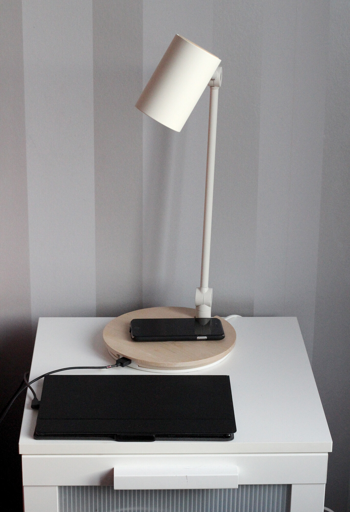
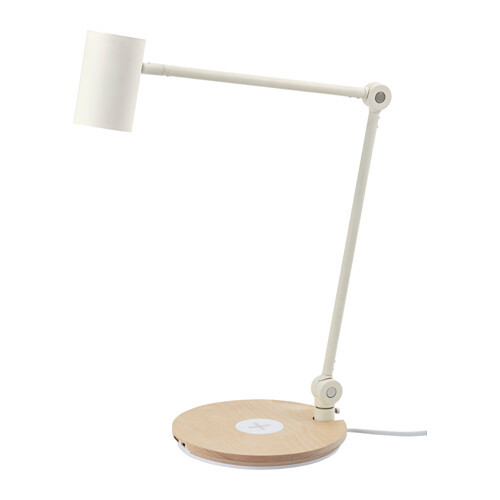
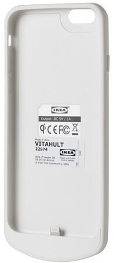
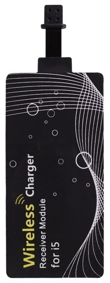

Kirjoittelin syyskuun lopulla perinteisen [säläartikkelin](/2015/langatonta-latausta-ikeasta-kuulokkeita-ja-muuta-mukavaa), jossa oli mukana puhelimen langaton lataus kohta. Ilmeisesti joulupukki oli lukenut tämän ja sainkin hieman kamaa lahjaksi tähän liittyen. Sain nimittäin juurikin siinä artikkelissa mainitsemani [Riggad lampun](http://www.ikea.com/fi/fi/catalog/products/40280678/) ja [Vitahult latauskuoren](http://www.ikea.com/fi/fi/catalog/products/10314000/).

Tuli sitten hankittua myöskin langatonta latauslätkää kaveriksi. Käynkin nämä kaikki yksitellen läpi ja sitten hieman koitan koota ajatuksiakin yhteen.

Oikealla onkin kuva kuva omasta yöpöydästäni (sekin Ikeasta). Sieltä löytyykin kaikki tämän artikkelin tuotteet – poislukien tuo Vitahult. Tabletti ei ole tuossa langattomasti latauksessa niin kuin johdosta voikin päätellä.

Ikea ei muuten vieläkään sponsoroi tätä artikkelia!

## Riggad

Otetaan ensin käsittelyyn tuo lamppu, joka onkin sitten koko homman ydin tällä hetkellä. Lamppuhan oli Ikean tapaan kasattava tosin osio oli levy ja itse varsi, jossa onkin kiinteä LED lamppu. Eli tämän kasaaminen ei vaatinut edes asennusjuomia ja homma oli valmis hyvinkin nopeasti.

Lampussa on keskellä valkoinen osio mihin laitetaan puhelin lataukseen. Tämä on ainut kohta lampussa missä kohtaa langaton lataus alkaa toimimaan.

Löytyypä tuosta myös USB portti, johon saa myös yhden laitteen lataukseen. Itse olenkin ladannut tablettiani tuota kautta ja puhelin on saanut olla langattomasti latauksessa.

Onhan tässä myös valokin! LED lampun saa näppärästi päälle ja se kyllä valaisee ihan tarpeeksi. Ainut miinus on tosiaan se, että tuon lampun palaessa sitä ei voi korvata sillä LED valo on kiinteästi asennettu tuohon.

Itse lataaminen on suhteellisen kivutonta. Laitat puhelimen oikeaan kohtaan ja valo syttyy kun lataus alkaa. Itsellä on puhelin sen valon päällä niin sitäkään ei pimeässä näy.

## Vitahult

Helpoin tapa saada puhelimeen tuki langattomalle lataukselle on ostaa kuori/suojus joka sen mahdollistaa. Ikeasta onkin helppo nappaista lampun mukana Vitahult kuori, jossa tämä tuki tulee.

Itse kuorihan on helppo sillä sen kuin puhelimen laittaa siihen ja antaa olla niin langaton lataus toimii kerrassaan mainiosti.

Ainoat miinukset on tässä ne pahimmat miinukset omasta mielestä. Kuori on todella tylsän näköinen ja siksipä sitä tuli käytettyä vain ja ainoastaan yöllä, kun puhelinta latasin. Toinen ongelma on sen koko sillä se tuo aika paljon lisää pituutta puhelimeen.

Näiden syiden takia tulikin hankittua alla mainittu erillinen Qi-vastaanotin, jonka voi teoriassa pistää mihin kuoreen tahansa ja langaton lataus toimii sen kautta.

## Insmat Qi-vastaanotin

Koska tuo Vitahult ei tyydyttänyt niin päätin hankkia Insmatin Qi-vastaanottimen sillä tämän saa aika hyvin laitettua puhelimen ja kuoren väliin.

Toimintahan on sellainen, että Lightning porttiin törkätään kiinni tuo ja se taitetaan sitten puhelimen taakse ja tökätään kuori päälle.

Omilla kuorilla tulee hieman kuori ulospäin ja olenkin miettinyt kuoren tuunausta niin, että siihen tulisi hahlo vastaanotinta varten.

Pienestä kohoumasta huolimatta olen käyttänyt tätä täysipäiväisesti käytössä ja langaton latauslätkä pysyykin mukavasti kuoren välissä.

Lataaminen Riggad lampun kanssa toimii hyvin. Vielä en ainakaan ole törmännyt ongelmiin tämän vastaanottimen kanssa ja olenkin ollut tyytyväinen hankintaan.

## Lopuksi

Onhan tämä langaton lataus helpottanut omaa elämääni sillä tavalla, että nukkumaan mennessä pitää vain laittaa puhelin kohdalleen ja se latautuu itsekseen siinä. Aamulla koppaan vain puhelimen lampun päältä ja lähden töihin.

Ainut ongelma on ollut tähän mennessä se, että välistä tuntuu oikean kohdan löytäminen olevan haastavaa. Tämä on varmaan ongelma tuossa lampussa sillä se ala millä se latautuu on suhteellisen pieni. Hieman jos sitä isontaisi vaikka kattamaan isomman osan lampun jalustaa niin olisi aika täydellinen setti.

Nyt kun ollaan langattoman latauksen siimeksessä niin pitää jossain välissä ostaa lisää noita latureita, jotta niitä olisi myös työpaikalla ja työpöydän ääressä kotona. Sillähän ei ole väliä millaisen Qi-standardin mukaisen laturin ostaa, mutta esimerkiksi Ikeasta saa [Nordmärke](http://www.ikea.com/fi/fi/catalog/products/40289792/) nimistä alustaa. Samoin sisutuksen syystä joutuu varmaan avopuolison yöpöydälle hankkimaan samanlaisen lampun ja tätä kautta on yhtenäinen yöpöytä… Onneksi tilasin Insmatin lätkiä suoraan kaksi kappaletta.

Suosittelen kokeilemaan näitä latureita ja varsinkin tuota lamppua. On hyvännäköinenkin vielä. Jos sinulla on kokemuksia langattomasta latauksesta niin tuonne kommenttien puolelle voi laitella!
