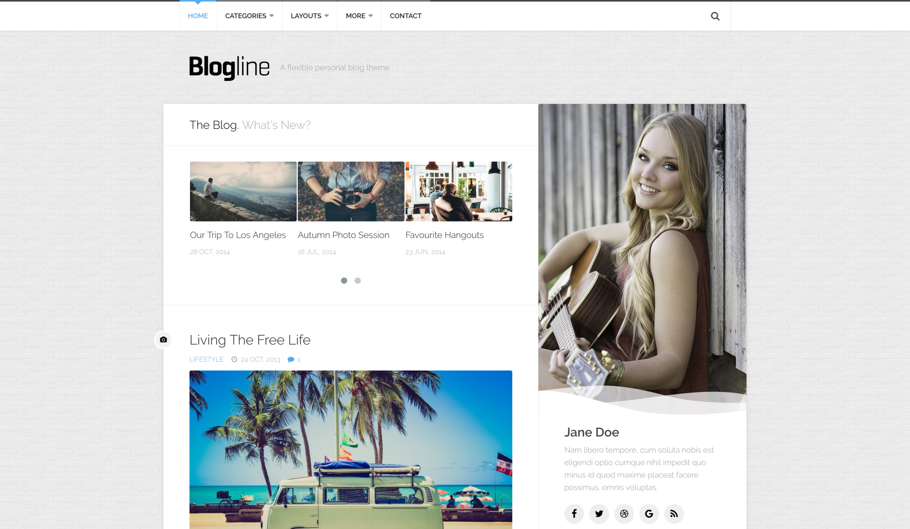
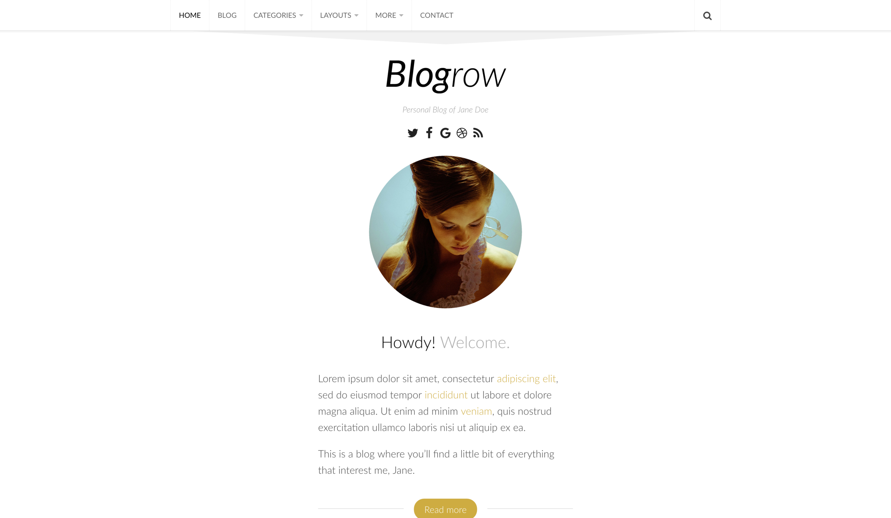
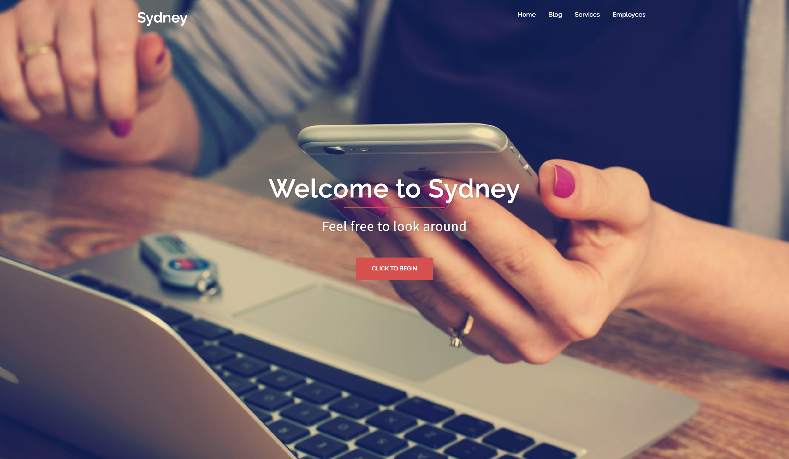
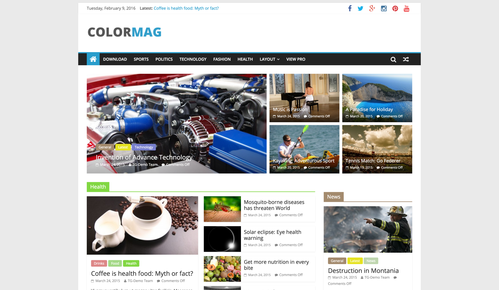

Olen linkannut ilmaisia teemoja ja olisi taas aika linkata lisää ilmaisia teemoja WordPressiin. Kaikki tässä kirjoituksessa mainitut teemat ovat siis ilmaisia ja ne ei maksa sinulle yhtään mitään. Pyrin linkkaamaan aina siihen versioon mistä saat kaikkein eniten irti.

## Blogline

Pidän tämän kaverin tekemisistä ja aiemmin suosittelinkin Hueman teemaa ja tällä kertaa suosittelenkin suhteellisen tuoretta Blogline nimistä teemaa. Kyseessä on todella hyvännäköinen teema henkilökohtaiselle blogille.

[Linkki teemaan](http://alxmedia.se/themes/blogline/)

## Blogrow

Taas samalta tekijältä kuin äskeinen ja häneltä olikin tullut toinen uusi teema jota pitää heti olla suosittelemassa. Tämäkin on suunnattu henkilökohtaisiin blogeihin päin.

[Linkki teemaan](http://alxmedia.se/themes/blogrow/)

## Sydney

Hieman enemmän tuonne yrityspuolelle suunnattua teemaa lähtisin vinkkaamaan seuraavaksi. Tämä on demon ja katselun perusteella varsin mukavanoloinen teema ja sopii varmasti yritykselle ulkoasuksi ainakin aluksi.

[Linkki teemaan](https://wordpress.org/themes/sydney/)

## ColorMag

Nyt mennään jo hieman uutissaittien puolelle, nimittäin ColorMag teema on sen tyylinen, että se sopisi sinne puolen mainiosti. Tämä kävisi myös oikein hyvin esimerkiksi peli tai vempain sivustolle teemaksi.

[Linkki teemaan](https://wordpress.org/themes/colormag/)

## Lopuksi

Suurimman osa noista teemoista taitaa tulla englanniksi. Tämä ei kuitenkaan ole yleensä ongelma sillä ne saa yleensä suomennettua helposti mukana tulevan käännöstiedoston avulla. Ilmaisella Poedit nimisellä ohjelmalla ne voi suomentaa ja tallentaa vain fi nimellä ne ja siirtää teeman kielikansioon.

Osa teemoista vaatii teeman omien asetuksien laittoa ja erillisiä lisäosia, jotta kaikki toiminnot toimii kunnolla. Mikäli teema ei siis näy oikein niin kannattaa tutustua dokumentaatioon.

Tässä nyt oli jokunen teema tosiaan lisää. Tuonne kommenttien puolelle voi heitellä omia suositteluja. Ehkäpä koppaan niitä mukaan seuraavaan artikkeliin sitten.
