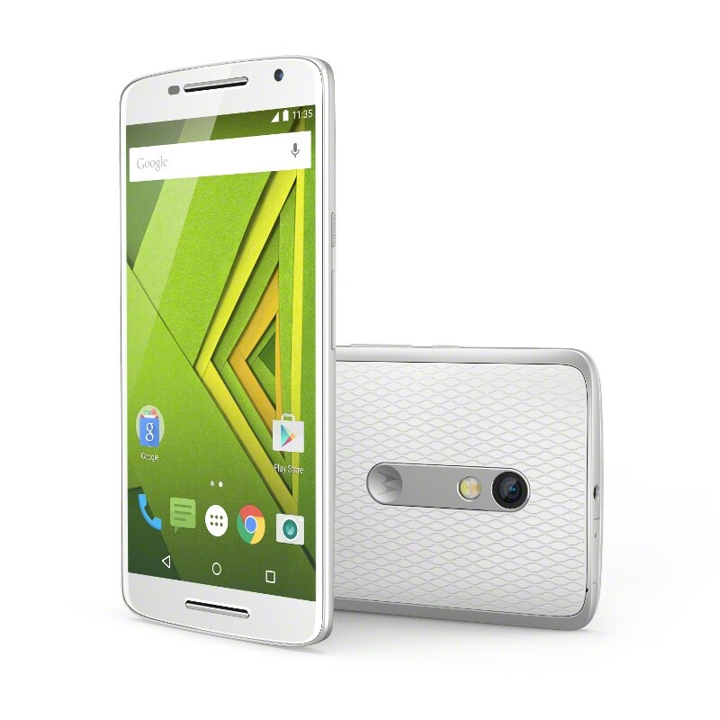
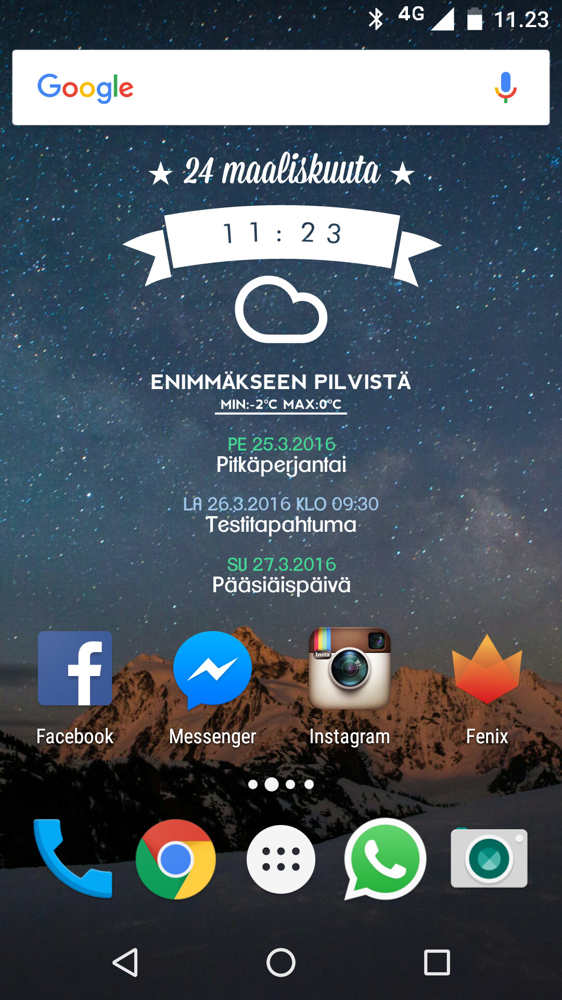

[iPhone 6](/2016/iphone-6-naytto-hajosi) lähti kiertoon ja CDonilla oli Moto X Play puhelimesta tosi hyvä tarjous ja sen sai 215 eurolla niin pistin sen tulemaan. Kesä/syksy akselilla on tarkoitus vaihtaa johonkin ns. lippulaivapuhelimeen taas ja tällä pärjäillään siihen asti ja tämä saa jäädä sitten ns. varapuhelimeksi sen jälkeen. Kerronkin hieman ensikokemuksia tästä puhelimesta ja nyt puhutaan oikeasti ensikokemuksista sillä sain puhelimen eilen keskiviikkona.

Paketti oli hyvin simppeli. Sieltä löytyi puhelin, laturi, ohjeita sekä sim korttiluukun avaukseen tarkoitettu ”työkalu”. Ihme kyllä kuulokkeita ei tullut matkassa. Yllättävää oli myös se, että paketissa oli laturi johon sai kaksi usb johtoa kiinni. Tulee käyttöön sillä yöpöydällä latautuu myös tabletti. Ilmeisesti matkassa ei tule kuitenkaan nopeaa laturia vaikka Moto X Play sitä taitanee tukea. No ei minulla yleensä kiire ole latauksen kanssa ja reissun päällä matkassa on nykyään 12000 mAh lisäakku.

Ensimmäinen asia oli tietysti puhelimen ihmettely. En ole paperilla koskaan pitänyt ajatuksesta, että puhelimessa on 5.5 tuuman näyttö ja tämä olikin ainut miinus minkä pikaisesti huomasin kun tilausta tein. Hinta kuitenkin oikeuttaa tämmöiset asiat ja päätin ottaa tämän ainakin kokeiluun. Onhan tämä tosiaan isompi kuin aikaisempi iPhone 6 puhelin sillä siinä oli 4.7 tuuman näyttö. Painoakin on hieman enemmän, kuin iPhonessa – toki on siinä se isompi näyttö. Nyt minulla on siis ensimmäinen ns. [phablet](https://fi.wikipedia.org/wiki/Phablet)!

Käyttöönotto oli simppeli tai no sitä lukuunottamatta, että akku oli täysin tyhjä ja sitä piti hetki latailla. Ensin piti tokin survaista sim kortti ja microsd kortti yhteiseen luukkuun sillä ne menee näppärästi samaan paikkaan. Oikein mukava keksintö. Availin ensin takakuorta ja ajattelin muistikortin menevän sinne, mutta eihän siellä paikkaa ollut (ohjeitahan ei lueta). Oikea paikka löytyi sitten lopulta sieltä sim kortin luota, kun sitä aloin laittamaan paikalleen. Muuten homma meni simppelisti – Google tiliin kirjautuminen ja valitaan wifi ja tämmöiset. Sitten olikin softien asennusta ja säätöä.

Mainitsin, että irroittelin takakuoren sekä sen, että siellä ei ollutkaan korttipaikka. Harmi oli myös se, että ei oltu käytetty hyödyksi mahdollisuutta tehdä vaihdettavaa akkua. Takakuoren ainut funktio on siis se, että sen voi vaihtaa eriväriseen halutessaan. Toki jos jotain pitää keksiä niin voit sinä sinne yhden setelin ehkä survoa (en ole kokeillut).

Moto X Play puhelimessa oli mukana 5.1 Android ja ensiksi tarjottiinkin myös päivitystä uudempaan 6.0 Androidiin. Aloitinkin tämän teon ja siinä kesti oma aikansa. Tätä ennen asentelin haluamani softat kuten Whatsappin, Facebookin, Instagrammin, Fenixin ja kasan muita sovelluksia. Varmuuskopiotkin pitäisi mennä Googlelle ja siltäkin osin puhelimen data on mukavasti tallessa. Kuvat pistin menemään taas Dropboxin camera uploadin kautta sillä niin ne meni iPhonessakin – onpahan nekin räpsyt jossain.

## Säätäminen

Androidissa pääsee säätämään. En ole rootannut saati asentanut Cyanogenmodia tuohon (ainakaan vielä). Eli mennään ihan Motorolan omalla setillä ja se onkin aika pitkälti puhdasta Androidia – ainakin niiltä osin mitä itse pystyn sanomaan. On nimittäin hetki siitä, kun olen Androidia aktiivisesti käyttänyt. Olen tällä hetkellä säätänyt tuohon widgettiä ihan jonkin verran Zooper Widget Pro avustuksella ja olen käyttänyt siihen jo ihan liikaa aikaa. Ikonit minua häiritsee hieman ja tulenkin varmaan vaihtamaan launcherin johonkin. Mikähän olisi passeli launcheri tänä päivänä? Nova launcheria tuli aikoinaan käytettyä.

Oikealla näkyykin mikä on tällä hetkellä se minun androidin homescreen ja se tulee todennäköisesti muuttumaan vielä jonkin verran. Vinkkejä otetaan tässäkin vastaan. Kalenterissa on pieni hienous tuon Zooper Widgetin kohdalla. Sitä voi tosiaan säätää. Huomaatte varmaan, että testitapahtumassa näkyy kello, mutta koko päivän kestävässä tapahtumassa taas ei. Samoin tuo väri merkkaa sitä missä kalenterissa kyseinen tapahtuma on sitten. Olen tällä hetkellä aika tyytyväinen tuohon tulokseen, mutta varmaan twiikkaan jotain vielä jossain vaiheessa!

Ne on ne pienet asiat mitkä saa loppuunsa roottaamaan ja vaihtamaan esim. Cyanogenmodiin. Tässä ei nimittäin ole mahdollista säätää kunnolla yläpalkin sisältöä saati noita quick settingejä. Osittain saa säädettyä, mutta ei niin hyvin kuin sain tuossa hätävarapuhelimessa Htc One S:ssä tässä muutaman päivän aikana. Voikin olla, että Cyanogenmodia pukataan sisään parin viikon sisällä. Android puhelimista tuttu ilmoitusvalokin lähtee kuulemma toimimaan vain roottauksella tässä puhelimessa. Harmillista, olisin tuota kaivannut varsinkin puhelimien ja viestien kohdalla jos niitä menee ohi.

## Lopuksi

Näin päivän jälkeen en akkukestosta voi sanoa juuta enkä jaata sillä tietenkin sitä tulee räplättyä aika paljon aluksi. Itsellä akkukestoon vaikuttaa hyvin paljon se miten paljon tulee puhuttua puhelimessa päivän aikana. Eli tähän voin palata vielä myöhemmin jos satun kirjoittamaan tästä juttua hieman pidemmän käytön jälkeen.

Kaiken kaikkiaan Moto X Play vaikuttaa erittäin mainiolle ja varsinkin kun sen sai reilulla 200 eurolla en voi olla kuin tyytyväinen hankintaan tällä hetkellä. Näyttö vaikuttaa hyvältä ja kamerakin tuntuu ottavan passeleita kuvia. En ole kauheammin kameraa vielä testaillut, mutta parin räpsyn jälkeen näyttää ihan hyvältä.

Koska olen ollut melkein pari vuotta pois Android maailmasta puhelimen osalta niin kaipailisin vinkkejä teiltä. Näitä asioita minulle saa vinkata: appseja, launchereita, widgettejä, ikoneita sekä taustakuvia. Eli melkeinpä mitä vaan mitä puhelimeen tulee törkättyä. *Kommenttiboxi on edelleen tuolla alhaalla! Samoin jos unohdin jotain niin muistuta minua!*
