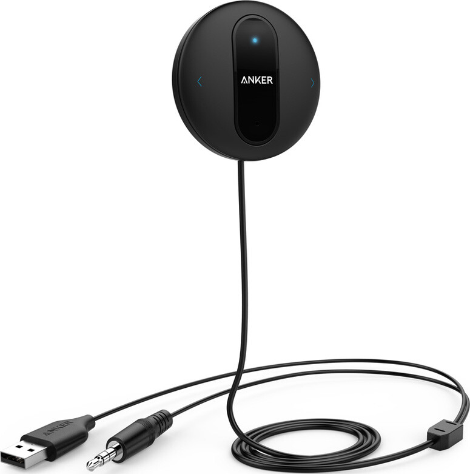

Omassa autossani ei ole bluetoothia suoraan, mutta siinä on aux liitäntä (3.5mm kuulokeportti). Puhelimen sain siis jo kiinni sen kautta autoon ja Spotifyn soimaan. Tässä oli kuitenkin pieni ongelma, sillä olin laittanut kuskin puolen puhelintelineen ratin vasemmalle puolen ja kaapelin joutuisi vetämään siis todella kauas. Ratkaisuna olikin bluetooth vastaanotin, joka kytketään aux liitäntään.

Hieman tutkailin asiaa ja päädyin tekemään tilauksen Amazonista sillä sieltä tarvittavan laitteen saa noin 12 punnalla (+ postit tietty). Päädyin tilaamaan Anker SoundSync Drive nimisen laitteen ja tässä vielä linkki suoraan [tuotesivulle](https://www.amazon.co.uk/gp/product/B0177T3OEU/). Kyse on yksinkertaisesta laitteesta joka saa virran usb:n kautta ja kytketään aux liitäntään.

Tämän voi kytkeä siis tupakansytyttimeen laitettavalla usb laturilla tai sitten auton usb porttiin mikäli se antaa tälle tarpeeksi virtaa. Itse kytkin tämän nimenomaan auton omaan porttiin. Käyttöönotto oli simppeliä sillä pistit vain piuhat kiinni ja laitteen päälle, jonka jälkeen paritit puhelimen Ankerin kanssa.

Olen nyt pari kuukautta käyttänyt ja ensimmäiseksi huomasin pienen ongelman tämän kanssa. Se piti suhinaa taustalla, kun ei ollut musiikkia ja musiikistakin joskus kuului taustalta suhinaa. Otin sitten yhteyttä valmistajaan ja he ehdottivat ratkaisuksi ns. ground loop isolator nimistä [palikkaa](https://www.amazon.co.uk/gp/product/B01GJHEA9O/). Tilasin tuon ja ongelma ratkesi sillä. Pisteet vielä valmistajalle asiakaspalvelusta. Tuo palikka tulee aux liitännän ja vastaanottimen väliin. Suosittelen tuon ostamaan suoraan vastaanottimen kanssa.

Toinen ongelma mihin törmäsin on ollut kahden puhelimen käyttö tai ei oikeastaan ongelma sinänsä. Jos molemmat mennään autoon niin vastaanotin yhdistää viimeksi käytetyn puhelimen kanssa ja jos haluaa toisella kuunnella niin siitä pitää vain bluetooth sammuttaa tai poistaa paritus – eli ei sinäsä ongelma vaan laite pystyy olemaan vain yhden puhelimen kanssa kerrallaan yhteydessä.

Tässä on myös handsfree toiminto jota en ole kokeillut sillä itselläni on sen verran hyvä [handsfree](/2015/plantronics-voyager-legend-bluetooth-handsfree) omasta takaa. Muilta toiminnoiltaan laite onkin sitä mitä lupaa – yksinkertainen vastaanotin, jonka kautta saan puhelimen kautta kuunneltua musiikkia autossa. Toinen noista ongelmista, kun ratkesi lisäpalikan kautta ja toinen on vain pieni säätö niin ei tässä mitään isompia ongelmia sitten olekaan. Tämä pitää vain muistaa laittaa napista päälle, kun sitä haluaa käyttää.

Tämä on ehkä enemmän puhelimen ominaisuus, kuin vastaanottimen – koen sen silti hyväksi mainita. Saan yhdistettyä handsfreen ja audio vastaanottimen yhtäaikaa puhelimeeni niin, että toinen saa puhelimen ja toinen saa median äänen. Näin puhelut eivät mene vastaanottimelle ja musiikki ei mene bluetoothille. Mikäli saan puhelun ajaessa niin audio hiljenee ja voin puhua sen omalla handsfreelläni. Tämä on mielestäni näppärä ominaisuus jo itsessään.

Itse voinkin suositella tätä kyllä muillekkin jos ei tämän kummempia tarpeita ole.

*Tuotteen ostin omilla rahoilla ja valmistaja ei ole pyytänyt arvostelemaan tätä tuotetta.*
