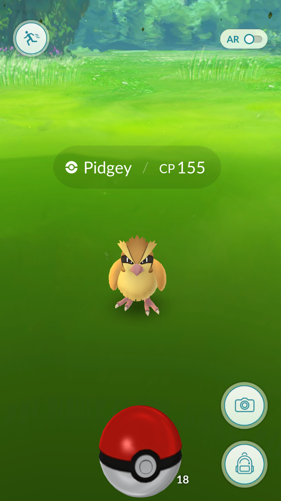
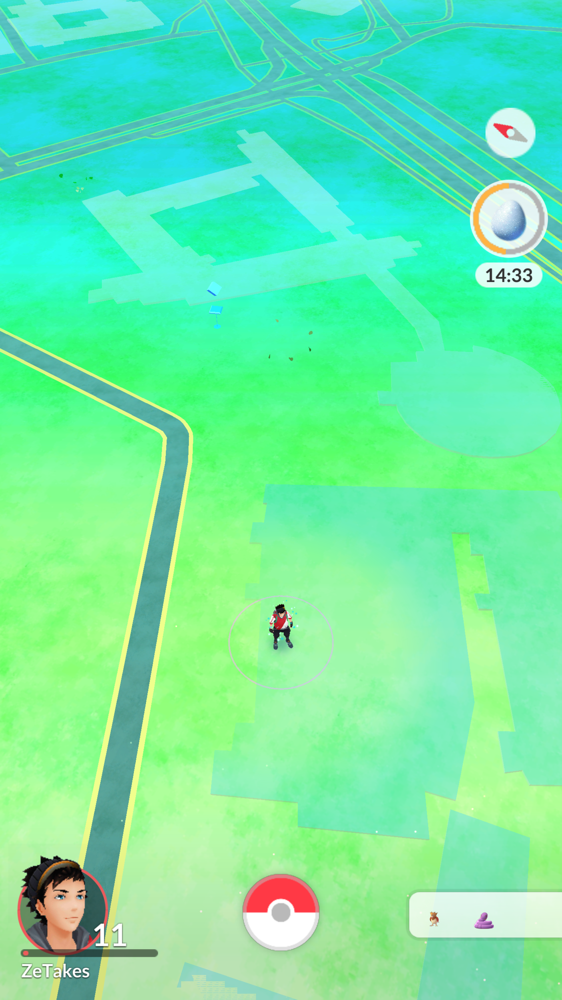
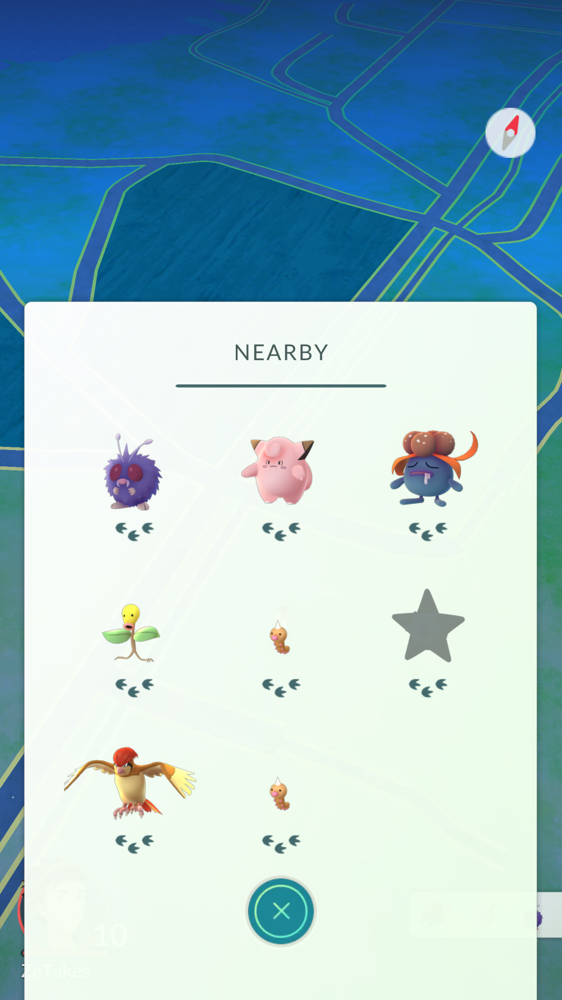
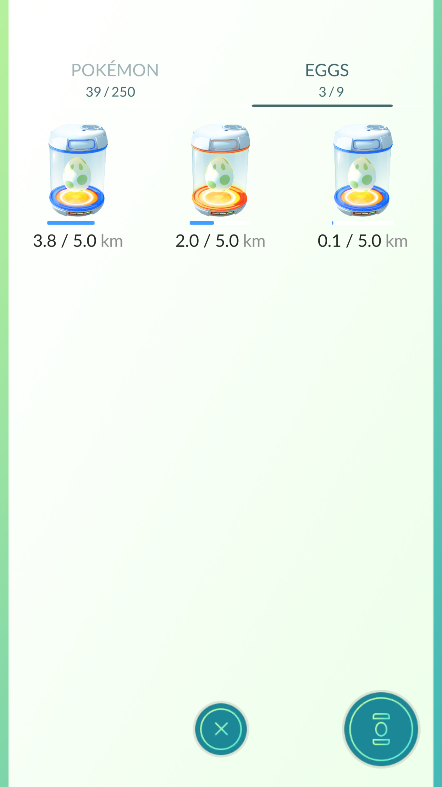
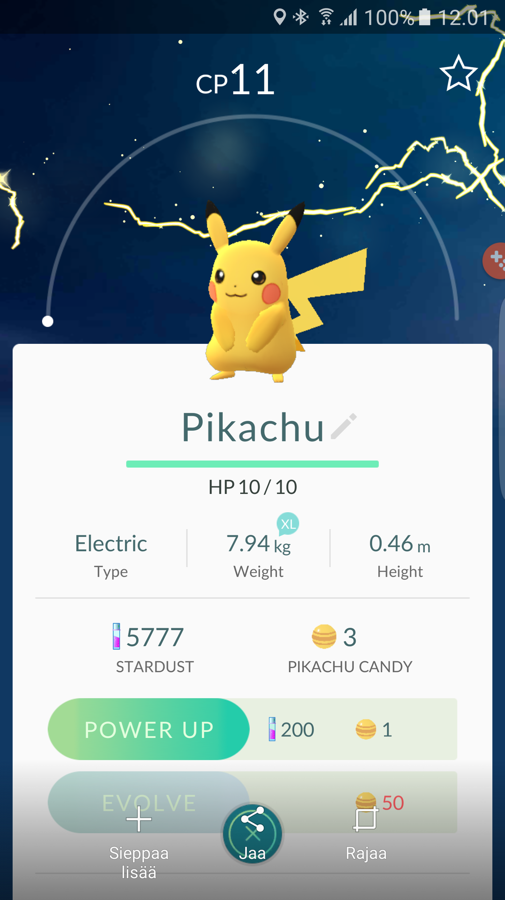
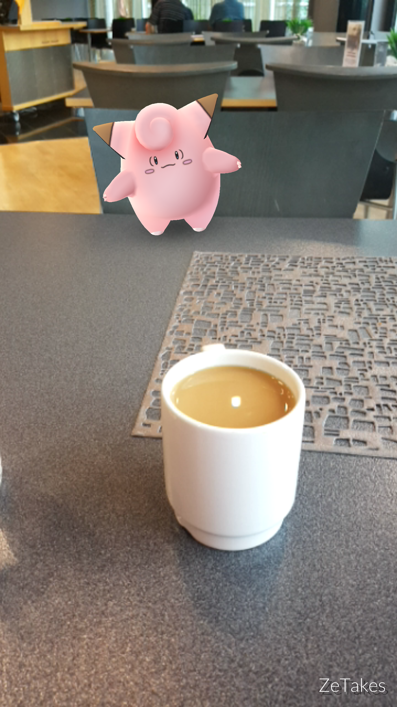

Pokemon Go julkaistiin viikonlopun aikana myös virallisesti suomeen. Ajattelin nyt kirjoittaa pari sanaa tästä pelistä vai pitäisikö sanoa jo ilmiöstä. Luvassa on siis tuttuun ja turvalliseen tapaan sekalaisia mielipiteitä tästä pelistä ja ajatuksia näin ylipäätään. Pelin taustalla on Niantic, joka on tehnyt myös Ingress nimisen pelin ja Pokemon Go:ssa onkin samoja elementtejä, kuin Ingressissä.

Ensinnäkin Pokemon Go on Android tai iPhone puhelimella pelattava peli, jossa kaikessa yksinkertaisuudessaan etsitään Pokemoneja sekä taistellaan saleista oman tiimin väreissä. Tiimejä on kolme Valor (punainen), Mystic (sininen) ja Instinct (keltainen). Pelissä on myös ns. Pokestoppeja joista saat lisää palloja ja tavaraa Pokemonien saalistukseen sekä salien valtaamiseen. Pokemonien etsiminen perustuu omaan sijaintiisi ja lähistöltä voitkin sitten etsiä Pokemoneja, vallata saleja ja kerätä tavarat stopeilta. Oman tiimin salia voi päivittää ja tällöin voit saada oman Pokemonisi vartioimaan salia. Kun oma Pokemon on salilla vartiossa niin saat kerran päivään kolikoita joilla voit ostaa sitten pelin kaupasta tarvikkeita. Noita kolikoita voi myös ostaa oikealla rahalla.

## Ongelmia?

Aloitetaanko niistä ongelmista mitä tässä pelissä tällä hetkellä on ja mitkä minua ärsyttää. Ensinnäkin palvelimet on ollut koko peliaikani enemmän tai vähemmän jumissa. On toki aikoja jolloin ne toimii hyvin, mutta pelin suosio taisi yllättää kehittäjän totaalisesti. Toki juuri julkaistussa pelissä on myös niitä bugeja. Tällä hetkellä itselle häiritsivimmät bugit ovat selkeästi nearby bugi ja pallobugi.

Pallobugissa olet saanut Pokemonin palloon ja tämän jälkeen peli jäätyy totaalisesti. Tähän auttaa vain jos pelin käynnistää uudelleen ja tällöin voisi alkaa tuplausmusiikki soimaan saitko Pokemonin vai et. Mikäli et saanut niin usein on Pokemon ilmestynyt takaisin ja voit koittaa uudelleen sen kiinni ottamista. Tuon bugin takia olen menettänyt niin Pokemoneja, kuin pallojakin.

Nearby bugi taas haittaa suoraan Pokemonien metsästystä. Tuossa listassa, kun pitäisi olla lähellä olevat Pokemonit ja askelmäärällä ilmoittaa kuinka lähellä ne oikein onkaan. Ideana hyvä ja se toimikin joskus, mutta nyt kaikki on 3 askeleen päässä. Olisi hyödyllistä tietää meneekö oikeaan suuntaan vaiko ei sillä muuten menee aika pitkälti hakuammunnaksi tämäkin homma. Varsinkin, kun Pokemoneja alkaa olla kerätty niin olisi kiva löytää myös niitä mitä ei ole jo listassa itsellä.

Itse taistelusysteemi on vähän kehno tai ei oikeastaan vain vähän. Saleja vallatessa taistelet käytännössä automatisoitua Pokemonia vastaan et toista ihmistä. Ja taistelu on sitä, että lyhyellä napautuksella tehdään perus hyökkäys ja pitkällä erikoisempi hyökkäys – väistö tehdään hipaisemalla oikealle tai vasemmalle. Tätä voisi kehittää johonkin suuntaan ja mielellään paremmaksi.

## Jotain hyvääkin

On tässä hyvääkin ei siinä. Tämä on jo kasvanut ilmiöksi sillä ihmiset kokoontuu puistoihin ja toreille stoppien luo keräämään Pokemoneja ja sosialisoitumaan. Tämä on myös saanut ihmisiä liikkeelle sillä pelin eräs mekaniikka on munien hautominen. Saat stopeilta munia ja niissä on eri kilometrimäärä (2, 5 tai 10 km). Mitä isompi kilometrimäärä niin sitä parempi Pokemon sieltä tulee ja sitä pitemmän matkan joudut tietty kävelemään.

Yritykset on ottaneet Pokemon Go pelin myös vastaan sillä Amerikassa esimerkiksi ruokaa/juomaa tarjoavat yritykset joilla on pokestop tiloissaan laittavat sinne ns. lureja jotka houkuttelee Pokemoneja sekä pelaajia. Tällä saadaan myös lisää maksavia asiakkaita esim. pizzalle tai juomaan pari juomaa.

Itseen tässä vetoaa tuo keräily puoli ehkä enemmän. Olenkin keräillyt jokusen Pokemonin (tällä hetkellä 44) ja keräilen niitä lisää kun sattuu eteen. Stoppeja tulee hieman kierreltyä kun niitä vastaan tulee sillä palloista on aina pula. Salien kanssa en ole vielä säätänyt sen kummemmin sillä kotini lähellä ei niitä kauheammin ole.

Pelihän käyttää myös hyödyksi ympäristöäsi ja oletkin varmaan nähnyt kuvia jossa Pokemon on mitä eriskummallisimmissa paikoissa. Tämä tapahtuu pelissä kun AR toiminnon laittaa päälle jolloin peli käyttää kameraasi ja gyroskooppia näyttämään Pokemonin ”oikeassa maailmassa”. Itsellä tämä on pois päältä sillä tuo vie enemmän akkua ja Pokemonit on vaikeampia saada kiinni tuolla tapaa.

## Toiveita

Ajattelin myös hieman kirjoittaa mitä haluaisin tähän peliin vielä. Jonkinlainen vaihtosysteemi olisi ehdottomasti saatava tähän peliin, jotta voisit vaihdella Pokemoneja kavereiden kanssa. Samaten olisi kiva saada jonkinlainen kaveri listakin tähän, jos vaikka näkisi kaverit kartalla ja voisi ehkä jopa suoraan keskustella heidän kanssaan (ryhmä ominaisuus kiva kiitos). Jossain välissä myös tulenee lisää Pokemoneja joten kerättävä ei varmaan lopu kesken ihan heti. Samoin olisi kiva taistella kavereita vastaan kunhan taistelusysteemiä kehitettäisiin hieman myöskin.

Tietenkin sitten tämmöisiä perusjuttuja kuten hahmon kustomointi ja ehkäpä tiimin vaihto voisi olla hyviä ominaisuuksia peliin. Muutenkin peliin sujuvuutta ja esimerkiksi evoluutio animaatioiden ohitus mahdollisuus olisi kivoja lisiä.

Mitä itse haluaisit tähän peliin?

## Lopuksi

Koukuttava peli ja kaupungilla näkeekin porukkaa naama kiinni puhelimessa. Kehoitankin ottamaan järjen käteen ja katsomaan myös eteenkin varsinkin, kun ollaan autojen ja pyörien läheisyydessä – ettei nyt kenellekkään sattuisi mitään.

Voi olla, että pelin innostus laantuu osalla porukkaa ja saadaan serverit pelittämään paremmin ja voi olla, että oma pelaaminen menee yhä satunnaisemmaksi. Sitä en osaa sanoa vielä tässä vaiheessa, mutta on kiva nappasta puhelin kouraan ja katsoa sattuisiko olemaan ympärillä yhtään Pokemonia napattavaksi.

Jotain jäi aivan varmasti sanomatta, mutta ei anneta sen häiritä. Kommentteihin voi heittää niitä asioita mitä minä unohdin ja olisi pitänyt mainita tässä jutussa! Pelaatko sinä jo Pokemon Go peliä? Montako Pokemonia olet saanut ja missä tiimissä pelaat? Kerro kommentteihin tai osallistu keskusteluun myös [keskustelualueella](https://keskustelu.markokaartinen.net)!

https://www.youtube.com/watch?v=vnFkgLF-1eY


