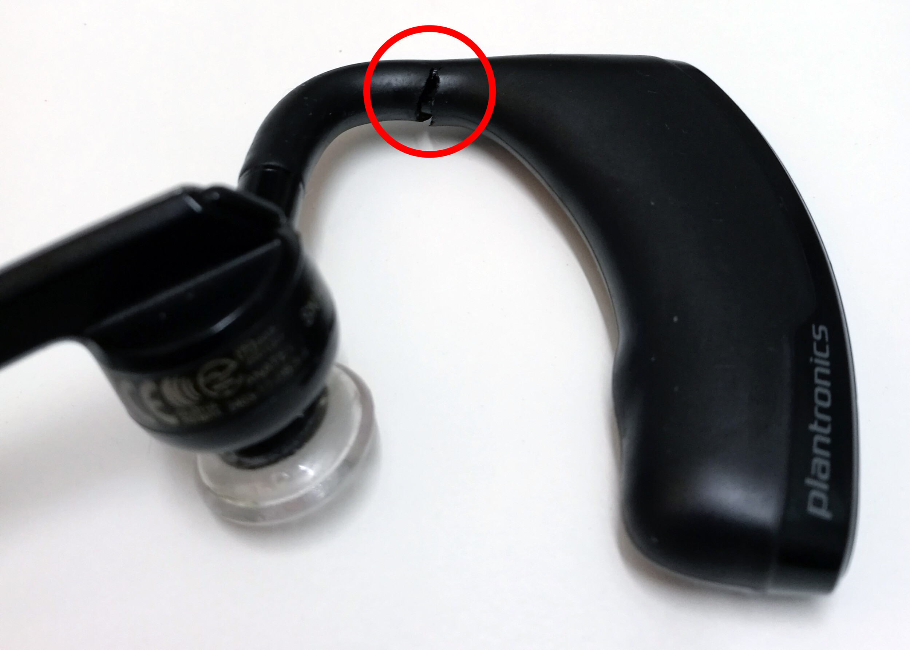

Ostin melkein kaksi vuotta takaperin itselleni uuden handsfreen ja sijoitin siihen 71 euroa. Nyt se on alkanut sitten hajoamaan.

Kirjoitin tästä lyhyen [arvostelunkin](/2015/plantronics-voyager-legend-bluetooth-handsfree) ja olen ollut todella tyytyväinen tähän handsfreehen. Tämä on minulla päivittäisessä käytössä joten helpolla se ei ole millään tapaa päässyt.

Olen vieläkin samaa mieltä, kuin pari vuotta sitten. Äänenlaatu ja akun kesto on hyvä sekä kokonaisuudessaan kyse on toimivasta laitteesta. Ainut miinus on tuo lataaminen.

Ongelmia oli jossain välissä siinä, että se ei tunnistanut oikein oliko korvalla ja ohjasi välistä kesken puhelun äänen puhelimeen. Tähän kyllästyin ja otin tuon toiminnon pois päältä.

Nyt kuitenkin on ilmennyt ongelma, josta en pääse yli. Se nimittäin hajosi ja tuli aukko tuohon kumimaiseen materiaaliin. Se näkyykin tuosta alla näkyvästä kuvasta hyvin.

Käyttöön se ei vielä vaikuta sillä handsfree toimii vielä hyvin. Päätinkin lähteä Giganttiin näyttämään tätä sillä se on ostettu sieltä 28.2.2015 ja kuitissa luvataan kahden vuoden takuu.

Noh tämä vika ei kuitenkaan ole takuunalainen vika Gigantin mukaan sillä se on kuluma ja johtuu käytöstä ei itsestään teknisestä viasta. Tuo on ollut käytössä itsellä käytännössä 21 kuukautta ja lähes joka päivä ollut korvalla.

Nyt siis käytän tämän handsfreen varmaan loppuun ja alan tutkimaan korvaajaa tälle. Tämä on kuitenkin itselleni työkalu siinä missä muutkin.
