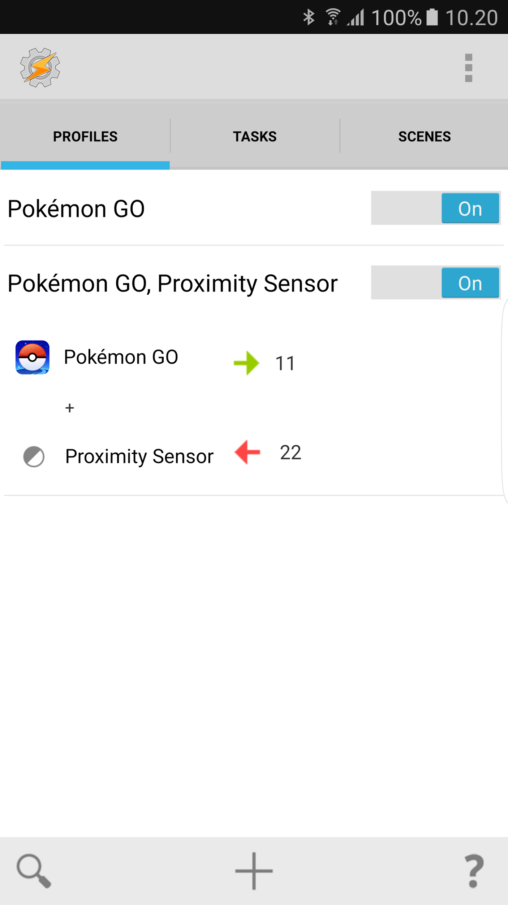

Olen hieman tutkaillut Pokemon Go peliä tässä viikon aikana ja tänään tuli sitten mieleen, että Tasker nimisellä ohjelmalla saan pari ärsyttävyyttä pois. Näitä vinkkejä varten tarvitset tosiaan Tasker nimisen ohjelman, jonka saa [Google Playstä](https://play.google.com/store/apps/details?id=net.dinglisch.android.taskerm&hl=fi). Tämä ei ole täydellinen opas millään muotoa Taskerin käyttämiseen vaan vinkkejä Pokemon Go peliin liittyen. Taskerista lisää sen [kotisivuilla](http://tasker.dinglisch.net/).

## Näyttö sammuu liian äkkiä

Itse idlaan kotosalla tuo päällä ja joskus sattuukin Pokemon pomppaamaan ruudulle. Täällä näkyy liikkuvan Eeveetä jonkin verran ja muuta Pokemoniakin. Halusinkin, että näyttö ei sammuisi ihan heti ja päädyinkin tekemään taskin, joka pistää näytön timeoutin 45 minuuttiin kun Pokemon Go peli on päällä ja takaisin minuuttiin, kun peli sammutetaan.

Loin siis uuden taskin ja nimesin sen. Tämän jälkeen actioniksi laitoin Display -\> Display Timeout -\> Valitsin ajaksi 45 min. Exit taskinkin loin ja tällöin tein täysin saman tempun, mutta valitsin ajaksi minuutin. Kun taskit on luotu niin tehdään uusi profiili ja se valitaan application mukaan ja taskinahan on ensin tuo 45min display timeout taski ja exit taskiksi tuo 1 minuutin taski.

## Vahinkokosketukset taskussa

Itselläni on tulut jokunen vahinkokosketus taskussa, sillä tämähän pitää olla päällä jos haluaa munan saada liikkumalla auki. Noh tähän löytyi ratkaisu, mutta tämä onkin hieman kinkkisempi ja koitan sitä avata parhaani mukaan.

Ensinnäkin luodaan uusi scene ja nimetään se. Vasemmalta sormen kuvasta otat resize ja laitat sen koko ruudun kokoiseksi. Oikealta ylhäältä otat kolmen pisteen kautta properties ja laitat Property Typeksi Overlay, Orientation System sekä väriksi \#000000 eli mustan. Omassa Samsungissa musta väri säästää näyttöä.

Kun scene on luotu niin tehdään kaksi taskia jo valmiiksi tasks välilehdeltä. Ensimmäinen task tehdään niin että valitaan actioniksi scene -\> show scene. Sieltä nimeksi kirjoita luomasi scenen nimi ja Display As kohtaan Overlay, Blocking, Full Window ja täppä pois kohdasta Show Exit Button. Tämän jälkeen luot toisen taskin vielä jossa actioniksi scene -\> hide scene ja nimeksi luomasi scenen nimi.

Nyt tehdään uusi profiili jossa ensin valitaan application ja se Pokemon Go. Valitaan sitten meno taskiksi tuo scenen näyttö ja exit taskiksi tuo scenen piilotus taski. Tämän jälkeen paina pitkään pohjassa profiilin Pokemon Go kohtaan ja valitse Add -\> State -\> Sensor -\> Proximity Sensor.

Itselläni näyttää alla olevan kuvanmukaiselta tämä profiili. 11 task on minun scenen näyttö ja 22 on minun scenen piiloitus taskin nimi.

Toivottavasti tämä auttaa jotakin ja tämä ei tosiaan ole Taskerin opas vaan suht huono selostus siitä millaiset taskit tein siihen tätä peliä varten. Jos ei auennut niin jaan teille xml muotoisena tuon koodin minkä Tasker minulle antoi noista. Tämä tosiaan pätee vain ja ainoastaan Androidiin! Tuon kun tallentaa xml muodossa Tasker/profiles kansioon ja pitkään painaa sormella Profiles kohtaa niin voi importata – toivottavasti toimii!

https://gist.github.com/MarkoKaartinen/377a49d14545f3d67105f063d15f44d4
