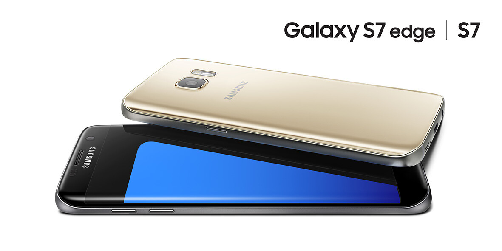
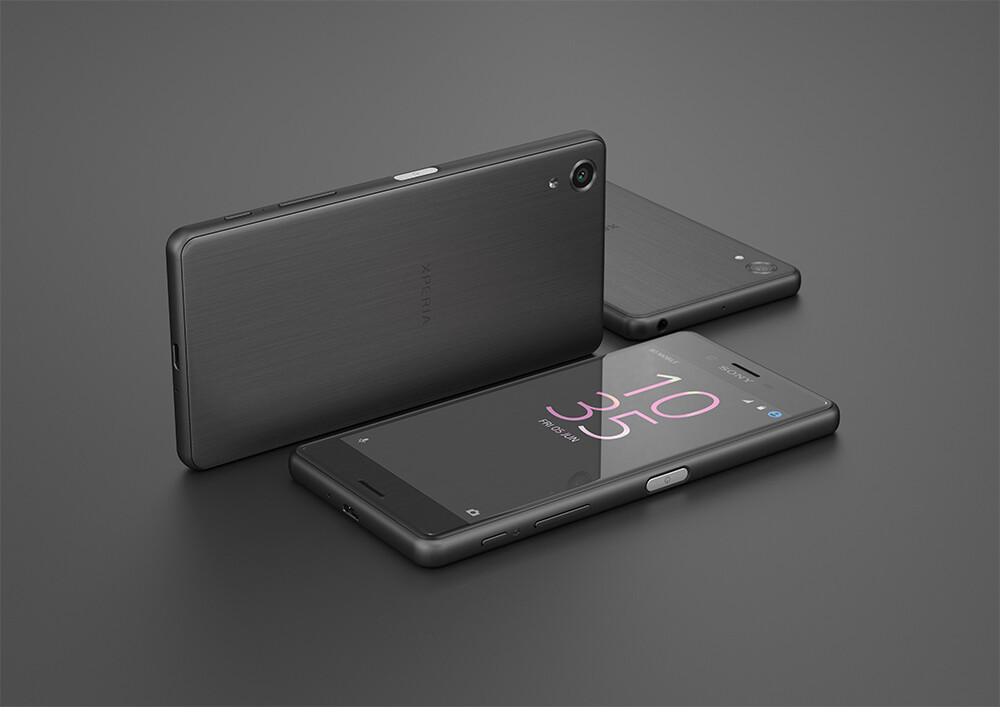

Palataan taas tähän tuttuun ja ”turvalliseen” aiheeseen. Nimittäin puhelimiin ja siihen, että minkä helkutin puhelimen sitä seuraavaksi ostaa. Tämä on kyllä vaikein osa ostopäätöksen tekemistä sillä tällä hetkellä on oikeastaan kolme vaihtoehtoa. Olen tästä kirjoittanut jutun [aiemmin](/2016/uusia-android-puhelimia) ja silloin olin hieman varmempi päätöksestäni – en ole enää.

## Samsung Galaxy S7 ja S7 Edge

\
Pääsin käpistelemään asiakkaan S7 puhelinta eräs päivä ja se piru vie tuntui hyvältä puhelimelta. Vikkelä kuin mikä ja näppäimistö tuntnui paremmalta, kuin tämän hetkisessä Moto X Play puhelimessa. Olen katsonut arvioitakin ja ilmeisesti Touchwiz ei ole niin paha mörkö enää.

Tässä on kaikki mitä kaipailenkin puhelimelta, mutta isoin ongelma on tosiaan se, että se on Samsung ja siinä on Touchwiz…

## Sony Xperia X Performance

\
Tätä pirulaista ei vielä ole päässyt köpistelemään missään sillä se ei ole edes markkinoilla. Speksit on myös miellyttävät ja ainoana puutteena kokisin langattoman latauksen puutteen. Tämä on iso kysymysmerkki sillä tämä ei ole edes arvostelijoille päätynyt – ei ainakaan arvosteluja ole näkynyt.

Tässä on tällä hetkellä ainoastaan se vika, että sitä ei ole julkaistu maailmalle ostettavaksi.

## Lopuksi

En oikein tiedä vielä mitähän helkuttia sitä tekisi tämän ”puhelinongelman” kanssa. Moto X Play käynee kaupaksi sopivalla hintaa. Pitää lähteä varmaan käymään puhelinliikkeessä ja ihmettelemässä näitä puhelimia tai no ainakin Samsungeja sillä tuota Sonyähän ei vielä voi käpistellä.

Alla on tosivaan vielä taulukko, jossa olen vertaillut minulle tärkeitä asioita.

\[table id=6 /\]

Kaikki vinkit ja kommentit on enemmän kuin tervetulleita!
