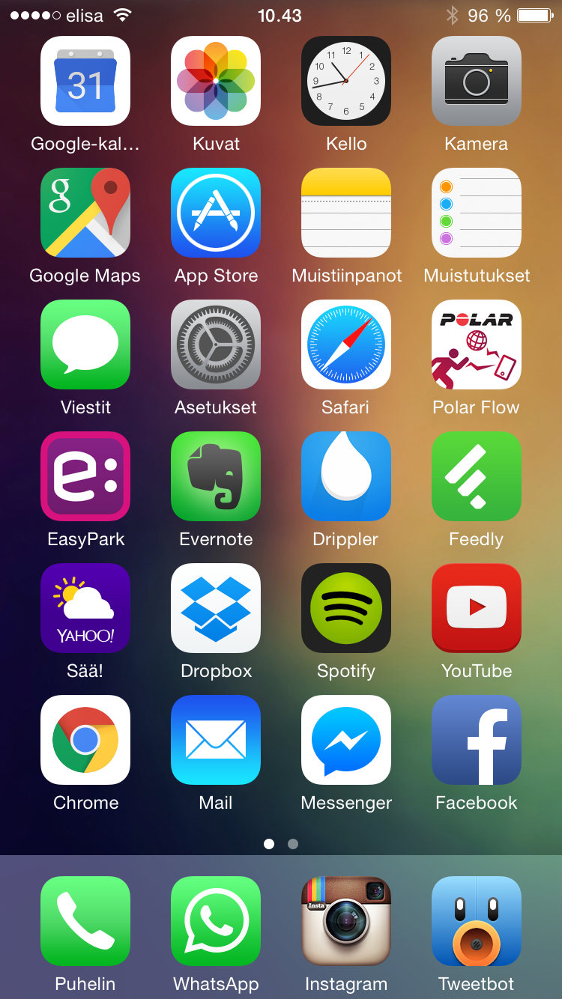
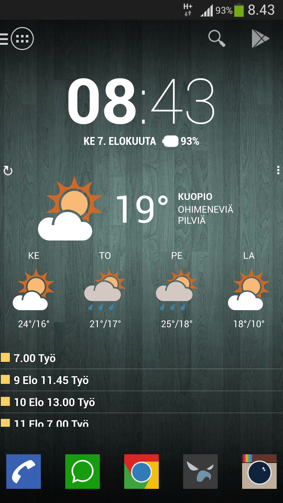
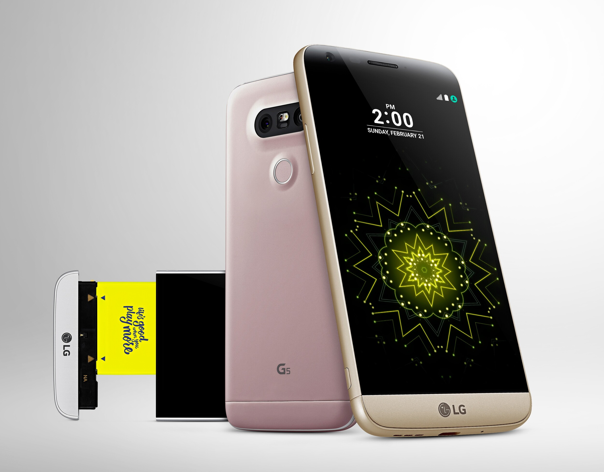
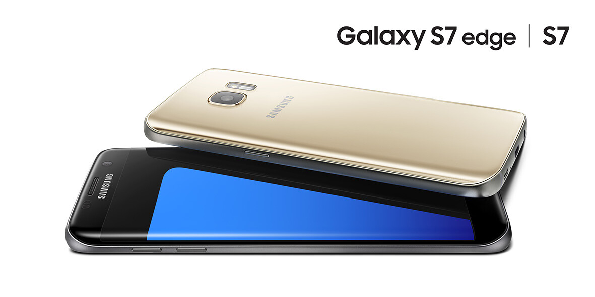
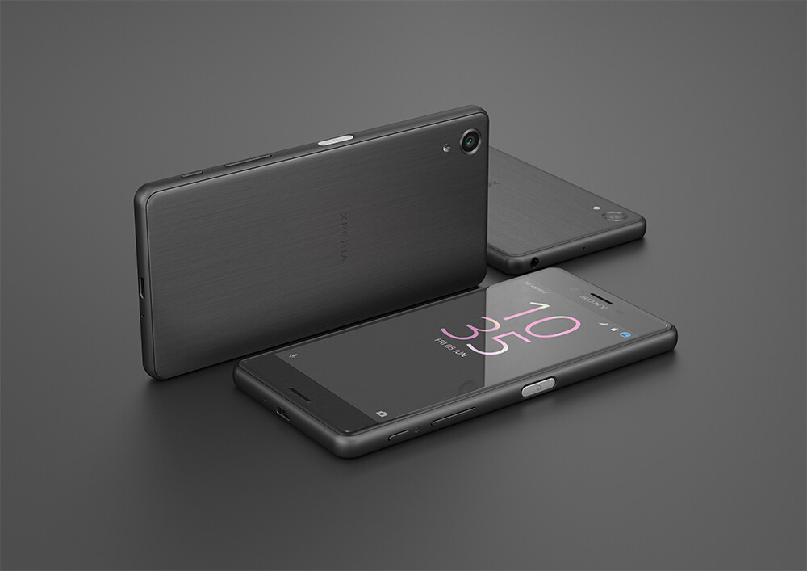

Tämänkin vuoden MWC (Mobile World Congress) toi uusia Android puhelimia ja nämäkös minua alkoi kiinnostamaan. Itsellänihän on tällä hetkellä käytössä iPhone 6 ja siinä on alkanut ärsyttämään pari asiaa tai oikeastaan ei itse puhelimessa, mutta käydään niitä läpi kohta tarkemmin. Nostan myös kolmen valmistajan puhelimia ylös ja kerron ottaisinko sen itselleni käyttöön näistä vaihtoehdoista.

## Ne ärsyttävyydet

iOS alkaa olla aika nähty ja rajattu ympäristö. Mitään uusia tuulia ei sieltä osaa ole näkyvissä ja erittäin kärjistettynä homma on ollut samalla mallilla alusta asti. Tietty pientä mukavaa on tullut, mutta ei mitään kauhean mullistavaa.

Laitoin tuohon oikealle kuvan omasta näyttöruudusta ja tuo kuva on toukokuulta 2015. Tuosta kuvasta minun puhelimen pääruutu ei ole muuttunut juuri miksikään. Spotifyn kuvake on rumempi ja pari kuvaketta on vaihtunut toiseksi.

Eli ihan kauheaa muutosta ei ole tässä vuoden ajalla tapahtunut eikä varmaan tule ihan heti tapahtumaankaan. iOS tuntuu junnaavan joiltain osin paikoiltaan ja itse kaipaankin nimenomaan hieman vaihtelua tähän aloitusnäyttöön ja en sitä, että vain järkkäisin kuvat uusiksi.

Vasemmalle laitoinkin sitten kuvan taannoisen Galaxy S4 puhelimen ruudusta. Tämä onkin sitten jo kolmisen vuotta taaksepäin. Jotenkin olen alkanut kaipaamaan takaisin tuohon suuntaan. Päivän infot heti ruudulla, kun kalenterin saa suoraan näkyviin.

Mahdollisuuksia siis olisi paljon enemmän tuolla Android puolella sillä iOS on aika suljettu ympäristö vaikka sen jailbreikkaisikin. Harmi kun iOS puhelimeen et saa asennettua Androidia, olisi aika kova pommi. Windows phone kun ei ole itselle minkäänlainen vaihtoehto enää sillä yksi kokeilu riitti.

Projektipuhelimiksi voisin kasailla hieman erilaisia käyttiksiä kuten Jollaa ja Windows phonea.

## Niin, niitä uusia Android puhelimia…

Tosiaan pitihän minun niistä uusista MWC:ssä julkaistuista puhelimistakin puhua. Nämä on nimittäin herättänyt mielenkiintoa ja osa enemmän ja osa vähemmän. Kerronkin hieman syitä mikä missäkin puhelimessa mättää tai ei ole ihan täysin mieleen. Nämähän on taas mielipiteitä ja oman mielipiteen voi aina laittaa kommentteihin!

### LG G5

Aikoinaan kun Galaxy S4 puhelinta hankin niin oli myös mietteissä LG:n vastaava malli, olikohan G3. Silloin sitä ei vain ollut niin hyvin saatavilla minun leveysasteilla niin valitsin sitten S4. Nyt tuli kuitenkin LG:n G5 puhelin uunista ulos.

Tässähän on erikoista se, että tässä on modulaarisia elementtejä. Alaosa lähtee irti ja akun voi vaihtaa sitä kautta. Samoin siihen voi liittää esimerkiksi kameramoduulin jossa on lisävirtaa ja kameran hallintaan lisää painikkeita.

Muuten tämän päivän julkaisuihin ei tuossa sinässään ihmeitä ole: hyvä näyttö, muistia, 32 gigaa tallennustilaa, microsd korttipaikka ja muuta mukavaa. Tarkemmat speksit voit katsastaa vaikka [täältä](http://www.gsmarena.com/lg_g5-7815.php).

Tämä ei tule päätymään omaan taskuun ja syitä on oikeastaan yksi. Tuo pirun kamera ”kumpu”. En pidä siitä millään tapaa, että kamera tulee noin paljon yli itse puhelimesta. En pidä siitä tässä iPhone 6:ssakaan, että kamera tulee tuon verran yli. Muutenhan tässä ei mitään vikaa ole ja tämä on nyt se syy miksi en tätä tule itselleni hankkimaan.

### Samsung Galaxy S7 ja S7 Edge

Minullahan oli Galaxy S4 eli aika paljon vanhempi malli kuin nämä. Siinä en pitänyt oikeastaan siitä Samsungin omasta Touchwiz systeemistä ja tässäkin on hieman samaa karsastusta.

Edgessä erikoisuutena on näytön reuna ja molemmissa on isonnettu akkua sitten S6 mallin. S7 onkin bloggareiden mukaan lähinnä parannus S6 malliin. Tässäkin on tietysti hyvä näyttö, muistia, 32 gigaa tallennustilaa, microsd korttipaikka ja muuta mukavaa kuten LG:ssäkin. Tarkat speksit löytää näistä linkeistä: [S7](http://www.gsmarena.com/samsung_galaxy_s7-7821.php) ja [S7 Edge](http://www.gsmarena.com/samsung_galaxy_s7_edge-7945.php).

Vaikka tässäkin kamera tulee hieman ulos takakannesta niin se ei ole häiritsevällä tasolla enää. Isoin ongelma onkin Samsung itse ja Touchwiz, en ole siitä pitänyt ja se tuo turhaa sälää muuten toimivaan Androidiin. Toki nämä voi vaihtaa ja pistää mitä vain, mutta S4:ssä kun laukesi ns. [Knox bitti](https://www.samsungknox.com/en/faq/what-knox-warranty-bit-and-how-it-triggered) niin takuu oli käytännössä mennyt.

### Sony Xperia X ja X Performance

Sonyn puhelinta en ole omistanut, mutta veljellä on sellainen ja itselläni on [Xperia Z4 tablet](/2015/sony-xperia-z4-tablet) käytössäni. Sonylta tulikin Xperia X ja Xperia X Performance mallit ja nämä onkin mielenkiintoiset tulokkaat kilpakentille.

Molemmissahan näissä on megapikseleiltään kovat kamerat ja detikoitu kameranäppäinkin. Muotoilultaan tämä on todella hyvännäköistä ja yksinkertaista. Kuten muissakin tulokkaista löytyy hyvää näyttöä, muistia, 32 gigaa tallennustilaa, microsd korttipaikka ja muuta mukavaa. Tarkat speksit löytää näistä linkeistä: [Xperia X](http://www.gsmarena.com/sony_xperia_x-7948.php) ja [Xperia X Performance](http://www.gsmarena.com/sony_xperia_x_performance-7949.php).

Tämä on näistä kolmesta se todennäköisin korvaaja omalle iPhone 6:lle. Ensinnäkin ominaisuuksista mitä itse tahtoisin uupuu vain langaton lataus, mutta lataaminen tukee ns. Quick chargea eli nopeampaa latausta. Kamera on hyvä ja etukamerakin on jopa fullhd tasoinen. Eikä se pirun kamera ainakaan kuvien perusteella tule tuosta takakannesta yli.

## Lopuksi

Melkein voisin sanoa jo tässä vaiheessa vuotta, että tänä vuonna palaan taas Android leiriin. iPhone 6 on ollut minulla julkaisusta asti ja en usko, että Apple tuo mitään uutta iOS rintamalle.

Se mikä puhelin sitten lopulta taskuun päätyy onkin vielä mysteeri. Xperia X Performance on tällä hetkellä todennäköisin voittaja. Tosin Google ei ole julkistanut Nexus puhelintaan tälle vuodelle, mutta jos siinä on samanlainen kameraratkaisui kuin edellisessä Nexus 6P puhelimessa, niin ei kiitos.

En halunnut tätä kirjoitusta spekseillä täyttää sillä ne voitte hyvin käydä lukemassa noista linkeistä. Itsehän haen puhelimelta tällä kertaa tyylikästä ulkoasua, tallennustilaa, tehoa, hyvää kameraa ja muutenkin mielekästä ratkaisua. Langattomasta latauksesta olen valmis luopumaan sillä onhan se nykyisessäkin iPhonessa [lätkän avulla toteutettu](/2016/langaton-lataus-kaytannossa-qi-ja-iphone-6).

Tarkempia arvosteluita odotellessa… **Samoin** minulle saa laitella luureja testiin tietysti! Omat kommentit ja mielipiteet voi tosiaan laitella tuonne kommenttiboxin puolelle!
