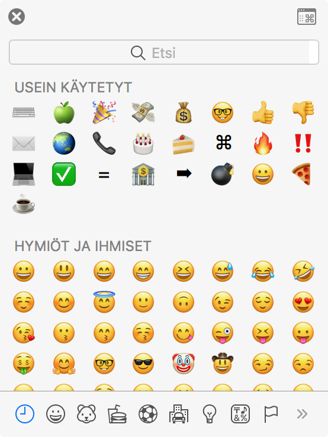

Tiesittekö, että voit aukaista oman ”näppäimistön” emojien syöttämiseen macOS käyttöjärjestelmässä eli mäkissä. Tämä on taas yksi näppäinyhdistelmä mikä hukkuu muistin syövereihin ja ajattelin laittaa senkin ylös tänne!

Kyse on siis tämmöisestä aukeavasta näppäimistöstä:\

Tästä voit valita näppärästi käytettävän emojin tekstiin! 🤓

Tämän ikkunan saat auki tällä näppäinyhdistelmällä:

CTRL Command ⌘ Välilyönti (space)
