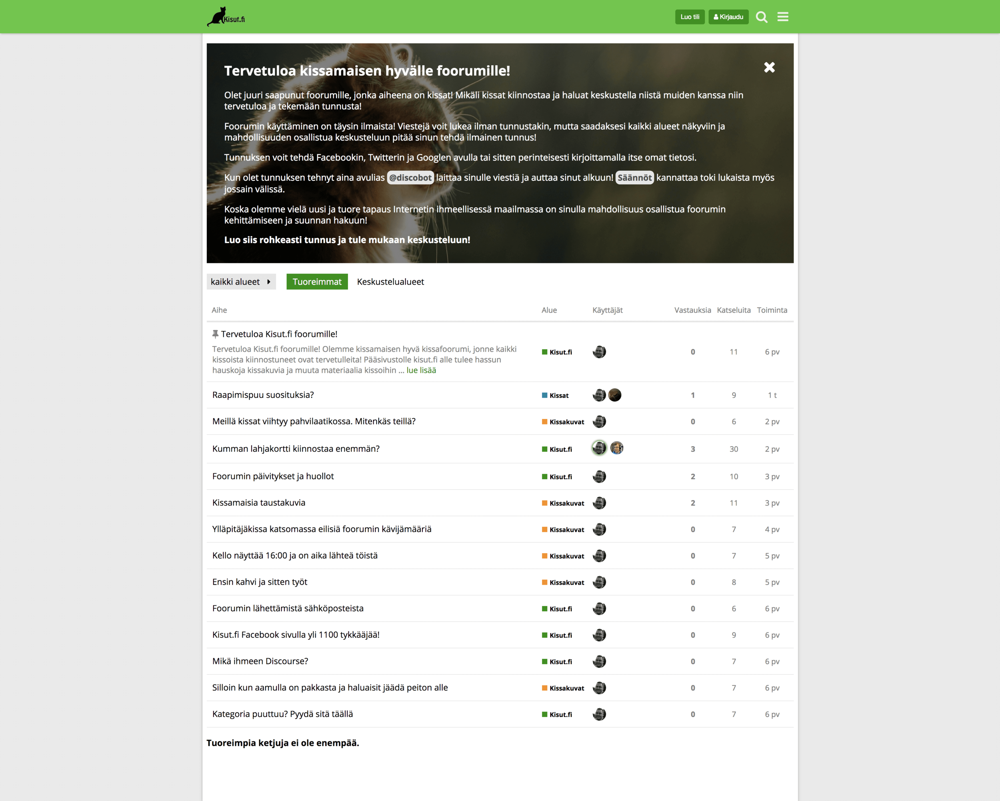

Halusin hieman esitellä täällä minunkin blogin puolella Kisut.fi sivuston foorumia, jonne on tarkoitus kerätä kissaihmisiä keskustelemaan.

Ajatus foorumiin lähti siitä, että Kisut.fi sivuston [Facebook sivuilla](https://www.facebook.com/kisutfi/) on kirjoitus hetkellä melkein 1200 tykkääjää ja halusin koittaa tuoda tätä väkeä keskustelemaan kissoista tuonne foorumin puolelle.

Foorumin tarkoitus on tuoda hyvä ja selkeä keskustelupaikka kaikille kissoista kiinnostuneille. Foorumi toimii myös pääsääntöisenä tapana kommentoidan Kisut.fi sivuston artikkeleita. Tarvitset siis yhden tunnuksen ollaksesi mukana toiminnassa!

Foorumi on haluttu aluksi pitää suhteellisen simppelinä. Ensimmäinen näkymä näyttääkin suoraan sen mitä on tapahtunut viimeksi ja jos haluaa lähteä syvemmälle keskustelualueisiin pureutumaan niin sekin on mahdollista. Alueita ei aluksi olla haluttu tehdä liikaa vaan niitä lisätään sitten tarpeen tullessa.

Osa sisällöstä on näkyvillä vain ja ainoastaan jäsenille. Tämä siitä syystä, että emme halunneet ihan kaikkea näyttää julkisesti ja näin saamme jäsenten kesken oman ”rauhan”. Keskusteluun osallistuminen vaatii tunnukset ja tunnusten luonti on ilmaista sekä helppoa.

Discourse otettiin pohjaksi johtuen sen yksinkertaisuudesta ja toimivuudesta. Onpa se myös aika pitkälti käännetty suomeksikin joten se myös iso helpotus. Samaten Discourse saadaan integroitua suoraan WordPressiin, joten tämäkin on yksi tekijä valinnassa.

Tällä hetkellä foorumilla on myös käynnissä arvonta, jossa voi voittaa 20 euron arvoisen lahjakortin Musti & Mirri liikkeeseen.

**Osoitehan on <https://foorumi.kisut.fi/>**
