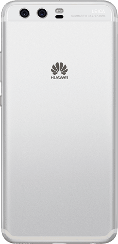
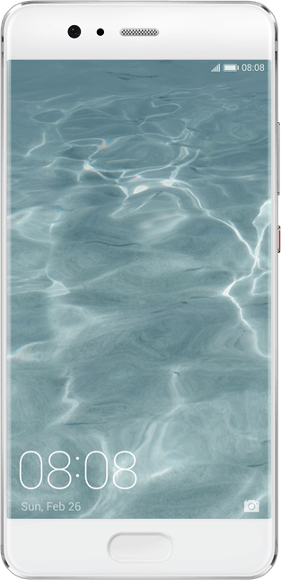
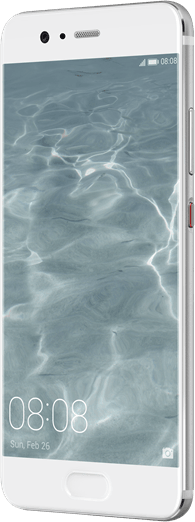

Suomi saa Huawei P10 -uutuuspuhelimet myyntiin ensimmäisten markkinoiden joukossa, vain muutama viikko niiden Euroopan lanseerauksesta. Huawei P10 ja Huawei P10 Plus -mallin ennakkoon tilanneet saavat lisäetuna Huawei AM185 -vastamelukuulokkeet. Etu on voimassa 10.-30.3. ja se koskee kaikkia operaattoreita ja Huawein jälleenmyyjiä.





> Useita mediapalkintoja Barcelonan MWC-messuilla saaneet Huawei P10 ja Huawei P10 Plus puhuttavat kamera- ja kuvausominaisuuksillaan. Molempien mallien etu- ja takakamerat ovat kehitetty yhdessä kameravalmistaja Leican kanssa ja uudistetusta kaksoiskamerasta löytyy 12 Mp värikenno ja suurempi 20 Mp mustavalkokenno. Uusi 2x hybrid zoom tuo lisää joustavuutta kuvaamiseen ja harrastuneemmille on tarjolla ammattitasoinen pro-tila, joka mahdollistaa kuvausarvojen manuaalisäädön ja RAW-kuvat. Videot onnistuvat nyt myös 4K-tarkkuudella ja lisäksi hidastus- ja bokeh-tiloissa.
>
> Huawei P10:n suuri 3200 mAh akku (P10 Plus 3750 mAh) kestää pitkään ja tukee SuperCharge-pikalatausteknologiaa, joka lataa varausta puolessa tunnissa koko päivän tarpeisiin. Matalavolttinen (4.5V/5A) pikalatausteknologia on myös turvallinen, sillä se minimoi lämpenemistä lataustilanteessa.
>
> Huawei P10:n voimanlähteinä toimii huipputehokas Kirin 960 8-ydinprosessori ja 4 Gt:n RAM-muisti (P10 Plus 6 Gt), joiden ansiosta raskaidenkin sovellusten käyttäminen on nopeaa ja sulavaa. Lisäksi uuden EMUI 5.1 käyttöliittymän koneoppimisalgoritmi optimoituu käyttötottumusten mukaan. Huawei P10:n Uusi Cat 12 -yhteystuki mahdollistaa jopa 600 Mt/s latausnopeuden ja sisäänrakennettu neljän antennin järjestelmä tunnistaa parhaan signaalin ja valitsee nopeimman yhteyden automaattisesti.
>
> Huawei P10-uutuudet sisältävät kaksi nanoSIM-korttipaikkaa. EMUI 5.1 mahdollistaa myös kaksoissovellustoiminnon, joten voit esimerkiksi käyttää kahta eri WhatsApp-tiliä samanaikaisesti. Toisen korttipaikan voi halutessaan käyttää myös tallennustilan laajentamiseen microSD-muistikortilla. Lisäksi P10-mallit tukevat käteviä rystystoimintoja; rystysen koputus- ja piirtoeleillä voi esimerkiksi ottaa kuvakaappauksen, avata halutun sovelluksen tai jakaa näytön kahden sovelluksen välillä.
>
> Huawei P10 saapuu kauppoihin 31.3.2017 ja P10 Plus huhtikuun lopulla. Molemmista malleista Suomessa myyntiin tulevat värit ovat musta, hopea, sininen ja kulta. P10:n suositushinta on 599 euroa ja P10 Plussan 799 euroa. Ennakkotilausetuun (10.-30.3.2017) sisältyvien Huawei AM185 -kuulokkeiden hinta erikseen hankittuna on 129 euroa.

### Kommentti

Huawei lähtee selkeästi kisaamaan taas kovempi hintaisten puhelimien luokassa sillä hintaluokka on S7 ja S7 Edgen luokkaa. Jännä nähdä miten tämän myynti lähtee menemään. [Honor 8](/2016/kokeilussa-huawei-honor-8) on itsellä kuitenkin aktiivisessa käytössä ja se on hintaluokaltaan varmaan tuota keskiluokkaa. Jännä nähdä ja seurata mitä arvostelijat ja käyttäjät tulee tykkäämään tästä!
