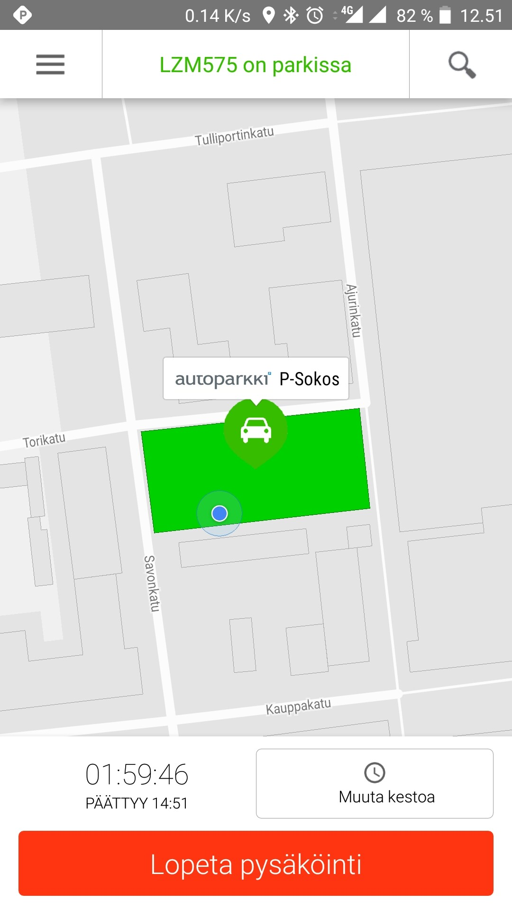
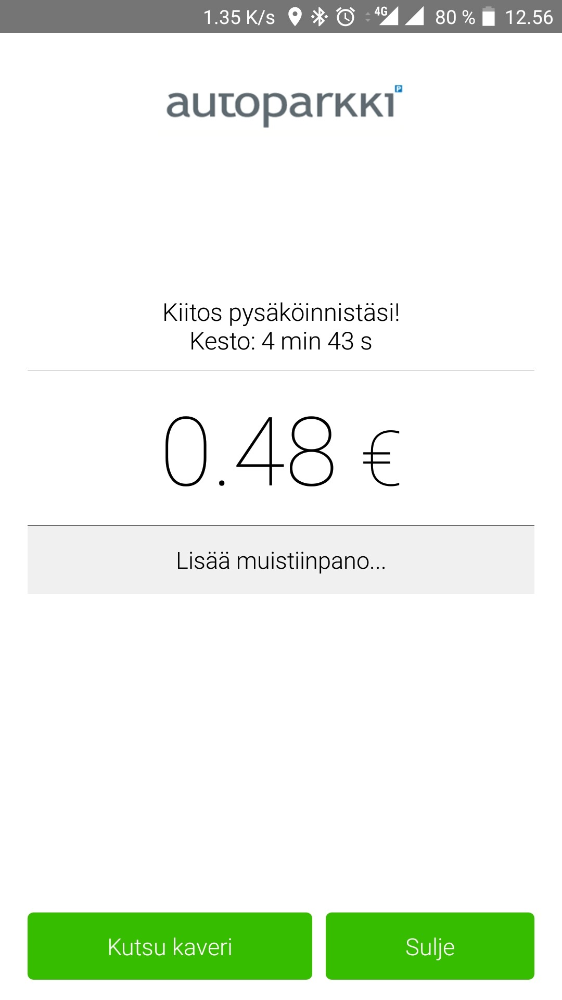
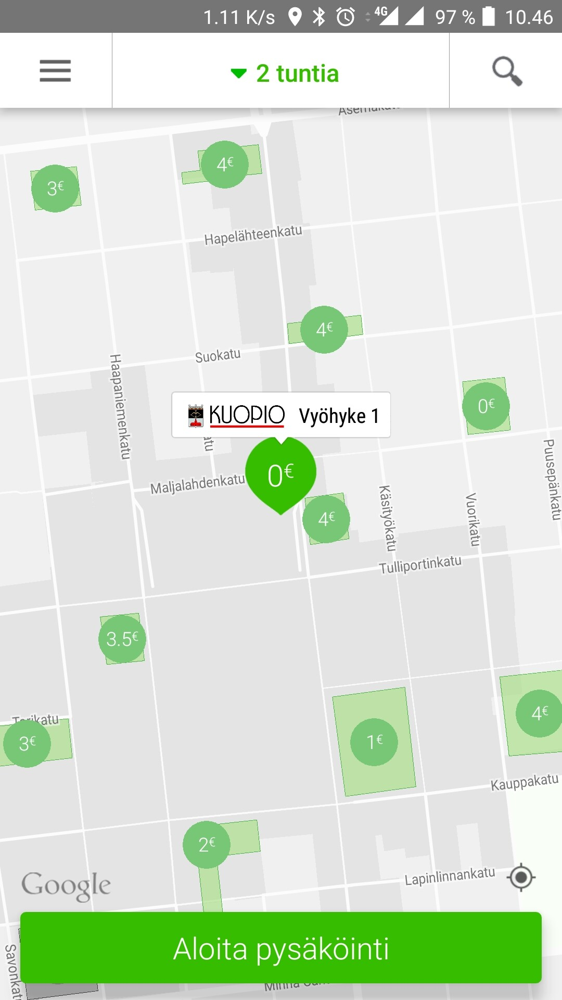

Olen käyttänyt jo ParkManin kilpailijaa [EasyParkkia](/2013/kokeilussa-easypark) jonkun aikaa ja nyt, kun Kuopioon tuli keskustaan ParkMan sekä EasyPark käyttöön kadunvarsipysäköintiin pitihän se tätäkin kokeilla.

Kokeilemaan innosti sekin, että koodilla sai ilmaisen pysäköinnin aina 10 euroon asti niin kehtasi koittaa Kuopion keskustan 1 vyöhykkeellä tuota pysäköintiä, jossa tunti maksaa arvioni mukaan 2.5 euroa.

Aloittaminen oli helppoa. Kyselin Twitterissä koodia ja sain sen kaverilta (oma koodini tuolla artikkelin lopussa!). Loin tunnuksen ja syötin koodin. Tämän jälkeen lisäilin maksutiedot sekä auton infot. Sittenpä oltiin oikeastaan valmiita pysäköimään auto.

Ajelet parkkipaikalle ja nappaat ParkManin päälle ja kappas kun se näyttää onko ko. alueella ParkManin pysäköintiä. Valitaan aika ja aloitetaan pysäköinti.





Kuten EasyParkissa voi ParkManissakin voit muuttaa aikaa kesken pysäköinnin ja voit lopettaa pysäköinnin kun haluat. ParkManissa isona plussana tulee se, että se näyttää pysäköintialueen hinnat. Alla näkyykin miten ParkMan ne näyttää.

Mikäli sinä haluat koittaa ParkMania ja haluat yhden pysäköinnin ilmaiseksi aina 10 euroon asti niin käytä tunnusta luodessa koodia **UCTE** – tällöin minä ja sinä saadaan molemmat ilmaiset pysäköinnit aina 10 euroon asti!

Alla vielä ParkManin oma mainosvideo.


