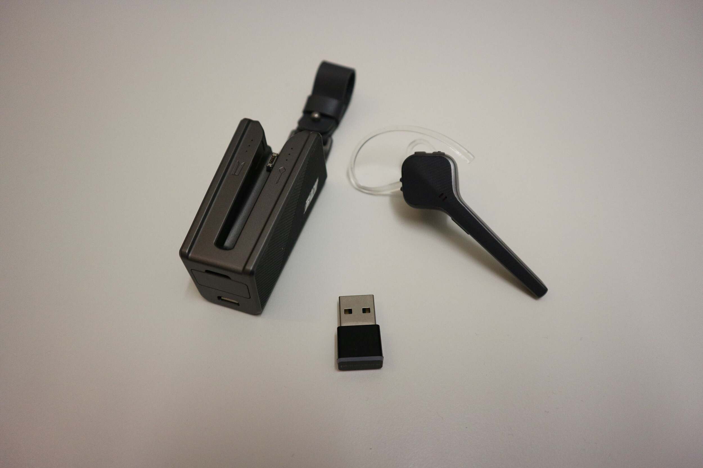
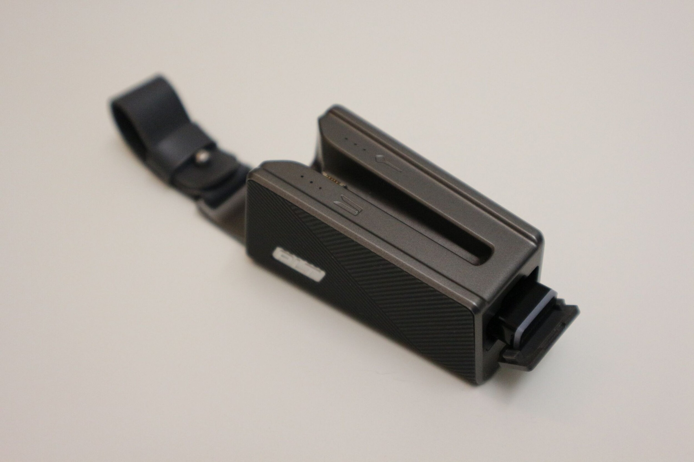
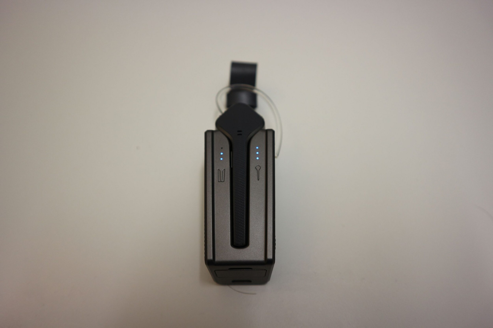
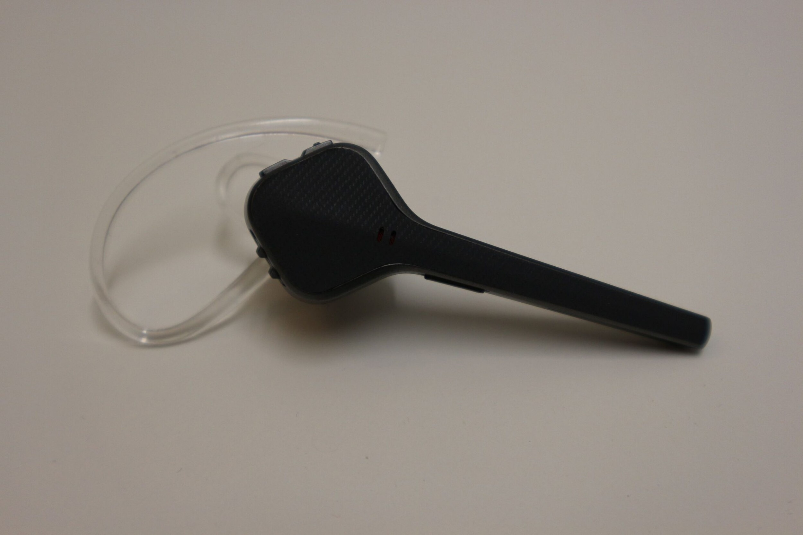
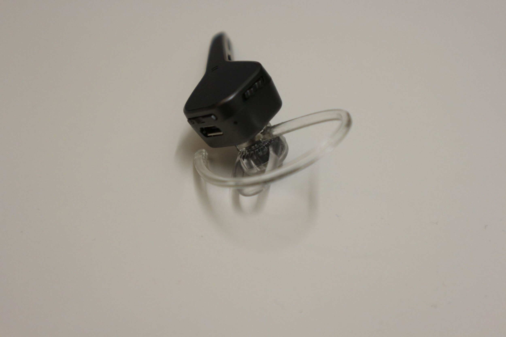
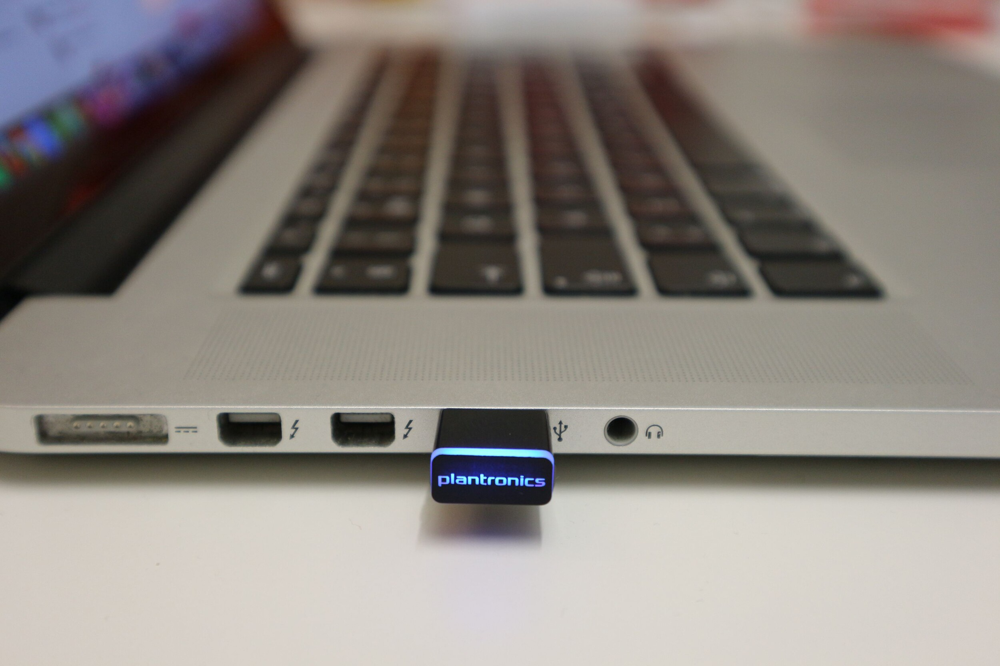

Tällä kertaa kokeiluun saapui Plantronics Voyager 3200 UC handsfree. Tämähän on tietenkin bluetoothin yli toimiva handsfree ja koska kyseessä on UC malli niin mukana tulee USB-adapteri, jolla sen saa myös tietokoneeseen kiinni.

Kylläpä muuten sattui oikeaan paikkaan tämän laitteen testaaminen! Mikäli oikein olen käsittänyt niin tämä on vielä uusi malli Plantronicsilta ja tulenkin vertailemaan sitä itsellä käytössä olevaan Plantronics Voyager 5220 handsfreehen. Otetaan alkuun ensin taustaa itsestäni ja näistä. Minulla on handsfree päivittäisessä käytössä töissä sillä olen kokenut, että kahdella kädellä kirjoittaa konetta paljon paremmin kuin yhdellä – handsfreen avulla ei tartte puhelinta siis nostaa korvalle! Olen kuluttanut loppuun parikin handsfreetä ja viimeisimpänä loppuun kului [Plantronicsin Voyager Legend](/2016/plantronics-voyager-legend-hajoaa) joka kesti pari vuotta minun käytössäni. Ihan en tätä paria vuotta ajatellut testata ja sen jälkeen kirjoittaa vaan nyt tämä on korvalla ollut parisen viikkoa.

Paketissa tulee kaikki tarpeellinen. Pieni ohjeläpyskä, itse handsfree, USB adapteri, kotelo, erikokoisia silikonikorvallisia, sanka sekä USB-johto. Olen erittäin tyytyväinen siihen, että Plantronics on siirtynyt käyttämään MicroUSB liitintä heidän handsfreessään. [Voyager Legendin](/2015/plantronics-voyager-legend-bluetooth-handsfree) kanssa pelkona oli, että latausadapteri katoaa ja pitää silloin hankkia uutta osaa tilalle. Tässä sitä ongelmaa ei kuitenkaan ole! Sekä lataavassa kotelossa ja itse handsfreessä on MicroUSB portti ja on samalla myös luovuttu turhasta latausadapteristakin – tämä tuli vielä tuon minun 5220 mukana (siinä oli myös MicroUSB porttikin).

Aloitetaan tuosta kotelosta sillä se on hyvä lisä tähän pakettiin. Ensinnäkin se on lataava ja sillä saa jopa 10 tuntia lisää aikaa eli lataa tämän handsfreen täyteen 1-2 kertaa. Kotelossa on myös paikka tuolle USB adapterille jos sitä haluaa kuljettaa mukanaan. Kun handsfree on kotelossa niin kotelo lataa sitä ja voit nähdä hipaisemalla sekä kotelon, että handsfreen varaustilanteen kolmen valon avulla. Jos kotelo on tarkoitettu vyölle meneväksi niin siinä ei olla minusta onnistuttu – tuo lenkki tuossa on liian lyhyt minun vyölle. Housunlenkkiin sen saisi periaatteessa, mutta se on silloin sivuttain. Olenkin heittänyt sen laukkuun tai taskuun mikäli se on ollut matkassa.





Sitten itse handsfreehen. Eroten Voyager Legendistä ja Voyager 5220 mallista tämä on kompaktimpi ja ei mene korvan taakse mikäli et itse sankaa pistä. Itse otin sangan käyttöön sillä se turvaa sitä kuitenkin hieman. Erikokoisilla korvallisilla tämän saa sopimaan omaan korvaan mainiosti ja pysyisi se paikallaan ilmankin, mutta halusinpa nyt tämän extraturvan käyttöön kun se oli mahdollista. Äänenlaatuhan on tässä vieläkin erinomainen molempiin suuntiin ja en olekaan kokenut sen kanssa ongelmia missään vaiheessa. Painikkeitakin on tarpeellinen määrä: äänenvoimakkuuden säätö, virtakytkin, vastauspainike sekä mute painike joka toimii myös painikkeena jolla voi aktivoida Sirin/Google assistentin/Cortanan.





Ominaisuudet ovat sitä tuttua Plantronicsia eli jos on sensorit päällä (voi säätää appsin kautta) niin puheluun vastataan nostamalla tämä korvalle, painamalla nappia tai sanomalla answer (mikäli tämä on päällä). Vastaamisesta sen verran, että pidin enemmän tuon Voyager 5220 napista sillä sen sai helpommin painettua, kuin tässä. Itsellä, kun on tämä korvalla niin haluan painaa ennemmin tuota nappia, kuin vastata puheluun muulla tapaa.

Akun keston kanssa ei ole ollut ongelmia. Kestää hyvin työpäivän verran satunnaista puhelua ja ääntä. Akun kestoahan voi parantaa lähettämällä handsfreelle vain puhelun äänet eikä puhelimen kaikkia ääniä – tämä onnistuu ainakin Androidissa. Näin voit autossa lähettää puhelun äänet handsfreelle ja [musiikin äänet autolle](/2016/musiikkia-autoon-bluetoothin-avulla). Itse olen työpäivän jälkeen aina pistänyt handsfreen tuohon koteloon ja se on silloin latautunut täyteen seuraavaa päivää varten. Latailen sitten tuota koteloa usb piuhalla. Näin vajaan parin viikon jälkeen en ihan täysin osaa sanoa montako kertaa olen ladannut koteloa. Olen ehkä pistänyt sen pari kertaa piuhan päähän ihan vain testiksi ja varmuuden vuoksi, että virtaa on. Mikään ei ole niin ärsyttävää kuin se, että handsfreestä loppuu virta (tai se jää kotiin) kesken päivän. Sitten pitää autoillessa käyttää siellä olevaa kuulokemikki settiä.

Sitten tuohon USB palikkaan. Laitoin sen kiinni omaan MacBookkiini ja se lähti toimimaan ilman mitään paritusta tai mitään. Korvassa handsfree kertoi tietokoneen olleen yhdistetty ja homma ok.  USB palikassa on led valo joka kertoo tilaa ja sitä kautta saakin hyvän indikaation siitä, että onko yhdistettynä. Äänenlaatu on hyvä tässäkin tapauksessa ja homma pelitti testeissäni oikein mainiosti. Tämä onkin mainio lisä koneeseen jos on tarvetta Skype miiteille tai muulle voip käytölle. Pelaamiseen suosittelen peliheadsettiä ennemmin kuin handsfreetä :)

Tämä on kaiken kaikkiaan mainio handsfree ja odotinkin sitä Plantronicsilta. Aiemmat heidän minun käytössä olleet laitteet ovat olleet rahan arvoisia ja niin on tämäkin paketti. Jos jostain pitäisi antaa pyyhkeitä niin se olisi tuo kotelon remmin lyhyys – osaava henkilö modaa tuostakin sopivan itselleen.

Kysymyksiä ja kommentteja voi heitellä tuonne kommenttiboxiin! Vastaan mikäli osaan ja pystyn niihin vastaamaan :)

Lisää tietoa saa heidän omilta sivuiltaan: [plantronics.com](http://www.plantronics.com/us/product/voyager-3200-uc)

*Handsfree on toimitettu minulla testattavaksi ilmaiseksi. Mielipiteet ovat kuitenkin omiani!*
