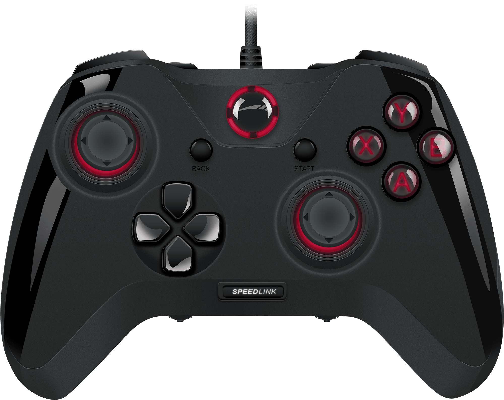
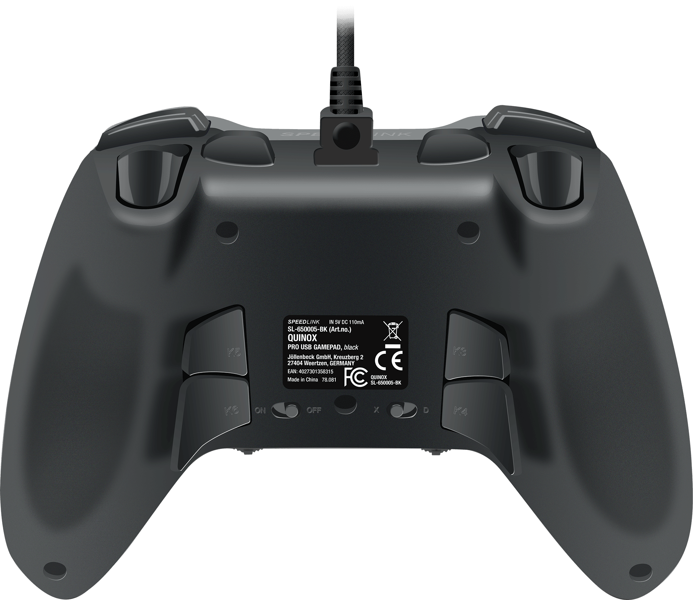
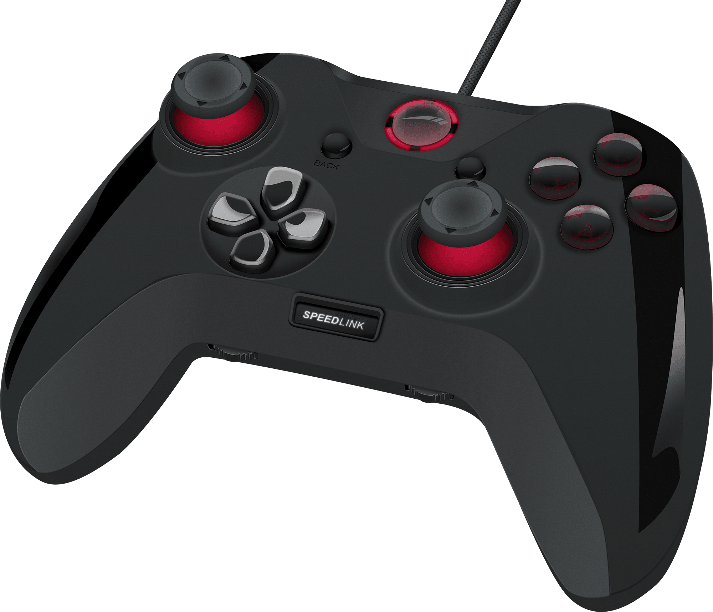

Tällä kertaa sain kokeiltavaksi Speedlink QUINOX Pro peliohjaimen. Ohjain on langallinen ja kytkeytyy tietokoneen USB-porttiin. Tätä ohjainta tulenkin vertaamaan aika suoraan Xbox Onen ohjaimeen, joka onkin omassa käytössäni.

Itse paketista paljatui ohjain johtoinen sekä parit pikaohjeet. Muutapa ei oikeastaan ohjaimen mukana tarvitakkaan. Käyttöönottokin oli yksinkertainen prosessi. Latasin Speedlinkin sivuilta ajurit ja asensin ne. Tämän jälkeen kytkin ohjaimen kiinni ja homma oli sillä selvä.

Katsotaanpas aluksi ohjaimen ominaisuudet läpi:

- Ohjelmoitava PAD-ohjain tietokoneelle
- Ohjainsauva ja digitaalinen, erittäin tarkka 8-suuntainen ristiohjain
- Ergonomisesti sijoitettu vasemmanpuoleinen ohjainsauva miellyttävään analogiseen pelaamiseen
- Kaksi analogista liipaisinta, kaksi bumper-painiketta ja kymmenen digitaalista painiketta sekä ”Back”- ja ”Start”-painikkeet
- 2 ylimääräistä olkapainiketta – toiminnot vapaasti määritettävissä, lisäksi niihin voidaan liittää makroja
- 4 lisäpainiketta alapuolella – toiminnot vapaasti määritettävissä, lisäksi niihin voidaan liittää makroja
- Painikkeiden toimintovaraukset voidaan tallentaa kahdessa painikeprofiilissa
- Makrot voidaan tallentaa kahteen makroprofiiliin
- Kaksi säätöpainiketta painikkeiden ohjelmointiin ja asetuksiin
- Käytännöllinen OLED-näyttö
- Intensiiviset värinäefektit tekevät pelikokemuksesta erittäin todentuntuisen
- Tyylikäs valaistus
- Analogisen ohjainsauvan ja liipaisimen herkkyys säädettävissä
- Irrotettava USB-johto (johdon pituus: 2,4m, micro-USB/USB-liitäntä)
- Paino: n. 205g

Ohjain on muuten verrattavissa näppäinlayouteiltaan ja olemukseltaan Xboxin ohjaimeen. Ainoana erona on tietysti ylimääräiset ohjelmoitavat painikkeet sekä säätömahdollisuudet. Itselle hyödyllisin ominaisuus onkin ollut pohjassa olevat painikkeet sekä ylimääräiset olkapainikkeet. Xboxin ohjain on myös ehkä hieman laadukkaamman tuntuinen ja tähän Speedlinkin ohjaimeen voisi lisätä hieman painoa ehkä tai laadukkaampaa muovia niin olisi yhtä laadukkaan tuntuinen kuin Xbox Onen ohjain.

Ohjainta voi tosiaan ohjelmoida itse ja ohjelmointi tapahtuu itse ohjaimessa pienen OLED näytön avustuksella. Tämä onkin näppärä tapa sillä silloin asetukset säilyy ohjaimen muistissa eikä tarvita erillisiä ohjelmia ohjelmointia varten koneelle.

Omien pelaamisten aikana ei minulla ollut ongelmia ohjaimen käytössä ja sain aika nopeasti haltuun nuo takanapit. Ohjelmoin takanapit RB/LB/LT/RT napeiksi eli käytännössä noilla saadaan hoidettua noiden nappien virkaa. Takana oli myös kaksi muuta ohjelmoitavaa näppäintä, jotka ohjelmoin tattien painallukseksi. Kerrassaan mainiota, vastaavaan on mahdollisuus Xboxin Elite ohjaimessa, mutta sen hintalappu taitaa olla kalliimpi kuin tämän.

Oikeastaan ainut asia miksi käytän vielä ennemmin Xbox Onen ohjainta on se, että tässä on johto ja sitä voin käyttää langattomasti. Tosin peleissä kuten Enter the Gungeon, jossa ampuminen on oletuksena RB/LB napeissa niin tämä oli paljon mukavempi pelata juurikin noiden takanappien ansiosta.

Windows 10:n kanssa ei ollut ongelmia ja kaikki pelitti vallan mainiosti. Johtokin on mukavan pituinen ja hyvän tuntuinen. Mikä parasta liitäntä on standardinmukainen micro-usb joten jos piuha hajoaa niin voi hakea kaupasta uuden tilalle.

Kaiken kaikkiaan ohjain on mainio ja jos olisi langaton niin se olisi täydellinen minulle. Viime aikoina olenkin koittanut uusia laitteita hankkiessa vähentää johtojen määrää, joten lanka onkin ainut isompi miinus. Ylimääräiset ohjelmoitavat napit ovat mainiot ja niitä ei usko tarvitsevan ennen kuin hankkii ohjaimen, jossa ne ovat!

Minulla on tämä ohjain vielä, joten jos on kysyttävää niin vielä kerkeää kysyä! Samoin, jos unohdin mainita jotain niin kommenttilootassa voi muistuttaa!

Lisää infoa ohjaimesta saat Speedlinkin sivuilta: <http://www.speedlink.com/?p=2&cat=2132&pid=45833&paus=1>

*Ohjain on toimitettu kokeiluun ilmaiseksi ja mielipiteet ovat omiani.*
