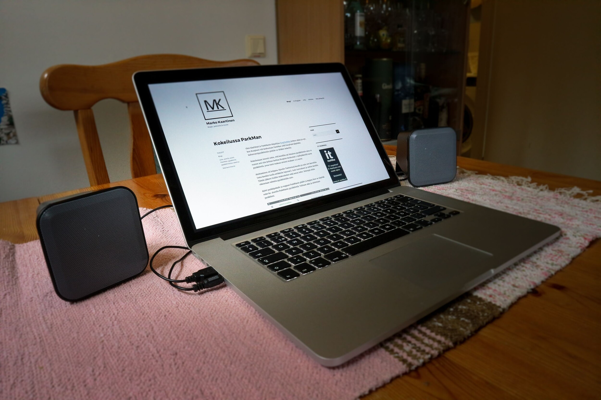

Tällä kertaa kokeiluun tuli Speedlink Snappy kaiuttimet. Nämä kaiuttimet on hintaluokaltaan 20 euron hintaluokassa ja on kyse ihan peruskaiuttimista.

Paketissa tulee itse kaiuttimet sekä ”ohjekirja”, jossa on käytännössä kuva liitännästä ja varoituksen sanat usealla kielellä. Näissä kaiuttimissa ei onneksi tarvita ihmeellistä ohjeistusta, jotta voit käyttää niitä.

Kaiuttimissa on kaksi kytkettävää johtoa: 3.5mm audiojohto sekä USB-johto. Virtaa laite ottaa USB-johdon kautta ja koitin sitä itse tietokoneessa sekä USB laturissani ja molemmista sai virtaa. Audiojohto sitten tökätään joko tietokoneeseen, tablettiin, puhelimeen tai muuhun laitteeseen mistä haluat ääntä ulos. Asennus on siis varsin simppeli.

Kaiuttimen johdossa on mokkula mistä saat laitettua kaiuttimet päälle/pois päältä sekä säädettyä äänenvoimakkuutta. Kun kaiuttimet ovat päällä palaa siinä myös valo.

Äänenlaatu näissä on ihan ok ottaen huomioon, että hintaluokka on 20 euroa ja niissä ei ole erillistä subwooferia. Kyllä nämä minun korvaan kuulosti paremmilta kuin MacBookin omat kaiuttimet. On näissä hitusen ehkä bassoakin, mutta minä en ole kovinkaan ”kultakorva”, jotta osaisin sanoa mitenkä paljon. Sen voin sanoa, että aikoinaan testaamat [Boset](/2016/kokeilussa-bose-qc35) kuulosti todella hyviltä.

Kaiuttimet näyttävät minusta myös hyviltä. Ulkonäöllisesti ne ovatkin mainiot. Ehkä johto voisi olla hieman pidempi niin kauttimien välissä kuin itse audio ja USB-johdotkin.

Sitten siihen käyttötarkoitukseen. Ensin ajattelin, että tämä korvaisi bluetooth kaiuttimeni jota ladataan MicroUSB portin kautta ja yhdistyy langattomasti tai audiojohdolla puhelimeen. Nyt kun olen käyttänyt niin tulen ennemmin kantamaan reissussa tuota pientä bluetooth kaiutinta ja nämä olisivat mainio kaveri esim. läppärille. Nämä voisi käydä myös mainiosti toimistoon, jos siis sinulla ei ole samassa tilassa muita työkavereita joita häiritset näillä :)

Kyllä näistä ääntä lähtee tuon 20 euron edestä. Nämä käy vallan mainiosti peruskaiuttimiksi ja nämähän ei tilaakaan vie paljoa. Näppärä ottaa mukaan ja kaikki johdot ovat kiinteitä joten niitäkään et saa hävitettyä.  Akku olisi kova lisä näihin sillä se toisi lisää kannettavuutta.

Lue lisää kaiuttimista [Speedlinkin omilta sivuilta](https://www.speedlink.com/en/oxid/PC-Accessories/Speakers/SNAPPY-STEREO-SPEAKERS-BLACK-GREY.html).

**ARVONTA!**\
Nämä kaiuttimet arvotaan [IT-Nurkan](https://it-nurkka.fi/) puolella! Kaikki, jotka luo tunnuksen ja osallistuu keskusteluun [IT-Nurkan keskustelualueella](https://keskustelu.it-nurkka.fi/) osallistuvat arvontaan. Tulen linkittämään tähän vielä tarkemman ohjeistuksen ja arvonta-ajan! Arvontaan voi osallistua vain suomalaisen osoitteen omaavat henkilöt.

Arvonnan ohjeistus: <https://it-nurkka.fi/tiedotteet/arvonta-voita-speedlink-snappy-kaiuttimet/>

*Kaiuttimet ovat toimitettu minulla testattavaksi ilmaiseksi. Mielipiteet ovat kuitenkin omiani!*
