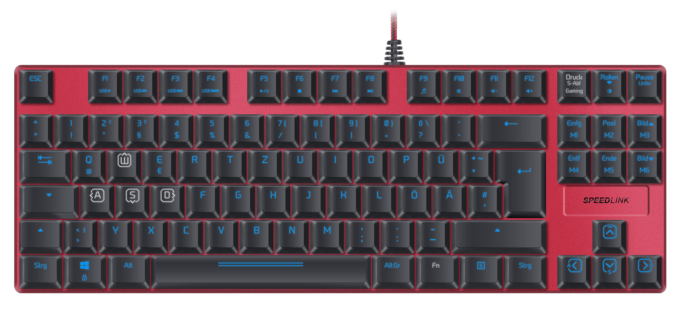

Ensimmäistä kertaa sain kokeiluun näppäimistön ja vielä mekaanisen sellaisen. Itselläni on ollut mekaaninen näppäimistö jo useamman vuoden ja olen kyllä pitänyt siitä. En enää tavallista näppäimistöä haluakaan pelikoneeseen. Kun mahdollisuus tarjoutui päästä testaamaan Speedlinkin ULTOR mekaanista näppäimistöä niin tietty otin sen kokeiluun.

Mekaanisissa näppäimistöissä itseä viehättää nimenomaan se ääni ja parempi tuntuma, kuin jos verrataan perinteisiin näppäimistöihin. Äänihän ja painallustuntuma riippuu millaiset kytkimet näppäimistössä on. ULTORissa on punaiset mekaaniset Kaihua Kailh -kytkimet, jotka on optimoitu pelaamista varten. Tämä ei ole sieltä mölyisimmästä päästä, joten säilyy jonkinlainen perherauhakin tämän näppäimistön kanssa.

Olen tässä nyt reilu pari viikkoa käyttänyt näppäimistöä pääasiallisesti pelaamiseen ja netissä surffailuun. En ole oikeastaan ongelmia siitä löytänyt. Minun sormiin tuntuma on toimiva ja näppäimen hakkaaminen on mennyt perille asti.

Käytäänpä tässä välissä hieman speksejä läpi:

- Ammattimainen pelinäppäimistö mekaanisilla kytkimillä
- Kustomoitava LED valaisu
- Vapaasti määritettävät näppäinkonfiguraatiot
- Ohjelmoitava pelimoodi (5 profiilia, 6 macronäppäinstä, vaihdettavat WASD ja nuolinäppäimet, uudelleenmääritettävät painikkeet sekä Windows napin deaktivointi)
- Punaiset mekaaniset Kaihua Kailh -kytkimet, jotka on optimoitu pelaamista varten
- Maksimoitu pelimukavuus kiitos korotettujan näppäimien
- Yksinkertainen layout kompaktissa alumiini rungossa
- N-key rollover takaa äärimmäisen anti-ghostingin
- Macroedotori integroituna ajuriin
- 64kb sisäinen muisti profiileja varten
- Peliprofiilien automaattinen lataus
- Säädettävä USB polling rate (1,000Hz asti (ultrapolling))
- Valittava vasteaika aina 1 ms asti
- Nopea pääsy 12 lisätoimintoon
- Taipuisa ja kestävä USB kaapeli (1.7m)
- Koko: 350 × 122 × 33 (L × S × K)
- Paino: 680g

Näppäimistössä on 1.7 metrin pituinen USB kaapeli, mutta harmikseni se on kiinteä. Mikäli piuha sattuu hajoamaan niin sen vaihtaminen ei ole ihan helppo homma. Kaapeli on kyllä laadukkaan oloinen, joten ihan heti se ei hajoa.

Toinen asia mikä harmittaa on RGB valojen uupuminen. Näppäimistön valojen väriä et voi säätää itse haluamaksesi ja tämä olisi ollut kiva lisä. WASD ja nuolinäppäimien valot ovat eriväriset kuin muiden joka on hieno lisä, onpa niissä hieman erilaiset merkinnätkin.

Näppäimistö on todella kompakti ja varsinkin, kun siinä ei ole numpadia ollenkaan. Omassa aiemmassa näppämistössä oli numpad ja tämä vaikuttaakin ihan kääpiölle siihen verrattuna. Rannetukea jäin tosin hieman kaipaamaan, mutta sellaisen voi ostaa tarvittaessa.

Asensin ohjelmiston siinä toivossa, että värejä olisi voinut vaihtaa, mutta ei voinut. Ohjelmistolla saisit kuitenkin säädettyä näitä peliprofiileja sekä makronäppäimiä. Itse en ole makroja käyttänyt oikeastaan koskaan saati sitten pelikohtaisia profiileja. Nämä onkin itselle ns. turhia ominaisuuksia, mutta onhan se kiva tietää, että ne ovat olemassa!

Isompia ongelmia ei minusta tässä näppäimistössä ole. RGB valojen ja irroitettavan USB piuhan puute on suhteellisen pientä. Näppäimistön kanssa pääsee alkuun hyvin ilman erillistä ohjelmaa, mutta jos haluaa säätää niin ohjelma on sitten pakollinen.

Lisää infoa näppäimistöstä saatte Speedlinkin omien [sivujen kautta](http://www.speedlink.com/?p=2&cat=4121&pid=39299&paus=1).

*Näppäimistö on toimitettu kokeiluun ilmaiseksi ja mielipiteet ovat omiani.*
