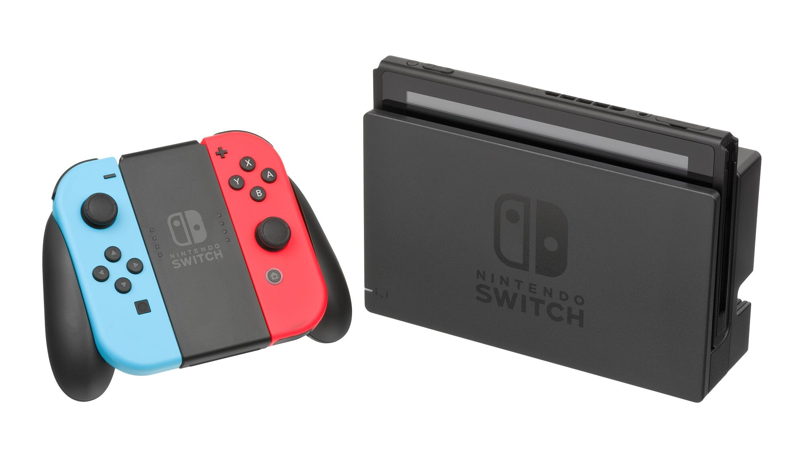

Itsekin tuli hankittua vihdoin ja viimein Nintendo Switch. Nyt sattui hyvä tarjous eteen ja tuli pistettyä tilaus sisään. Tiistaina se Switch sitten saapuikin ja piti heti käydä nappaamassa Super Mario Odyssey sille ja e-shopista tuli vielä hankittua SteamWorld Dig 2 sille – oli vielä tarjouksessakin. Isoin syy miksi en julkaisussa hankkinut Switchiä oli pelitarjonta. Nyt se on kuitenkin lisääntynyt huimasti, joten hankinnan aika on passeli.

Nintendo Switch on Nintendon uusin konsoli, jonka voisin jollain tapaa luokitella ”hybridiksi”. Sitä voit nimittäin pelata joko television kautta tai sitten ottaa sen mukaan ja pelata. Konsolista saat ohjaimet eli joy-conit irti ja niillä voi pelata kiinni konsolissa (ei tietenkään telakoituna), ilman grippiä tai gripin kanssa. Vaihtoehtona on myös erillinen ohjain, joka on ostettava erikseen.

Itse olen tosiaan pari iltaa käyttänyt konsolia ja pelannut sillä muutaman tunnin. Haluankin nyt kertoa omia mietteitäni tästä. Olen siis pelannut Super Mario Odysseytä ja SteamWorld Dig 2 pelejä. Mariota olen pelannut niin televisiotilassa, kuin ”handheldinä” ja SteamWorldia vain ”handheldinä”. Olen pelannut ainoastaan joy-coneja käyttämällä joko irrallaan konsolista tai sitten konsolissa kiinni.

## Ensin ne huonot ja oudot

Ensin pitää mainita se, että aikuisen käteen joy-conin napit ovat hitusen pienet – ainakin omaan makuuni. Ymmärtää sinällään, että kompromisseja pitää tehdä jo kannettavuuden vuoksi ja halutaan pitää koko järkevänä.

Toinen outous tulee sitten tuon oikean joy-conin tatin sijoittelusta sillä se on vähän outo. Sehän on ajateltu niin, että sitä voi käyttää kahden pelaajan tilassakin. Joy-conit nimittäin ovat omat erilliset ohjaimetkin esimerkiksi Mario Kartissa (jota en omista). Tästä syystä onkin mietinnässä kalliin Switch Pro ohjaimen hankinta jossain välissä (70 euroa – huh!).

Telakasta olenkin saanut jo lukea paljon kauhutarinoita, että se naarmuttaa näyttöä ja pitää olla varovainen. Itse laitoinkin suoraan näytönsuojan Switchiin (jonka hankin itse) ja laitoinpa telakan sisään vielä ohuen mikrokuituliinan, jotta se ei naarmuttaisi näyttöä.

Pakko on mainita tuo Nintendo Switchin jalusta, joka kääntyy takaa niin, että Switch pysyy pystyasennossa jos ei ole telakassa. Tämä on aika heppoisen tuntuinen ja kova luotto siihen ei ole. Harmi, että tuommoista yksityiskohtaa on jätetty huomioimatta, muuten hyvän tuntuisessa laitteessa.

## Sitten ne hyvät

Konsoli on toiminut vallan mainiosti. Super Mario Odyssey on maittavaa pelata niin television, kuin Switchinkin ruudulta. Ajatus siitä, että voin ottaa samat pelit mukaan, kuin mitä pelaan televisioruudulta on mahtava. Olenkin kasannut itselleni listaa peleistä mitä hankin jossain välissä tähän ja siihen kuuluu tietysti niin uusin Zelda, kuin Mario Karttikin – sekä tietysti indie pelejä, kuten Stardew Valley.

Se on jo itsessään hienoa, mistä mainitsinkin, että voit ottaa konsolin matkaan mukaan. Voi kun tämä olisi ollut minulla jo viime viikolla niin olisin saanut junaan tekemistä (nyt tosin pelasin 3DS:llä picrossia junamatkan).

Itse konsolin käyttäminen on helppoa ja yksinkertaista. Mitään ongelmia en ole löytänyt ja käyttöönottokin sujui mallikkaasti.

Muun kuin Nintendon pelitarjonta. Switchille on tullut ja on tulossa paljon pelejä muiltakin, kuin Nintendolta. Esimerkiksi Doom ja Skyrim on portattu myös Switchille ja indie pelejä on tietysti iso kasa. Mario + Rabbids Kingdom Battle on Ubisoftin ja Nintendon yhteinen tekele. Kukkaro huutaakin armoa, kun katselee Switchin pelejä…

Muistikorttituki. Playstation Vitassa oli surkea muistikorttituki sen takia, että piti olla Sonyn lisensoitu ja omanlainen muistikortti. Switchiin taas käy yleinen standardi: MicroSd. Itse tilasinkin Saksan Amazonista vajaalla 40 eurolla 128 gigaisen muistikortin Switchiä varten.

## Sitten jotain loppulöpinää

Olen varsin tyytyväinen hankintaani ja kasuaali pelaaja, kun olen niin tämä lisännee omaa pelaamistani. Sohvan nurkalla voikin napata Switchin kouraan ja pelata ilman, että valtaa television. Näenkin itseni ostamassa enemmän indie pelejä tälle, kuin PC:lle – tosin riippuu hieman pelin tyypistä. SteamWorld Dig 2 sopii mainiosti Switchille ja uskon myös Stardew Valleyn olevan hyvä peli siinä. Zeldakin tulee hankittua jossain välissä joko lainaan tai omaksi.

Pelejähän on vaikka millä mitalla ja esimerkiksi [jalkapallofaneille](https://futisfani.com/) löytyy Fifan muodossa jotain pelattavaa sekä tietysti muunlaisia jalkapallopelejä. Kannattaa kokeilla!

**Kysymyksiä ja kommentteja saa esittää, kuten aina!**

*Mielipiteet ovat omiani ja laite on itse hankkimani. Käytetty kuva: [Evan-Amos](https://en.wikipedia.org/wiki/File:Nintendo-Switch-Console-Docked-wJoyConRB.jpg)*
