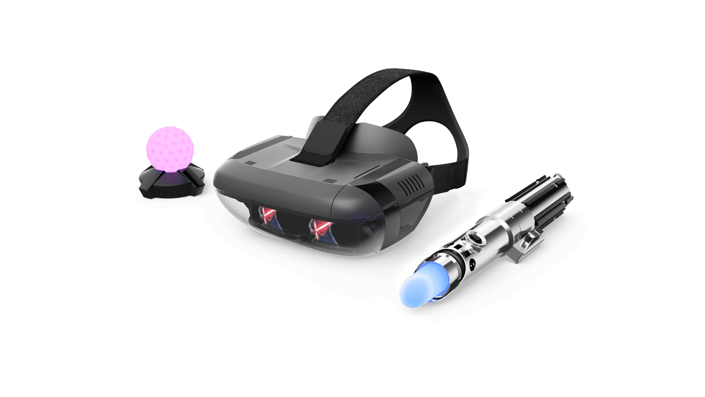
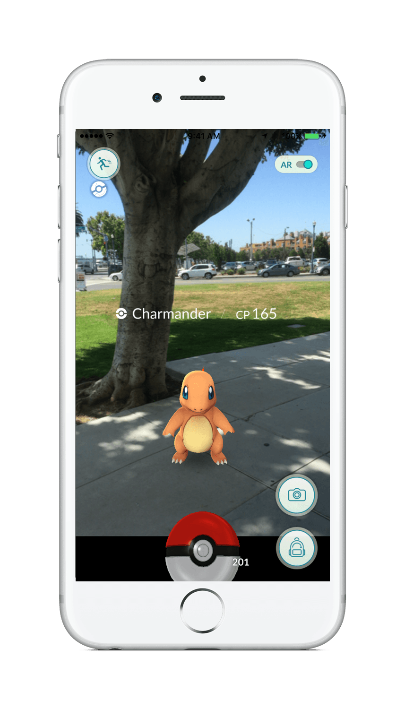

Lähdin kokeilemaan augmented reality (AR) tai suomeksi sanottuna lisättyä todellisuutta. Tämähän on käytännössä näkymä johon on lisätty graafisia elementtejä esim. tietokoneella tai matkapuhelimella. Viittaankin loppu artikkelissa tähän AR termillä pääsääntöisesti.

Lainataan ensin hieman [Wikipediasta](https://fi.wikipedia.org/wiki/Lis%C3%A4tty_todellisuus) tietoa:

> Lisätty todellisuus (engl. augmented reality, lyh. ar tai AR) viittaa näkymään, johon on lisätty tietokonegrafiikalla tuotettuja elementtejä ja jota käyttäjä tarkastelee läpikatseltavien (see-through) näyttöjen kautta. Se on siis järjestelmä, jossa keinotekoista, tietokoneella tuotettua tietoa (kuva, ääni, video, teksti, GPS-informaatio) on lisätty näkymään todellisesta ympäristöstä.
>
> Yhdysvalloissa asuva Ronald Azuma määritteli vuonna 1997 lisätyn todellisuuden seuraavasti:
>
> - Yhdistää todelliset ja virtuaaliset objektit todellisessa ympäristössä
> - Toimii interaktiivisesti ja reaaliaikaisesti
> - Kohdistaa todelliset ja virtuaaliset objektit toistensa kanssa
>
> Lisätty todellisuus liittyy laajempaan tehostetun todellisuuden (mixed reality) käsitteeseen, joka voidaan nähdä liukuvana jatkumona kevyesti lisätystä todellisuudesta kohti täydellisempää immersiota virtuaalitodellisuuteen.

## Star Wars: Jedi Challenges

Itse pääsin hyppäämään suoraan ”syvään päähän” tässäkin kokeilussa sillä sain lainaan [Star Wars: Jedi Challenges](https://www3.lenovo.com/fi/fi/jedichallenges/) setin. Paketissa tuleekin valomiekka, seurantamajakka ja Lenovo Mirage AR -lasit. Kerronkin hieman omaa kokemusta tästä setistä.

Käyttöönotto oli tässä simppeliä. Appi puhelimeen ja seuraili sitten ohjeita, kohta olikin ruudulla valomiekka ja pääsi väistelemään valoammuksia. Majakan ympärille käytännössä tulee erilaisia elementtejä ja hieman tilaa vaaditaan tähän jotta voidaan pelata kivasti. AR käyttää siis olemassa olevaa huonetta pelikenttänä ja lasien avulla näkyy sitten siellä elementtejä.

Jedi Challenges setti sisälsi kolme eri peliä. Yhdessä valomiekkailtiin ja huidottiin lähelle tulevie droideja tai ohjattiin valoammuksia niitä päin. Toisessa pelattiin eräänlaista shakkia ja kolmannessa hallittiin taistelukenttää. Itse pidin ehkä eniten strategisesta taistelukentän säätö pelistä joka toi omalta osaltaan mieleen Civilization, Age of Empires ja tämänkaltaiset peleit.  Kaikki pelit käytti hyödyksi valomiekkaa joko ohjaimena tai sitten ihan valomiekkana.

Alla lyhyet videot kaikista:

https://www.youtube.com/watch?v=BQc8CZDt9Qg

https://youtu.be/WPWnQGqkk3c

https://youtu.be/-p1usNKD-Rg

Pakko myöntää, että tämä oli ihan hauska peli. Valomiekka oli kiva ohjaimena niin toi jotain fyysistä mitä heilutellaan. Toki lasit päässä valomiekassa oli valo! Puhelinhan meni noihin lasien sisään ja sitä kautta heijasti dataa laseihin. Puhelin toimi siis koko homman älynä! Tämä on kyllä ihan mielenkiintoinen ja jännä idea ja toimi kyllä yllättävän hyvin. En olisi itse tätä ostanut, mutta hauska sitä oli päästä kokeilemaan!

Kirjoitushetkellä yhteensopivien laitteiden lista on seuraavanlainen: iPhone X, iPhone 8 Plus, iPhone 8, iPhone 7 Plus, iPhone 7, iPhone 6s Plus, iPhone 6s, iPhone 6 Plus, iPhone 6, Samsung Galaxy S8, Galaxy S7 edge, Galaxy S7, Google Pixel XL, Google Pixel, Moto Z² Force Edition, LG G6. Itse sovellus puhelimiin on maksuton.

## AR muualla

Jedi Challenges ei ole ainut mikä käyttää AR tekniikkaa hyväksi. Ikealla on esimerkiksi Ikea Place niminen appi joka heijastaa tuotteita kotiisi sen avulla. Tämä käyttää hyväksi puhelimen kameraa ja näin saat katsottua miltä esimerkiksi tietty Ikean tuoli näyttäisi kotonasi.



Suosittu Pokemon peli kännyköille käyttää halutessasi hyödyksi AR tekniikkaa kameran kautta ja tuo näin Pokemonit vaikkapa kotiisi.

Eli AR ei ole sinänsä mikään kauhean uusi juttu. Tämä on kuitenkin mielenkiintoinen sillä puhelimissa alkaa olla aika paljon laskentatehoja ja mahdollisuuksia tämänkaltaiseen toteuttamiseen on. Ikean sovellus on hyvä esimerkki siitä miten tätä voi käyttää hyödyksi omien tuotteiden ja myynnin tuessa.

Tätä kirjoittaessa tuli mieleen, että onkohan jo maalaukseen liittyvää puhelin appsia tullut. Voisi valita seinälle värin ja näkisi miltä se näyttäisi. Pikainen googletus toi tuloksen ja näitä näkyy olevan jo jonkin verran. Tämäkin on yksi hyödyllinen esimerkki siitä mihin tätä AR tekniikkaa voi käyttää.

Seuraavaksi olisi kiva päästä kokeilemaan virtuaalitodellisuutta eli virtual reality (VR) puolta. Tällä puolella pelit ja laitteet kiinnostaa todella paljon.

**Minkälaisiin AR toteutuksiin sinä olet törmännyt?**
