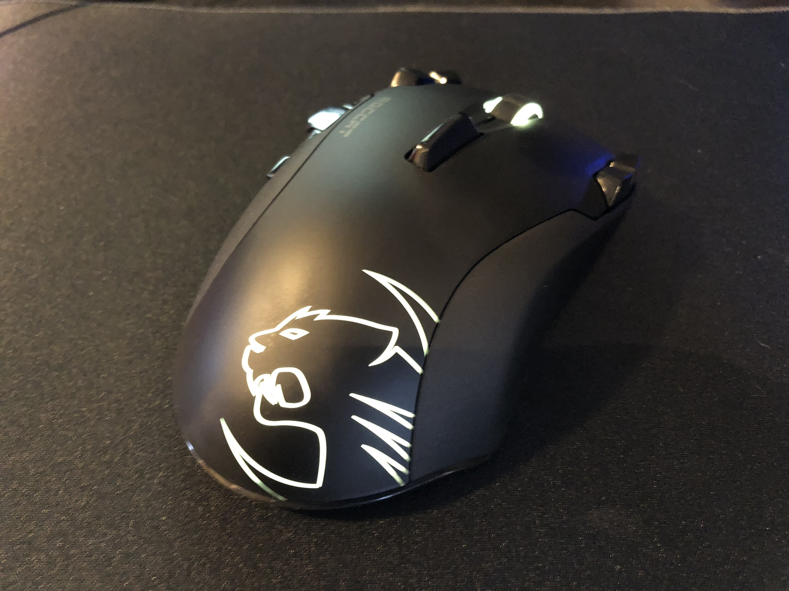
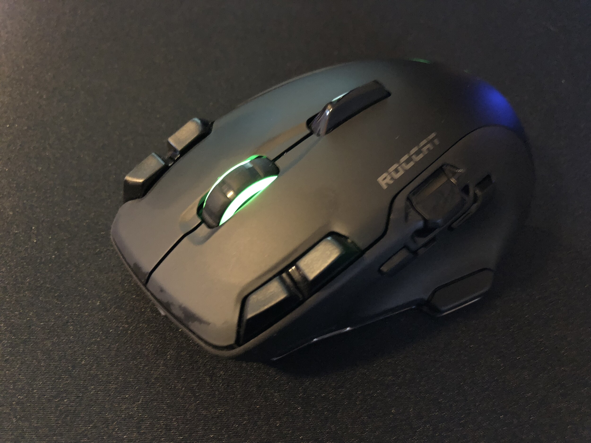
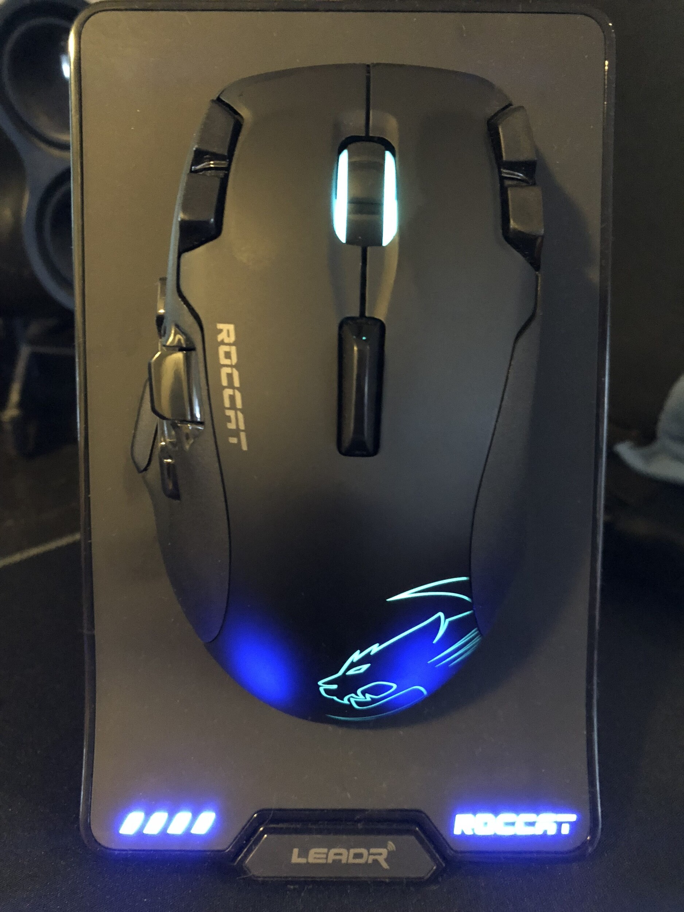
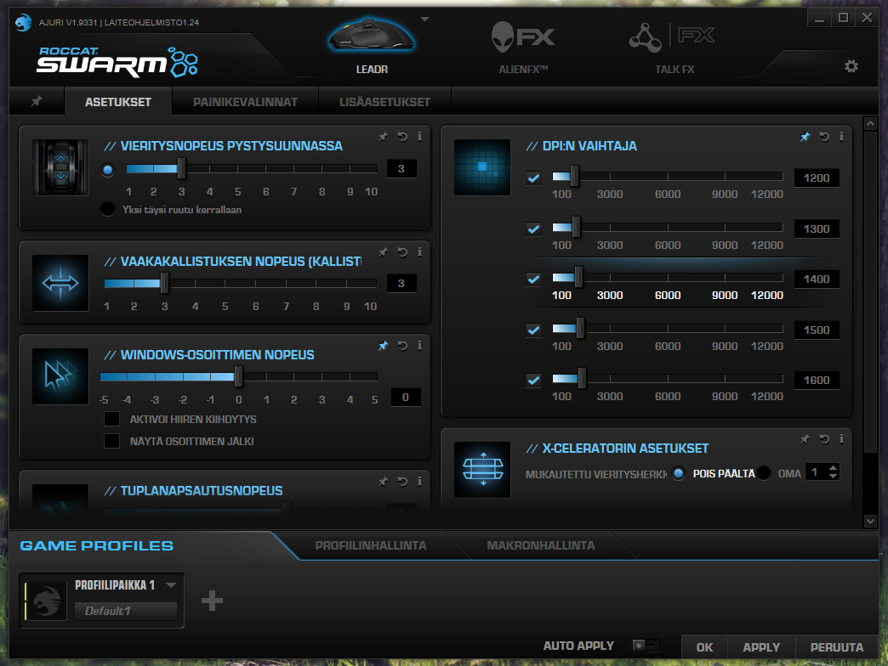
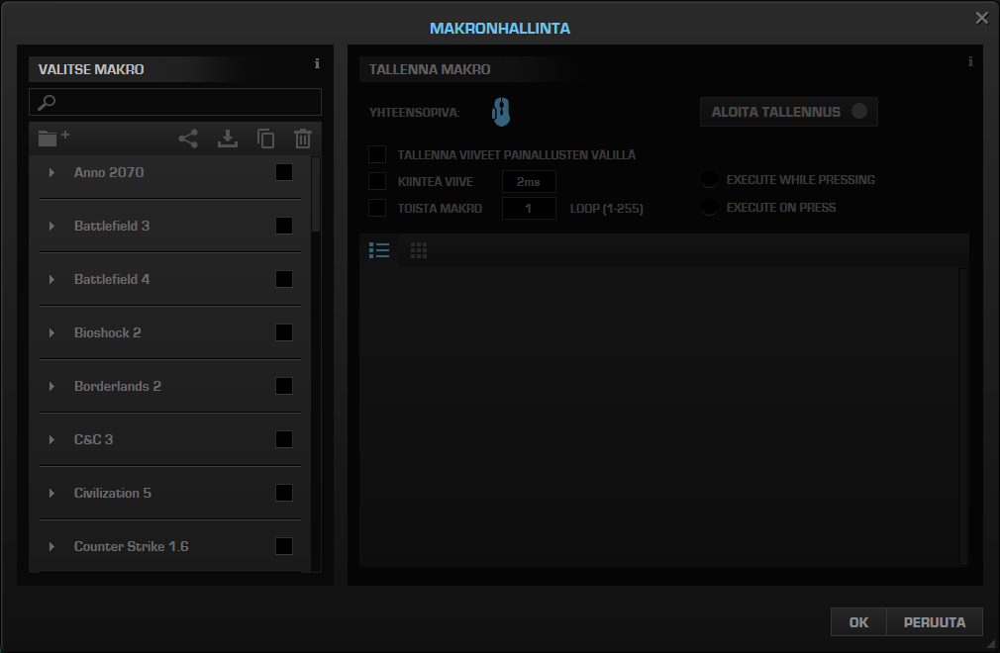
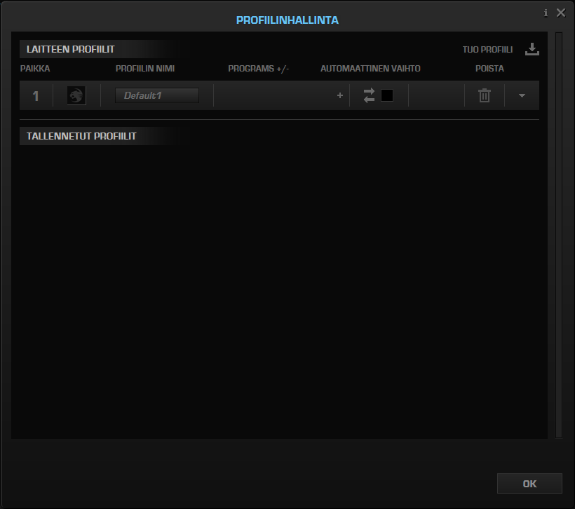
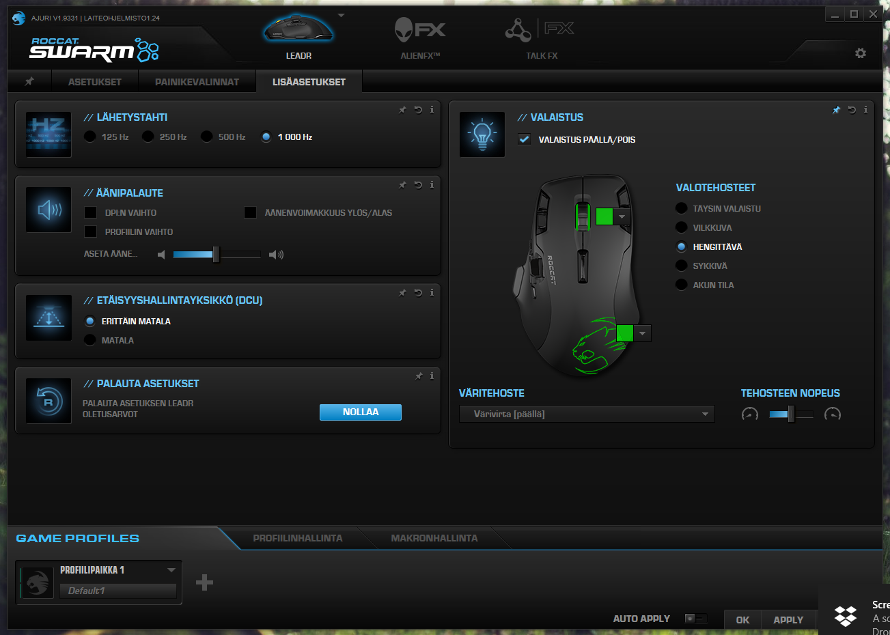
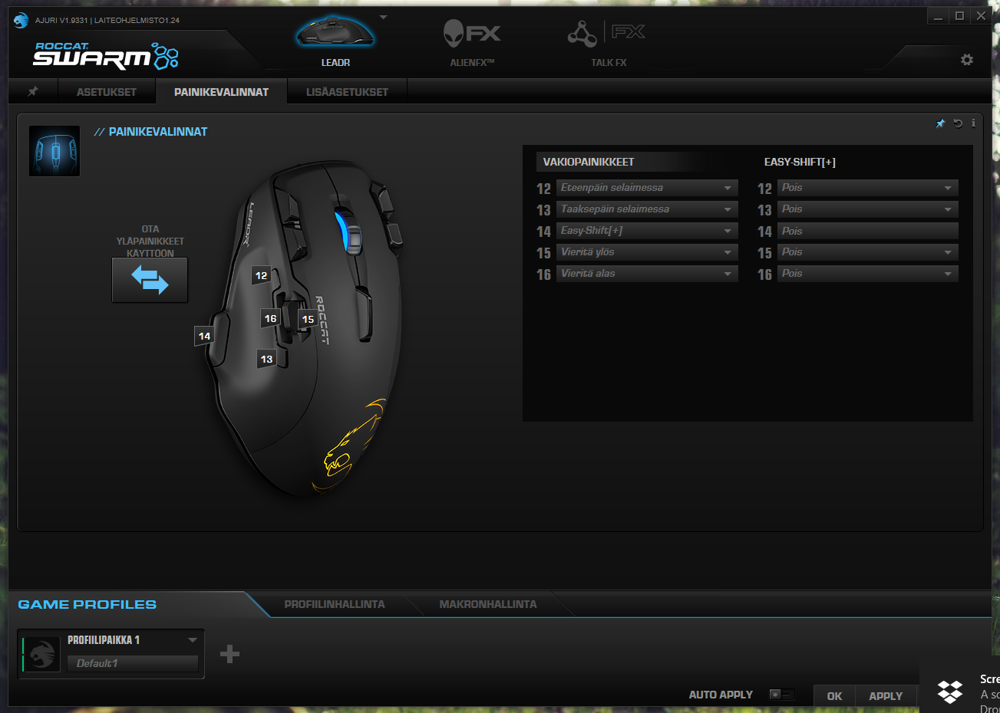
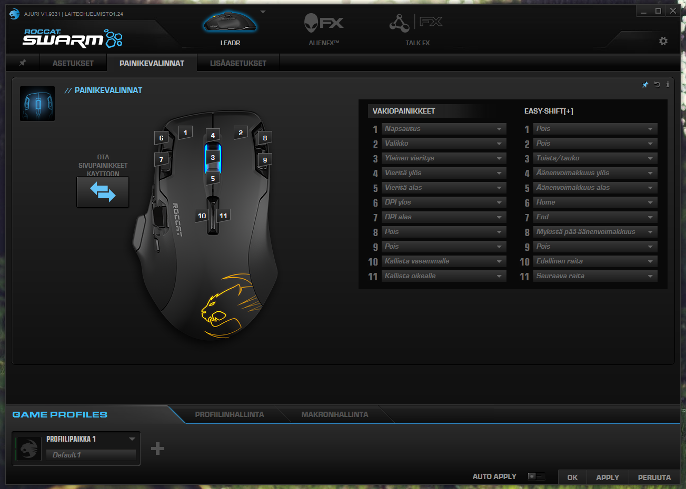
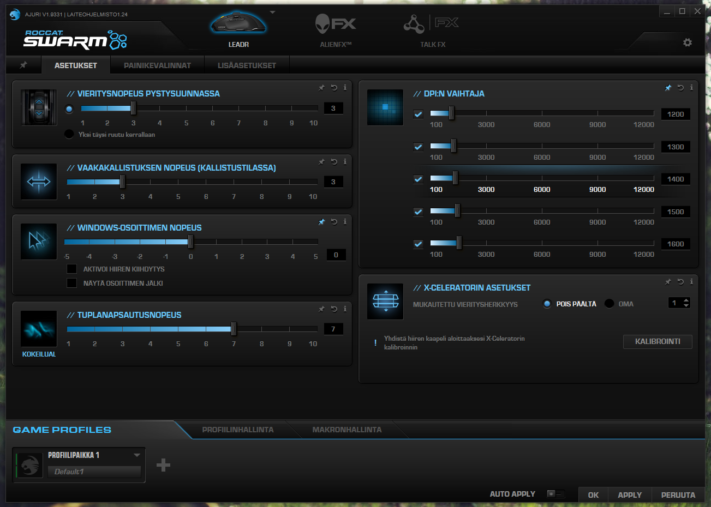

Kyllä nyt pelaajaa hemmotellaan, kun juuri Battlefield V julkaisun kynnyksellä sain testattavaksi pelihiiren! Kyseessä on ROCCATin tekemän Leadr niminen pelihiiri.

Lähdetään ensin siitä mihin lähden vertailemaan tätä. Minulla oli nimittäin jo langaton Logitech G403 Prodigy hiiri ja tämä tuli kyllä korvaamaan sen. G403 oli näppäimiä kuusi kappaletta. Tässä taas näppäimiä on 14 kappaletta! Leadrissa on optinen 12000 dpi:n Owl-Eye-sensori. Oikeastaan kaikki tekniset tiedot on teidän helpoin lukea suoraan ROCCATin sivuilta: <https://fi.roccat.org/Mice/Leadr>

Ensimmäinen yllätys tulee jo itse pakettia aukoessa sillä alunperin luulin saavani näppäimistön testattavaksi. Paketista paljastuikin hiiri! Hiiren matkassa tulee tietty hiiri, kaapelit sekä lataustelakka. Käyttöönottokin on simppeliä, sen kuin laittaa vaan koneeseen kiinni sekä itse asentelin tietty ROCCAT Swarm ohjelman, jotta päästään muokkaamaankin noita nappeja hieman.

Tämä hiiri on vain oikeakätisten käyttöön sillä muotoilu on suoraan suunniteltu oikeakätisille. Tietty hiiressä on RGB valotkin ja niiden asetuksiakin voi säätää Swarm ohjelman kautta. Tuo telakka on minun mielestä kiva lisä sillä nyt on joku paikka mihin hiiren voi pistää aina kun lopettelee koneella olemisen ja tuleepa se hiiri ladattuakin. Verrokissani G403:ssa ei telakkaa ollut ja lataus tulikin tehtyä viimeistään silloin, kun akku oli vähissä.

Nappien määrä mietitytti itseäni ensin sillä G403:ssa niitä ei ollut 14 kappaletta. Nyt kuitenkin pakko sanoa, että näitä nappeja tulee kyllä hyödynnettyä niin pelailussa kuin sitten ihan Windowsin puolellakin. Nappien ja hiiren asetusten säätö tapahtuu ROCCAT Swarm ohjelman avulla ja kaiken tarvittavan olen saanut kyllä tehtyä ja varmaan saisi vielä hieman enemmänkin jos olisi itselle tarvetta. Itsellä, kun ei ole tarve useammalle profiilille vaan käytän yhtä ja olen dpi asetuksiakin säätänyt valmiiksi. Dpi:tä tulee tietty vaihdettua hiirestä löytyvien nappien avulla. Alla onkin jokunen kuvankaappaus Swarmista.





Entäs sitten hiiren käyttäminen? Olen tässä testannut hiirtä ihan työpöytäkäytössä sekä Battlefield V:n parissa. Pakko sanoa, että homma on toiminut molemmissa ja ei ole Battlefieldin menestys jäänyt hiirestä kiinni – lähinnä omasta taidosta tai sen puutteesta. Omaan käteen tämä on oikein sopiva ja napit ovat hyvillä paikoilla itselleni.

Pakko näistä napeista vielä hieman jauhaa. Itsellä ja oletuksenakin taisi olla määritetty tuo peukalon alla oleva nappi Easy Shift napiksi. Tämä tarkoittaa sitä, että tämä nappi, kun on pohjassa niin jokaisella napilla on voi olla toinen tarkoitus. Esimerkiksi Easy Shift nappi ja rullan pyöritys säätää äänenvoimakkuutta. Nämäkin voit itse määrittää haluamaksesi – kuten kaikki muutkin painikkeet.

Käytössä en myöskään huomannut lagia tai latenssia ja muutenkin homma pelasi oikein mainiosti. Tämä tulee korvaamaan oman G403 hiiren ja pääseekin täysipäiväiseen käyttöön. Nyt on sitten se tilanne, että seuraavassakin hiiressä on oltava nappeja tarpeellinen määrä… Samoin langattomuudesta en enää hiiren kohdalla luovu sillä tekniikka on tullut hyvin eteenpäin, että langattomat hiiret ovat pelikäyttöönkin hyviä.

*Hiiri on toimitettu kokeiluun ilmaiseksi ja mielipiteet ovat omiani.*
