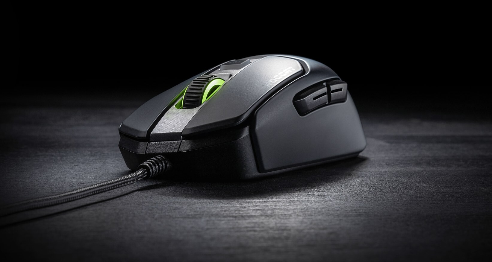
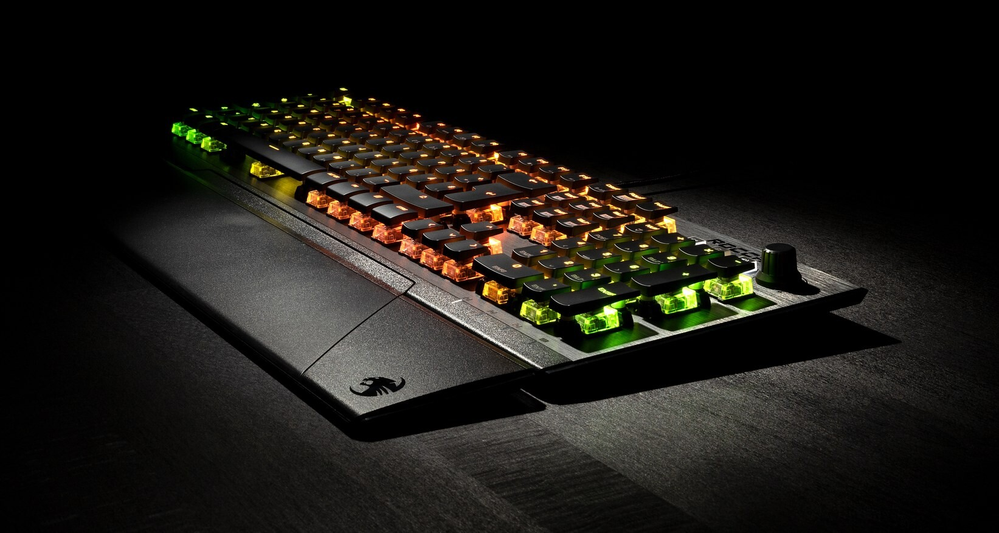

Tällä kertaa kokeiluun tuotiin näppäimistö sekä hiiri! Eli nyt päästään testaamaan mitenkä homma toimii näiden kanssa! Sopivasti tulikin vielä The Outer Worlds ulos, joten uudet työkalut pääsi heti testiin.

Ennestään [tuttu](/2018/kokeilussa-roccat-leadr) ROCCAT Swarm taas koneeseen sisään ja katsomaan mitä kaikkea pystyykään säätämään. Oikeastaan taas kaikkea peruskauraa voi säätää molemmissa ja hiiressä DPI ensin kuntoon ja hieman katsotaan mitä hiiren painikkeissa onkaan. Näppäimistössä taas sitten hieman katsellaan säätöjä. ”Tärkeimpänä” on kuitenkin valot! Näissähän on molemmissa tuki ROCCAT AIMO valomääreille ja nehän pistetään ehdottomasti päälle! Lisää AIMOsta voi lukea [täältä](https://aimo.roccat.org/fi).

Vaikka nämä toimitettiin yhdessä niin katsotaan niitä kuitenkin ensin erikseen hieman. Ovathan ne kuitenkin kaksi eri tuotetta ja saatavilla erikseen.

## ROCCAT Kain 120

Pitkästä aikaa langallinen hiiri käyttöön ja päästäänkin sopivasti pelailemaan The Outer Worlds peliä. Omaan käteen hiiri sopii vallan mainiosti ja näppäimiä on omaan makuun sopivasti.

Hiiren muotoilu on tosiaan oikein mainio ja sensorikin tuntuu omaan tuntumaan sopivalti. DPI:tä saa säädettyä napin painalluksella ja Swarmilla saa sopivat vaihtoehdot itselle asetettua.

Valaistus toimi mainiosti, kuten odottaa saattoikin. Hiiressä omasta mielestä valot ovat hieman toissijainen asia sillä käyttäessä käsi peittää ne aika tehokkaasti. Valot pääsevät esiin vasta, kun hiiri makaa matollaan ilman, että sitä käyttää koneen ollessa päällä.

Testin aikana ei ollut hiiren kanssa ongelmia ja se toimi koko ajan ongelmitta. Käyttö oli sujuvaa niin peleissä, kuin ns. normaalikäytössäkin.

Jos tästä jotain miinusta pitäisi alkaa vuolemaan niin itselleni tämä on ehkä hitusen liian kevyt, mutta eniten häiritsee ehkä tuo johto sillä olen tottunut jo langattomiin hiiriin. Nämä nyt on oikeastaan aika pieniä asioita muuten varsin mainiossa hiiressä.

Lisää hiirestä ja sen tekniset tiedot löydätte suoraan ROCCATin sivuilta: <https://fi.roccat.org/Mice/Kain-120-AIMO>

## ROCCAT Vulcan 121

Tämä tuli melkein, kuin tilauksesta omaan testipenkkiin sillä olinkin pohtimassa näppäimistön uusimista ja entinen ilman numpadia oleva näppäimistö alkoi ehkä tuntua liian pienelle. Käytän kuitenkin numpadiä jonkin verran, kun tulee joskus töitäkin tehtyä kotona pöytäkoneella.

Ensimmäisenä silmään pisti tietysti ulkonäkö joka on omaan silmään oikein miellyttävä ja toimiva! Valot tuo kivan säväyksen ja näppäimistössä niistä pääseekin nauttimaan enemmän, kuin hiiren kanssa.

Näppäimistössä on kytkiminä ROCCATin Titan Switchit ja nämä oli omaan käyttöön kyllä sopivat mekaaniset kytkimet. Sopivasti ”kolinaa” ja tuntuma oli hyvä niin pelatessa, kuin koodatessakin. Hieman vaati totuttelua, mutta siitä se homma lähti rokkaamaan.

Tätäkin voi hallita Swarmin avulla ja saadaan määritetty asetuksia niin valojen, kuin näppäimienkin kohdalta. Itse tykästyin AIMO valaistukseen ja se onkin ollut päällä melkein alusta asti.

Itselle tuli myös positiivisena se, että mukana tuli rannetuki ja se onkin jäänyt omaan käyttöön. Siitä pienen miinuksen annan, että rannetuki toimii magneetilla ja joskus kiivaassa koodauksessa/pelisessiossa se voi lähteä hieman irti, mutta napsahtaa sitten takaisin.

Kytkimet ovat koholla jolloin näppäimistön puhdistaminen muruista ja roskista on helppoa sekä niistä pirun kissankarvoista joita menee joka paikkaan. Profiili on muutenkin näppäimistössä itselle mukavan matalahko.

Näppiksessä on myös säätörulla jolla voi säätää esim. äänenvoimakkuutta taikka sitten vaikka näppäimistön valojen kirkkautta. Erillisiä makronappeja ei ole, mutta pelitilassa voi käyttää M1-6 näppäimiä jotka on insert/delete yms. nappien takana suoraan.

Tässä jäin kaipaamaan USB läpivientiä eli olisin voinut mielelläni ottaa pari USB porttia tuonne näppäimistön taakse, mutta ei ole iso juttu.

Lisää näpäimistöstä ja sen tekniset tiedot löydätte suoraan ROCCATin sivuilta: <https://fi.roccat.org/Keyboards/Vulcan-121-AIMO>

## Lopuksi

AIMO valaistuksen ansiosta nämä sopii todella hyvin yhteen ja varsinkin jos haluaa työpöydälle sitä extra valaistusta niin tässä on varsin toimiva kombinaatio.

Saman valmistajan laitteissa on se hyvä puoli, että niihin käy yksi sovellus jota kautta voi sitten hallita molempia laitteita. Sekä se mahdollistaa tuon yhteensopivan valaistuksenkin helposti.

Pystyn kyllä suosittelemaan näitä molempia! Itsellä ei ollut testijakson aikana mitään ongelmia näiden kanssa ja homma rokkaa vieläkin tätä kirjoittaessa!
