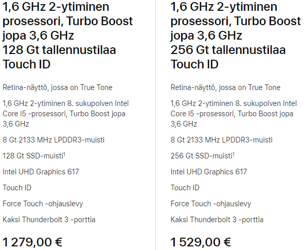
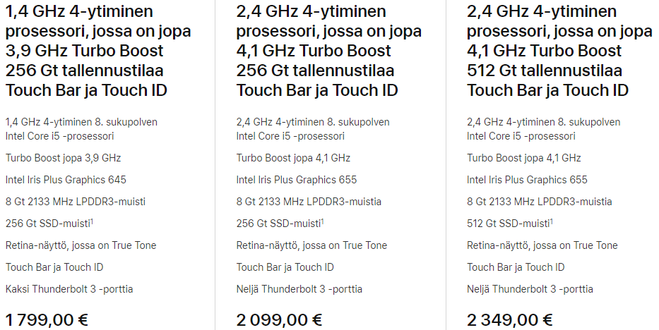
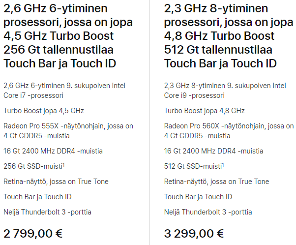
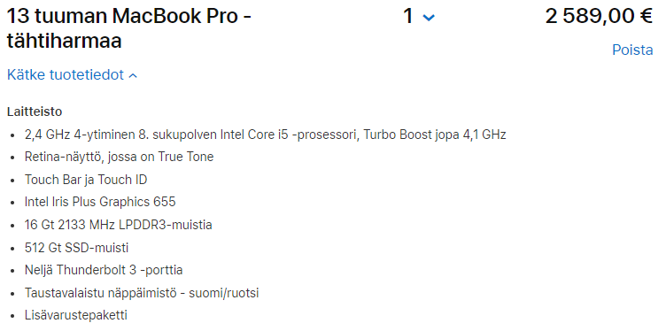

Viime vuonna kauan palvellut [MacBook Pro](/2015/macbook-pro-15-retina) hörppäsi omenamehua ja erinäisten vaiheiden kautta päätyi vakuutusyhtiön avustuksella huoltoon ja sille tielle se sitten jäi sillä sitä ei kannattanut enää korjata.

Tuli siis aika hankkia uusi kone työkäyttöön. Tässä en pitänyt kiirettä ja lopulta sopiva löytyi. Nyt on reilu vuosi mentykin Windows koneen kanssa ja aina silloin tällöin tulee suoraan sanottuna ikävä MacBookkiani… Se olisi kuitenkin vielä ollut ihan toimiva peli ja harmittaa oikeastaan vieläkin, että se hörppäsi mehut sisäänsä.

Päätin tutkailla hieman MacBookin tilannetta uudelleen ihan vain yleisellä tasolla. Kaikki hinnat ja speksit olen ottanut suoraan Applen omilta sivuilta ja ne ovat tämän hetkisten saatavilla olevien mallien infoja. Nämä siis voi erota hieman suomessa olevista hinnoista tai yleensäkin tarjouksista jne. jne.

## MacBook Air?

Kompakti koko houkuttelee tietysti aina. Olisihan se kiva jos tämmöisessä koossa oleva kone menisi täysin työkäyttöön minulla. Katsotaan.

Halvempi malli hylätään jo suoraan sillä 128 gigaa tilaa ei riitä mihinkään. Teoriassa tuo toinen malli voisi toimia, mutta riittääkö prosessorin tehot? Se epäilyttää eniten sillä pitää pystyä pyörittämään useita ohjelmia yhtä aikaa kuten Photoshop sekä koodieditori ja mahdollisesti virtuaalikone kylkeen vielä. 256 gigan tilakin voi tulla ahtaaksi. Tilaa voi Applella päivittää 512 gigaan, mutta hintaa tulee lisää 250 euroa.

Hylätään siis MacBook Air jo heti kättelyssä.

## MacBook Pro

Nyt ollaan taas tutummilla vesillä. Ensimmäinen MacBook oli 13″ Pro malli ja se palveli useita vuosia. Sen jälkeen tuli tosiaan tuo 15″ Pro malli ja sekin palvelisi vieläkin ellei olisi mennyt juomaan sitä mehua.

Aloitetaan 13″ malleista ja niistä on oikeastaan kolme vaihtoehtoa tiputin neljännen vaihtoehdon pois jo pienen 128 gigaisen kiintolevyn vuoksi.

Näistäkin melkein lähtisin katsomaan noita kahta jälkimmäistä ja ehkä ennemmin tuolla 512 gigaisella kiintolevyllä sillä olisi tilaa sitten hieman enemmän. Näitähän ei nykyään voi oikein itse mitenkään päivitellä.

Vilkaistaan vielä pari vaihtoehtoa 15″ malleista.

Tässä alkaa olla jo tehoja molemmissa vaihtoehdoissa. Isoin ero tulenee ehkä tuosta kiintolevytilan määrästä sekä tietysti hieman parempi prosessorikin on toisessa.

Totta puhuakseni voisin ehkä ennemmin lähteä tuonne 13″ koneen linjalle sillä se on sitten kuitenkin hieman pienempi ja kevyempi. Muistia kuitenkin voisin päivittää 16 gigaan ja kiintolevytilan siihen 512 gigaan.

Tehdäänpäs siis Applen kautta itselleni se ehkä toimivin kombo.

Eli napattiin siis 13″ Macbookeista tuo 512 gigainen malli ja nostettiin muistin määrä 16 gigaan. Tämä voisi olla se valinta mihin kallistuisin.

Hinnat on muuten jonkin verran nousseet sillä vuonna 2015 tuo minun MacBook Pro 15″ oli hieman yli 2000 euroa ja nyt vastaavasta saa maksaa lähemmäs 3000 euroa.

[Yksi vaihtoehto koneen rahoitukselle on vertailla erilaisia lainoja kotimaisessa talouspalvelussa.](https://www.summarum.fi/lainaa/kulutusluotto/)

## Joko on kone tilattu?

Ei. Mielelläni kirjoittaisin tähän, että kyllä. Myyntimiehet voi tosin aina tarjouksia pistää tulemaan, mutta ei sitä konetta ihan hetkeen olla tilaamassa sillä nykyinen toimii hyvin. Sekä jos oltaisiin tilaamassa niin pitäisi katsoa taas mitä Windows maailma tarjoaa ja millä hintaa.
