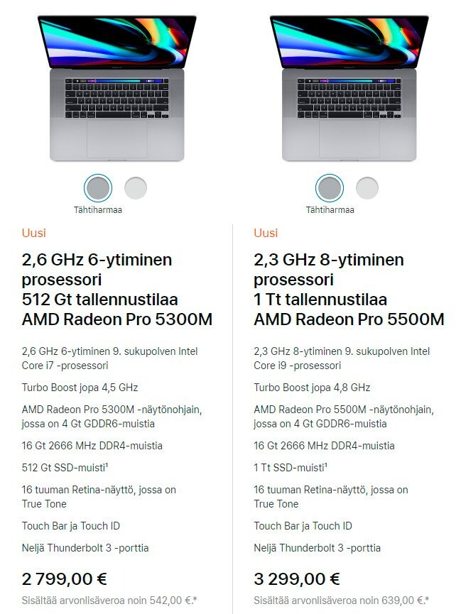

Kirjoittelin aiemmin [MacBookkien hinnoista](/2019/macbook-mielessa-mutta-se-hinta) ja tämän artikkelin jälkeen on julkaistu uusi MacBook, joka olisi se MacBook, jonka hankkisin tällä hetkellä. Näin joulun jälkeen onkin hyvä miettiä millä eri keinoilla sen saisi hankittua hyppysiin.

Otetaan ensin perusteluja, että miksi. Ensinnäkin näppäimistö on kuulemma tuotu taas hyvälle tasolle ja itsehän pidin vanhojen MacBookkieni näppäimistöistä ja tässä on ilmeisesti kuunneltu hieman asiakkaita jopa. Akun kapasiteettiakin on kasvatettu ja näytön kokokin on nyt 16″. ”Halvemmassa” mallissakin on muistia 16 gigaa ja kiintolevytilaa 512 gigaa, joten silläkin pärjäisi. Hintahan tuossa on vain suht korkea… Tarkat speksit voitte katsastaa [Applen omilta sivuilta](https://www.apple.com/fi/shop/buy-mac/macbook-pro/16-tuumaa).

Käydäänpäs alla hieman eri maksutapoja miten voit hankkia tämän MacBookin itsellesi.

## Käteinen / suoraan maksaminen / säästäminen

Nykyään ei itsellä ainakaan käteistä ole, mutta kyllä sitä vielä käytetään huhujen mukaan. Voit toki pistää säästöt tai tilin sileäksi maksamalla sen suoraan. Säästäminen onkin hyvä vaihtoehto, mutta usein kun saa säästöt kasaan niin on jo uutta mallia tulossa ja hinta voi olla taas ihan mitä tahansa. Toki silloin ei tarvitse uuteen malliin enää välttämättä säästää niin paljoa.

## Laina

Lainan ottaminen ei ole tänä päivänä ihan mahdoton ajatus. Otetaan autolainaa, asuntolainaa ja lainaa isompiin hankintoihin. Olemme esim. autolainan yhteydessä ottaneet siihen hieman lisää lainaa, kuin tarvittu ja näin hankittu uusia huonekaluja tai muuta tarpeellista.

Lainoja on tosiaan erilaista ja asuntoa varten tietysti asuntolainaa ja autoa varten autolainaa. Hankintoja varten taas on [kulutusluotto](https://sortter.fi/kulutusluotto/) tai siten [joustoluotto](https://sortter.fi/joustoluotto/). Se kumpi näistä sopii itselle on jokaisen henkilökohtainen päätös.

Lainan kilpailuttaminen kannattaa tietysti eli ei välttämättä kannata kysyä vain omasta pankista vaan muualtakin. Lainoja voitte kilpailuttaa esimerkiksi Sortter yrityksen verkkosivujen kautta [www.sortter.fi](https://sortter.fi/).

Lainoissa sovitaan summa sekä maksuaika ja kuukausittainen erä määräytyy summan, maksuajan sekä koron perusteella. Alla olevaan osamaksuun verrattuna lainoissa voi olla jopa viiden vuoden tai pidempiäkin maksuaikoja.

## Osamaksu

Moni tarjoaa myös osamaksua ja osalla se on jopa maksutonta. Näissä kuitenkin voi tulla maksuaika vastaan sillä nämä ovat yleensä yhden, kahden tai kolmen vuoden maksuajalla.

Näissä kannattaa olla tarkka ja varsinkin, jos osamaksu ei ole maksutonta. Näissä voi olla korot huomattavasti suuremmat, kuin sitten perinteisessä pankkilainassa.

## Lopuksi

Mitenkä itse lähtisin hankkimaan näinkin isoa hankintaa, kuin MacBook Pro 16″ kannettava tietokone? Tämä onkin hyvä kysymys ja vaatisi melkein jo Excelin kanssa rustaamista eri maksuaikojen kanssa sekä vertailua siihen mistä tämän koneen saa edullisemmin. Itsehän olen tarjousten perään ja saatan odottaa sopivaa tarjousta pidemmäkin aikaa. Tässäkin voi jo hieman säästää…

Joskus voi kannattaa ottaa useampi isompi hankinta samaan pakettiin ja hakea pankista perinteistä lainaa hieman pidemmällä maksuajalla. Riippuu tietysti aina omasta taloudellisesta tilanteesta, joten melkein fiksuin tapa olisi ensin tutkia mitä jää kuukausittain käteen tällä hetkellä ja onko varaa lähteä hankkimaan konetta (tai muutakaan isompaa hankintaa).

Psssst. Excelille ilmainen vaihtoehto on Googlen Sheet sovellus, joka toimii selaimessa!

*Artikkeli on toteutettu yhteistyössä [Sortter Oy](https://sortter.fi/):n kanssa.*
